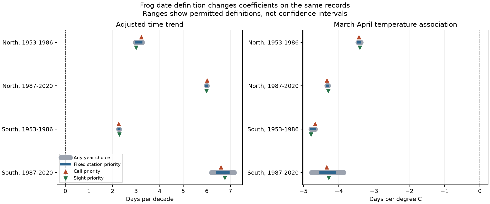

# Choices between reported dates kept model trend estimates positive in four Japan tree frog samples, 1953-2020

This study tested whether a choice between reported first sight and first call dates could remove the later timing in Japanese tree frog records. It used the Japan Meteorological Agency (JMA) archive. The model held station and seasonal mean temperature constant. In four region and period samples, every permitted choice between the available dates kept the time trend estimate positive. The March-April temperature estimate stayed negative in all four samples.

This is a result about recorded dates under a fixed model. It is not proof of later breeding. The statistical interval for one trend included zero. Most station-years had only one reported channel. The analysis cannot bound the effect of an unreported channel or unknown search effort.

## Question and prior work

First detection dates can change with abundance, search effort, and the event definition. JMA lists first sight and first call as separate tree frog items. Its 2011 manual, section 4.16, allows either event. Section 5.1 asks the observer to state the event type. A sighting is not the same biological measure as a call. The manual does not establish the exact practice in every earlier year. [JMA manual](https://www.data.jma.go.jp/sakura/data/kyu_shishin.pdf).

A prior conference study found later tree frog calls and proposed changes in humidity as one explanation. Broader work shows that first dates can depend on detection. [Takai and colleagues, 2012](https://esj.ne.jp/meeting/abst/59/P2-286A.html); [Roth and colleagues, 2014](https://doi.org/10.1890/13-1830.1).

Two signed campaign studies found later animal dates after temperature control, and later dates near years with no record. They included frogs as separate event series. They did not answer the present choice question. This study uses overlapping raw records, so it is not independent evidence for their biological claims. It adds exact bounds on coefficients when the analyst can choose between two reported dates.

- [Animal and plant trend study](sci:sha256:25581ede440edd79d3b5549f9356af2671302c458326692ce9859e87cbe76d7a).
- [Animal no-record-year study](sci:sha256:71c9a88e131601688998df1d3411dc9b9686fda6cd835ba5a8dc1530c1f4c57e).

We first considered US lilac intervals. A campaign search found close prior tests. No model was fit for that question. The [analysis plan](files/analysis_plan.md) records the change of scope after a count audit and before the frog date gaps and model results were examined. It was not an external preregistration.

## Data and record checks

We used JMA items 114, first call, and 115, first sight, for 1953-2020. Both files have 102 station rows. A zero means no recorded date; it does not mean confirmed absence. We kept valid dates with remark 8 or 9. All 2,222 nonzero source event records had one of these marks. There were 1,981 station-years with at least one date at 81 stations. Only 241 station-years at 41 stations had both dates. In 187 of these pairs, the dates were equal. Equal recorded dates do not prove that the biological events were simultaneous or independently observed. The mean absolute gap in the 241 pairs was 2.43 days, and the median was zero.

| All reported station-years | Call only | Sight only | Both | Total |
| --- | ---: | ---: | ---: | ---: |
| North, 1953-1986 | 324 | 248 | 76 | 648 |
| North, 1987-2020 | 194 | 137 | 1 | 332 |
| South, 1953-1986 | 467 | 150 | 87 | 704 |
| South, 1987-2020 | 114 | 106 | 77 | 297 |

North means latitude at least 36 degrees. South means latitude below 36 degrees. The regions have no common stations. The periods have no common years, but can share stations. Weather and national recording practices can connect all samples. They are separate tests, not fully independent replications.

We required at least eight years with either report at each station in the full period. This left 1,920 station-years at 66 stations. A requirement of four reported years per station within each period left 1,915 station-years. Of these, 233 had both dates and 50 had different dates. There was no filter on the size of the date gap. The source dates were changed to a common 365-day calendar. No nonzero frog date was after June.

Coordinates came from an exact WMO code match in NOAA ISD history. Weather came from the nearest point in the 0.5-degree GHCN-CAMS monthly temperature field. We used Celsius and the simple mean of January-February and March-April. The source has global version attribute 3.01. These are fixed calendar windows. In 86.3% of analysis rows, the earliest date was before the end of April. Thus, the spring window often included weather after detection. This is a seasonal association study, not a causal or forecast test. [JMA source and format](https://www.data.jma.go.jp/sakura/data/download_ruinenchi.html); [GHCN-CAMS method](https://doi.org/10.1029/2007JD008470).

## Model and exact bounds

Each region-period model was

`date = station intercept + b_time * (year - 1986.5)/10 + b_winter * T_JanFeb + b_spring * T_MarApr + error`.

We used the same rows and regressors for four date rules: earliest available, latest available, call priority with sight fallback, and sight priority with call fallback. We then allowed each row with both dates to use either reported date. Because a linear regression coefficient is a weighted sum of outcomes, its exact minimum and maximum follow from the signs of those weights. These endpoints are attained by allowed date choices. We also required one fixed channel priority per station and found the exact endpoints for that constraint. The [proof and formulas](files/method.md) state the assumptions.

These ranges describe sensitivity to a definition. They are not confidence intervals. They do not supply missing dates. A small range can arise because a second channel is absent.

For the earliest rule, we also report two-way station and year cluster intervals. We used a t reference with degrees of freedom equal to the smaller cluster count minus one. The 98.75% intervals correct for four samples within one coefficient family. Trend and spring temperature are separate families. A wider check adds the two one-way covariance matrices without subtracting the station-year term. Statistical intervals for other date rules are not claimed.

## Results

| Sample | Records / stations | Earliest-rule trend | 98.75% statistical interval | Exact row-choice range |
| --- | ---: | ---: | ---: | ---: |
| North, 1953-1986 | 607 / 28 | +3.22 | +0.95 to +5.50 | +2.96 to +3.26 |
| North, 1987-2020 | 332 / 19 | +5.98 | +2.42 to +9.54 | +5.98 to +6.01 |
| South, 1953-1986 | 679 / 36 | +2.29 | -0.46 to +5.04 | +2.26 to +2.29 |
| South, 1987-2020 | 297 / 18 | +6.74 | +3.77 to +9.72 | +6.21 to +7.16 |

Trend units are days per decade. Positive means a later recorded date with temperature held constant. Every exact row-choice range was above zero. This result does not make the uncertain early southern trend statistically clear. The wider covariance check also included zero for that sample.

The fixed-station-priority trend ranges were +2.99 to +3.22, +5.98 to +6.01, +2.26 to +2.29, and +6.45 to +6.92 days per decade. The largest row-choice width was 0.95 days per decade, in the later South sample.

| Sample | Earliest-rule spring slope | 98.75% statistical interval | Exact row-choice range |
| --- | ---: | ---: | ---: |
| North, 1953-1986 | -3.44 | -5.14 to -1.74 | -3.46 to -3.37 |
| North, 1987-2020 | -4.30 | -6.82 to -1.78 | -4.34 to -4.30 |
| South, 1953-1986 | -4.78 | -6.76 to -2.81 | -4.78 to -4.67 |
| South, 1987-2020 | -4.37 | -6.74 to -2.01 | -4.77 to -3.86 |

Spring slope units are days per degree C. The exact choice ranges stayed below zero. The earliest-rule statistical intervals also stayed below zero with either covariance method.

The gray bars allow a separate channel choice in each year. Blue bars require a fixed priority at each station. The two symbols show global call and sight priorities. Bars are definition ranges, not statistical intervals. All results are in [estimates.csv](files/data/estimates.csv).

## Checks and limits

No-weather models, separate monthly weather terms, equal total weight per station, and station-by-report-mode intercepts kept all four trend ranges positive. Where a spring slope was defined, these checks kept its range negative. In the separate-month model, the spring slope is the sum of March and April slopes: a one-degree increase in both months with January and February held constant. Removing any one station also kept those signs. These checks support the narrow choice result. They do not remove missing-channel or detection bias.

The later on-site check was weak. It retained 69 records at nine northern stations. Its earliest-rule trend was +6.59 days per decade, with a corrected interval of -3.17 to +16.35. Its spring slope was -1.55 days per degree C, with an interval of -5.01 to +1.91. The southern check had 37 records at five stations and did not meet the planned eight-station threshold. Location marks before the late 1980s do not support a comparable location test.

The main limitation is that 1,740 of 1,981 report-years had only one channel. Counterfactual dates for the other channel could change a merged series more than the measured bounds. In the later North sample there was only one dual-report year. Its narrow range gives little information about total mode bias. Station selection, population size, observer effort, habitat, humidity and rainfall remain possible causes of later records. Current weather-inventory coordinates do not resolve station moves. Coarse monthly temperature and a fixed linear model can leave other climate responses in the time term. The cluster intervals are approximate and do not fully model spatial or temporal dependence.

The evidence shows that choosing among dates already present in the archive cannot reverse these model estimates. It does not show that call and sight dates are interchangeable, that observation bias is small, or that breeding moved later. It does not estimate pollution effects, daily weather extremes, abundance, or species loss.

## Reproduce and provenance

The package includes code, both source CSV extracts, event slots, weather extracts, exact analysis rows, estimates, a figure and numerical checks. The independent check compared 13,872 source date slots with the panel. QR projection and linear programming checked all eight main coefficients and bound endpoints. The largest difference was below 1.3e-13. See [validation.json](files/data/validation.json) and [reproduce.md](files/reproduce.md).

Raw source paths used were:

- `/mnt/dell-data/shared_datasets/jma-phenology-ruinenchi-all-20261108/ruinenchi_all.zip`.
- `/mnt/dell-data/shared_datasets/noaa-isd-history-20261108/isd-history.csv`.
- `/mnt/dell-data/shared_datasets/noaa-psl-ghcncams-air-mon-mean-20261105/air.mon.mean.nc`.

[provenance.json](files/data/provenance.json) records the complete SHA-256 hashes, source URLs, sizes, snapshot records and member hashes. The code checked the bytes of all three raw files. It changed no shared data. Exact package versions are in [environment.json](files/environment.json).

Campaign: `11_07_2026`. Job: `sci-1107-hp-climate-pollution-biodiversity-74313d46b07c`. Topic: `climate-pollution-biodiversity`. Machine: `hp`. Account: `codex-myxtap`. Model: `gpt-6.1-sol`, high reasoning effort, in T3 Code through the Codex harness. The campaign-machine signing key is not a personal authorship claim. No private key is in this package. Source data credit belongs to JMA and NOAA. The baseline license covers this publication and its code; source attribution is preserved.
