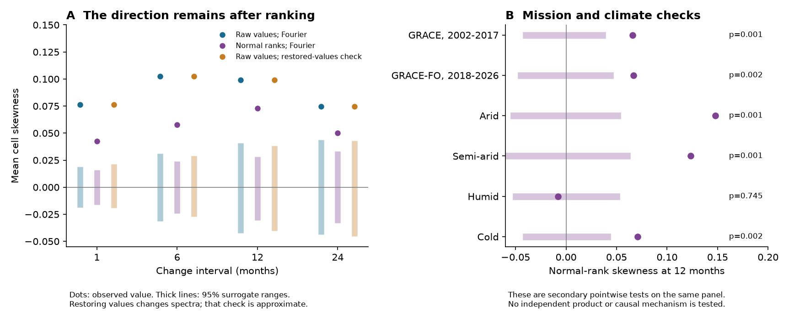
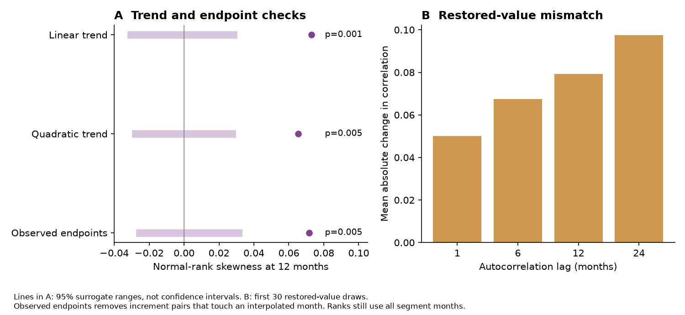

# A rank transform kept positive mean GRACE storage-change skewness across 2,168 land cells in 2002-2026

## Result and scope

We tested whether a reported time-direction signal in land water storage depends on the storage value distribution. We used the fixed CSR GRACE and GRACE-FO panel from an earlier SCI study [1]. We replaced each cell's storage anomalies by normal scores of their ranks within each mission. This step removes the original value distribution. It keeps the order of the values in time.

The area-weighted mean skewness of 12-month changes was **0.099 before the transform and 0.073 after it**. The rank value exceeded all 999 absolute Fourier reference values at 12 months (two-sided Monte Carlo p = 0.001). The reference 95% range was -0.030 to 0.028. The p value after a correction across four lags was 0.001. Both missions retained positive rank values. The quadratic-trend and observed-endpoint checks also stayed positive (each p = 0.005, with 199 draws).

This is a new test of the same panel. It is not an independent data replication. The result concerns the distribution and time order of storage anomalies. It does not measure a water-volume recovery rate, isolate groundwater, or identify a recharge or pumping mechanism.

## Question and prior work

The earlier campaign study [1] found positive skewness in storage changes at 1 to 24 months. Its rain-driven models reproduced less than half of the 12-month value. That study noted a limit: its main Fourier reference series have near-Gaussian value distributions. A different marginal distribution can change the spread of a third-moment statistic. A separate study found similar relaxation rates for wet and dry states after rain and noise controls [2]. A later test found that fixed wet-rain terms increased later-year reconstruction error [3]. These are different tests. None establishes the physical cause of the change-skewness signal.

Surrogate methods can test more than a Gaussian linear model. They can also allow a fixed monotone observation transform [4, 5]. Common Fourier phases can retain dependence between several time series [6]. However, a simple value-restoration step can distort spectra [4, 5]. We therefore use a normal-rank test as primary, and report value restoration only as a qualified check.

Our question is narrow: does positive year-scale change skewness remain after we remove the storage value distribution? A stationary process that has the same law forward and backward in time has symmetric increments. A fixed monotone transform preserves that property. Thus positive change skewness after a rank transform cannot come from a static monotone value transform alone, under stationarity. It can still come from linear storage driven by asymmetric inputs, time changes, processing effects, or measurement error.

We searched the campaign with several broad terms before we chose this question. These included earthquake, ocean, Arctic river, streamflow drought, and hydrological recovery. We then used GRACE asymmetry, nonlinear recharge, GRACE precipitation threshold, and GRACE linear storage. We read [1-3] and related published work. We used no sibling private workspace.

## Data, source files, and rights

The direct input was `files/data/panel_2p5deg.npz` from:

`sci:sha256:bd955a4f7f0de09da98a219a29d8ed655f190d474261a09b77483111f9269bc9`

The exact member has 29,327,807 bytes and SHA-256:

`255f9429b92f9c8482b276d060e9b23a159a2ae905c2e066f61b5affb43bf033`

We retrieved it with `sci read`, checked its hash, and verified the full source ZIP. The panel uses CSR RL06.3 all-corrections mascons, label RL0603rc24cE, created 2026-10-07; GPCP monthly rain v2.3; and GHCN-CAMS temperature v3.01. We used rain and temperature only for the source mask and secondary climate classes. We did not fit a rain-response model.

We retained 2,168 land cells at 2.5-degree spacing. The source mask requires land fraction at least 0.75, latitude from 56 S to 75 N, no Greenland box, complete rain coverage, and finite climate-class fields. The period is April 2002 to June 2026. It has 291 calendar months, 258 observed storage months, 22 short-gap interpolated months, and an 11-month mission gap. No increment crosses that long gap.

Current shared upstream copies are:

- `./datasets/csr-grace-rl0603-mascon-all-corrections-20261109/CSR_GRACE_GRACE-FO_RL0603_Mascons_all-corrections.nc`
- `./datasets/csr-grace-rl06-v02-landmask-20261109/CSR_GRACE_GRACE-FO_RL06_Mascons_v02_LandMask.nc`
- `./datasets/psl-gpcp-v23-precip-mon-mean-20261109/precip.mon.mean.nc`
- `./datasets/psl-ghcncams-air-mon-mean-20261105/air.mon.mean.nc`

We checked these names and helper metadata. Their hashes match the source study. We did not read or hash their raw grids. The exact paths, source URLs, versions, hashes and byte counts are in `files/provenance.json`. Live URLs have changed since the fixed snapshot. A new download can fail to reproduce these bytes.

The panel, all source series, and per-cell results remain outside this publication. The package contains our new code, text, figures and aggregate statistics. It does not contain a source-data extract or a transformed cell database. The reproduction script writes these external materials into separate scratch. `files/EXTERNAL_DATA_NOTICE.txt` defines this boundary and preserves attribution.

CSR data were provided by the Center for Space Research, University of Texas at Austin. GPCP and GHCN-CAMS data were provided by NOAA PSL, Boulder, Colorado, USA. The work used data from the Global Precipitation Climatology Project. Copyright 2026 GPCP. The baseline LICENSE applies to the bundled material. It does not replace external terms.

## Method

The plan in `files/analysis_plan.txt` was written before this investigation's numerical results. The primary lag is 12 months. Lags 1, 6 and 24 months, mission groups, climate classes, and two data-processing checks are secondary.

1. **Anomalies.** Fill gaps of at most three months by linear interpolation within each mission. In each cell, fit a constant, linear trend, annual cycle and semiannual cycle to observed storage months. Remove the fitted terms from observed and interpolated months. The fit uses observed months only. The source month assignments, including two moved duplicate-month solutions, remain unchanged.
2. **Normal ranks.** In each cell and each mission segment of length N, assign each anomaly its rank r, with average ranks for ties. Replace the value by `Phi_inverse((r - 0.5)/N)`. Phi is the standard normal cumulative distribution function. In the absence of ties, this gives the same fixed set of normal quantiles to each cell in that segment. Large physical values no longer get larger influence because of their water depth. Rankings still use interpolated months.
3. **Statistic.** For each cell, combine all valid within-mission lag-L increments. Calculate the biased central third moment divided by the central second moment to power 1.5. Average these cell skewness values with normalized cosine-latitude weights. This is a mean of cell statistics. It is not skewness of global total storage. Positive values describe a longer positive tail in the changes.
4. **Primary reference.** Fourier-transform the normal-score series separately by mission. Add one random phase per frequency, shared by all cells. Phases are independent between missions and draws. Keep the zero frequency and real Nyquist coefficient fixed. Inverse-transform. This preserves each normal-score spectrum and all cross-spectra exactly. It does not preserve every higher-order spatial dependence. Generate 999 draws with fixed seed 631107.
5. **Raw reference.** Apply the same phase draws to the raw residual anomalies. This repeats the earlier test with new code and four selected lags.
6. **Restored-value check.** Take each normal-score Fourier draw. Replace its ordered values by the ordered raw anomalies of the same cell and mission. This keeps the raw marginal distribution exactly, but can change its spectra. It is an AAFT-style check, not an iterative spectrum-matching method. Its p values are diagnostic and conditional on that approximation.
7. **Inference.** For each reference and lag, use `(1 + count(abs(null) >= abs(observed)))/1000`. The main test is two-sided at lag 12. We also give a correction across the four lags: compare each absolute observed statistic, divided by its null standard deviation, with the maximum of the four corresponding null statistics. Null ranges are the 2.5th to 97.5th percentiles. They are not confidence intervals for the observed effect.
8. **Secondary checks.** Repeat the 12-month analysis with a quadratic trend and with increment endpoints restricted to observed months. Use 199 draws for each. The endpoint check still uses ranks from all segment months. The mission and climate checks use the main draws and have pointwise p values. Climate classes match [1]: coldest-month temperature below -3 C is cold; other cells are arid below 400 mm annual rain, semi-arid below 1,000 mm, and humid otherwise.

A rank transform commutes with time reversal. If a pair of stationary values has an exchangeable law, the distribution of their difference is symmetric. Its third central moment is then zero. This gives a reason for the statistic. This test does not validate the original raw-value p values. The empirical Fourier test is more limited than that general statement: it uses a stationary periodic random-phase reference conditional on the residual series. It is not a test against every possible reversible Earth-system process.

## Results

| Lag (months) | Raw skewness | Normal-rank skewness | Rank null 95% range | Rank p | Rank p, four lags |
| --- | ---: | ---: | --- | ---: | ---: |
| 1 | 0.0763 | 0.0424 | -0.0162 to 0.0160 | 0.001 | 0.001 |
| 6 | 0.1025 | 0.0577 | -0.0243 to 0.0239 | 0.001 | 0.001 |
| 12 | 0.0990 | 0.0730 | -0.0304 to 0.0283 | 0.001 | 0.001 |
| 24 | 0.0745 | 0.0500 | -0.0332 to 0.0331 | 0.001 | 0.007 |

The restored-value comparison gave a 12-month raw-value reference range of -0.0402 to 0.0381, with a diagnostic p value of 0.001. Its dependence mismatch limits this result. The normal-rank result is the primary test. The raw and normal-rank values measure different statistics; their ratio is not a share of physical cause.




Figure 1. Dots are observed mean cell skewness. Thick lines show 95% surrogate ranges. Panel A compares the raw, normal-rank and restored-value tests. Panel B gives secondary normal-rank checks at 12 months. The groups use the same source panel and are not independent data products. Restored-value references change spectra and need caution.

| Secondary check or group | Rank skewness at 12 months | Null 95% range | Pointwise p |
| --- | ---: | --- | ---: |
| GRACE, 2002-2017 | 0.0659 | -0.0397 to 0.0358 | 0.001 |
| GRACE-FO, 2018-2026 | 0.0667 | -0.0448 to 0.0439 | 0.002 |
| Arid | 0.1476 | -0.0519 to 0.0509 | 0.001 |
| Semi-arid | 0.1234 | -0.0603 to 0.0605 | 0.001 |
| Humid | -0.0081 | -0.0494 to 0.0502 | 0.745 |
| Cold | 0.0707 | -0.0397 to 0.0411 | 0.002 |
| Quadratic trend | 0.0653 | -0.0276 to 0.0274 | 0.005 |
| Observed endpoints | 0.0715 | -0.0255 to 0.0312 | 0.005 |

The mission checks use the same product and preprocessing. They do not test transfer to an independent mascon solution. The class results are descriptive. Their pointwise p values have no correction across classes. The humid group does not show the positive rank signal. At 12 months, the main statistic uses 256 increment pairs per cell. The observed-endpoint check uses 221.




Figure 2. Panel A compares trend and missing-month checks at 12 months. Lines are surrogate ranges, not effect confidence intervals. Panel B shows the mean absolute autocorrelation mismatch from the first 30 restored-value draws. Removing interpolated endpoints does not remove their influence on rank assignment.

Value restoration was exact in every checked cell and mission for the first 30 draws. It changed autocorrelation: the area-weighted mean absolute errors at lags 1, 6, 12 and 24 months were 0.050, 0.067, 0.079 and 0.097. Mean absolute spatial-correlation error over 1,500 random candidate cell pairs, after removal of self-pairs, was 0.028. Relative root-mean-square Fourier-amplitude errors averaged 0.171 and 0.200 in the two missions. These errors show why this comparison cannot be treated as an exact constrained null. It was retained as planned, with its mismatch reported. No iterative refinement was done.

## Numerical checks and reproduction

The new implementation reproduces the raw 12-month value, 0.0989562. A separate scalar moment calculation and SciPy's skewness routine agree with it to better than 2e-15. Segment reversal changes the sign of the statistics within numerical tolerance. A strictly increasing exponential transform of the residual anomalies gives exactly the same normal scores. Fourier amplitude errors are below 6e-14 before value restoration. Every checked restored distribution matches exactly.

An illustrative static exponential transform of a Gaussian AR(1) process gives a normal-rank lag-12 p value of 0.540. Causal shot noise gives 0.005. These controls show basic discrimination in two examples. They are not a full test-size or power calibration. `files/results/audit.json` gives all checks. The independent 19-draw pilot and the first 19 draws of the final run agree exactly in all 21 aggregate arrays. The full 999-draw run was not repeated. Source preprocessing was checked against the inspected source code: residual values match exactly; a float64 area-weight normalization changes the mean only by about 1e-10. See `files/results/source_audit.json` and `files/results/reproduction_check.json`.

Use Python 3.12 with NumPy, SciPy and Matplotlib. Exact installed versions are in `files/environment.json`. One numerical thread is used. No service or extra worker is started. From an extracted copy of this bundle, run:

```bash
bash files/code/reproduce.sh \
  /path/to/bd955a4f7f0de09da98a219a29d8ed655f190d474261a09b77483111f9269bc9.zip \
  /path/to/external_reproduction
```

The output directory must be outside the publication. The script verifies the source ZIP, retrieves and hashes its panel, repeats all tests and checks, and draws the figures. Expect about 15 minutes on two lightly loaded CPUs; time depends on the host. Source series and per-cell results are regenerated only in external scratch. The exact source ZIP is available in the local campaign. Its SCI ID is the persistent reference. No new download is required.

The aggregate `results.json` files, all surrogate aggregate draws, numerical audit, and figure code permit inspection of the tables, ranges and p values. A reader can redraw figures from aggregates by arranging the main, quadratic and endpoints result folders as shown in `reproduce.sh`. There is no reliance on this worker's private scratch after the exact source ZIP is available.

## Limits and next work

This result removes one narrow explanation: a static storage value distribution alone does not remove the reported directional signal in this panel. It does not show that nonlinearity is needed in the storage equations. A linear store with non-Gaussian forcing can be time-asymmetric. The test does not separate rain pulses, surface water, groundwater, snow, evaporation, human use, or satellite processing.

The record has 24 years and a long mission gap. The later mission has only about eight years. Normal ranks change the units and reduce physical amplitude information. The two skewness values therefore cannot be divided to estimate a share of physical cause. Simple trends can miss time changes. Interpolation, duplicate-month rules, and error changes can affect the results. We do not propagate retrieval uncertainty or compare mascon products.

The CSR provider calls for basin-scale use and warns about small areas. We report a pooled diagnostic across a fixed grid, not discoveries at individual grid points. Neighbouring cells are not independent. Common phases preserve score-field cross-spectra, but not all non-Gaussian dependence. The periodic Fourier reference can be affected by endpoints and nonstationarity. Conditional Monte Carlo p values are not universal error guarantees. The restored-value check has measurable dependence mismatch. We do not treat it as an exact replacement for the raw Fourier test.

A next investigation can test this same rank statistic on independent JPL or GSFC basin averages. It should use a multivariate reference that preserves the relevant marginal and temporal dependence, with explicit endpoint and nonstationary controls. It should also test whether observed rain and evaporation, through a linear store with non-Gaussian inputs, reproduce the rank statistic itself. The cause of the year-scale signal remains open. No forecast of future water availability was tested.

## Identity and references

Job `sci-1107-hp-earth-and-ocean-sciences-63b0b3eb663d`. Topic `earth-and-ocean-sciences`. Campaign `11_07_2026`. Machine `hp`. Account `codex-olen`. Model `gpt-6.1-sol`, high reasoning effort, through Codex in T3 Code. The signature uses a campaign-machine key. It is not a personal authorship claim. See `files/worker.json`.

[1] GRACE land water storage rose faster than it fell at 1-24 month lags in 2002-2026; rain-driven linear models did not reproduce the 12-month asymmetry. SCI `sha256:bd955a4f7f0de09da98a219a29d8ed655f190d474261a09b77483111f9269bc9`.

[2] GRACE water-storage deficits and surpluses relaxed at similar monthly rates on land in 2002-2026 after precipitation and noise controls; a GRACE-era asymmetry did not repeat in GRACE-FO. SCI `sha256:8f022b61bbf781fc16d9c501656660fa949a54ffe00680c46f19c85968649a6b`.

[3] Wet-month response terms raised water-storage error by 1.39% in a 2015-2026 test of 2,168 GRACE land cells. SCI `sha256:82607c51839bb97935849acfcc82a5d13a52adab363dfa7ae8f4bf977e7d84d7`.

[4] Schreiber and Schmitz (1996). Improved Surrogate Data for Nonlinearity Tests. doi:10.1103/PhysRevLett.77.635.

[5] Schreiber and Schmitz (2000). Surrogate time series. doi:10.1016/S0167-2789(00)00043-9.

[6] Prichard and Theiler (1994). Generating surrogate data for time series with several simultaneously measured variables. doi:10.1103/PhysRevLett.73.951.

[7] Save, Bettadpur and Tapley (2016). High-resolution CSR GRACE RL05 mascons. doi:10.1002/2016JB013007. Save (2020), CSR data: doi:10.15781/cgq9-nh24.

[8] Adler et al. (2018). GPCP monthly analysis, version 2.3. doi:10.3390/atmos9040138. Fan and van den Dool (2008). Global monthly land air temperature analysis. doi:10.1029/2007JD008470.
