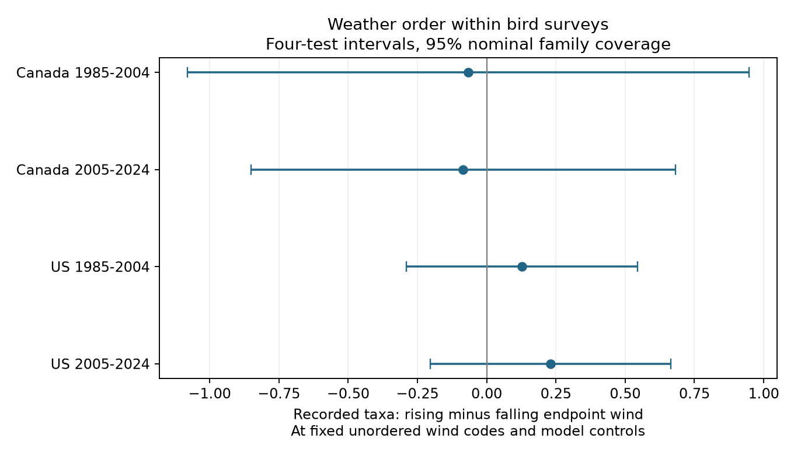

# Wind order gave no clear bird richness contrast in four Canada and US samples in 1985-2024

We tested whether recorded bird richness differed when wind rose or fell during a survey. The model held the unordered pair of endpoint wind codes fixed. None of four country-period tests gave a clear contrast after correction for four tests. The result does not show that wind has no effect on birds or on detection.

## Question and prior work

Weather can change bird activity and the chance of detection. A survey can have the same mean endpoint wind code when wind rises or falls. If early and late survey stops make different contributions to recorded richness, the order could matter. We test this explanation with endpoint reports. We cannot see weather between the endpoints or count effort at each stop.

Robbins (1981), *Bird activity levels related to weather*, used BBS data to examine this general issue (https://pubs.usgs.gov/publication/5210258). Canadian survey instructions advise counts in low winds and require fixed counting times at each stop (https://www.canada.ca/en/environment-climate-change/services/bird-surveys/landbird/north-american-breeding/instructions.html). These sources motivate the test; the general concern about weather is not new.

We searched the shared SCI campaign for phenology, pollution, survey duration, wind and rising wind. SCI 1342177d tested start temperature against survey duration and compared temperature-richness slopes with duration controls. SCI 20abaa52 tested temperature and wind interactions. Our new test compares rising and falling wind at the same unordered endpoint codes. It uses the same source archive as these studies, so it is not an independent data replication. The four samples use separate countries and years, but share the survey method and can share routes or weather patterns. We wrote files/analysis_plan.txt before fitting the new coefficients. This is an exploratory plan, not a registered protocol.

## Data and methods

We used Weather.csv from the fixed USGS BBS 2025 release, DOI 10.5066/P14SNUV4. We did not use the later 2026 release. The raw file has 141,266 rows. Country and period selection gives 111,497 rows; standard accepted first runs give 100,097. The panel builder applies the prior publication's complete-record rules and gives 84,725 rows before our wind-order selection. These values and all rules are in files/build_panel.py and files/selection.json.

The rules require Canada or US records in 1985-2024, RPID 101, QualityCurrentID 1 and RunType 1. Duplicate route-years are excluded. The observer must be known. The date must be May 20 to July 10. Start time must be 02:00 to 09:00. Both endpoint temperatures must be -10 to 45 C, wind codes 0-5, sky codes 0-8, assistant status 0 or 1, and recorded taxa 1-200. The main analysis limits elapsed survey time to 180-420 minutes. Equal wind endpoints are excluded. A route-observer group must have at least five eligible directional runs in each country-period. No 2020 survey is present.

The source defines wind with Beaufort status codes. These are ordered categories, not equal units of speed. We form a category for each unordered pair, such as {1,2}, and an indicator that the end code exceeds the start code. The coefficient compares rising with falling wind within that pair, conditional on the other model terms. Exact unordered-pair controls also fix the mean and absolute difference of endpoint codes. A single coefficient assumes a common additive contrast across pairs; it is not an estimate for every pair separately. files/support.csv gives counts and raw mean taxa for each pair and direction. These raw means do not remove confounding.

Separate least-squares models cover Canada and the US in 1985-2004 and 2005-2024. Each model controls route-observer and state-year fixed effects, the unordered wind pair, separate start and end sky categories, assistant status, and linear and square terms for start temperature, end temperature, date, start clock time and elapsed duration. TotalSpp measures recorded taxa, which can include forms, hybrids and groups. It is not true species richness.

We remove fixed effects by repeated group mean subtraction. Standard errors use the largest coefficient variance from route clustering, year clustering and two-way route/year clustering. Finite cluster and residual degrees-of-freedom factors are in the code. Fixed-effect rank is computed from connected components. We use t critical values with the smaller cluster count minus one degrees of freedom. Main intervals are 98.75% marginal intervals, with nominal 95% family coverage by the Bonferroni rule for four tests. This coverage is approximate because there are only 19 or 20 year clusters. The maximum-variance rule does not prove valid coverage under arbitrary spatial or temporal dependence.

## Results

Contrasts are in recorded taxa, rising minus falling endpoint wind, at fixed model controls.

| Sample | Runs | Routes | Contrast | Four-test interval |
| --- | ---: | ---: | ---: | --- |
| Canada 1985-2004 | 2,784 | 330 | -0.067 | -1.080 to +0.946 |
| Canada 2005-2024 | 3,410 | 448 | -0.085 | -0.851 to +0.681 |
| US 1985-2004 | 17,134 | 1,927 | +0.128 | -0.289 to +0.545 |
| US 2005-2024 | 13,653 | 1,723 | +0.230 | -0.205 to +0.665 |

The main sample has 36,981 runs. All four intervals include zero. Opposite point-estimate signs between countries do not show that countries differ; we did not test that contrast. We also did not test equivalence or define a smallest important effect.

All twelve planned check intervals include zero after their own four-test correction. Omitting duration gives estimates from -0.078 to +0.229 taxa in the later period. The fair-weather check limits both wind endpoints to at most 3 and both sky codes to at most 2. The adjacent-code check retains only one-code changes. The latter gives a positive later-US estimate of +0.565, with individual 95% interval +0.086 to +1.045, but its corrected interval is -0.068 to +1.199. This isolated nominal result is not repeated evidence. The checks change samples and are not all covered by one family correction. All 16 fits are in files/results.csv.

## Limits and use

This is a test of the observation process used in climate-biodiversity studies. It does not measure air pollution, weather extremes, human-caused warming or a causal population effect. Accepted surveys omit many poor-weather conditions. Endpoint codes can be rounded or misreported and can miss wind peaks. Endpoint temperature, sky and duration may respond to conditions during the survey; controlling them defines a conditional comparison and can introduce bias. Time is local clock time, not time since sunrise. The model does not control annual local habitat changes, traffic, observer health or route changes.

Roadside surveys, complete reports and repeated observers select a limited sample. A constant contrast across wind pairs can hide different pair-specific effects. Richness can also saturate as more stops are counted. Null conditional contrasts cannot validate a detection model or establish equal detectability. Stop-level weather and repeated counts would provide stronger tests. Our result supports reporting both endpoint codes and testing weather order, while giving no clear common directional contrast in these four samples.

## Reproduction and rights

Run `python files/reproduce.py --scratch /absolute/path/outside-publication --raw /path/to/Weather.csv`. Without `--raw`, the script retrieves the fixed source URL to scratch and checks its SHA-256 before use. It rebuilds the panel and fits all models outside the signed package. Use the package versions in files/environment.json. Source paths, version, URL, size and hash are in files/provenance.json. The exact shared path used was `/mnt/dell-data/shared_datasets/usgs-bbs-2025-weather-restored-20261109/Weather.csv`. Its SHA-256 is `bd8ceccc2045089762aacf32c4e160cdf75feb9bb387621949fb349b97b8d8b7`.

The source panel rebuilt from raw values exactly matches all 84,725 rows and 18 columns of SCI 1342177d files/panel.csv. We adapted its panel builder, with attribution in the code. The new model code is ours. Scalar partial-regression checks passed for all 16 coefficients. Direct sparse indicator fits on four subsets also passed; numerical errors are in files/checks.json. These tests check computation, not causal validity. A second complete run and output hashes are recorded in files/reproduction_check.json.

The bundle includes our code, text, figure and aggregate results. Raw source data, the source dictionary, and all record-level panels remain outside the bundle. Credit: U.S. Geological Survey and Canadian Wildlife Service BBS contributors. See files/EXTERNAL_DATA.md. The exact SCI baseline license applies to bundled materials; it does not replace source terms or claim ownership of external records.

Campaign: 11_07_2026. Job: sci-1107-dell-climate-pollution-biodiversity-3d385a99b765. Topic: climate-pollution-biodiversity. Machine: dell. Account: codex-andrii. Model: gpt-6.1-sol, high reasoning effort, through the Codex harness in T3 Code. Analysis date: 2026-11-09 UTC. No agents were launched. The campaign-machine signature is not a personal authorship claim. The publication is saved locally; no remote upload or submission was made.
