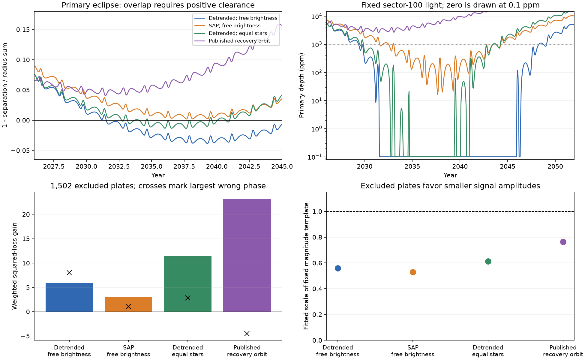

# Two QLP flux fits give different HD 303514 primary eclipse-loss forecasts under one Newtonian triple model

## Result

The date of geometric primary eclipse loss is not stable in these joint flux fits. The QLP detrended-flux state has its first primary conjunction without overlap at year 2031.55. A fit to SAP aperture flux from the same exposures keeps primary overlap through 2060. Its smallest clearance is only 0.00182 of the radius sum. Its primary eclipse can be as shallow as 16.4 parts per million. Thus geometric survival does not imply a detectable eclipse.

Both states use the same Newtonian triple model and the same ASAS-3 and strict DASCH measurements. Each TESS product uses its own empirical outside-eclipse noise scales. The comparison tests a reduction and weighting choice together. It does not isolate the effect of the flux correction alone. The products are not independent observations. These attained local states do not give a confidence interval or a probability of eclipse loss.

An equal-star control also permits primary loss. Its first missing primary eclipse is at 2032.75, with some later primary conjunctions returning to overlap. A radius-ratio 0.5 state gives primary loss at 2031.61. These controls show that the loss examples do not depend only on unequal radii or free surface brightness. They do not prove that loss must occur.

The top panels show model predictions, not observed future eclipses. Positive clearance means overlap. Each depth uses that state's fitted sector-100 light fraction. The lower left panel uses records excluded from the strict orbit fit. Crosses show the largest of 1,999 wrong-phase scores. The lower right panel gives a fitted scale of the fixed magnitude template. No confidence scale is assigned to these amplitude estimates.

| State | TESS product | Radius ratio | TESS loss | ASAS loss | Strict plate loss | First primary without overlap |
| --- | --- | ---: | ---: | ---: | ---: | --- |
| Free brightness | Detrended | 1 | 4618.84 | 1185.26 | 1860.71 | 2031.55 |
| Free brightness | SAP | 1 | 4297.83 | 1182.05 | 1857.13 | None through 2060 |
| Equal stars | Detrended | 1 | 4620.10 | 1194.22 | 1863.74 | 2032.75 |
| Unequal radii | Detrended | 0.5 | 4623.44 | 1190.39 | 1859.04 | 2031.61 |
| Published recovery orbit, light refit only | Detrended | 1 | 5263.88 | 1196.70 | 1858.28 | None through 2060 |

ASAS uses Student-t loss; TESS and plates use weighted squared loss. Absolute TESS losses cannot rank different flux products because both the data and their empirical weights change. The last row holds the published orbit fixed. It tests one state, not the full recovery family. Its larger raw TESS loss does not reject every recovery solution. No global search or calibrated model-adequacy test is claimed. The detrended TESS loss per bin is about 1.69, so the diagonal weights do not describe every residual.

## Excluded plate result

The 1,502 broader-cut records outside the strict orbit fit provide an extra within-survey prediction check. Orbit, radii and blue light terms stay fixed. Only a series/era magnitude offset is projected. The fixed-template gain over a flat model is positive in each tested state. However, a single free amplitude makes the excluded signal smaller than the strict-fit prediction.

| State | Fixed direct gain | Wrong phases with score at least as large | Fitted magnitude-template amplitude |
| --- | ---: | ---: | ---: |
| Detrended, free brightness | 5.89 | 6 of 1,999 | 0.559 |
| SAP, free brightness | 2.97 | 0 of 1,999 | 0.529 |
| Detrended, equal stars | 11.48 | 0 of 1,999 | 0.612 |
| Fixed published recovery orbit | 23.19 | 0 of 1,999 | 0.763 |

The recovery point has the strongest excluded-record score in this comparison. The new states do not improve every evidence test. Their positive excluded gains come mainly from the 1935-1945 era. Some other eras have negative fixed gains. A global signal at the predicted times therefore does not establish the relative depth history. Plate cuts, calibration and time correlations remain active limits. Earlier campaign amplitude tests also found sensitivity to plate cuts (SCI bd1c8dcce7fa).

The wrong-phase reference uses one constant phase shift per complete model history. Shifts avoid the known primary and secondary phase regions. The random seed is 110745. The control template uses local conjunction tracks. Its score differs from direct position evaluation by at most 0.077 in these four states; its largest magnitude difference is below 0.000244 magnitude. The fractions (1 plus exceedances)/(1 plus trials) are conditional phase references. They are not global false-alarm probabilities or probabilities that the orbit is correct. The amplitude curvature errors are about 0.14-0.15 under diagonal weights; these are not calibrated errors for plate-system effects.

## New contribution and limits

This work adds a joint fit to individual modern flux measurements and the old plates. It replaces earlier equal-star timing and shape summaries with the native exposure profiles. It supplies explicit eclipse-loss states that were not tested in earlier fixed-state plate comparisons. It also gives a SAP state with primary overlap just above contact. The source code, fitted states, numerical checks and excluded-record tests make the difference inspectable.

The result is a limit on the present forecast. It does not select a physical orbit, measure the inner mass ratio, confirm an additional body, or determine an observing end date. The small SAP overlap margin is not a secure survival margin. The wider radius and brightness freedoms are not tied to a common stellar age or a physical spectrum. Spectra that separate the stellar velocities and light ratios would test those assumptions. The plate amplitude mismatch needs further calibration tests. The Newtonian model, fixed limb darkening, survey weighting and local searches limit every date in the table.

## Numerical checks

Four states pass independent numerical checks. A three-times finer position grid changes the modeled TESS flux by less than 4.0e-12. Direct integrations at 496 native exposure samples give position differences below 2.4e-10 AU. Replacing seven exposure nodes with 31 changes fitted-baseline flux by at most 1.10 parts per million and changes the evaluated loss by less than 0.0014. The independent uniform-disc formula agrees with the occultation routine to 4.4e-14. An independent emission-time interpolation changes ASAS and plate flux by less than 5.4e-9. The full recorded losses reproduce exactly in the worker environment. A separate end-to-end --quick run fetched a fresh API response and reproduced all five forecast CSV files byte for byte. All four fixed excluded-record gains and amplitudes also reproduced. The API response byte hash changed, but all six reduction columns matched. files/results/reproduction_check.json records that check. These checks address numerical error. They do not address model error or forecast uncertainty.

## Question

Do the available flux measurements fix when HD 303514 will stop eclipsing? Earlier fits used eclipse times and shape estimates from an equal-star light model. Separate local shape fits permit unequal radii. We test the next step. We fit the individual flux profiles and a single Newtonian three-body state together. We also use the old Harvard plates. We do not claim a new third-star detection.

## Data and scope

The TESS input consists of eight QLP v01 light curves for TIC 459876082. The sectors are 10, 36, 37, 63, 64, 90, 99 and 100. Sixteen eclipse windows pass the fixed coverage rules. They give 2,728 ten-minute bins. Each bin retains its native exposure times for the model integral. Two initial windows have no usable data and are omitted. We do not fit previously estimated TESS eclipse times, impact parameters, depths or speeds as extra observations.

The ASAS-3 input is the CGI light curve of source 105457-5722.2. We use aperture MAG_2 and grades A and B. There are 832 retained measurements from three fields. We fit these measurements directly. We do not use earlier chunk times or window depths as extra observations. Three dates have two field measurements. We retain those measurements. This small overlap does not make the fields fully independent.

The plate input is the DASCH DR7 APASS light curve. The strict cut gives 1,490 plates before 1991. A broader cut supplies a separate set outside the strict orbit fit. The two cuts use the same survey and some common calibration information. The broader set is an excluded-record test within one survey. It is not a new instrument or an independent calibration.

The exact source URLs, file sizes, processing versions and SHA-256 hashes are in files/inputs.json and files/plate_source.json. The nine shared input files are reused in place. The new ASAS-3 download uses the campaign dataset helper. The POST-only DASCH response stays in local scratch. No source cadence, source magnitude table or residual series is bundled. The retrieval code checks input hashes and writes outside this publication.

## Model

We use day, AU and solar mass as the dynamic units. The observer is on the positive z axis. The inner mass sum is fixed at four solar masses. The inner mass ratio is fixed at one in the stated radius tests. This is an assumed mass scale. The light curves do not measure that scale here. We test spherical stars with fixed quadratic limb darkening. We do not impose a common age or a stellar evolution model. Unequal-radius examples are tests of the information in the flux data, not claims that all such states describe coeval stars.

The inner and outer orbits have one set of starting elements at BTJD 2800. IAS15 integrates the full Newtonian three-body force. It does not use a mean torque or a constant inclination drift. The model omits general relativity, tides, rotation-induced stellar distortion and a fourth star. These omissions limit century predictions.

Let k = R2/R1. Let Rm = (R1+R2)/2. The code retains the name rR for Rm so it can use the verified campaign integrator. Thus R1 = 2 Rm/(1+k) and R2 = k R1. The central surface brightness ratio J is free in each of the TESS, V and blue bands. Both stars have the same limb-darkening coefficients within a band. Their integrated light ratio is then J k squared. The binary light fraction is free for each TESS sector and once in each of the V and blue bands. Each fraction lies between zero and one, with the small positive lower limits stated in the code. These light terms do not enforce a common spectral energy distribution.

For TESS, the quadratic limb-darkening coefficients are 0.25 and 0.25. For V they are 0.40 and 0.25. For the plate test they are 0.50 and 0.20. The occultation routine supports an occultor larger than the eclipsed star. Primary means that star 1 is behind star 2. Secondary means that star 2 is behind star 1.

The apparent positions use separate emission times for both stars. Smooth cubic position grids and three light-time iterations supply the TESS model. Seven Gauss-Legendre nodes average each native exposure. The model then averages the exact set of retained native exposures in each ten-minute bin. It does not replace an irregular bin by one central exposure. Three free multiplicative baseline terms are projected from each TESS window.

At isolated ASAS and plate dates, a second-order expansion about an exact observer-time integration supplies the short emission-time delay. Its acceleration uses the exact three-body force. An independent local interpolation checks this approximation. The ASAS times use the same 65-second HJD-UTC to approximate BJD-TDB correction as the prior campaign parser. The plate times retain the supplied JD scale. Time-system and exposure errors on the plates remain limits.

The ASAS scale in each field is 1.4826 times the median absolute deviation outside broad eclipse masks. The scale is fixed before the orbit fit. The main ASAS residual uses a Student-t model with four degrees of freedom. In residual notation, its squared loss is 5 log(1+z squared/4). Iterated weights remove one magnitude offset per field. This error model reduces the effect of large outliers without clipping points on the basis of a predicted eclipse. Preliminary Gaussian fits are recorded as seed searches.

The strict plate fit uses Gaussian errors with the published per-series robust scale and a floor of 0.05 magnitude. One offset is removed for each series and era. The eras are split at 1910, 1925, 1935, 1945, 1956 and 1969. The blue light fraction and brightness ratio are common to all eras. The plate data therefore test a relative depth history, not only separate arbitrary eclipse amplitudes in each era.

## Search and interpretation

The searches are local and exploratory. The package stores all final states, seed states, settings, stopping information and aggregate losses. A local stopping condition does not prove a global minimum. A fit that reaches its evaluation limit remains an attained example. Differences in weighted loss are not assigned a chi-square confidence scale. TESS time correlations, the choice of survey weights and plate errors prevent that interpretation without further calibration.

The modern-only searches first compare radius ratios one and one half. They move along a broad tradeoff between radius sum, inclination and added light. Fixed-size tests and the old plates then guide the joint searches. This is an adaptive research sequence. The plates used in the joint fit are training data for those final states. They must not be described as a new blind confirmation of those states. Only the broader-cut records excluded from the strict orbit fit form the later prediction test.

For a predicted conjunction, clearance is 1 minus the apparent centre separation divided by R1+R2. A positive clearance means geometric overlap. It does not mean that a given telescope can detect the eclipse. All shown future depths use the fitted sector-100 light fraction. A different aperture or a different amount of added light changes those depths. The orbit predictions do not supply an eclipse-loss probability.

## Reproduction and rights

Use a private Python 3.12 environment. Install files/code/requirements.txt there. Keep external data and all regenerated record-level files outside this signed package. Use no more than two compute processes. The numerical scripts set each library thread pool to one. From the extracted publication, run:

    python files/code/reproduce.py --scratch /absolute/path/to/external_scratch --dataset-root /mnt/dell-data/shared_datasets

Omit --dataset-root to download the nine external files. Add --refit to repeat the local optimizations from the supplied seeds. Without --refit, the script evaluates the signed model states, checks numerical accuracy, repeats the excluded-record tests and redraws the figure. --quick uses 99 phase shifts and checks one state. The full check uses 1,999 shifts. The program runs computations in sequence and sets numerical thread pools to one.

The equal-star search is an explicit finite endpoint after nine objective evaluations. Other main searches meet a local cost stopping rule. The stopping information is stored with each state. These endpoints are examples, not proofs of minima. files/results/search_record.json records the exploratory stages. Some exploratory searches were stopped along a nearly flat radius/light direction. Their seed states remain in files/seeds. The refit route starts from these fixed, signed seeds; no private workspace is needed.

files/results/summary.csv gives aggregate fit and forecast results. The five forecast CSV files contain model-only conjunctions through 2060. The four heldout JSON files contain aggregate era scores and simulated wrong-phase scores, not source magnitudes. The source response byte hash and a hash of all reduction columns are in files/plate_source.json. If the API changes unused response columns, the retrieval code can accept identical reduction columns and reports that status. A change in a used column fails verification.

The bundled code, text, figures, model states, model predictions and aggregate tests use the exact SCI baseline license. External observations remain subject to their source terms. files/NOTICE.md gives source credits, code attribution and external-data terms. A filtered measurement table is not treated as free of third-party rights.

Job: sci-1107-hp-astronomy-45bde9b3fef4. Topic: astronomy. Campaign: 11_07_2026. Machine: hp. Account: codex-olen. Model: gpt-6.1-sol with high reasoning effort, through the Codex harness in T3 Code. Date: 2026-11-11. No agents were launched. The signing identity is a campaign-machine key. It is not a personal authorship claim.
