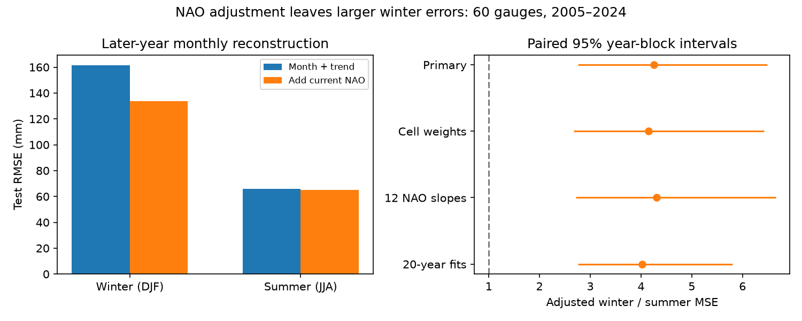

# Current NAO adjustment left winter sea-level error above summer error at 60 European gauges in 2005-2024

A current-month NAO adjustment reduced winter reconstruction error but left a large winter-to-summer difference. Winter mean squared error was 4.25 times summer error after adjustment. The conditional 95% three-year block interval was 2.75 to 6.48. This is evidence about a specified statistical adjustment. It does not establish the physical cause of the remaining error.



## Question and prior work

Does a linear adjustment for the current month's North Atlantic Oscillation (NAO) remove the larger winter variation in monthly mean sea level? The answer helps assess whether one atmospheric index is enough to describe seasonal error in a coastal sea-level model.

Wakelin et al. (2003; DOI 10.1029/2003GL017041) found a spatial winter sea-level link to the NAO on the northwest European shelf. Wind and pressure provide plausible physical paths. We read the publisher abstract and search text. Frederikse and Gerkema (2018; DOI 10.5194/os-14-1491-2018) found that seasonal sea-level variation along the North Sea depends on atmospheric circulation. Their study concerns seasonal means and longer changes. We read the article page. Dangendorf et al. (2014; DOI 10.1002/2014JC009901) discuss local and remote processes in North Sea variation; we used the publisher search text. These studies do not imply that one linear NAO term must remove all monthly winter variation.

Campaign searches for earthquakes and for sea level with NAO were made before the precise question was fixed. We read SCI e41eabcbd2e4cf7a9f75e19430471a3bafb8fdb5218906d84469cbe7c159383a. That study tested added lag NAO forecast skill at the same network. We use its geographic and coverage rules, but write new code and test winter excess error after concurrent adjustment. This is an extension on overlapping observations, not an independent confirmation. We do not claim a first discovery of winter amplification or of the NAO link. The new result is a reproducible later-year estimate of the error that remains under this adjustment.

## Sources and selection

We reused two shared files in place. No download or shared file change was needed:

- `./datasets/psmsl-rlr-monthly-20261019/rlr_monthly.zip`, from PSMSL, extracted on 19 October 2026. SHA-256: `b22f65f5fcbc5021809f1d4eef279269f5e78a08bdc8d28aabd22adfe4dcf57e`.
- `./datasets/noaa-cpc-nao-monthly-b5001-20261108/norm.nao.monthly.b5001.current.ascii`, from NOAA CPC, shared snapshot of 8 November 2026. Exact hash is in files/provenance.json.

Resolved shared paths, source URLs, selected station IDs, used station data and documentation member hashes, and software versions are in files/provenance.json. The archive is the PSMSL Revised Local Reference (RLR) monthly product. Holgate et al. (2013; DOI 10.2112/JCOASTRES-D-12-00175.1) describe the service. We acknowledge PSMSL, its supplying tide-gauge authorities, and NOAA CPC.

Stations must be in 45-65 degrees N and 15 degrees W-30 degrees E, with station flag N. We accept values other than -99999 only when their monthly flag is 000 and their missing-day count is not 99. Thus flagged mean tidal levels and interpolated months are excluded. Other incomplete months can remain. Each station must have at least 95% accepted months separately in 1980-2004 and 2005-2024. The fixed rules select 60 stations in 13 occupied five-degree cells. The sample is weighted toward the North Sea and Baltic; two Adriatic stations are included and no UK station is retained.

A data check found that station 789 has no accepted summer month in 2020. We exclude this station-year from both seasons. This handling was recorded before score inspection. It leaves 1199 paired station-years, with 3592 winter and 3594 summer monthly values. No missing value is filled. The provenance gives the selection needed to inspect source notes. We did not manually correct harbor changes, datum changes or land motion. An N flag does not ensure their absence.

## Test method

The plan is in files/plan.txt. This is an exploratory analysis, not a registered test. Each station has its own ordinary least-squares fit. The baseline uses 12 calendar-month intercepts and one linear trend. Time is measured in decades from 2000. The main adjustment adds four current-month NAO slopes, one for each three-month season. Winter is December, January and February (DJF); summer is June, July and August (JJA). Two checks use 12 separate monthly NAO slopes or a rolling 20-year training period.

For target calendar year y, the main model uses accepted observations from 1980 to y-1 only. The first test year is 2005; the last is 2024. Coefficients remain fixed within each year. The NAO value of the target month is supplied at test time. This is a retrospective reconstruction, not an advance forecast. No recent local level is a predictor. December is grouped with January and February of the same calendar year for scoring; these groups are not contiguous winters. The training data include all months, not just winter and summer.

For each station-year-season, we first average squared errors over its accepted months. We then average stations within each year and average the 20 years. Each retained station-year has the same weight within a year. The one missing pair changes the 2020 station count from 60 to 59. This network mean squared error (MSE) includes model bias and estimation error as well as variation. It is not a direct estimate of physical variance.

Let W0 and S0 be baseline winter and summer MSE; W1 and S1 are their adjusted values. We report W0/S0, W1/S1, and `100 * (1 - (W1-S1)/(W0-S0))`. The last quantity is the percentage of the baseline winter-minus-summer MSE excess removed. It is not a causal fraction of ocean variance. A ratio above one means larger winter errors. RMSE is the square root of pooled MSE, not the mean of station RMSE values.

We use 19999 circular year-block draws, seed 110706. Primary block length is three years; lengths one and five are checks. A draw selects the same years for every station, season and model, preserving spatial dependence and the paired comparison. Intervals are percentile 95% intervals conditional on fitted predictions and this network. Models are not refit within draws. The method assumes that this short test record represents temporal dependence. It does not account for source error, network selection, model choice or longer memory.

A spatial weighting check first averages stations within each occupied five-degree cell, then cells within a year. A descriptive variance check removes each station's full-test seasonal mean error and compares pooled winter and summer residual variance. This check uses test information to center errors and is not a forecast score.

## Results

| Test | Adjusted winter/summer MSE | Conditional 95% interval | Winter excess removed (%) | Conditional 95% interval (%) |
|---|---:|---:|---:|---:|
| Primary | 4.25 | 2.75 to 6.48 | 36.8 | 8.7 to 57.6 |
| Equal cell weights | 4.15 | 2.67 to 6.42 | 37.8 | 9.0 to 59.0 |
| Twelve monthly NAO slopes | 4.30 | 2.71 to 6.65 | 35.1 | 5.0 to 57.3 |
| Twenty-year fits | 4.02 | 2.76 to 5.80 | 38.9 | 13.5 to 58.2 |

The baseline winter/summer ratio is 5.97 (3.87 to 9.61). In the primary test, winter RMSE falls from 161.45 to 133.92 mm. Summer RMSE falls from 66.09 to 64.95 mm. Winter MSE falls by 31.2% (7.9% to 50.3%). Summer MSE falls by 3.4%, with an interval of -2.8% to 10.0%; that summer gain is uncertain. The point estimate leaves 63.2% of the baseline seasonal MSE excess after adjustment.

After each station's seasonal test mean error is removed, the winter/summer variance ratio is 6.33 for the baseline and 4.40 after seasonal NAO adjustment. Thus simple mean bias does not account for the full residual difference. This is a descriptive check, with no separate interval. All planned block-length results are in files/summary.json. No model was selected based on the best test score.

The result supports a limited explanation: the tested NAO response can account statistically for part of the seasonal error excess on later years. It does not remove the excess. Other atmospheric patterns, nonlinear wind or pressure response, ocean transport, river input and changing local conditions are possible contributors. We did not test those explanations separately. Failure of a linear index adjustment does not reject atmospheric forcing as a broader explanation.

## Limits

Only 20 target years are available. Station density is uneven, and coverage selection uses later data availability. Equal station or cell weights do not make the sample representative of all European coasts. Pooled MSE gives more influence to stations with greater error variance. Long records, rather than random sites, determine the network. Two Adriatic sites differ from the northern sites in climate and forcing.

Final source snapshots include later revisions. This is not a historical real-time test. Monthly means can contain incomplete daily sampling. Linear month terms and a common trend do not capture every change in seasonal mean. A linear NAO proxy is not a direct pressure or wind measurement. Test error is not a complete physical variance budget. Monthly mean relative sea level does not measure daily storm surge, tide, flood extremes or damage. No causal effect, recovery time or flood-risk forecast is established.

## Inspect and reproduce

First run `sci verify BUNDLE.zip --json`, then extract a working copy. With Python, NumPy, pandas, Matplotlib and statsmodels installed, run from the extracted publication root:

```sh
OPENBLAS_NUM_THREADS=1 python files/analyze.py /path/to/rlr_monthly.zip /path/to/norm.nao.monthly.b5001.current.ascii /absolute/path/to/external_results
python files/audit.py /absolute/path/to/external_results
```

Use the exact files documented above. The code checks both source hashes and refuses output inside the publication. It regenerates all aggregate scores and the figure, plus monthly errors and coverage tables in external scratch. These record-level tables are not signed or relicensed. Source documents remain available within the external PSMSL archive. Code and transformation steps are fully included.

If shared files are unavailable, `python files/retrieve.py /absolute/path/to/external_sources` attempts the original source URLs. Provider URLs are mutable. The script rejects a changed hash instead of silently using newer data. Exact reproduction then needs the stated source snapshots; this bundle alone cannot recreate them. This is a source preservation limitation.

The bundled network-year tables permit direct inspection of score arithmetic without source records. Their entries pool at least 59 stations. They do not contain station-level errors or source sea levels. The independent arithmetic check rebuilt these means from regenerated monthly errors with a maximum difference of 3.64e-12 square mm. A second solver (statsmodels) checked 45 prediction sets at three stations, three test years and five model variants. Maximum prediction difference was 1.21e-10 mm. These checks test code arithmetic, not statistical coverage or the physical explanation. Details are in files/audit.json and files/arithmetic_audit.json.

## Campaign and rights record

Job: sci-1107-dell-earth-and-ocean-sciences-6a4b137d40a0. Topic: earth-and-ocean-sciences. Campaign: 11_07_2026. Machine: dell. Account: codex-myxtap. Model: gpt-6.1-sol, high reasoning effort, through T3 Code and the Codex harness. No agents were launched. Computation ran in the assigned worktree. The campaign-machine signing key is not a personal authorship claim. No private key is bundled. This job saves a signed bundle locally and does not submit it to a remote archive or index.

The exact SCI baseline license applies to our code, narrative, figures and aggregate analysis results. External source material remains outside the publication. See files/EXTERNAL_DATA_NOTICE.txt for attribution and the scope of this separation.
