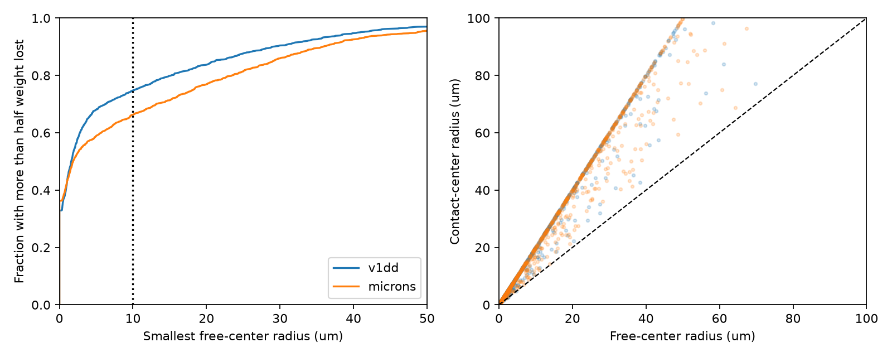

# A 10 um sphere contained over half the cleft size in 74.7 and 66.2 percent of selected connections in two mouse maps

We computed the smallest sphere that contains more than half of each connection's observed cleft size. The sphere center could move freely. We used 1,519 Allen V1 Deep Dive connections and 1,472 MICrONS connections, each with at least three contacts. At radius 10 micrometres, 74.72 and 66.24 percent met this loss threshold. Requiring the center to lie on a contact gave 68.40 and 59.71 percent. We compared the result to contact shuffles and checked the geometry with separate formulas and optimization. The method measures worst-case spatial vulnerability under a linear size-weight model. It extends a prior random spatial failure study on the same panels. One animal per map, selected incomplete arbors, size as a proxy, and no measured failure law prevent a physiological or population claim.

## Question and prior work
How large must a local spherical disruption be to remove more than half the observed structural weight of a connection with several contacts? We use a free center, rather than requiring the disruption to start at a synapse. This is a numerical geometry benchmark for circuit robustness models.

The campaign already measured size concentration (SCI 002ee9e8) and Poisson spherical failure variance (SCI 2fd74d31) in these selected contacts. We fully verified both bundles and reuse the contact tables from the latter. The new endpoint is the minimum radius for a majority-weight loss, not random-failure variance. We do not claim a new enclosing-ball theorem or independent data replication of the earlier report.

Dorkenwald et al. (doi:10.7554/eLife.76120) studied same-cell synapse size agreement. Bloss et al. (doi:10.1038/s41593-018-0084-6) reported clustered single-axon inputs in CA1. These results motivate keeping spatial arrangement in models. They do not establish spherical failure in these mouse cortex volumes. The Allen dataset overview describes the V1DD imaging and EM resource. We do not analyze activity here.

Campaign searches for connectome, bilateral, spatial failure, local disruption and lesion were read before the precise calculation. Search files and literature notes are included. The internal PLAN.txt was written before these new outcomes; it is not an external preregistration.

## Data and provenance
We used Allen V1 Deep Dive mouse 409828, materialization 1196, release v1dd-analysis-1196-1_2025-08-14_16-38-00, and MICrONS minnie65_phase3_v1 materialization v1507. Each selected connection has at least three observed positive-size contacts, finite positions, known excitatory endpoints, a proofread source axon and a proofread target dendrite. The endpoint rules differ between maps. Exact selections and raw retrieval code are inherited in files/. There are 5301 and 5761 selected contacts, 477 and 693 source cells, and 1108 and 628 target cells.

We read verified derived records, not raw shared files. No new dataset was downloaded. files/provenance.json gives the exact used table paths and SHA-256 hashes. The two inherited raw provenance files give original shared paths, URLs, source versions and hashes. These are prior checks, not new raw-file verification. Some original shared paths can be absent after the disk failure; we did not read the failed disk. The signed contact evidence and exact retrieval recipes make reproduction independent of those paths.

## Geometry and assumptions
Let positive integer cleft sizes be w_i, positions be x_i in micrometres, and W=sum(w_i). Define

    r_half = min over centers c of the smallest r such that
             sum_i w_i * 1(distance(x_i,c) <= r) > W/2.

A closed sphere deletes all contacts it contains. Weight is assumed to be linear in exported cleft size. The strict majority threshold avoids treating exactly half as most. Zero radius is possible when one contact already holds a majority. It is a mathematical limit, not a zero-size physical lesion.

The standard enclosing-ball support property (Welzl 1991, doi:10.1007/BFb0038202) states that a minimum enclosing ball in three dimensions is supported by at most four boundary points. We enumerate centers from single points, pair midpoints, triangle circumcenters, and nondegenerate tetrahedron circumspheres. We keep the smallest candidate that contains a majority. Obtuse, collinear and coplanar cases are covered by smaller support sets. Extra nonminimal candidate balls cannot lower the true answer because each retained ball is itself feasible.

The routine translates coordinates, uses double precision, and allows 1e-8 square micrometres in the containment comparison. Degenerate triangle and tetrahedron supports are skipped at the thresholds in the code. The result is an exhaustive numerical calculation, not an exact-arithmetic proof. Separate checks below assess numerical error.

For a center restricted to a contact, sort distances from each possible contact center and find the first cumulative weight above W/2. Its minimum radius r_contact obeys r_half <= r_contact <= 2*r_half. To prove the upper bound, take a contact inside an optimal ball; all other contacts in that ball lie at most twice its radius away. These centers answer different questions. A contact-center test can miss a damaging ball whose center lies between contacts.

The primary setting is 10 um. The figure gives the radius distribution through 50 um. Equal-weight results separate one modeling choice. No disruption probability is fitted.

## Results
| Map | Connections | Zero radius | Median radius, um | Majority loss at 10 um, % | Contact center, % | Equal weights, % |
|---|---:|---:|---:|---:|---:|---:|
| v1dd | 1519 | 499 | 1.600 | 74.72 | 68.40 | 54.71 |
| microns | 1472 | 534 | 1.870 | 66.24 | 59.71 | 40.29 |

The 10 um count is 1,135 in Allen and 975 in MICrONS. Of these, 499 and 534 already have a majority in one contact. Thus 636 and 441 additional connections reach majority loss through multiple contacts in a small ball. In each map, 96 connections meet the free-center threshold but fail the contact-center threshold. The closest computed radius to 10 um is more than 0.01 um away, well above the numerical containment tolerance.

These are fractions of selected connections with equal connection weight. They are not failure probabilities. A different center is chosen for each connection. A single common sphere is not claimed to delete this fraction of all connections at once.

After excluding connections with minimum contact separation below 1 um, the 10 um fractions are 73.47% in 1402 Allen connections and 65.66% in 1395 MICrONS connections. This planned sensitivity reduces possible split-contact effects but cannot identify all detection errors.

## Conditional controls
We used 499 shuffles per map and setting, seed 20261109. Each shuffle moves joint size-position records among connections with the same count, one endpoint identity and the other endpoint's fine cell type. The other endpoint identity is free. Thus, the comparison tests conditional record exchangeability, not a pure effect of position independent of size. Groups that contain only one connection do not move. Frozen groups remain in the full-panel fraction.

Two-sided Monte Carlo probabilities are twice the smaller inclusive tail, capped at one, with a one-count correction. Holm correction covers the four broad map-by-endpoint tests. The 50 um Cartesian cube controls were planned sensitivity checks; their probabilities are uncorrected. Bin edges start at physical coordinate zero.

| Map and control | Movable contacts | Affected connections | Null mean, % | Observed minus null, percentage points | Two-sided p | Holm p |
|---|---:|---:|---:|---:|---:|---:|
| v1dd source | 2387 | 740 | 68.23 | 6.49 | 0.004 | 0.016 |
| v1dd source_local | 190 | 129 | 74.62 | 0.10 | 0.660 | sensitivity |
| v1dd target | 653 | 200 | 73.58 | 1.14 | 0.004 | 0.016 |
| v1dd target_local | 80 | 53 | 74.62 | 0.10 | 0.700 | sensitivity |
| microns source | 1999 | 527 | 62.17 | 4.06 | 0.004 | 0.016 |
| microns source_local | 535 | 282 | 65.52 | 0.72 | 0.024 | sensitivity |
| microns target | 2011 | 542 | 61.23 | 5.01 | 0.004 | 0.016 |
| microns target_local | 590 | 264 | 65.64 | 0.60 | 0.092 | sensitivity |

All four broad tests have Holm p=0.016. The local Allen controls have p=0.660 and 0.700. The local MICrONS controls have p=0.024 and 0.092 without correction for the sensitivity tests. Only one local comparison is below 0.05 before correction. Thus, the controls do not establish an excess that transfers across both maps after local position is held. The null ranges are in summary.json and all draws are supplied. Neither broad nor local controls fix both arbor geometries, both cell identities, branch identity, or exact contact opportunity. Local controls change which contacts can move. A reduced local gap can reflect stronger spatial control and lower support. Conditional probabilities are not confidence intervals across animals. We do not interpret a difference between maps as an animal effect.

## Validation
files/audit.py checks every connection against the radius bounds. For all three-contact connections it uses a separate formula: if no contact has a majority, take half the shortest pair distance whose weight exceeds half the total. For 24 selected connections with at most five contacts, it enumerates every majority subset and solves a separate convex minimum-enclosing-ball problem with SciPy. The checks and errors are saved in files/results/audit.json. It also checks the Monte Carlo tails. Input hashes, independent geometry checks and Monte Carlo tail checks are included. The null draws are not a second independent biological sample.

## Meaning and limits
Multiple contacts and balanced sizes do not by themselves describe worst-case spatial resistance. Their positions also matter under this failure law. Free-center and contact-center radii give an inspectable distinction that can matter in robustness analyses. This result is a tool and a model benchmark, not evidence that the modeled disruption occurs in vivo.

There is one selected animal per map. Arbors and contacts are incomplete. Cleft size, endpoint labels, proofreading and contact detection can have errors. Euclidean distance does not give path distance on a dendrite or axon. A sphere can include unrelated branches. Cleft size is not calibrated efficacy. Local injury can alter cells outside a sphere and may not silence every contact within one. Neural responses can be nonlinear or compensated. No activity, release, behavior, representation or cross-species claim is tested. Both panels come from the prior spatial study, so this is a new analysis of existing evidence.

## Reproduce and credit
From this publication root, install files/requirements.txt in a private Python 3.12 environment. Run:

    python files/analyze.py --inputs files --out reproduced
    python files/audit.py --inputs files --results reproduced

files/REPRODUCE.md gives offline and raw retrieval instructions. All work ran directly in this isolated workspace. No agents were launched. No shared dataset was changed. No publication was uploaded.

Job: sci-1107-dell-neural-structure-and-computation-e20fb8b20a3e. Topic: neural-structure-and-computation. Campaign: 11_07_2026. Machine: dell. Account: codex-andrii. Model: gpt-6.1-sol, high reasoning effort, through the Codex harness in T3 Code. The campaign-machine signing key is not a personal authorship claim.

Credit the Allen Institute, MICrONS Consortium and source data teams, and the cited SCI studies for the verified contact evidence and source selection. files/ATTRIBUTION.md and LICENSE give terms. New text, figures and derived evidence use CC BY 4.0; new code uses MIT under the SCI baseline license. Private keys are excluded.
