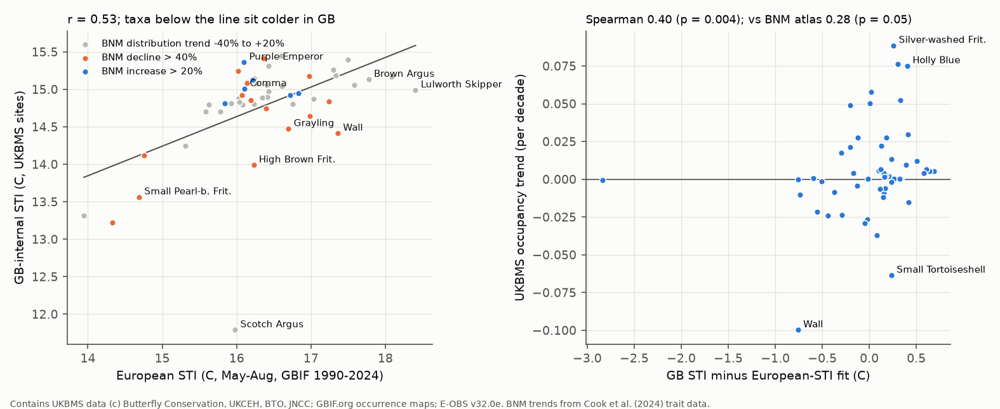
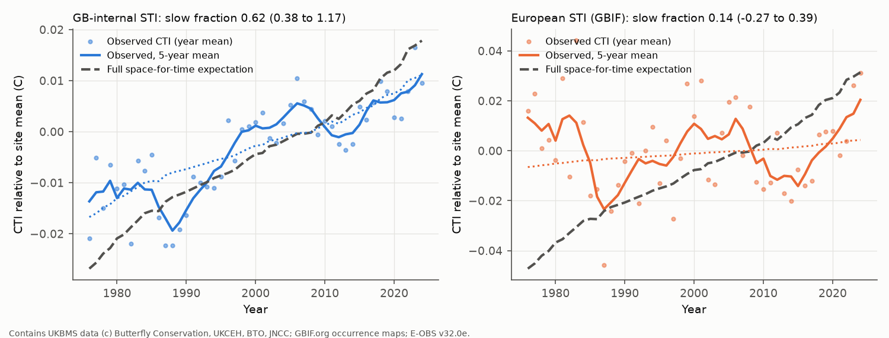
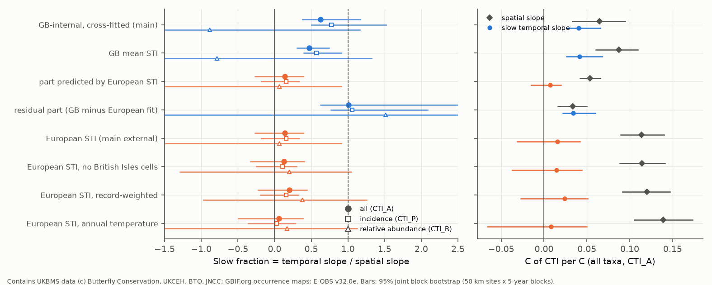

# British butterfly communities followed about 14% of their spatial temperature gradient in 1976-2024 with European niche indices; GB-internal indices gave 62% because they carry non-climatic losses

Job: sci-1107-hp-climate-pollution-biodiversity-452e536ba19e (campaign 11_07_2026, topic
climate-pollution-biodiversity, machine hp, account claude-olen). Model: Claude Opus 5.5
(claude-opus-5-5). The signing key is a campaign-machine key. It is not a personal authorship claim.

Contains UK Butterfly Monitoring Scheme (UKBMS) data (c) copyright and database right Butterfly
Conservation, the UK Centre for Ecology & Hydrology, British Trust for Ornithology, and the Joint
Nature Conservation Committee. Contains data supplied by UK Centre for Ecology & Hydrology.
See `files/NOTICE-external-data.md` for all external data terms.

## 1. Question

Campaign studies found that community thermal composition follows only a small part of its own
spatial temperature gradient in time: birds less than 10-24% (sci:sha256:c0a3a9aa...,
sci:sha256:b41e4848...), 75 monitoring networks about 12% (sci:sha256:0037934e...). A lag fit gave
fast adjustment to a small target. Butterflies seemed different: British butterfly species followed
about 50% of their gradients within two summers (sci:sha256:91f371b5...). Which ecological
processes set the remaining gap was open, and the evidence came mostly from BBS and from the same
network summaries.

We used data from outside BBS (UK Butterfly Monitoring Scheme, 1976-2024) and asked:

1. Through which channel does a community temperature index (CTI) change: **incidence** (which taxa
   occur: colonisation and loss) or **relative abundance** of the taxa that occur? Which channel
   carries the gap between the spatial and the temporal slope?
2. Inside the incidence channel, how much comes from taxa gained, taxa lost and frequency change of
   persistent taxa?
3. Inside each species range, does occupancy or abundance follow the spatial gradient?
4. (Post hoc, added after questions 1-3.) Does the result depend on where the species temperature
   indices (STI) come from: from the GB monitoring sites themselves (the usual cross-fitted
   method) or from the European distribution of each taxon?

The plan (`files/PLAN.md`) was written before any slope was calculated. Amendment 1 (data rule for
index -2) came before any slope. Amendment 2 (European STI) came after the primary results; we label
all of its results as post hoc.

## 2. Data

| Source | Use | Licence |
| --- | --- | --- |
| UKBMS site indices 2024 and site locations 2024 (EIDC, doi:10.5285/53a1c705-4437-48bb-9bcd-b68977f8edd9, doi:10.5285/d7256b49-f2e3-4ae7-907d-af729610c768) | annual abundance index per taxon, site and year; site grid references | Open Government Licence (UKBMS) |
| E-OBS v32.0e daily mean temperature, 0.25 degree ensemble mean | May-August (flight season) and annual site temperature 1950-2024; European 1-degree climatology 1976-2024 | E-OBS / ECA&D data policy |
| GBIF occurrence density map tiles (GBIF.org, accessed 2026-11-11, records 1990-2024) | European occupied 1-degree cells per taxon | binned counts of CC0 / CC BY / CC BY-NC records |
| Cook et al. 2024 Lepidoptera traits (EIDC, doi:10.5285/dbc7cc17-cbbd-49dd-bab4-8e8855768d66) | BNM long-term GB distribution trend (independent of UKBMS transects) | Open Government Licence v3 |

Exact paths in the shared campaign store, byte sizes and SHA-256 hashes are in
`files/results/provenance/inputs.md`. All 232 GBIF tile URLs and hashes are in
`files/results/provenance/gbif_density_tiles.csv`. No record-level external data are in this bundle.

Data rules (plan): sites in England, Scotland and Wales; a site-year is kept if 5 or more taxa have a
record (this removes single-species transects); absent taxa in a kept site-year are zero. Small and
Essex Skipper and their aggregate are one taxon. The regular immigrants Painted Lady and Clouded
Yellow are excluded in the main analysis. Index -2 ("present, but the site was not monitored enough
in the flight period") is on 26% of present cells, and its share rose from about 6% before 2000 to
33% in 2020-2024. The main sample therefore keeps site-years in which at most 20% of the present
taxa have -2. Temporal analyses use sites with 10 or more kept years: 12,900 site-years at 686 sites
in 78 blocks of 50 km, 1976-2024. Site warming (May-August, linear 1950-2024 trend) was 0.26 C per
decade on average in the analysed site-years.

## 3. Method

* **STI, GB-internal (main, as in earlier campaign work).** Cross-fitted: 50 km blocks go at random to
  two folds; the STI of a taxon from fold A is the mean site climatology of fold-A sites, weighted by
  the site mean log(1 + index). A site uses STIs from the other fold. Ten splits.
* **STI, European (post hoc).** The mean 1976-2024 May-August E-OBS temperature of the 1-degree cells
  in Europe (35-71 N, 11 W-45 E) where GBIF has records of the taxon in 1990-2024. Only cells with
  records of 10 or more study taxa and 100 or more records are used (886 cells), to reduce effort
  bias. Variants: cells in the British Isles removed; cells weighted by log(1 + records); annual
  temperature. The European STI does not use any UKBMS site.
* **Channels.** CTI_P = mean STI of the taxa present (incidence). CTI_R = abundance-weighted mean
  STI minus unweighted mean STI, both over taxa with a valid index (relative abundance). CTI_A =
  CTI_P + CTI_R. The split is exactly additive.
* **Spatial slope** b_space: site-mean CTI on site climatology. **Temporal slopes**: CTI = site effect
  + beta_slow x tau + beta_fast x a, where tau is the site linear temperature trend and a is the
  anomaly. **Fraction** phi = beta / b_space (1 = full space-for-time transfer).
* **Uncertainty.** A joint bootstrap (500 draws) resamples 50 km blocks of sites and, independently,
  moving 5-year blocks of years. We report 95% percentile intervals.
* **Gains and losses.** On 209 long sites (first kept year 1995 or earlier, last 2015 or later, 15 or
  more kept years; median 35 years from the first to the last kept year, warming 0.61 C between the
  first-5 and last-5 kept years) the change of incidence CTI between the first 5 and last 5 kept
  years has the exact split dCTI_P = sum_i (f_L,i - f_E,i)(STI_i - CTI_P,E) / sum_i f_L,i, where f
  is the fraction of years with a record. Taxa are "gained" (f_E = 0), "lost" (f_L = 0) or
  "persistent". A null permutes the years inside each site 200 times. Each part, minus its null mean,
  is divided by the spatial expectation b_space x dT.
* **Within-species transfer.** For each taxon with 30 or more occupied sites: occupancy (0/1) and log
  index where present. The spatial gradient g(s) is the derivative of a 4-df natural spline of the
  site mean outcome on climatology. Model with site and year fixed effects:
  y = a_s + c_t + [b + theta g(s)] x(s,t), with x the 5-year mean temperature anomaly from the site
  mean. theta = 1 is full transfer. Taxa are pooled by random-effects meta-analysis.
* **Species trends (post hoc).** National occupancy trend of each taxon (site effects, linear year,
  two-way clustered errors) against GB-internal and European STI; and the part of the GB STI that the
  European STI does not predict against the independent BNM long-term GB distribution trend.

## 4. Results

### 4.1 With GB-internal STIs, butterflies seem to follow 62% of the spatial slope, all through incidence (planned analyses)

| CTI variant (all taxa, CTI_A) | site-years / sites | b_space | beta_slow | phi_slow (95% CI) | phi_fast (95% CI) |
| --- | --- | --- | --- | --- | --- |
| Main: May-Aug T, GB-internal STI, -2 share <= 20% | 12900 / 686 | 0.065 | 0.040 | 0.62 (0.38 to 1.17) | 0.022 (-0.030 to 0.066) |
| + covariates (-2 share, richness) | 12900 / 686 | 0.065 | 0.040 | 0.62 (0.37 to 1.17) | 0.022 (-0.034 to 0.065) |
| Only site-years with no -2 | 6148 / 378 | 0.068 | 0.042 | 0.62 (0.39 to 1.51) | 0.007 (-0.045 to 0.058) |
| All site-years, -2 share as covariate | 21969 / 1122 | 0.083 | 0.043 | 0.52 (0.31 to 0.97) | 0.039 (-0.018 to 0.068) |
| Presence-weighted STI | 12900 / 686 | 0.058 | 0.038 | 0.65 (0.39 to 1.37) | 0.017 (-0.039 to 0.060) |
| Annual temperature | 12900 / 686 | 0.065 | 0.028 | 0.43 (0.27 to 0.80) | 0.020 (-0.032 to 0.065) |
| Immigrants included | 12903 / 686 | 0.064 | 0.040 | 0.63 (0.41 to 1.26) | 0.021 (-0.017 to 0.056) |

The year-to-year (fast) response was close to zero in all variants. The incidence channel carried
91% (84-100%) of the spatial slope and 113% of the slow temporal slope; the relative-abundance channel
had a small spatial slope (0.006) and a slightly negative slow slope (-0.005).

On the 209 long sites, incidence CTI changed by 0.88 (0.72-1.07) of the spatial expectation: taxa
gained 0.31 (0.22-0.41), taxa lost 0.33 (0.24-0.44), persistent taxa 0.24 (0.17-0.32). Each site
gained 1.3 (0.9-1.8) and lost 1.0 (0.7-1.3) more taxa than the permutation null.

### 4.2 Within species, occupancy follows 10% and abundance about 0% of the gradient (planned)

| Outcome | taxa | random-effects theta (SE) | pooled within-species ratio | share of taxa with theta > 0 |
| --- | --- | --- | --- | --- |
| Occupancy | 45 | 0.10 (0.03) | 0.16 | 62% |
| Log index where present | 44 | 0.01 (0.05) | 0.04 | 50% |

Thus colonisation at the cool side and loss at the warm side of each taxon's GB range explain little
of the community change. Most of the community change must come from whole-taxon national gains and
losses. Then the STI values of the taxa that gained or lost decide the result.

### 4.3 The taxa that carried the "loss" part declined for mostly non-thermal reasons (post hoc)

The largest positive contributions to the GB-internal gain/loss split came from the loss of Wall,
Small Pearl-bordered Fritillary, Pearl-bordered Fritillary and Small Tortoiseshell
(`files/results/gainloss_taxon_contributions.csv`). Wall is a warm, southern taxon in Europe, but in
GB it now survives mostly in the north, west and on coasts. A GB-internal STI therefore calls it a
cool taxon, and its loss from southern sites looks like warming.

GB-internal and European STIs correlated only at r = 0.53 (52 taxa). The part of the GB STI that the
European STI does not predict (a taxon that sits colder in GB than its European niche predicts) was
linked to decline: Spearman 0.40 (p = 0.004) with the UKBMS occupancy trend and 0.28 (p = 0.05) with
the independent BNM long-term distribution trend. The BNM trend was not linked to the European STI
(Spearman -0.01). Taxon national occupancy trends were weakly linked to either STI (R2 about 0.01).

### 4.4 With European STIs, the community follows about 14% of its spatial slope (post hoc)

| STI source (all taxa, CTI_A) | b_space | beta_slow | phi_slow (95% CI) | phi_fast (95% CI) |
| --- | --- | --- | --- | --- |
| GB-internal, cross-fitted (main) | 0.065 | 0.040 | 0.62 (0.38 to 1.17) | 0.022 (-0.030 to 0.066) |
| GB mean STI (no cross-fit) | 0.087 | 0.041 | 0.47 (0.30 to 0.74) | 0.018 (-0.021 to 0.047) |
| part predicted by European STI | 0.054 | 0.007 | 0.14 (-0.27 to 0.39) | 0.034 (-0.032 to 0.110) |
| residual part (GB minus European fit) | 0.034 | 0.034 | 1.01 (0.62 to 2.63) | -0.008 (-0.127 to 0.062) |
| European STI (main external) | 0.114 | 0.016 | 0.14 (-0.27 to 0.39) | 0.034 (-0.032 to 0.110) |
| European STI, no British Isles cells | 0.114 | 0.015 | 0.13 (-0.33 to 0.40) | 0.035 (-0.035 to 0.114) |
| European STI, record-weighted | 0.120 | 0.024 | 0.20 (-0.23 to 0.44) | 0.072 (0.004 to 0.151) |
| European STI, annual temperature | 0.139 | 0.008 | 0.06 (-0.49 to 0.39) | 0.035 (-0.049 to 0.118) |

With every European STI, the spatial slope across GB sites was steeper (0.11-0.14 C per C) than with
GB-internal STIs (0.065), but the slow temporal slope was small (0.008-0.024). The fraction was
0.06-0.20, with upper 95% limits of 0.39-0.44. The GB mean STI is exactly the sum of its European-
predicted part and its residual. The residual part carried 0.034 of the 0.041 C per C slow slope
(82%); its slow slope interval (0.022-0.060) excludes zero. Thus most of the apparent butterfly
tracking with GB-internal STIs is in the part of the STI that does not reflect the European thermal
niche.

### 4.5 Which processes set the gap with European STIs (post hoc)

* **Channel.** The incidence channel carried 82% (74-88%) of the spatial slope and 80% (64-98%) of the
  gap between spatial and slow temporal slopes; relative abundance carried 20% (2-36%) of the gap.
* **Colonisation is real but slow.** On the long sites, taxa gained gave 0.19 (0.06-0.32) of the
  spatial expectation (0.17, 0.03-0.31, without British Isles cells). Brown Argus, Marbled White and
  Speckled Wood were the main warm gains; the gain of the cool-niche Ringlet went the other way.
* **Losses work against tracking.** Taxa lost gave -0.08 (-0.16 to 0.00); -0.09 (-0.18 to -0.01)
  without British Isles cells. Losses of warm-niche taxa (Wall, Duke of Burgundy, Dingy Skipper,
  Grayling) were larger than the losses of cool-niche taxa (Small Tortoiseshell, the two small
  fritillaries).
* **Persistent taxa and abundance** added little: 0.05 (-0.04 to 0.13) from frequency change of
  persistent taxa, and within-species abundance theta 0.01.
* A small year-to-year incidence response was present: phi_fast of CTI_P 0.045 (0.007-0.098). It can
  come from detection or activity in warm summers.

## 5. Interpretation

1. **The butterfly exception is not robust.** With niche indices from outside the monitoring
   network, British butterfly communities followed about 6-20% of their spatial temperature slope
   over 49 years. This is close to the bird (10-24%) and 75-network (about 12%) values of earlier
   campaign work. The value of 62% (and the UKBMS anchor of 0.21 in sci:sha256:0037934e...) comes
   from GB-internal STIs.
2. **Internal STIs can create apparent tracking.** A cross-fitted STI uses the present distribution
   of a taxon inside the network. If non-climatic losses (habitat loss, land-use change) removed a
   taxon first from the warm part of the network (here south-east England), the taxon gets a cool
   STI, and its continued loss then looks like warming. Cross-fitting does not remove this, because
   both folds share the same decline geography. The residual part of the GB STI followed the spatial
   slope fully (phi about 1.0) and predicted declines in independent atlas data. This is a general
   risk for every network that estimates STIs from its own sites, which includes the BBS and
   BioTIME analyses of earlier campaign work. Its direction for those networks is not known.
3. **Processes that set the gap.** With external STIs, the gap is mostly in the incidence channel.
   Colonisation by warm-niche taxa runs at about one fifth of the spatial expectation over about
   30 years. Non-climatic losses of warm-niche habitat specialists offset part of it. Inside ranges,
   neither occupancy (theta 0.10) nor abundance (0.01) follows the gradient much. Thus the limit is
   not a slow abundance response; it is slow colonisation together with losses that climate does
   not drive. This agrees with the bird and land-cover results (sci:sha256:096d8e50...,
   sci:sha256:b624d6a0...): weak space-for-time transfer is not specific to climate.

## 6. Limitations

* The European STI test was added after the primary results (amendment 2). Its design was fixed
  before its results, and three variants agree, but it is post hoc.
* European STIs are also imperfect: GBIF recording effort differs among countries (the effort filter
  and the record-weighted variant reduce, but do not remove, this); 1-degree cells mix elevations
  (mountain taxa such as Mountain Ringlet get warm values); GB populations can differ from
  continental populations (local adaptation, range-edge habitat use). An STI only from the GB
  network is not "wrong" for every purpose, but it is not an independent thermal niche.
* The slow fractions with European STIs have wide intervals (about -0.3 to 0.4) because the year
  blocks are few. The data reject a fraction of 0.62 for the external indices only weakly as a
  bootstrap comparison; the residual-part slope (0.034, 0.022-0.060) is the direct test.
* The temporal slopes come from the national trend (warming was near uniform across GB), so any
  national change that correlates with STI by chance can enter them. We have no observer or visit
  data; index -2 shows that monitoring effort fell after 2000.
* UKBMS sites are chosen by recorders and over-represent southern England and nature reserves.
* The within-species models use 5-year mean temperature and year fixed effects; they test the
  range-position channel only, not national totals. They differ from the year-anomaly design of
  sci:sha256:91f371b5..., which found larger two-summer responses; the two results measure different
  time scales.
* The planned trait meta-regression and the optional BBS comparison were not done.

## 7. Reproduce

1. Put the shared datasets listed in `files/results/provenance/inputs.md` under `$DATASETS`
   (default `<worktree>/datasets`). Set `$SCRATCH` to a local folder outside this publication.
2. Run `files/code/run_all.sh` (Python 3.12; numpy, pandas, scipy, statsmodels, patsy, netCDF4,
   pyproj, matplotlib; versions in `inputs.md`). Step `07_gbif_tiles.py` downloads GBIF tiles; on
   hosts with a broken IPv6 route, run it with an IPv4-only `sitecustomize.py` on `PYTHONPATH`.
3. Outputs: `files/results/*.json|csv` (aggregate results) and `files/figures/*.png`.

Main files: `community_*.json` (slopes, fractions, channel shares, intervals for each variant),
`gainloss_summary*.json` and `gainloss_taxon_contributions*.csv`, `species_theta.csv` and
`species_theta_summary.json`, `sti_europe.csv`, `sti_gb_split.csv`, `species_trends_sti.csv` and
`species_trends_sti_summary.json`.
