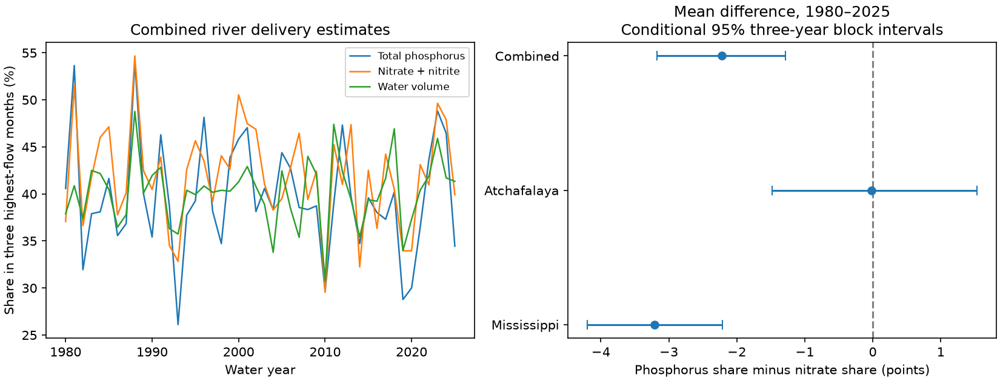

# The mean phosphorus share in three high-flow months was below nitrate in combined Gulf river estimates for 1980-2025

The three highest-flow months of each water year held a smaller mean share of total phosphorus load than nitrate plus nitrite load in the combined Mississippi and Atchafalaya estimates. The shares were 39.685% and 41.909%. The paired mean difference was -2.224 percentage points. Its conditional 95% three-year block interval was -3.179 to -1.282 points. This is a result about a fixed set of USGS estimates. It does not establish a physical cause or a change in nutrient sources.

## Question and prior evidence

Do the highest-flow months carry a larger share of phosphorus than nitrate, and did the difference change between two equal parts of 1980-2025? This matters because nutrient timing affects the inputs available to coastal systems. We tested load shares, not total nutrient mass, hypoxic area, or biological recovery.

Kamrath and Yuan (2023), doi:10.1016/j.jenvman.2023.117598, studied nutrient export in flow classes in smaller Midwestern watersheds. That work supports a test of export timing but does not give a prediction for monthly load shares at the two large river outlets. We read its abstract and search excerpts. Monthly means can hide short flood peaks.

Before choosing this question, we searched the shared SCI campaign for earthquakes, ocean season, nitrate, and high-flow load concentration. We read the verified text of sci:sha256:8329fbb481988e1341423dce49ffbf4dd7e100fc746028cbbab91ba80bee372f. It tested May nitrate share in the same source release. We also inspected its extraction code. We use the same date conversion and daily flux units, but write a new extraction and analysis for flow-ranked months and three nutrient forms. The data overlap. This is not independent confirmation of that prior result. The novelty search was focused, not exhaustive.

The primary contrast was the combined-river mean total phosphorus share minus nitrate share in the three highest-flow months. We chose it before we saw load-share results. We did not register a plan. Separate sites, one or six selected months, volume ranking, ordinary WRTDS output, and the period contrast are secondary checks. After we saw the small primary gap, we added a bounded-error stress test. All calculated comparisons are retained, including null results.

## Data

We use the USGS release by Brian J. Klager, version 3.0, revised 27 May 2026, doi:10.5066/P1BCA8QV. STFR is Mississippi River near St. Francisville, water-quality site 07373420. MELV is Atchafalaya River at Melville, site 07381495. Flow comes from Army Corps sites at Tarbert Landing and Simmesport. The USGS release page states CC0 1.0 Universal. Source credit and data terms are in files/EXTERNAL_DATA_NOTICE.txt.

The exact shared input is:

    /mnt/dell-data/shared_datasets/usgs-gulf-loads-v3-202605-elists-zip/eLists.zip

The archive has 93,810,766 bytes and SHA-256:

    909138f3f83b24ff4fb9837c1b23873d91e721842e0730fd5ddfcb8ef535a55a

We use six RDS members: K models for TP, NO3_NO2 and OP at each site. Their hashes are in files/member_hashes.json. TP is total phosphorus as P. NO3_NO2 is filtered nitrate plus nitrite as N, called nitrate below. OP is filtered orthophosphate as P. These are not measurements of identical nutrient pools.

Each selected member has all 16,802 dates from 1979-10-01 through 2025-09-30. We check unique dates, the exact daily sequence, finite positive flow and loads, and identical flow across nutrient members within each site. An initial check of sediment found 39 missing days at MELV. We excluded sediment before the load-share analysis. No source data were altered. The archive stays external. Small monthly sums and derived results are included.

## Method

A water year starts in October and ends in September of its named year. We sum daily GenFlux in kg/day to monthly kg. This is the archived WRTDS-Kalman estimate, called K here. We do not fit new source models or regenerate their random draws. We sum Q times 86,400 to monthly water volume in cubic metres. Monthly mean discharge equals volume divided by days and 86,400. We rank the 12 monthly mean discharges within each water year, then choose the highest three. A stable sort resolves ties in ascending calendar-month order. There are no missing months in the analyzed inputs.

For the combined series, we add the two rivers' monthly volumes and loads before ranking and computing shares. Separate-site ranks can differ. For each nutrient and year, share is 100 times load in the chosen months divided by load in all 12 months. We subtract nitrate share from TP share within each year. We then average those differences across 46 years. Each year has equal weight. This is not a ratio of pooled loads across all years. Annual scaling of a nutrient series by a common factor cannot change its within-year share.

The primary uncertainty calculation resamples circular three-year blocks from the 46 yearly records. Each draw has 46 years after truncation. All nutrients and sites use the same year indices, so pairing is retained. There are 20,000 draws, with seed 731109. The interval uses the 2.5th and 97.5th percentiles. One- and five-year blocks are checks. This procedure assumes that year blocks are exchangeable enough for this use. It is conditional on the archived load estimates. It does not include source-model error, measurement error, or future revisions. It is not a confidence interval for a causal effect. There is no multiple-comparison adjustment; only the stated combined three-month contrast is primary.

For the secondary period comparison, we subtract the mean for 1980-2002 from the mean for 2003-2025. We resample each 23-year period separately, with paired river and nutrient years. This describes actual estimated delivery under the flow in those years. It is not a flow-normalized trend test or a management assessment. EGRET documentation recommends flow-normalized output for concentration and load trend assessment. Our target is a share of actual estimated delivery, and our period comparison must not be read as such a trend assessment.

## Results

| Series, three months, K | Mean TP share (%) | Mean nitrate share (%) | Paired difference (points) | Conditional 95% interval (points) |
|---|---:|---:|---:|---:|
| Combined rivers | 39.685 | 41.909 | -2.224 | -3.179 to -1.282 |
| Mississippi | 39.015 | 42.226 | -3.210 | -4.196 to -2.215 |
| Atchafalaya | 41.025 | 41.042 | -0.016 | -1.477 to +1.530 |

The combined difference was negative in 33 of 46 years. Leaving out one year at a time gives means from -2.414 to -2.066 points. The two sites do not give the same result. We did not test whether their differences are statistically distinct.

The combined mean water-volume share was 40.182%. The OP share was 35.417%. TP exceeded OP by 4.268 points, with a conditional interval of 3.148 to 5.394. Thus the ordering of load shares depends on nutrient form. The simple expectation that phosphorus must have a larger high-flow share than nitrate does not hold for this monthly outlet product. Season, dilution, source mixing, retention, and source-model structure are possible explanations. We did not separate them. The TP-versus-OP comparison is consistent with different transport of phosphorus forms, but cannot identify sediment transport or erosion as the cause.

The combined TP-minus-nitrate difference changed from -2.599 points in 1980-2002 to -1.850 in 2003-2025. The change was +0.750 points, with a conditional interval of -1.062 to +2.605. This gives no clear period change. The individual TP, nitrate and OP share changes also have intervals that include zero. A null interval does not prove a constant share.

| Combined-river check | Mean TP-minus-nitrate share (points) | Conditional 95% interval (points) |
|---|---:|---:|
| Three months, one-year blocks | -2.224 | -3.378 to -1.046 |
| Three months, five-year blocks | -2.224 | -3.032 to -1.436 |
| Three months ranked by volume, three-year blocks | -2.477 | -3.435 to -1.513 |
| Three months, ordinary WRTDS, three-year blocks | -2.482 | -3.681 to -1.236 |
| Six months, K, three-year blocks | -2.709 | -3.542 to -1.854 |
| One month, K, three-year blocks | -0.407 | -1.726 to +0.839 |

The one-month check does not resolve a difference. Ordinary WRTDS uses FluxDay from the same six source members. It shares data and model structure with K. It is not independent validation.

## Source-error stress test

The narrow year-block interval does not measure source accuracy. We tested how small bounded temporal load errors could erase the primary point gap. Keep flow and the selected months fixed. Increase TP loads in selected months by a fraction e, and decrease TP loads in other months by e. Reverse those signs for nitrate. Recompute each share and its yearly mean. For an original fractional share s, the increased share is (1+e)s / [(1+e)s + (1-e)(1-s)]. The decreased share uses the opposite signs.

The mean gap becomes zero at e = 0.023326, or 2.33%. At 1% the gap is -1.271 points; at 3% it is +0.637 points. This is a deliberately opposed error pattern, not an estimate of error magnitude or probability. It shows that the sign of the small product-level gap is not secure against all modest temporal source errors. A constant error factor over the whole year would cancel in each share. We need joint time-resolved source uncertainty to assess the real risk of a sign change.

## Audit, limits, and use

A separate standard-library program recomputes the primary yearly shares from the monthly evidence. It checks 552 annual scalar values and all reported primary mean and period point estimates within 1e-10 points. It does not independently validate the USGS model or bootstrap coverage. A full extraction and a second analysis run reproduced the saved evidence and results. Files/checks.json gives software versions, seed and sizes.

These are modeled daily loads between water-quality samples. Monthly aggregation removes flood peaks and within-month sequences. Only two outlets and one fixed release are tested. The sites share upstream inputs. Nutrient forms differ. We did not control calendar season, fit a causal model, or estimate hypoxia. The source-error stress test limits confidence in the physical interpretation even where conditional year-block intervals exclude zero. The useful output is a reproducible paired load-timing benchmark and a quantitative warning about its source-error sensitivity.

## Reproduction

From the publication root, use Python 3.12 with numpy, pandas and matplotlib. The extraction also needs rdata==1.1.0; install it in a private environment. Do not change the shared environment.

    python files/analyze.py --output /tmp/flow-share-repeat
    python files/audit.py --output /tmp/flow-share-audit.json
    python files/error_bound.py --output /tmp/flow-share-error-bound.json

Use a new analysis output directory. The analysis writes annual_shares.csv, summary.csv, checks.json and result.png. The main result can be reproduced from the bundled monthly.csv without the large archive. For full extraction from shared data:

    python files/extract.py /mnt/dell-data/shared_datasets/usgs-gulf-loads-v3-202605-elists-zip/eLists.zip /tmp/flow-share-extracted
    python files/analyze.py --monthly /tmp/flow-share-extracted/monthly.csv --output /tmp/flow-share-full-repeat

For a different machine, retrieve the fixed archive into external scratch:

    python files/retrieve.py /tmp/flow-share-source

The retrieval program checks size and SHA-256. It never writes raw data into the publication. The ScienceBase endpoint can change or refuse access; use the DOI to locate the version and require the recorded hash. Network access to ScienceBase was not retested here because the shared archive was available. Our direct shell request to the USGS page failed DNS; the web research tool supplied the release metadata and rights statement.

## Worker record

Job: sci-1107-dell-earth-and-ocean-sciences-7aefa7d9b29e. Topic: earth-and-ocean-sciences. Campaign: 11_07_2026. Machine: dell. Account: codex-myxtap. Model: gpt-6.1-sol, high reasoning effort, through Codex in T3 Code. Date: 2026-11-09. The campaign-machine signing key is not a personal authorship claim. No private key is included. No agents were launched. This study ends with a local signed bundle; it makes no remote submission.
