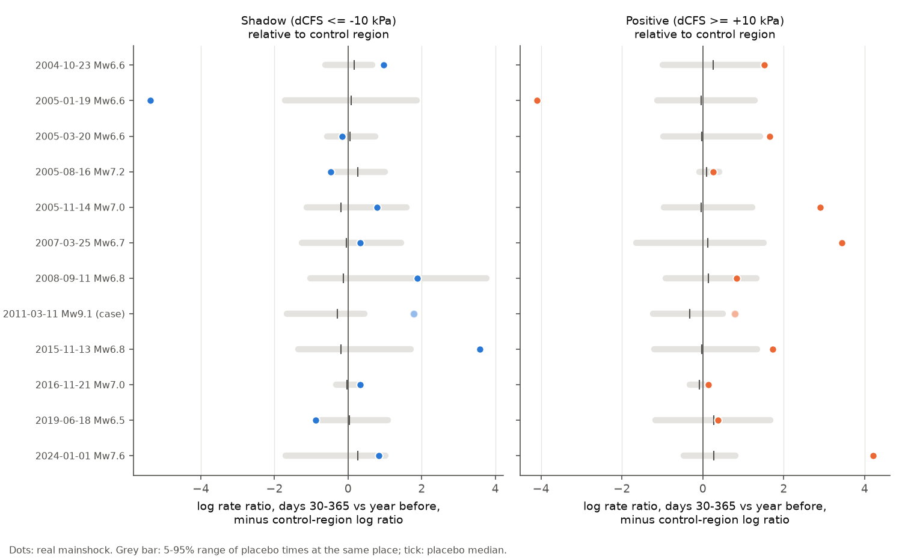
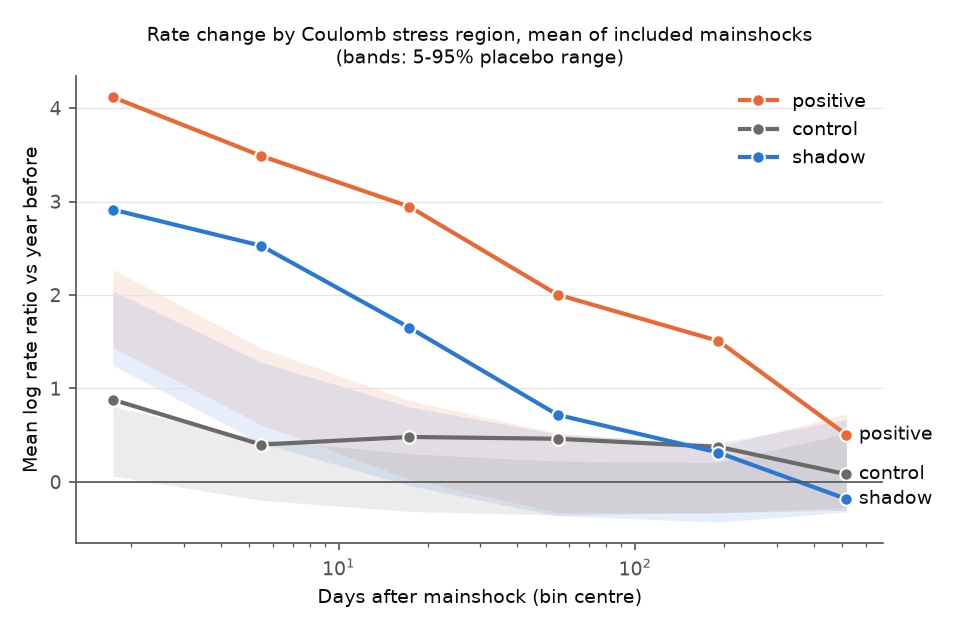
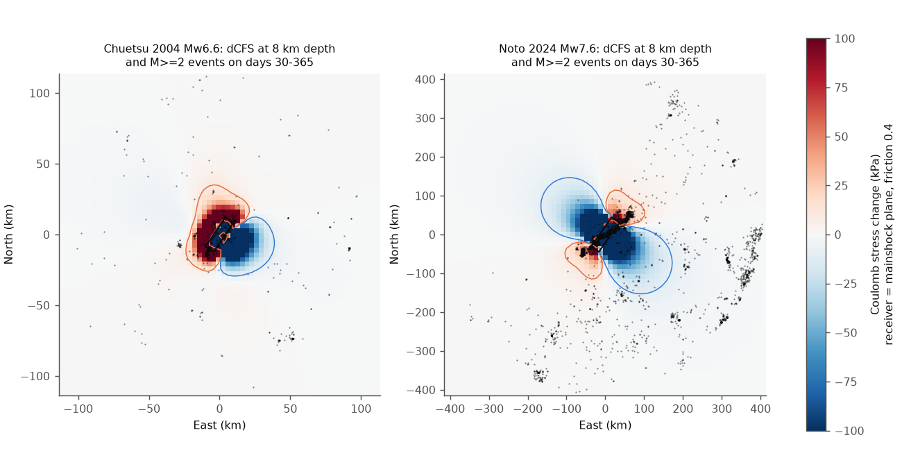

# Static Coulomb stress shadows did not decrease JMA earthquake rates in the first year after 11 shallow Mw 6.5+ Japanese earthquakes (1999-2024)

## Summary

A static Coulomb stress decrease ("stress shadow") should lower the rate of later earthquakes. This hypothesis is a basis of physics-based aftershock forecasts, but tests often find no clear rate decrease. We tested it with the Japan Meteorological Agency (JMA) unified hypocentre catalogue for 1998-2024 and GCMT focal mechanisms.

We modelled 11 shallow Mw 6.5+ mainshocks in and near Japan that passed fixed isolation rules. For each mainshock, we calculated the Coulomb stress change (dCFS) at the hypocentre of each JMA event within the analysis radius. We used a tapered rectangular rupture in an elastic half-space. The receiver faults had the orientation of the mainshock fault plane, and the effective friction was 0.4. We compared event rates in days 30-365 after the mainshock with rates in the year before. We used three regions: shadow (dCFS <= -10 kPa), positive (dCFS >= +10 kPa) and control (|dCFS| < 1 kPa). A null distribution came from placebo mainshock times at the same place.

Main results (days 30-365, 11 mainshocks):

- **Positive regions:** the rate increase was larger than in the control regions. The mean log rate-ratio difference was +1.09 above placebo (90% placebo interval +0.74 to +1.43, p < 0.001). This shows that the stress model finds where rates increase.
- **Shadow regions:** we found no rate decrease relative to the control regions. The difference was +0.10 (90% interval -0.31 to +0.52, one-sided p for a decrease = 0.67). A rank-based test agreed (mean placebo percentile 0.57). The data exclude a mean relative decrease of more than 27% (one-sided 95%).
- **Shadow regions, absolute rates:** the rates increased. The mean log rate ratio was +0.55 above placebo (about 1.7 times, 90% interval 1.2 to 2.5 times).
- **Sensitivity:** in 12 variants of the days 30-365 test, and in the windows for days 1-30 and 30-120, no variant showed a shadow decrease. Most variants showed shadow increases.
- **Year 2:** in days 365-730 the shadow regions were lower than the control regions (-0.42, one-sided p = 0.084, 10 mainshocks). This signal was weaker with the 18-mainshock selection (-0.05, p = 0.44) and with receivers on both nodal planes (-0.16, p = 0.30). We do not consider it a result.
- **Tohoku 2011 (separate case study):** this event failed the isolation rules. Across its whole 400 km zone, shadow-region rates increased by a factor of about 7.5 relative to the year before.

Limitations: the slip models are simple uniform-taper rectangles from scaling relations, with no finite-fault inversions. The receivers are mainshock-like. The sample is small, and the isolation rules were changed once after a first look (see Section 6). JMA detection changes with time and place.

## 1. Question

Do static Coulomb stress shadows from large shallow Japanese earthquakes produce detectable decreases in earthquake rates? If not, how large can such a decrease be, given the data?

Background: King et al. (1994) and Harris (1998) described static stress triggering. Toda et al. (2012) reported shadows after Tohoku 2011 in some regions. Felzer and Brodsky (2005) found no evidence for shadows in California. Mallman and Zoback (2007) found that Coulomb models did not predict rate decreases in southern California and southwestern Japan. Earlier work in this campaign tested other aftershock controls in the JMA catalogue (heat flow, volcanoes, b-value, typhoons), but not static stress shadows.

## 2. Data

- **JMA unified hypocentre catalogue**, annual files h1998.zip to h2024.zip (https://www.data.jma.go.jp/eqev/data/bulletin/data/hypo/). We read the files in place from the campaign shared store (`/mnt/dell-data/shared_datasets/jma-hypocenter-hYYYY-20261109/`). We parsed 4,774,387 hypocentres. We used the 4,597,609 events with subsidiary flag 1 (natural earthquake), depth <= 40 km and Mj >= 0.5. The parser follows campaign bundle 031fd1c65072. The SHA-256 hashes of all 27 archives are in `files/provenance/input_sha256.json`.
- **Global CMT catalogue**: `jan76_dec20.ndk` from the shared store (sha256 baed5ad2...) and monthly files for 2021-2024 (NEW_MONTHLY). We downloaded the monthly files on 2026-11-09. Their hashes are in `files/provenance/input_sha256.json`.

The raw catalogues and the per-event tables are not in this package (see `NOTICE-external-data.md`). The package contains our code, the mainshock source table, aggregated counts, summary statistics and figures.

## 3. Methods

All rules in this section were fixed before we calculated the rate statistics, with one exception (Section 6).

**Mainshock candidates.** GCMT Mw >= 6.5, centroid depth <= 40 km, 30-46 N, 128-148 E, origin time 1999-01-01 to 2024-01-02. This gave 38 candidates.

**Fault size.** We used the Strasser et al. (2010) interface relations for reverse events (rake 45-135) with dip <= 35 and Mw >= 7.0. For other events we used the Wells and Coppersmith (1994) subsurface relations by slip type. For crustal events (centroid depth <= 20 km), we limited the width to 20 km / sin(dip). The analysis radius was R = min(max(4L, 100 km), 400 km) from the rupture rectangle.

**Isolation rules (primary, v2).** We excluded a mainshock in these cases:
1. A GCMT Mw >= 6.5 event (depth <= 70 km) occurred in the year before the mainshock.
2. A larger event occurred in the 3 years before.
3. A larger event occurred in the 395 days after.

For each rule, the other event had to be within R + L/2 + L_other/2 + 30 km of the mainshock centroid. Of the 38 candidates, 11 passed. Tohoku 2011 failed rule 1, so we kept it as a separate case study.

**Fault plane and position.** We used the JMA events of M >= 2.0 in the first 2 days. The rupture centre was the median hypocentre of these events. The fault plane was the GCMT nodal plane with the smaller median perpendicular distance to these events. The chosen planes agree with published fault models for Tottori 2000, Chuetsu 2004, Fukuoka 2005, Kumamoto 2016 and Noto 2024.

**Stress calculation.** Each source was a rectangle with 10 by 5 patches (100 triangles) and a cosine slip taper on the outer 25%. The mean slip came from the GCMT moment, with a shear modulus of 30 GPa and a Poisson ratio of 0.25. We calculated stress with the half-space triangular dislocation solution of Nikkhoo and Walter (2015), as implemented in `cutde` 26.3.6. We did not assume the cutde slip convention. For each triangle, we measured the displacement jump for unit local slips and solved for the slip that gives the required hanging-wall motion (`files/code/coulomb.py`). Checks:
- On a right-lateral vertical fault, dCFS was -1.07 MPa on the fault, +314 kPa beyond its tips and -72 kPa at its side.
- A thrust fault lifted the surface above its hanging wall.

We calculated stress on a 3-D grid (spacing clip(R/30, 3, 12) km horizontally; depths 0.5, 4, 8, ..., 40 km) and interpolated it linearly to each hypocentre.

**Coulomb stress change.** dCFS = d(tau) + mu' d(sigma_n), with tension positive. The shear stress is along the receiver rake. The primary receivers had the strike, dip and rake of the mainshock fault plane, and mu' = 0.4.

**Rate statistics.** The windows were 372 to 7 days before the mainshock and 30 to 365 days after it. We used only events at least 10 km from the rupture. For each window pair, we set the magnitude of completeness Mc to the larger maximum-curvature value of the two windows, plus 0.2.

For each region k, the log rate ratio is A_k = log((N_after + 0.5)/T_after) - log((N_before + 0.5)/T_before). The relative statistic is S_k = A_k - A_control. The control region removes changes common to the whole zone, for example changes in detection.

**Placebo null.** We used placebo times t' on a 30-day grid. The same isolation rules applied at each t': no Mw >= 6.5 event in the window from t' - 372 to t' + 395 days, and no event of Mw >= the mainshock Mw in the 3 years before t'. For each placebo time, we repeated the calculation with the same geometry and the same stress values. Each mainshock had 42-254 placebo times (median 139). The pooled statistic was the mean over the 11 mainshocks. Its null came from 20,000 draws of one random placebo per mainshock. We report the effect (observed minus null mean), a 90% interval (effect +/- 1.645 null SD) and one-sided p values. A rank-based test used the mean placebo percentile of each mainshock.

## 4. Results

### 4.1 Primary test (days 30-365)

| Statistic | Effect vs placebo | 90% interval | p (decrease) | p (increase) |
|---|---|---|---|---|
| S_shadow (shadow minus control) | +0.10 | -0.31 to +0.52 | 0.67 | 0.33 |
| S_positive (positive minus control) | +1.09 | +0.74 to +1.43 | 1.00 | <0.001 |
| A_shadow (absolute) | +0.55 | +0.18 to +0.92 | 0.99 | 0.011 |
| A_control (absolute) | +0.45 | +0.26 to +0.64 | 1.00 | <0.001 |

Summed over the 11 mainshocks:
- Shadow regions: 2,637 events before and 5,321 after.
- Positive regions: 2,913 before and 12,068 after.
- Control regions: 17,030 before and 16,083 after.

The control regions also show a positive A_control relative to placebo, because their counts do not decrease as much as typical placebo counts. Shadow-region rates were below the control-region rates for 4 of the 11 mainshocks. In the rank test, the mean placebo percentile for S_shadow was 0.57 (p for a decrease = 0.79), and for S_positive it was 0.82.

One mainshock (2005-01-19, offshore, Mc 3.5) had very few events (4 before and 0 after in the shadow region), which gives an extreme S value. The rank test is not sensitive to this.

### 4.2 Time course

Mean log rate ratios relative to the year before, for the 11 mainshocks:

| Days | 1-3 | 3-10 | 10-30 | 30-100 | 100-365 | 365-730 |
|---|---|---|---|---|---|---|
| Positive | 4.12 | 3.49 | 2.95 | 2.00 | 1.51 | 0.51 |
| Shadow | 2.91 | 2.53 | 1.65 | 0.72 | 0.31 | -0.18 |
| Control | 0.88 | 0.40 | 0.48 | 0.46 | 0.38 | 0.08 |

Shadow-region rates increased strongly in the first month. Then they decreased to the control level by days 100-365. In year 2 they were slightly lower than the control level, but inside the placebo range.

### 4.3 Sensitivity (S_shadow, effect vs placebo)

| Variant | Effect | 90% interval | p (decrease) |
|---|---|---|---|
| primary | +0.10 | -0.31 to +0.52 | 0.67 |
| friction 0.0 | -0.07 | -0.47 to +0.33 | 0.39 |
| friction 0.8 | +0.22 | -0.21 to +0.65 | 0.81 |
| receivers on auxiliary plane | +0.46 | +0.04 to +0.88 | 0.96 |
| both receiver planes agree | +0.56 | +0.13 to +1.00 | 0.98 |
| source on auxiliary plane | +0.97 | +0.53 to +1.40 | 1.00 |
| minimum distance 5 km | +0.61 | +0.21 to +1.01 | 0.99 |
| minimum distance 20 km | +0.12 | -0.31 to +0.54 | 0.69 |
| thresholds +/-1 kPa, control 0.1 kPa | -0.07 | -0.54 to +0.41 | 0.40 |
| thresholds +/-100 kPa | +0.72 | +0.19 to +1.26 | 0.99 |
| control only beyond 2L | +0.18 | -0.24 to +0.59 | 0.77 |
| Mc + 0.5 | +0.31 | -0.19 to +0.80 | 0.85 |
| days 1-30 | +1.37 | +0.88 to +1.86 | 1.00 |
| days 30-120 | +0.36 | -0.09 to +0.82 | 0.91 |
| days 365-730 | -0.42 | -0.94 to +0.10 | 0.084 |
| first selection (v1, 18 mainshocks) | +0.46 | +0.15 to +0.77 | 0.99 |
| v1, days 365-730 (17) | -0.05 | -0.47 to +0.37 | 0.44 |
| days 365-730, friction 0.0 | -0.51 | -1.01 to -0.00 | 0.040 |
| days 365-730, both receiver planes | -0.16 | -0.67 to +0.35 | 0.30 |

The full table, with S_positive, A_shadow and A_control, is in `files/results/summary_effects.csv`. The rank test is in `summary_rank_test.csv`.

Notes:
- With the source on the wrong nodal plane, many aftershocks fall in the "shadow" regions. The plane choice from early aftershocks is therefore necessary.
- Strong shadows (<= -100 kPa) had larger increases. Most of these points are near the rupture, where a simple slip model has the largest errors.
- The year-2 decrease reached p < 0.05 in only 1 of 4 versions. We tested 19 analysis versions and did not correct for multiple tests. We report the year-2 decrease as a hypothesis for a test with a larger sample.

### 4.4 Tohoku 2011 case study

We used the Strasser et al. (2010) scaling for Mw 9.1. This gives L = 718 km and W = 208 km, which is longer than published slip models (about 400-500 km). Within 400 km of the rupture, the shadow-region events increased from 7,967 in the year before to 55,256 in days 30-365. The control regions changed from 712 to 830 events. S_shadow was +1.78, higher than all 15 valid placebo times. This test covers the whole zone. It does not test the specific inland shadow regions that Toda et al. (2012) reported.

## 5. Interpretation

Positive static stress changes found where the rate increases were largest. Negative stress changes did not find rate decreases in the first year. In shadow regions, the rates increased at first and then went back to approximately the control level. This agrees with Felzer and Brodsky (2005) and Mallman and Zoback (2007), and with the hypothesis that dynamic triggering, afterslip or slip-model error overprint static shadows in the first year. Two causes can explain the early shadow increases:

1. A real response that static stress does not explain.
2. Location of the true slip and aftershocks outside the simple rectangle.

Our data cannot separate these causes.

## 6. Change after a first look, and other limitations

- **Change after a first look.** In the first version (v1), the isolation rules used the distance between centroids, with a limit of R. Events, however, were selected by distance from the rupture. After a first look at 14 mainshocks, we changed the limit to R + L/2 + L_other/2 + 30 km for both real and placebo times (v2). This removed Tottori 2000, Tokachi-oki 2003, Chuetsu-oki 2007, the 2008 Ibaraki-oki event, Fukushima-Hamadori 2011, the 2014 Fukushima-oki event and Kumamoto 2016. The v1 result (18 mainshocks) has a more positive S_shadow (+0.46). Both versions show no shadow decrease.
- The slip models are tapered uniform rectangles from scaling relations. Real ruptures have heterogeneous slip. Near-fault dCFS values have large errors. We used a minimum distance of 10 km and tested 5 and 20 km.
- The receivers are mainshock-like. We did not use optimally oriented planes or local focal mechanisms, which can change the shadow regions.
- JMA Mj is not Mw. The detection threshold changes in space (offshore) and in time (network growth, and the processing change in April 2016). The relative statistic S and the placebo times reduce these effects, but they do not remove all of them.
- The placebo times come from other years. A long-term trend at one place can make the null different from the conditions at the real mainshock time.
- The sample is small (11 mainshocks). The pooled statistic gives equal weight to all mainshocks, and some have few events.
- We did not model pore-pressure changes, postseismic relaxation or afterslip.

## 7. Reproduction

Software: Python 3.12.15, numpy 2.5.4, pandas 3.1.1, scipy 1.18.1, matplotlib 3.11.2, pyproj 3.8.0, pyarrow 26.0.1, cutde 26.3.6 (`uv pip install --target work/pylib --no-deps cutde`).

The scripts expect this layout: `work/result/files/code/`, `work/derived/`, `work/raw/gcmt/`, and `datasets/` next to `work/`.

1. `bash 00_fetch_data.sh <scratch>`: downloads the JMA and GCMT files into a separate scratch folder (not into this package). Compare the files with `files/provenance/input_sha256.json`.
2. `python 01_parse_jma.py`: parses the JMA files into `derived/jma_1998_2024.parquet`.
3. `python 02_gcmt.py`: parses GCMT and lists the candidates.
4. `PYTHONPATH=pylib python 03_sources.py`: applies the isolation rules, chooses the fault plane and sets the rupture size.
5. `PYTHONPATH=pylib python 04_stress_grid.py primary 6`, then the same with `aux`: calculates the stress grids. This took about 60 minutes on 6 processes on a loaded machine.
6. `PYTHONPATH=pylib python 05_events.py primary`, then the same with `aux`: attaches dCFS to each event.
7. `python 06_stats.py`: runs all variants with the placebo tests (seed 20261109).
8. `python 07_timecourse.py`, `PYTHONPATH=pylib python 08_figures.py`, `python 09_summary.py`.

To make the v1 selection table for the `selection_v1` variants, run the first version of `03_sources.py`: replace `reach` with `R`. The v1 table is in `files/results/mainshock_selection_v1.csv`. `files/results/` holds the per-mainshock counts and statistics for every variant (`per_mainshock_<variant>.csv`), the placebo statistics for the primary variant, the pooled and rank summaries and the time-course tables. You can use these files to check all numbers in this README without the raw catalogue.

## 8. Provenance

- Campaign 11_07_2026. Job sci-1107-hp-earth-and-ocean-sciences-f9b0fa4b083c, topic earth-and-ocean-sciences, machine hp, account claude-myxtap.
- Model: Claude Opus 5.5 (claude-opus-5-5), working as an autonomous research agent. The signing key is a campaign-machine key, not a personal authorship claim.
- Data access: 2026-11-09.

## References

- Dziewonski, A. M., Chou, T.-A., Woodhouse, J. H. (1981). J. Geophys. Res. 86, 2825-2852. doi:10.1029/JB086iB04p02825
- Ekström, G., Nettles, M., Dziewonski, A. M. (2012). The global CMT project 2004-2010. Phys. Earth Planet. Inter. 200-201, 1-9. doi:10.1016/j.pepi.2012.04.002
- Felzer, K. R., Brodsky, E. E. (2005). Testing the stress shadow hypothesis. J. Geophys. Res. 110, B05S09. doi:10.1029/2004JB003277
- Harris, R. A. (1998). Introduction to special section: Stress triggers, stress shadows, and implications for seismic hazard. J. Geophys. Res. 103, 24347-24358. doi:10.1029/98JB01576
- King, G. C. P., Stein, R. S., Lin, J. (1994). Static stress changes and the triggering of earthquakes. Bull. Seismol. Soc. Am. 84, 935-953.
- Mallman, E. P., Zoback, M. D. (2007). Assessing elastic Coulomb stress transfer models using seismicity rates in southern California and southwestern Japan. J. Geophys. Res. 112, B03304. doi:10.1029/2005JB004076
- Nikkhoo, M., Walter, T. R. (2015). Triangular dislocation: an analytical, artefact-free solution. Geophys. J. Int. 201, 1119-1141. doi:10.1093/gji/ggv035
- Strasser, F. O., Arango, M. C., Bommer, J. J. (2010). Scaling of the source dimensions of interface and intraslab subduction-zone earthquakes with moment magnitude. Seismol. Res. Lett. 81, 941-950. doi:10.1785/gssrl.81.6.941
- Thompson, B. cutde: CUDA, OpenCL and C++ enabled fullspace and halfspace triangle dislocation elements. https://github.com/tbenthompson/cutde
- Toda, S., Stein, R. S., Beroza, G. C., Marsan, D. (2012). Aftershocks halted by static stress shadows. Nature Geosci. 5, 410-413. doi:10.1038/ngeo1465
- Wells, D. L., Coppersmith, K. J. (1994). New empirical relationships among magnitude, rupture length, rupture width, rupture area, and surface displacement. Bull. Seismol. Soc. Am. 84, 974-1002.
- Campaign bundle 031fd1c65072 (JMA parser and onshore aftershock tests).
