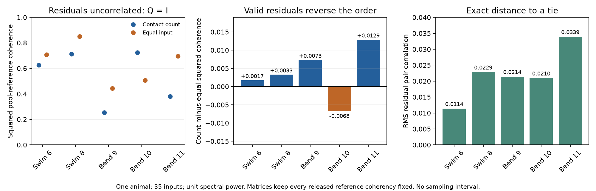
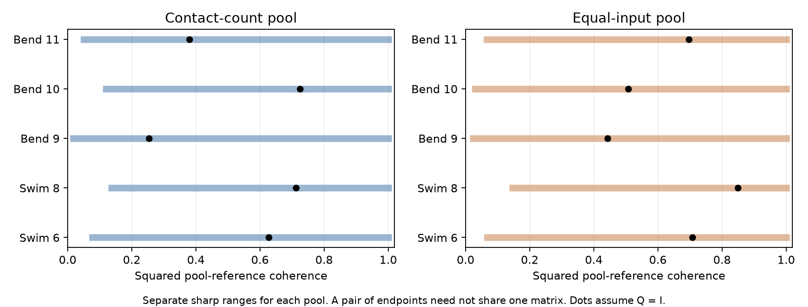

# Residual correlations with RMS below 0.035 reverse pooling order in five selected leech trial models

The released reference spectra do not fix which of two positive input pools has greater coherence with a leech motor neuron. We tested contact-count weights and equal-input weights in 35 mapped inputs to DE-3R. Each input and the reference had unit spectral power in the model. With uncorrelated residual inputs, equal weights gave greater squared coherence in four trials. Count weights gave greater squared coherence in one trial. Valid spectral matrices reversed each order while keeping every released input-to-reference value fixed. The residual pair correlation RMS was below 0.035 in all five reversal examples.

These are model compatibility results. They are not measured residual correlations, confidence intervals, or evidence that either weight rule is better in the animal.



The left panel assumes uncorrelated residual inputs after projection on DE-3R. The middle panel uses a separate valid residual matrix in each trial. Its perturbation is 1.02 times the nearest tie perturbation. Positive bars favor count weights; negative bars favor equal weights. Each sign is opposite to its sign in the left panel. The right panel gives the exact RMS distance to a tie. A tie is a minimum; the threshold for strict reversal is its infimum. No animal sampling interval is shown.

## Question and prior work

Can a single-reference activity summary support a preference for anatomical contact-count weights over equal-input weights? This matters when a model uses anatomy to form a reliable activity pool. A sum of individual coherencies gives a pool's cross-spectrum with the reference. The pool's own power also depends on spectra between the inputs.

Ashaber and colleagues linked electron microscopy and voltage imaging in the same leech ganglion [1]. This gives a direct anatomical match. We use their fixed public source [2]. We searched the signed campaign for neural structure, connectome dynamics, Allen connectivity, reliability, synphys, leech, pooling, residual coherence, and weights. Allen slice studies were already numerous. We chose a direct same-animal link instead of a link between unrelated resources.

We read three close campaign results. The count study tested repeated single-input coherence [3]. The weighted-change study tested trial changes in a sum of reference coherencies and explicitly distinguished that sum from coherence of pooled signals [4]. The spectral-completion study found that the same reference summaries permit both signs of a spatial synchrony contrast [5]. We reuse their source version and sample definitions. We add a different endpoint: the coherence order of two pools under one common spectral matrix, and the exact distance from an uncorrelated-residual model to a tie. This is new analysis of the same animal, not independent experimental replication. Prior code and record tables were not copied into this package. The pinned source retrieval metadata were adapted from [5].

The importance of covariance structure for neural readouts is established [6]. Positive semidefinite correlation constraints and matrix nearness are also established [7]. Our short proof uses these basic ideas and Cauchy-Schwarz. We make no broad priority claim for those methods or for matrix completion.

## Data and model scope

We read 13 unchanged files from `./datasets/ashaber2021-leechem-*`, under the HP shared store's compatibility path `/mnt/dell-data/shared_datasets`. The source version is repository commit `bee0897e8f4ef2b0a9e4cdb1a9f8ab4e3a9b2ac2`. `files/provenance.json` records each exact logical path, resolved path, URL, byte count, and SHA-256. `files/sources.json` is the portable retrieval recipe. No raw data download was needed.

The database was opened read-only. We counted distinct source-tree and site-ID pairs with a type-5 source node and a type-6 node on target tree 444, DE-3R. Repeated node annotations do not multiply a contact. The snapshot has 135 input trees and 527 such pairs. The article reports 531 final input synapses. We do not resolve that difference. A tree can be a fragment of a neuron.

A mapping table links 45 input trees to imaging ROIs. Requiring at least two contacts gives 35 inputs and 271 contacts. The primary analysis uses that sample without a coherence cutoff. Trials 6 and 8 are swim. Trials 9, 10, and 11 are left local bend. Each released summary has 250 ROIs. Reference ROI 174 has magnitude one and phase zero within rounding error. It is not in the input samples.

For each trial, we set `z_i = magnitude_i exp(i phase_i)`. The primary interpretation treats magnitude as the modulus of complex coherency. A sensitivity check uses its square root. We treat the summaries as exact at each trial's reference frequency. We do not use raw traces, spectral uncertainty, or frequency-wide activity. Separate residual matrices are allowed in separate trials.

The readouts use positive weights on standardized input activity. Count weights are `a_i = contact_count_i / total_contacts`. Equal weights are `e_i = 1/n`. They are fixed across the five trials within each sample. They are not conductance estimates. Contact sign, release probability, terminal power, dendritic filtering, and physical input-current units are absent.

## Method

Let `r_i = sqrt(1-|z_i|^2)`. Every valid normalized input spectral matrix has the form

    C = z z* + diag(r) Q diag(r),
    Q positive semidefinite, diag(Q) = 1.

Q describes residual input coherency after linear projection on the motor reference. Q=I means uncorrelated residuals at this frequency. It does not mean statistical independence or independent trial noise. Each such Q gives a valid full reference-plus-input matrix. This condition is the Schur complement used in the prior spatial study [5].

For weights a, let `k_a = |a^T z|^2` and `u_a = a*r`. The squared coherence of the pool with the reference is

    H_a(Q) = k_a / (k_a + u_a^T Q u_a).

We compare both pools using the SAME Q. Cross multiplication gives

    sign(H_a-H_e) = sign(tr(B Q)),
    B = k_a u_e u_e^T - k_e u_a u_a^T.

Let `d=tr(B)` and let `B_off` be B with zero diagonal. The nearest tie to Q=I, without a positivity constraint, is

    Q_star = I - d B_off / ||B_off||_F^2.

If Q_star is positive semidefinite, the exact RMS distance to a valid tie is

    epsilon_star = |d| / (||B_off||_F sqrt(n(n-1))).

This is the RMS of off-diagonal residual correlations over all distinct input pairs. Cauchy-Schwarz proves that no smaller distance can reach a tie. We check positivity before calling this value sharp. `files/proof.md` gives the derivation, the complex-matrix case, individual pool ranges, and the fallback when positivity fails. Our reversal examples use `Q_reverse = I + 1.02*(Q_star-I)`, and each passes a separate positivity check.

The internal design precedes the formula probe and records planned samples and checks. It is not a public preregistration. An exploratory check added a limit on every residual pair rather than its RMS. The first full script run stopped at an overly strict reference phase check. Trial 9 has reference phase 3.37e-14 radians. We changed the check from 1e-14 to 1e-12 and changed no phase values. `files/design.txt` records these details.

## Results

| Trial | Count H at Q=I | Equal H at Q=I | Exact RMS to tie | Count H in reversal | Equal H in reversal |
| --- | ---: | ---: | ---: | ---: | ---: |
| Swim 6 | 0.62637 | 0.70678 | 0.011381 | 0.69361 | 0.69187 |
| Swim 8 | 0.71212 | 0.84962 | 0.022857 | 0.85369 | 0.85039 |
| Left bend 9 | 0.25341 | 0.44293 | 0.021432 | 0.46950 | 0.46218 |
| Left bend 10 | 0.72448 | 0.50769 | 0.020981 | 0.75409 | 0.76085 |
| Left bend 11 | 0.37911 | 0.69663 | 0.033939 | 0.73863 | 0.72574 |

All five equality matrices are positive definite. Their minimum eigenvalues range from 0.07712 to 0.69943. Thus, the reported distances are sharp within the stated model. All five reversal matrices are also positive definite. Their RMS values range from 0.011608 to 0.034618. The reversal differences are small because these examples sit only 2% beyond a tie. Their signs differ from zero by much more than numerical error.

A small RMS does not limit every pair to that value. The largest absolute residual pair values in the five RMS reversal witnesses are 0.09973, 0.23834, 0.20149, 0.04931, and 0.33120. We therefore also checked a uniform limit. The exact maximum-pair limits needed to reach a tie are 0.01698, 0.04368, 0.04105, and 0.02295 in trials 6, 8, 9, and 10. For trial 11, we only establish a lower bound of 0.07917 and a feasible upper bound of 0.32470. The simple uniform-limit witness fails positivity there. We do not claim a sharp uniform threshold for that trial.

A nonnegative one-factor family, `Q=(1-rho)I+rho*11^T`, crosses a tie only in trial 6, at rho=0.10568. It does not reverse the other four orders for rho from zero to one. The general result therefore depends on the pattern of residual correlations, not just adding the same positive value everywhere.



Each pool separately can have squared coherence one under a valid completion that cancels its residual sum. Count-pool lower bounds range from 0.01806 to 0.13679; equal-pool lower bounds range from 0.02355 to 0.14635. These wide separate ranges do not alone prove a ranking change. The common-matrix witnesses in the table do prove it.

The all-mapped sample has 45 inputs and 281 contacts. Its five exact RMS thresholds range from 0.003108 to 0.018856. Taking the square root of the primary magnitudes gives five exact thresholds from 0.014951 to 0.031333. The strict confidence sample has 21 inputs and 191 contacts. It requires both source match scores to be at least 80 and excludes explicit postsynaptic confidence rows. Four thresholds are exact, from 0.022594 to 0.045362. Its trial 11 projection fails positivity: 0.068508 is only a lower bound, and a constructed feasible tie gives an upper bound of 0.292496. We did not solve that constrained minimum. These checks share the same animal and are not independent replications.

`files/results.csv` contains all 20 aggregate case results. Nineteen have sharp RMS thresholds. Every case has a valid opposite-order witness. Confidence annotations are not calibrated probabilities.

## Validation, interpretation, and limits

An independent checker uses site-first grouping to recount contacts. It checks all 13 source hashes, rebuilds the complex reference values, and audits 96 full spectral matrices. The minimum full-matrix eigenvalue was -1.05e-14 from roundoff; the largest diagonal error was 3.82e-13. The largest tie error was 6.67e-16. Scalar results agreed within 1.45e-15. Checks also covered 1,000 two-input examples, including 672 with an active positivity limit, and 500 random complex completions. `files/validation.json` records these checks. They validate calculations and do not validate biological assumptions.

The result gives a practical audit: before choosing anatomical weights from reference-only summaries, test how much missing residual coherence can change the comparison. Here, the conditional model order is not identified by the released summaries. This does not establish that count weights fail in the real circuit, that equal weights are optimal, or that true residual correlations resemble the constructed matrices. The closest tie is an adversarial compatibility calculation. It is not an estimate of likely correlation structure.

There is one animal, one target, a selected set of input fragments, two swim trials, and three left-bend trials. Mapping errors and missing inputs remain. Exact-summary assumptions omit measurement error. Unit power and positive readout weights do not predict physical synaptic current. Different trials can use different dominant frequencies and different residual matrices. We did not test a residual matrix fixed across trials, a causal circuit model, stimulus decoding, or behavior prediction. We make no empirical claim across animals, regions, or species. The algebra can apply to other linked datasets, but that empirical generalization remains untested.

A next study should calculate full input-to-input spectra from simultaneous raw recordings, retain spectral errors, and evaluate held-out pooling performance. More matched animals are needed for animal-level inference. A useful method extension would impose a measured residual structure or one shared across conditions, then compare the resulting thresholds. The strict-confidence trial 11 constrained minimum remains open.

## Reproduction and rights

The package includes original code, proof, figures, aggregate results, the design record, package versions, and exact source provenance. Source records and per-input spectral witnesses remain external. The fixed source repository has an LGPL 2.1 notice [2]. `files/EXTERNAL_DATA_NOTICE.txt` identifies the external materials. The SCI baseline applies to the bundled original work and does not replace source terms. No external code is imported or copied. The full method regenerates record-level derivatives in a separate directory.

Use Python 3.12 and the pinned packages in `files/requirements.txt`. From an extracted publication root, choose output directories OUT and EXT outside that root. For example:

```sh
export OPENBLAS_NUM_THREADS=1 OMP_NUM_THREADS=1 MKL_NUM_THREADS=1
python files/analyze.py --data /mnt/dell-data/shared_datasets --out ../pool_replay --external ../pool_external
python files/check.py --data /mnt/dell-data/shared_datasets --results ../pool_replay --external ../pool_external --report ../pool_replay/validation.json
```

If the source files are absent, first run `python files/retrieve.py ../new_leech_sources`, then use `--data ../new_leech_sources` in both commands. Retrieval is sequential, pinned, and hash-checked. It also preserves the source license. It never writes downloads into the signed publication. We did not repeat network retrieval because the files were already in the shared store. The unchanged-source analysis and independent checker were run here. Regeneration needs one compute process with numerical library threads set to one. No service, agent, or compute queue is needed.

The external directory holds the full per-input matrices, source counts, and exact z vectors for inspection. It is not needed for signature verification and is not part of the baseline bundle. It can be recreated from the pinned raw files. No claim relies on private scratch surviving.

## Job provenance and references

Job: `sci-1107-hp-neural-structure-and-computation-bf3ac7af6395`. Topic: `neural-structure-and-computation`. Campaign: `11_07_2026`. Machine: `hp`. Account: `codex-olen`. Model: `gpt-6.1-sol`, high reasoning effort, through the Codex harness. No agents were launched. The campaign-machine key signs the publication and is not a personal authorship claim. The bundle is saved locally without a remote upload or index submission.

[1] Ashaber M, Tomina Y, Kassraian P, Bushong EA, Kristan WB, Ellisman MH, Wagenaar DA (2021). Anatomy and activity patterns in a multifunctional motor neuron and its surrounding circuits. [eLife 10:e61881](https://doi.org/10.7554/eLife.61881). We credit these authors for the experiment and source data.

[2] [Pinned repository](https://github.com/wagenadl/leechem/tree/bee0897e8f4ef2b0a9e4cdb1a9f8ab4e3a9b2ac2) and [external source license](https://raw.githubusercontent.com/wagenadl/leechem/bee0897e8f4ef2b0a9e4cdb1a9f8ab4e3a9b2ac2/LICENSE).

[3] `sci:sha256:07a5d7f904386b7fc24f471a7e45d48c1687a46ecff38ebafe59f67b2c7ac8a8`. Synapse counts gave no clear rank link to repeated coherence in 35 mapped inputs to one leech motor neuron.

[4] `sci:sha256:ce87f5ffb0d48764ec5569137996e13275aef46960b6f9ca4f7415dd6f809fca`. Synapse-count weights gave no clear reduction in repeated coherence change in 35 inputs to one leech motor neuron.

[5] `sci:sha256:0f2db6dd56764c6b5e9c3a0413c3acc28a472517f82d8daa6ec0ec68e8648bed`. Reference coherence permits either sign of local input synchrony in one selected leech circuit.

[6] Moreno-Bote R, Beck J, Kanitscheider I, Pitkow X, Latham PE, Pouget A (2014). [Information-limiting correlations](https://doi.org/10.1038/nn.3807). Background on the role of covariance structure; the present endpoint is coherence, not Fisher information.

[7] Higham NJ (2002). [Computing the nearest correlation matrix: a problem from finance](https://doi.org/10.1093/imanum/22.3.329). Background on correlation constraints and matrix nearness; its solver is not used here.
