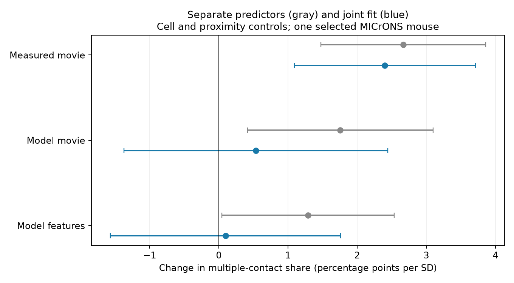

# Measured movie similarity retained a contact-count link after two model controls in one MICrONS mouse

## Result
Measured movie-response similarity retained a positive link to multiple synaptic contacts when two digital twin similarity measures entered the same model. The estimate was **2.40 (1.09 to 3.71) percentage points per standard deviation (SD)**. Parentheses give a nominal 95 percent interval. This is a conditional association in one selected mouse tissue sample.

The result shows that these two model summaries did not account for the full measured-response link under the stated linear adjustment. It does not show that the measured response is more accurate than the model. All three measures can contain error and can describe different parts of visual response.



Figure 1. Gray points show separate similarity models. Blue points show the joint model. Each model has separate source and target effects and four proximity terms. Bars are nominal 95 percent dyadic intervals. The three tests share the same data. They are not replications.

## Question and prior work
Circuit models can assign more than one synaptic contact to a connection. The visual features that relate to this allocation need not be the same as those that relate to connection presence. We ask whether measured movie similarity retains a contact-multiplicity link after two released digital twin similarity summaries are included.

Ding and colleagues reported visual similarity and wiring relations in this mouse. This broad association is prior work. See the [source study](https://doi.org/10.1038/s41586-025-08840-3), [dataset study](https://doi.org/10.1038/s41586-025-08790-w), and [source code](https://github.com/cajal/microns-funconn-2025).

A [prior campaign report](sci:sha256:8a590e728fd86661a1ec13978f22ab06ca9465111c259538d17a946b40263cae) used one similarity measure at a time for this outcome, with both cell effects. We test their joint adjustment. A [count-distribution report](sci:sha256:c9bb2c579661bc4ac475c81a03a1a6791a2d255dd574325dfa450b606a093984) included absent connections and tested prediction for new targets. Our test conditions on detected connections and estimates within-cell associations. It does not test prediction for new cells. We read published results and used new code. The local plan was written after schema and prior-work inspection, before fitting outcomes. It is not a registered protocol.

## Data
The MICrONS functional connectomics v1 edge table links electron microscopy anatomy and visual calcium responses for identified neurons. The Allen Institute is part of the MICrONS Consortium. The [public portal](https://www.microns-explorer.org/cortical-mm3) identifies this release.

We selected rows labelled Connected, with positive axon_len and dend_len and finite values for the three predictors. There were **8,128 ordered pairs**, 148 sources, 4,811 targets and 741 multiple-contact pairs. Ordered pairs were unique. The predictors are in_vivo_sig_corr, in_silico_sig_corr_cvt and readout_similarity_cvt. They describe measured movie correlation, model movie correlation and model feature similarity, respectively. These are scalar summaries from the released analysis table. We did not reprocess raw activity or reconstruct anatomy.

The exact shared input path is:
`/mnt/dell-data/shared_datasets/microns-funconn-ding2025-v1-edge-data/edge_data_v1.pkl`

The file has 201,511,086 bytes and SHA-256:
`efcd387233960026464f285597fd5bc1c3a00432e4d62570bc578149a9707bbb`.

Version, URL, absolute input path and resolved store path are in files/provenance.json. We checked the hash before reading the pickle. We reused this file in place and changed no shared data. No node table or other raw data were used. The selected rows are in files/selected.csv.gz. Credit for the source data belongs to Zhuokun Ding and colleagues and the MICrONS Consortium. See the portal [terms](https://www.microns-explorer.org/terms-and-conditions) and [citation policy](https://www.microns-explorer.org/citation-policy). The baseline license applies to our code, text, figures and derived outputs; source attribution remains applicable.

## Methods
The primary outcome is one if n_synapses is at least two and zero if it is one. The model is:
`multiple_ij = source_i + target_j + b1*measured_z_ij + b2*model_movie_z_ij + b3*model_feature_z_ij + geometry_ij + error_ij`.

Each SD uses all 8,128 selected pairs and population SD (ddof=0). The three SDs are 0.17457, 0.13179 and 0.10824. Geometry consists of the separate log axon and dendrite proximity lengths and their squares. These lengths describe anatomical opportunity, not conduction paths. Constant changes of length units do not change this quadratic log adjustment.

Source and target roles form a bipartite graph. Repeated removal of degree-one vertices leaves 5,158 pairs, 144 sources and 1,844 targets. Edges removed this way carry no contrast after both cell effects. The core has 3171 residual dimensions after the cell effects. We use it for all main fits. Alternating projections remove cell means; least squares then estimates the remaining terms. The joint design has full predictor rank. Conditioning is recorded in summary.json.

Uncertainty allows score dependence between any two rows that share either neuron, including a neuron in different roles. For row score vector v, the dyadic sandwich variance is the sum of outer products of cell score sums minus the sum of outer products of unordered-pair score sums. We multiply by G/(G-1), with G=144 source cells, and use t with G-1 degrees of freedom. This follows the [dyadic sandwich method](https://doi.org/10.1093/pan/mpv018). It does not allow arbitrary dependence between disjoint pairs in the same tissue.

The measured-response coefficient is the single primary test. The other two coefficients and sensitivity fits are descriptive. Their intervals are nominal and have no familywise coverage claim. The question was selected after reading campaign results. There is no correction for selection or for all tests in the campaign. A residual-dimension sensitivity check multiplies the standard error by 1.277; this is an assumed scaling, not a proof of coverage.

## Estimates
Units are percentage points per full-sample SD.

| Similarity measure | Separate model, 95 percent interval | Joint model, 95 percent interval |
|---|---:|---:|
| Measured movie | 2.67 (1.48 to 3.86) | 2.40 (1.09 to 3.71) |
| Model movie | 1.76 (0.41 to 3.10) | 0.53 (-1.37 to 2.44) |
| Model features | 1.29 (0.05 to 2.54) | 0.10 (-1.57 to 1.76) |

The primary joint p value is 0.00039812. The residual-dimension interval is 0.73 to 4.07 points. Both digital twin intervals include zero in the joint fit. These uncertain estimates do not show that the model summaries have no relation to contact count. Shared variation and measurement error limit the comparison.

## Sensitivity and checks
Deleting each of the 148 original sources gave measured-response estimates from 2.24 to 2.62 points. Deleting a source can prune other degree-one edges. These are influence checks, not independent studies.

With projection/layer pair labels added, the joint primary estimate was 2.62 (1.30 to 3.95) points. With counts above five omitted it was 2.33 (1.02 to 3.63) points. With log contact count as outcome, the coefficient was 0.02102 log units per SD. Its full interval is in estimates.csv.

A separate sparse fit with explicit cell indicators reproduced the joint coefficients to 9.1e-13. An explicit double sum over pairs that share cells reproduced the primary sandwich variance to 1.8e-19. The packaged-data repeat and comparisons are recorded in repeat_check.json. These checks test the computation, not the biological assumptions.

## Limits
There is one mouse, selected source arbors and a finite tissue volume. We cannot test transfer across animals, species, brain regions or behavioral conditions. Many target cells do not support cell-adjusted contrasts. The result applies to the supported graph and stated linear model.

Conditioning on connectivity can induce associations. Incomplete fine geometry, unmeasured cell interactions, reconstruction error, cell matching error and response estimation error can remain. Digital twin measures are related estimates, not experimentally set controls. Joint coefficients are not causal effects or measures of information unique to a biological mechanism. They need not be stable under other stimuli or nonlinear adjustments.

Contact count is not measured synaptic efficacy or reliability. We do not test release fluctuations, information transfer, recurrent dynamics or behavior. A useful next test is the same joint contrast in another mouse with repeated functional measurements and independent reconstruction.

## Reproduce
Python and library versions are in files/requirements.txt and files/summary.json. From an extracted bundle root:
```sh
python files/analyze.py --data files/selected.csv.gz --out rerun
```
This runs offline and writes only to rerun. Compare estimates.csv, leave_source_out.csv and summary.json with the supplied files using numerical tolerance 1e-9. The supplied figure is files/figure.png; the rerun writes rerun/figure.png. You can also run python files/compare.py files rerun to check both estimate tables. To extract the raw rows again:
```sh
python files/analyze.py --raw /path/to/edge_data_v1.pkl --out raw_rerun
```
Reuse the shared path above, or retrieve the exact URL in provenance.json to local scratch and check its hash first. Never load an unverified replacement pickle. The code performs the hash check. The full raw file is not duplicated in this package.

## Campaign record
Campaign: 11_07_2026. Job: sci-1107-dell-neural-structure-and-computation-b118e94e0eeb. Topic: neural-structure-and-computation. Machine: dell. Account: codex-andrii. Model: gpt-6.1-sol, high reasoning effort, through T3 Code and the Codex harness. One worker; no child agents. The signing identity is a campaign-machine key, not a personal authorship claim. This bundle is stored locally and is not sent to a remote archive or index.
