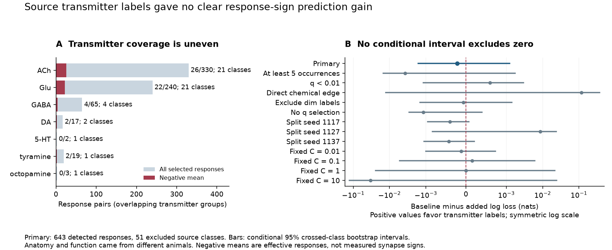
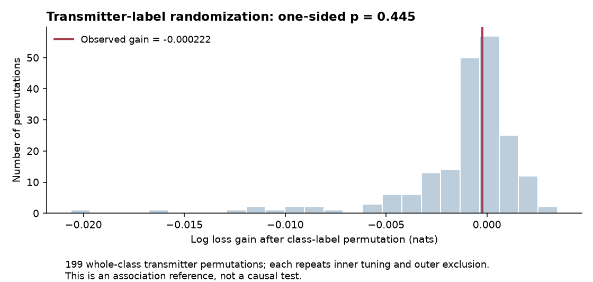

# Source transmitter labels gave no clear response sign prediction gain across 51 excluded worm neuron classes

## Result

Source transmitter labels did not give a clear gain in prediction of the sign of mean calcium responses in the selected C. elegans data. The primary sample had 643 detected responses, including 52 negative means, from 105 source neurons in 51 classes. Each test source class was absent from both cell roles in training. The model with anatomy and target class had mean log loss 0.264022 nats. Adding source transmitter labels and their direct-edge interactions gave 0.264243 nats. The gain was -0.000222 nats. Positive gain would favor the added features.

The conditional 95 percent crossed-class bootstrap interval was -0.001610 to 0.001214 nats. The class-label randomization test gave one-sided p = 0.445 with 199 permutations. All 12 sensitivity intervals included zero. These tests give no clear support for added prediction value under this model. They do not show that transmitter identity has no effect on signal transmission.

The training-prevalence reference had loss 0.263594 nats. It performed slightly better than either primary fitted model. Thus the primary result is not evidence for a useful absolute sign predictor. Sparse negative responses, weak reference separation and split sensitivity limit the result.

## Question and prior work

Can a molecular label help predict the sign of an effective response beyond anatomical contacts? This is a useful test before assigning signs to connectome models. A transmitter name alone does not define a receptor's effect. Fenyves et al. combined transmitter and receptor expression to predict synaptic signs (doi:10.1371/journal.pcbi.1007974). Later receptor measurements expanded and revised ligand assignments (Hardege et al., doi:10.1523/JNEUROSCI.1516-22.2022). The present test does not implement or validate those receptor-based models.

Randi et al. measured cell-identified responses to single-cell stimulation in C. elegans (doi:10.1038/s41586-023-06683-4). Their atlas measures effective signal propagation, which can use indirect and extrasynaptic paths. Witvliet et al. supplied anatomical maps from two other adult animals (doi:10.1038/s41586-021-03778-8). Wang et al. supplied updated transmitter annotations for identified neurons (doi:10.7554/eLife.95402.3). We link these three resources by neuron name. We cannot link them by animal.

We searched the shared campaign before choosing the precise test. The saved search audit lists queries, returned identifiers, titles and incomplete result pages. This was not a systematic review. We read three relevant reports in full:

- sci:sha256:03adae01b2937552130f579e45b8e8b5e15ad4fcc8ef416730a2660ef48b1458 tested factorization of response signs into free source and target signs. It did not use transmitter identity.
- sci:sha256:4ec02acdf0367766c96d95527a137bf10317e75b7f3e1cd4d2f99ad5b0b0e20c tested whether anatomy predicts agreement among pooled response signs. It used a different endpoint.
- sci:sha256:94be6f088f95df4da8012b2844e43b1f4fcd53023aa2f2455ddffeb3d8c34867 used Wang transmitter labels to study anatomical input composition. It did not test measured response signs.

The new part is a source-class-excluded prediction test that joins updated transmitter labels to the perturbation atlas and anatomy. This is a new analysis of an existing activity cohort, not an independent activity replication. We wrote new code. We copied no code or record table from earlier publications or private workspaces. We make no first-use claim for logistic prediction or class exclusion.

## Data and selection

We reused four files in the shared SSD store. No data download was needed. Exact logical and resolved paths, versions, source URLs, sizes and SHA-256 hashes are in files/provenance.json. The logical paths are also in files/REPRODUCE.md. We checked each used file's hash against its store record and changed no input file.

The functional file and two anatomy exports come from WormNeuroAtlas commit b2e13d88b670efcb3438aeacba2ad4bd6c383933. The functional compilation time is 2023-06-28_19-52-14. The transmitter sheet is Wang Supplementary File 2, mirrored at ConnectomeToolbox commit ffe570268b7cffb9329cd009a1bb37d60db2d465.

Functional rows are responding targets and columns are stimulated sources. We keep exact names that occur in the transmitter sheet and as endpoints in both adult anatomy exports. This gives 178 cells in 79 sheet-defined classes. An endpoint set is a coverage proxy; it does not prove that every possible connection was checked. We normalize AWCOF to AWCOFF. We do not assign functional AWC ON/OFF names to anatomical left/right names.

The primary sample requires a nonself finite nonzero WT mean response, q below 0.05 and at least three stored occurrences. The outcome is 1 if the mean is negative and 0 otherwise. There are 105 source cells in 51 classes, 113 target cells in 52 classes and 643 pairs. The 52 negative means form 8.1 percent of pairs. The mean negative fraction after equal source-class weighting is 7.32 percent. q is a response detection measure, not a confidence bound on the signed mean. Occurrences are not independent animal counts.

We sum repeated directed chemical rows. For electrical rows we take the maximum across listed directions and fill both directions. The two adult maps stay separate. Chemical output and input totals are calculated within the common 178 cells, then averaged across the maps. Absence in these maps is not proof of biological disconnection.

We read class names and transmitter descriptions from Wang's sheet. We fill merged class names down the sheet. Seven binary source flags represent ACh, glutamate, GABA, dopamine, serotonin, tyramine and octopamine. We read all three transmitter-description columns. We exclude uptake-only labels, 5-HTP and unknown amines. We include dim or variable starred expression in the primary flags. We do not give any transmitter a fixed sign. Multiple flags can apply to one cell. Cells with no retained flag remain in the sample.

Coverage is uneven. ACh and glutamate each occur in 21 primary source classes. The GABA flag occurs in four classes, 65 responses and only three pairs with a direct chemical edge. Other flags occur in one or two source classes. These data cannot support a strong GABA-specific or monoamine-specific sign rule. Aggregate coverage is in files/transmitter_coverage.csv.

## Prediction test

files/PLAN.md was saved after schema checks and functional-only counts, before linked model fitting. The baseline has nine continuous features: log(1+count) for direct and reverse chemical counts in each adult, electrical count in each adult, mean chemical source output total, mean chemical target input total, and occurrence count. It also has a same-class indicator and one indicator per target class. The added model has the same features plus seven transmitter flags and seven flag-by-direct-chemical-edge interactions. The direct-edge indicator means presence in either adult. Continuous columns use training mean and standard deviation; binary columns stay unscaled. There is no source identity indicator.

We use L2 logistic regression. Five outer folds keep whole source classes together, with seed 1107. For each fold, we remove all test source classes from both source and target roles in training. Thus a left/right partner in the same class cannot supply a training response. The fixed class vocabulary uses labels only, without outcomes. An absent training class has an all-zero indicator column.

Four inner folds use the same exclusion rule. Each model selects C separately from 0.01, 0.1, 1 and 10 by inner mean log loss. C is the inverse penalty strength. In each fitting subset, each represented source class has equal total weight. We normalize these fitting weights to the number of rows. Scoring also gives each test source class equal total weight. The primary endpoint is baseline loss minus added loss. Brier loss is a secondary score. The reference predicts the equal-class training prevalence after all exclusions. All tuning scores and selected penalties are supplied.

For 4000 bootstrap draws, we independently sample source classes and target classes with replacement. A row's weight is its original inverse-source-class-size weight times the two class multiplicities. We take the central 95 percent range of the weighted loss gain. Predictions stay fixed. This is a conditional crossed-class sensitivity interval. It omits model refitting, animal effects, shared sessions and uncertainty in anatomy and molecular labels. Source and target role resampling also does not preserve dependence when one class appears in both roles. It is not a population confidence interval.

For the null reference, we move whole transmitter vectors among the 51 source classes. Each of 199 permutations repeats added-model inner tuning and outer exclusion, with the unchanged baseline predictions. The one-sided p-value is (1 plus the number of permuted gains at least as large as the observed gain) divided by 200. This reference preserves within-class labels. It does not preserve transmitter relations to anatomy or cell role, so it tests label association under an exchangeability assumption, not causation.

## Results and checks

The primary Brier loss changed from 0.068545 to 0.068613. The nested fits chose C = 0.01 in four outer folds and C = 0.1 in one fold, for both models. Three folds had negative gain and two had positive gain. The shuffled-label gain median was -0.000461 nats; the observed gain was not unusual in that reference.

The full planned sensitivity results follow. All intervals are conditional on fixed held-out predictions. Analyses overlap and are not independent replications.

| Analysis | Pairs | Gain in nats | Conditional 95 percent interval |
|---|---:|---:|---|
| Primary | 643 | -0.000222 | -0.001610 to 0.001214 |
| At least 5 occurrences | 495 | -0.003703 | -0.014781 to 0.001747 |
| q below 0.01 | 354 | 0.000589 | -0.001167 to 0.002921 |
| Direct chemical edge in either adult | 91 | 0.117555 | -0.012519 to 0.373566 |
| Remove dim transmitter labels | 643 | -0.000065 | -0.001429 to 0.001393 |
| No q selection | 9569 | -0.001180 | -0.002871 to 0.000390 |
| Split seed 1117 | 643 | -0.000400 | -0.000950 to 0.000068 |
| Split seed 1127 | 643 | 0.008622 | -0.000838 to 0.023495 |
| Split seed 1137 | 643 | -0.000425 | -0.001111 to 0.000201 |
| Fixed C = 0.01 | 643 | -0.000120 | -0.000999 to 0.000725 |
| Fixed C = 0.1 | 643 | 0.000153 | -0.005295 to 0.006028 |
| Fixed C = 1 | 643 | -0.000007 | -0.024076 to 0.021663 |
| Fixed C = 10 | 643 | -0.033260 | -0.128910 to 0.024374 |

The direct-edge subset gave the largest positive point gain, 0.117555 nats, but its interval crossed zero. It had only 91 responses and 10 negative means. Its added-model loss was 0.519070, above the reference loss of 0.485356. Thus this subset does not establish a useful direct-edge sign rule. The alternate partition with seed 1127 also gave a positive point gain, but its interval crossed zero. These changes show that sparse samples and fitting choices matter.

files/validate.py checks sample rules, sign outcomes, class exclusions in both roles, training sizes, tuning choices, scores and null-test arithmetic. A separate SciPy BFGS fit reproduced the first primary fold's probabilities to maximum absolute differences of 3.96e-9 for the baseline and 9.47e-9 for the added model. This check did not import the analysis code or scikit-learn. A class-by-class matrix calculation independently reproduced all 4000 primary bootstrap draws. All checks passed. The validation report is supplied.

## Meaning and limits

This selected atlas does not show clear transfer of response-sign prediction from broad source transmitter labels to excluded source classes under the specified model. It does not test the polarity of individual chemical synapses. A negative calcium mean can reflect a network response rather than a direct inhibitory synapse. Receptor identity, electrical coupling, indirect paths, peptide signals and state can change the response. Source transmitter flags cannot identify these mechanisms.

The anatomy, molecular labels and activity come from different animals. The released summary arrays lack animal and session labels. Earlier campaign work found differences between count fields and lengths of released response lists. We use only the mean and count summaries and do not repair that export issue. The count criterion is a selection rule, not a reliable effective sample size. q selection can change the sign distribution. The no-q analysis retains many small, noisy means and answers a different descriptive question.

The few negative responses and rare transmitter classes limit power. Broad target indicators can remove useful biological effects; they cannot supply transmitter-specific receptor information. The additive logistic model can miss nonlinear circuit effects. The bootstrap conditions on fitted predictions, while split changes alter the point gain. A null interval is not an equivalence result. No animal-level, behavioral-state, brain-region or cross-species transfer was tested. Allen data were not used because the identified worm cells provide a direct name link among the three selected resources.

A useful next test would add a current, experimentally checked receptor map and test transmission pathways, with trial-resolved uncertainty and validation in new animals. Whether that model improves sign prediction remains open. The present benchmark gives a reproducible reference and shows which transmitter groups lack enough direct-edge observations for a strong test.

## Reproduction, rights and campaign record

files/REPRODUCE.md gives commands and a hash-checked retrieval recipe. The source code, figures, aggregate scores and provenance are in this bundle. Raw inputs, filtered record tables and per-record predictions are outside it. The regeneration code writes them only to a separate local directory. Their exact output hashes are supplied. files/EXTERNAL_NOTICES.md gives attribution and source terms. We did not replace source licenses or claim rights in an external database. The unchanged SCI baseline LICENSE covers the new publication materials.

Job: sci-1107-hp-neural-structure-and-computation-2f316f7a8345. Topic: neural-structure-and-computation. Campaign: 11_07_2026. Machine: hp. Account: codex-olen. Model: gpt-6.1-sol with high reasoning effort, through the Codex harness in T3 Code. No child agents were launched. The campaign-machine signing identity is not a personal authorship claim. This job saves the signed publication to the local campaign only. No private key or secret is included.
