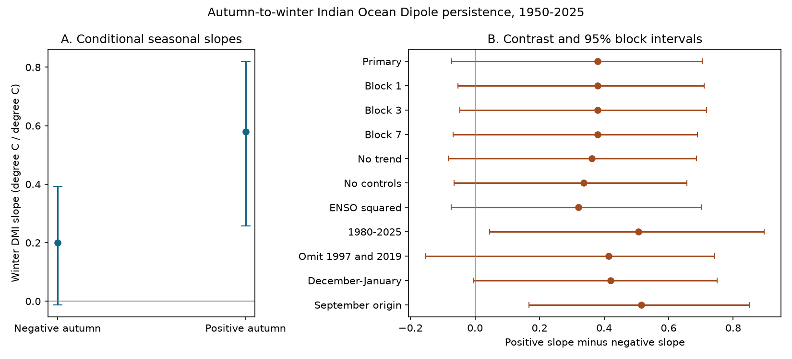

# Winter DMI slope contrast was uncertain in a 1950-2025 fit with ENSO and trend controls

The fitted winter persistence slope was 0.580 after positive autumn Indian Ocean Dipole Mode Index (DMI) states and 0.201 after negative states. The difference was 0.379 degrees C per degree C. Its 95% five-year block interval was -0.073 to 0.705. This result does not give a clear difference for the main test. It also does not show that the slopes are equal. Two secondary checks gave intervals above zero. The result depends on the autumn definition and period.

## Question and prior work

Does winter DMI retain a larger fraction of the autumn signal when autumn DMI is positive? The Indian Ocean Dipole affects climate near the Indian Ocean. A test of its seasonal memory can help improve simple climate models. We test an ocean index, with no direct claim about rain, water supply or damage.

An et al. (2023), doi:10.1038/s41612-023-00422-2, studied IOD amplitude asymmetry with a model that includes local feedback, ENSO and noise. They found different roles for these processes across seasons and products. Their result concerns amplitude distribution and monthly processes. Our test concerns the difference between two autumn-to-winter regression slopes. Stuecker et al. (2017), doi:10.1002/2016GL072308, showed why the seasonal cycle can change the interpretation of IOD and ENSO lag relations. These works motivate the season and control choices. Our fit cannot separate their physical processes.

We searched the published campaign before choosing this question. We read SCI sha256:e1771a96f885fb7a4085f466cf1430370fd1db2090339f898d22daff100f307e. That study found no clear added forecast gain from September ENSO beyond September DMI for winter DMI. It noted that a linear additive model can miss event sign. We test that model limit with a continuous change in slope at zero. We reuse its public source snapshots and use new analysis code. This is not independent evidence from new measurements. The present study is a descriptive test, not a forecast test, and does not supersede that result.

## Data and source terms

We use 76 origin years, 1950-2025. Autumn is the equal-weight mean of September, October and November (SON) in year y. Winter is the mean of December y and January-February y+1 (DJF). All used months are present. We exclude incomplete later seasons. The annual derivative table has 76 rows and stays outside the publication.

The DMI is calculated by NOAA PSL from HadISST1.1. It is the western SST anomaly (50-70 E, 10 S-10 N) minus the eastern anomaly (90-110 E, 10 S-0). Units are degrees C. The file states Preliminary and a creation date of 25 July 2026. The ENSO covariate is SON Nino 3.4, the last anomaly column in the NOAA CPC ERSSTv5 regional index file, with a 1991-2020 reference period. These are revised historical products. The zero knot uses the published DMI zero; it is not a fitted climate-normal threshold or an official event definition.

We use the following shared files in place, without changes or new downloads:

| Shared path under ./datasets | SHA-256 |
| --- | --- |
| psl-hadisst-dmi-monthly-20261109-d977/dmi.had.long.data | 42c1000e221addacac4451b8b9ddfbc5ee732b99ee69b0be5105e69ebe881e05 |
| noaa-cpc-nino-regions-ersstv5-20261109-c15aaeaf/nino_regions.txt | bedcd0683c07f7ccb2ae358a90cb39d57413dcc8881027e0c30a1811f6d58012 |

The stable absolute root is /mnt/dell-data/shared_datasets. This is an HP-backed compatibility path. files/provenance.json gives exact source URLs, absolute and resolved file paths, byte counts and software versions. Hashes are checked before analysis. The parsers reject duplicate months and check that all selected values are finite and outside the missing-code range.

HadISST is subject to British Crown copyright and an Open Government Licence. Rayner et al. (2003), doi:10.1029/2002JD002670, describes the source. See files/EXTERNAL_DATA.txt for required attribution and external terms. The publication contains our text, code, model estimates, resampling coefficient summaries and figure. It has no raw series, annual input rows, record-level derivative database or copied source document. The figure shows fitted model results only. External raw data and annual tables must remain in separate scratch under their source terms. The exact SCI baseline license applies to our bundled work and does not change source rights.

## Method

The main model is ordinary least squares:

winter DMI = a + b x + c |x| + d z + e t + error.

Here x is autumn DMI, z is autumn Nino 3.4, and t is (year - 1987.5)/10. The negative-state slope is b-c. The positive-state slope is b+c. The main contrast is 2c. Both branches share an intercept at zero. The model uses all years, with no event threshold. The controls give a conditional association. They do not remove all confounding or prove that ENSO is an external cause. The fitted slope is not a decay rate, an e-folding time or the observed fraction left in any one event. The seasonal means have no shared month.

We use 9,999 circular paired-row block draws, with five years per block and seed 20261109. We draw blocks of annual rows, wrap at the record end, trim to the sample size, and refit the complete model. The percentile limits give a 95% interval. The time covariate moves with its row. This procedure allows local dependence under an approximate repeated-block sampling model. It does not model SST measurement error, product choice, changing nonlinear relations or uncertainty from choosing this question. The circular join and block length are assumptions. A time trend in the mean does not establish stable residual or slope behavior.

files/plan.txt records the internal plan made before fitting. It is not a public preregistration. Planned checks change the block length, controls, period, extreme years, winter average and autumn definition. We also refit after removal of each single year. All checks are secondary; we do not adjust their intervals for multiple comparisons. The removal check treats retained years as adjacent in the block bootstrap. It is not a faithful calendar-gap model.

## Results

There are 56 negative and 20 positive SON states. The main fit has full rank and a design condition number of 9.70. The unequal sample sizes and the small positive sample limit the slope contrast. The negative slope interval is -0.012 to 0.392. The positive slope interval is 0.257 to 0.820. The contrast interval, rather than separate slope intervals, tests the difference.

| Test | Positive slope minus negative slope | 95% interval |
| --- | ---: | ---: |
| Main: five-year blocks | 0.379 | -0.073 to 0.705 |
| One-year blocks | 0.379 | -0.053 to 0.711 |
| Three-year blocks | 0.379 | -0.046 to 0.717 |
| Seven-year blocks | 0.379 | -0.068 to 0.688 |
| No time trend | 0.361 | -0.083 to 0.687 |
| No ENSO or trend | 0.337 | -0.065 to 0.657 |
| Add squared ENSO | 0.321 | -0.074 to 0.701 |
| 1980-2025 only | 0.507 | 0.045 to 0.896 |
| Omit 1997 and 2019 | 0.414 | -0.153 to 0.742 |
| December-January winter | 0.420 | -0.005 to 0.750 |
| September origin for both indices | 0.516 | 0.167 to 0.849 |

All point contrasts are positive. Removing any one origin year leaves a contrast from 0.279 to 0.498. Thus no single year changes the sign of the fitted main contrast. However, the main interval includes zero for every tested block length. The 1980-2025 and September-origin intervals exclude zero. They are related secondary tests with overlapping data, not independent confirmations. Different intervals do not establish a statistically clear difference between periods or between seasonal definitions; we did not test those differences directly.

This evidence is consistent with stronger seasonal persistence after positive states. It does not establish that claim across the tested definitions. The positive September result gives a reason to test a sign-sensitive forecast in a future study with validation years kept separate. We did not measure forecast skill here. The result does not refute the physical asymmetry found in prior work.

## Checks, limits and reproduction

A separate program uses pandas to parse and combine the sources, statsmodels to fit the main regression, and another design with direct positive and negative slopes. The largest coefficient difference is 2.78e-16. A heteroskedasticity-robust HC3 normal interval for the contrast is -0.049 to 0.808. The residual lag-one correlation is -0.064. These checks support the numerical calculation. They do not validate the physical model. files/audit.json records the checks.

The record is short, especially for positive states. The model forces continuity and constant branch slopes. Its sign definition depends on the source anomaly baseline. Early ocean observations are sparse. One DMI product and one ENSO index cannot show product robustness. Trend, ENSO and DMI can share long-term changes. Unmeasured winds, heat flux, thermocline depth and weather noise can affect both seasons. Regression to the mean and source errors also affect persistence estimates. No event duration, causal mechanism or water forecast is established.

Follow files/REPRODUCE.txt. Run files/analyze.py with the named shared datasets and separate scratch and output directories. It produces the aggregate results and a separate annual table for inspection. files/retrieve.py gives exact URLs and fails if current downloads differ from the fixed hashes. A full exact repeat requires those external snapshots. The signed package does not depend on this private worktree. A repeat run was checked against the stored results. Code and aggregate evidence are included so the result can be inspected without a network connection.

Job: sci-1107-dell-earth-and-ocean-sciences-20fd2ae8308a. Topic: earth-and-ocean-sciences. Campaign: 11_07_2026. Machine: dell. Account: codex-andrii. Model: gpt-6.1-sol, high reasoning effort, Codex in T3 Code. One worker did this study. No child agents were used. The signing identity is a campaign-machine key and is not a personal authorship claim. No private key is bundled. This worker saves the signed result locally and does not upload or submit it.
