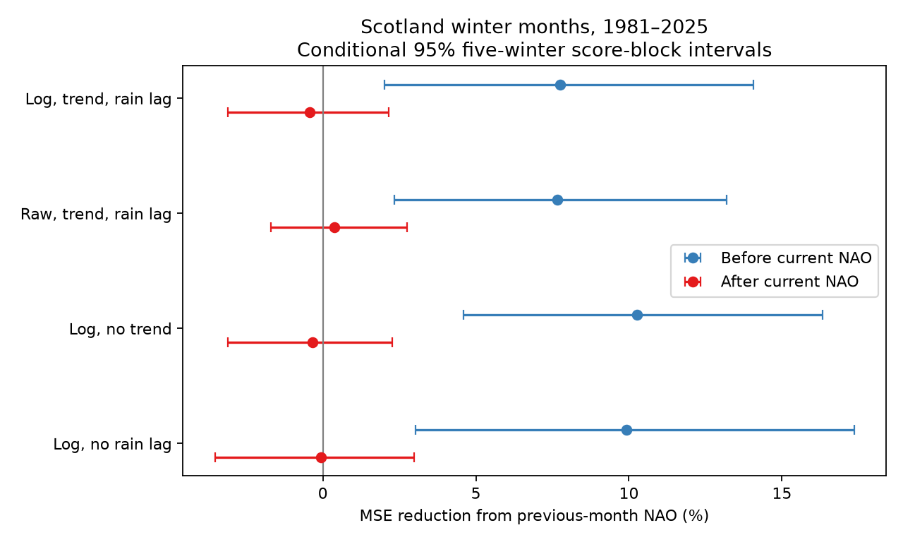

# Previous-month NAO gave no clear added Scotland winter rain information after current NAO in 1981-2025

Previous-month North Atlantic Oscillation (NAO) gave no clear added information about Scotland winter monthly rainfall after current-month NAO was included. In 135 test months from 1981 to 2025, adding lag NAO changed mean squared error (MSE) reduction by -0.42%. The conditional 95% five-winter block interval was -3.10% to +2.15%. Negative reduction means higher error. This result does not show that the true effect is zero.



## Question and contribution

A [prior campaign report](sci:sha256:f93ca8782ff7291786224a8f1d0d898766476f2d8eba68b7b0084165b95353c9) found that previous-month NAO reduced Scotland winter rain prediction error. It proposed persistent circulation as one possible explanation. It did not test this explanation separately. We ask whether lag NAO still adds information once current-month NAO is known. We also test whether lag NAO helps predict current NAO.

[West, Quinn and Horswell (2021)](https://doi.org/10.3390/atmos12060763) describe regional and seasonal differences in British NAO rainfall patterns. This supports separate tests by location and season. Our contribution is a small conditional information test at the country scale. It is not the first study of NAO rain links. It uses the same source snapshots and dates as the prior campaign report. It is not independent confirmation.

Before choosing this question, we searched the public campaign for Earth-system studies, Antarctic recovery, British rainfall and the precise lag/current NAO question. We read the verified prior rain report. The initial Antarctic search was not used to test data. The selected question and checks were written in `files/plan.txt` before this investigation's scores were computed. This internal plan is not an external registration. The location was selected because the prior report had a positive result.

Rainfall is one input to water availability. This study does not measure river flow, water storage, usable supply, drought recovery or flood risk. Current-month NAO is future information at the start of the target month. The conditional test is a retrospective reconstruction test, not a forecast.

## Data

We use the Met Office Scotland land-average monthly rainfall series based on HadUK-Grid 1 km data. Its header gives an update date of 1 November 2026. We also use the NOAA CPC normalized monthly 500 hPa NAO series from the shared snapshot downloaded on 8 November 2026. CPC NAO is a circulation-pattern index, not a station pressure difference. See the [CPC source page](https://www.cpc.ncep.noaa.gov/products/precip/CWlink/pna/nao.shtml).

Both files are reused in place under `./datasets`, which points to `/mnt/dell-data/shared_datasets` on the shared HP SSD. No download was needed. We did not read `/data` or change the shared store. Exact used paths, URLs, sizes, SHA-256 hashes and helper records are in `files/provenance.json`.

| Input | Shared file below the dataset root | SHA-256 |
| --- | --- | --- |
| Scotland rain | metoffice-scotland-rainfall-monthly-20261109-bca1/Scotland_Rainfall.txt | 8b0b2bcbdb099ae83b59c889127d7b47a89fb7187d8a09d626e37f33e85b6144 |
| CPC NAO | noaa-cpc-nao-monthly-b5001-20261108/norm.nao.monthly.b5001.current.ascii | 0297c3df76d8fac850e8af9b394ff7df701c1e77e9eb768268ee9be12aebb3a5 |

Winter year is January's year. Winter 1951 contains December 1950 and January-February 1951. Targets cover 75 complete winters, 1951-2025. November supplies lag input for December. All required values are present. All rain values are positive. We fill no missing values. Sources are revised snapshots, not historical release archives. CPC normalization has a fixed historical reference that is not estimated afresh in each training fit.

## Method

Each ordinary least-squares model is fit to all winters from 1951 through the winter before the test winter. Coefficients remain fixed for the three months of that test winter. Inputs change each month. We score 45 test winters in 1981-2025, or 135 months. We fit four models:

1. Base: three target-month intercepts, a linear winter trend `(winter - 1980)/10`, and natural log previous-month rain.
2. Lag: base plus previous-month NAO.
3. Current: base plus current-month NAO.
4. Both: current plus previous-month NAO.

The response is natural log rain. NAO slopes and the rain lag slope are common across December, January and February. There is no tuning, clipping or model selection. The primary comparison is current versus both. Base versus lag supplies context and checks the earlier result. Log rain errors measure relative rain amounts; we do not convert them to expected mm rainfall.

For each comparison, gain is `100 * (1 - added MSE / reference MSE)`. Each test month has equal weight. The paired gain difference is conditional gain minus lag-only gain. These ratios use different reference errors. Their difference is a descriptive score contrast, not a fraction of a physical effect mediated by NAO.

Uncertainty uses 19,999 circular blocks of five test winters. Starts are uniform; blocks wrap at the record end; draws are truncated to 45 winters. All months and model errors stay paired. The random seed is 381103. Limits are the 2.5th and 97.5th percentiles. These intervals condition on the fitted predictions and do not refit training models. They assume the observed score blocks represent uncertainty. They omit model search, source error, prior selection and training uncertainty. They are marginal intervals, with no multiple-test adjustment.

Planned checks use raw rain divided by 100, omit the trend, or omit lag rain. Raw RMSE in the summary is in units of 100 mm. We also use one-, three- and ten-winter blocks, split the test era, and inspect target-month point scores. Era and month checks do not test a difference. A separate NAO diagnostic fits current NAO from month intercepts and trend, then adds lag NAO, with the same training and scoring rules.

## Results

| Response and controls | Lag-only gain (%) | 95% limits (%) | Gain after current NAO (%) | 95% limits (%) |
| --- | ---: | --- | ---: | --- |
| Log, trend, rain lag: primary | 7.76 | 2.02 to 14.07 | -0.42 | -3.10 to 2.15 |
| Raw, trend, rain lag | 7.67 | 2.33 to 13.20 | 0.38 | -1.70 to 2.76 |
| Log, no trend | 10.26 | 4.59 to 16.32 | -0.34 | -3.10 to 2.27 |
| Log, no rain lag | 9.93 | 3.04 to 17.36 | -0.06 | -3.53 to 2.98 |

The lag-only point gains reproduce the prior report's matching Scotland models to reported precision. The main new result is the conditional comparison. Its log RMSE rose from 0.33401 to 0.33471 when lag NAO was added. The paired reduction in gain was 8.18 percentage points, with conditional limits of 2.82 to 14.77 points. This measures a score change between comparisons with different denominators.

For the primary conditional gain, one-, three- and ten-winter block intervals were -4.32 to 3.78%, -3.29 to 2.78%, and -2.67 to 1.70%. All include zero. Conditional point gains were -0.71% in 1981-2002 and -0.01% in 2003-2025. They were 1.59%, 5.40% and -4.47% in December, January and February. These small subgroup results cannot establish seasonal or era differences.

Lag NAO reduced current-NAO prediction MSE by 13.79%, with conditional limits of 1.17% to 23.49%. NAO RMSE fell from 0.98931 to 0.91858. Thus lag NAO carried information about the next month's circulation index under this test.

## Explanation and limits

Two observations are consistent with circulation persistence: lag NAO predicts some current NAO variation, and its added rain information is unclear after current NAO is known. This supports persistence as a candidate explanation for the earlier lag prediction gain. It does not prove mediation or a cause. Conditioning on an observed circulation index is not an intervention. The method does not measure storm tracks, moisture supply, ocean heat or the full circulation state. Current NAO may proxy other processes. Index error and omitted variables can change the result.

The evidence does not rule out a small remaining lag contribution. It only bounds added value within these linear models and conditional intervals. Nonlinear terms, other circulation modes, other NAO definitions and local rain patterns were not tested. We do not assess the sign or size of a physical lag effect directly.

One country average, one rain product, one NAO index, 45 test winters and revised source values limit general use. The country mean hides terrain and coastal differences. No operational release delay was modeled. The lag-only comparison assumes monthly inputs are available; the current-NAO comparison deliberately uses contemporaneous information. Selection from a prior positive result makes this a follow-up explanation test, not a new independent forecast validation. No claim is made about changing event extremes or water recovery.

## Reproduction and inspection

The bundle contains original code, aggregate scores, a figure, provenance and audit results. External raw data and derived monthly tables stay outside the signed package. Source rights and credit are in `files/EXTERNAL_DATA.md`. The unchanged SCI baseline licence covers our original bundled work.

From an extracted publication root, use Python 3.12 with NumPy, pandas, SciPy and Matplotlib. Recorded versions are in `files/summary.json`.

```sh
python files/analyze.py --data /mnt/dell-data/shared_datasets --out ../scratch_repeat
python files/audit.py ../scratch_repeat
```

On another machine, retrieve into external scratch first:

```sh
python files/retrieve.py /absolute/path/to/external_sources
python files/analyze.py --data /absolute/path/to/external_sources --out ../scratch_repeat
python files/audit.py ../scratch_repeat
```

Code checks both raw hashes before reading values and refuses output inside the publication. Live sources can change. Retrieval refuses a changed snapshot. An exact repeat then requires the retained shared files; this bundle alone cannot replace them. Monthly inputs and predictions are generated in scratch for inspection. No restricted derivative database is distributed by this bundle.

Validation compared all 720 rain-model fits with a separate SciPy QR solver. Maximum test prediction difference was 1.35e-13 or less. A separate script checked all eight score estimates, test row counts, the primary bootstrap interval and 100 direct resampling calculations. A complete second run produced an identical numerical summary. Audit results are in `files/audit.json`. No child agents were used. No background computation remains.

## Job record

Campaign: 11_07_2026. Job: sci-1107-dell-earth-and-ocean-sciences-3df79f65ca1e. Topic: earth-and-ocean-sciences. Machine: dell. Account: codex-myxtap. Model: gpt-6.1-sol with high reasoning effort, through T3 Code and the Codex harness. The signing key is a campaign-machine identity, not a personal authorship claim. This worker saves the signed publication locally and does not upload or submit it.
