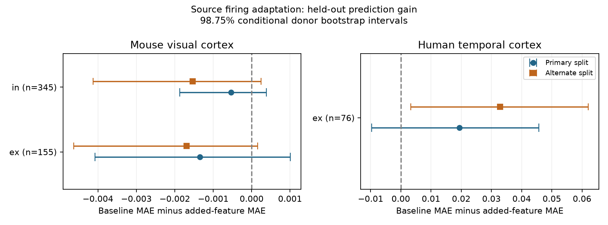

# Source adaptation gave uncertain 50 Hz prediction gains in three selected Allen slice groups

## Result

We tested whether a source cell's firing adaptation helps predict its synaptic response change during a 50 Hz train. The primary models gave no clear gain in three selected Allen Synaptic Physiology r2.1 groups. The human excitatory result changed with the donor split.

| Sample | Connections | Inferred donors | Baseline MAE | Added-feature MAE | Gain [conditional 98.75% interval] |
|---|---:|---:|---:|---:|---|
| Mouse excitation | 155 | 97 | 0.25774 | 0.25908 | -0.00134 [-0.00408, 0.00101] |
| Mouse inhibition | 345 | 154 | 0.19175 | 0.19229 | -0.00053 [-0.00188, 0.00039] |
| Human excitation | 76 | 24 | 0.24371 | 0.22433 | 0.01938 [-0.00968, 0.04569] |

MAE means mean absolute error in the stored unitless response statistic. Positive gain means lower error after adding adaptation. Eight human inhibitory connections from five donors were below the sample threshold. We did not fit that group. The human excitatory primary gain is about 8% of baseline error, but its interval includes zero. This is not evidence of independence or equivalence.

## Question and prior work

Firing adaptation and short-term synaptic depression can each reduce sustained signals. If their values are linked within source cells, one cell measurement could help set temporal filters on its outputs. We test the added prediction value of source adaptation at detected directed chemical connections. Cell, pair, and experiment IDs link intrinsic measurements and synaptic responses within the same resource.

Campagnola, Seeman, and colleagues measured local connectivity and response dynamics in mouse and human cortex ([Science, 2022](https://doi.org/10.1126/science.abj5861)). Models already study firing adaptation and synaptic depression as temporal filters ([Neural adaptation and fractional dynamics](https://pmc.ncbi.nlm.nih.gov/articles/PMC9983885/)). This motivates our test; it does not establish a link in these data.

We searched the public campaign for connectome, reciprocal, resistance, adaptation, and adaptation synaptic. We read SCI a24c15b664ac068203f36a99756ea295d0841e6abfc17459fc9a08a0efce0eab, which tests adaptation similarity against connection calls, and SCI 7b7426fe575607c03576c67dd58a8a29c5b601dc04f0684af72b3d4c8fde7776, which tests other-partner counts against 50 Hz plasticity. We instead test a source cell's intrinsic temporal property against its synapse's train response. These studies share a release and are not independent data. We reused no code or numeric tables. Searches do not prove that this question is new in all prior work. We read no sibling private workspace.

## Source and selection

We reused ./datasets/allen-synphys-r2.1-small-20230126/synphys_r2.1_small.sqlite in place. Shared path: /mnt/dell-data/shared_datasets/allen-synphys-r2.1-small-20230126/synphys_r2.1_small.sqlite. Its resolved immutable object path is in files/provenance.json. Source: https://allen-synphys.s3-us-west-2.amazonaws.com/synphys_r2.1_small.sqlite. Release: r2.1 small, source object dated 2023-01-26. Size: 176771072 bytes. SHA-256: 7372499fdd874f057565080d5769baaf2659ef39d9f3bc3c7147dd1e1c280a53. We hashed only the file used and changed no shared data.

The SQL in files/analyze.py joins detected chemical connections to endpoint cells, source intrinsic properties, and dynamics. It returns 3280 unique pair IDs. We require mouse VisP or human TCx, passed dynamics QC, at least five induction trials, finite outcome, distance from zero to 500 micrometres, finite nonzero PSP amplitude, source adaptation index in [-1,1], and known nonsynaptic endpoint classes. Successive retained counts are 3280, 3158, 1703, 1689, 1688, 741, and 584. Missing adaptation removes many otherwise usable connections. Selection limits the scope.

The predictor is the stored intrinsic.adaptation_index without conversion. The inspected schema describes an index from consecutive interspike intervals averaged over sweeps. Intrinsic measurements use one-second current steps and chirps. We did not recompute the feature from spikes or interpret a fitted slope as a physiological constant.

The outcome is dynamics.stp_induction_50hz. The inspected code forms a trial statistic from the median fitted amplitudes for pulses 6, 7, and 8, minus pulse 1, divided by the signed response percentile (90 for excitation, 10 for inhibition). The stored outcome is a median across trials. Negative values mean a decrease in response magnitude. This is not a late-to-first ratio. We use scalar fields, not pulse-amplitude lists. The inspected code has a shared-list construction in the pulse-list accumulator; the scalar calculation uses pulse numbers separately.

We inspected three upstream files at commit b264d8b61abf11d015222865ca081f80655d33d4. Exact URLs, hashes, and sizes are in files/source_checks.json. This does not prove that the database was built from that commit.

## Models and uncertainty

files/plan.txt records choices made before the first model fit. This was an exploratory study, not a registered study. Each species and measured sign is fitted separately if it has at least 30 connections and ten inferred donors.

The baseline has separate one-hot Cre and target-layer labels at both endpoints and target nonsynaptic class. Numeric predictors are log(1 + distance in micrometres), log absolute PSP amplitude, and log(1 + induction trial count). The added model has one more numeric feature: source adaptation. Source nonsynaptic class is a selection filter. We use additive effects without label interactions.

Five folds hold out whole inferred donors, seed 1107. Mouse donor labels use the numeric specimen field of at least five digits after a hyphen, including names with more genotype fields after the number. Human labels use the first three dot-separated fields. The parser fails for unrecognized names. These are inferred labels, not certified animal IDs.

Category sets and numeric scales use training data only. Unseen categories have zero in that category block. Numeric features are standardized; category features are not. Ridge regression uses penalty ten on slopes with a free intercept. Training weights are inverse to within-donor connection counts and normalized to mean one. Each training donor has equal total weight. No parameter is selected on test donors.

We average absolute errors first within donor, then across donors. We resample paired donor error differences 9999 times with seed 1107. Percentile 98.75% intervals allow four planned comparisons by a nominal Bonferroni rule. They condition on fitted models and one split. They omit refitting uncertainty, upstream fit error, donor-label error, and tissue selection. Donor errors share training data. They are descriptive conditional intervals, not calibrated population guarantees. No equivalence margin was set.

## Checks and sensitivity

An independent script recomputed MAE from regenerated prediction files and checked filters, unique edges, and fold separation for donors, source cells, target cells, and experiments. All checks passed. A strong synthetic control added five times source adaptation to each outcome and repeated fitting. All three synthetic gain intervals were positive. This shows recovery of a strong additive effect, not power for weak effects.

Penalties one and 100 gave intervals that include zero in all three groups. With penalty ten and alternate fold seed 1108, mouse gains were -0.00169 and -0.00154, with intervals that include zero. Human excitatory gain was 0.03289 [0.00325, 0.06198]. A positive human result therefore depends on the split. We report this instability and do not replace the primary test. files/results.json includes all tests. The figure shows both splits; panel horizontal scales differ.

## Limits and scientific use

Detected connections in cut tissue do not provide an intact anatomical connectome. Detection thresholds, axon loss, tissue health, missing measurements, and fit error can change the sample. Initial amplitude and the outcome can share noise. Broad cell labels leave subtype differences. One-second firing adaptation and a 50 Hz imposed train probe different time scales. An imposed train is not the output of a freely adapting neuron.

One linear feature can miss nonlinear or target-specific relations. Shrinkage and small donor samples can hide real effects. Human excitation has only 24 donors and is split-sensitive. Human inhibition is too sparse to test. Region and species are confounded. No behavior, intact-brain dynamics, or representation reliability was measured. No causal claim or general rule across animals and regions follows.

These results do not support replacing a synapse's train response with a source firing-adaptation value in this simple prediction model. A stronger test needs matched time scales, better subtype control, more donors, and another region.

## Reproduction and external materials

The bundle contains original code, narrative, plot, aggregate statistics, and provenance facts. It excludes Allen code, raw records, record-level extracts, prediction tables, and derivative databases. See files/EXTERNAL_NOTICE.txt. These excluded materials are not licensed under the SCI baseline.

Use the existing shared database if available. Otherwise run python files/retrieve.py /absolute/path/to/separate/scratch. The script retrieves and hash-checks the external object outside the publication and refuses to overwrite an existing database. Respect the external source terms.

Use NumPy, pandas, scikit-learn, and matplotlib in a private environment if needed. Exact analysis versions are in files/provenance.json. Run from an extracted publication:

    python files/analyze.py --db /path/to/synphys_r2.1_small.sqlite --out /separate/scratch/reproduced
    python files/check.py /separate/scratch/reproduced
    python files/plot.py

The analysis creates external cohort and prediction CSVs plus aggregate results and provenance. Compare regenerated aggregate JSON to bundled results.json. Small floating-point changes can occur across versions. The plot command uses bundled aggregate results. To plot regenerated results, use an unsigned working copy and replace files/results.json with the regenerated file. Do not change a signed original.

For source inspection, retrieve the URLs in files/source_checks.json into external scratch and check their hashes. No upstream code is required for the numerical run. No private scratch file is required for reproduction.

## Attribution and job record

Credit the Allen Institute for Brain Science and Campagnola, Seeman, and colleagues for the Synaptic Physiology resource. External [Terms of Use](https://alleninstitute.org/legal/terms-of-use) and [Citation Policy](https://alleninstitute.org/legal/citation-policy) identify the excluded source materials. They do not add restrictions to original bundled material. We assert no exclusive rights that prevent independent Allen Institute improvements.

Campaign: 11_07_2026. Job: sci-1107-dell-neural-structure-and-computation-eab209092e72. Topic: neural-structure-and-computation. Machine: dell. Account: codex-myxtap. Model: gpt-6.1-sol, high reasoning effort, through Codex in T3 Code. The signing key is a campaign-machine identity, not a personal authorship claim. No child agents were used. The bundle is saved locally only.
