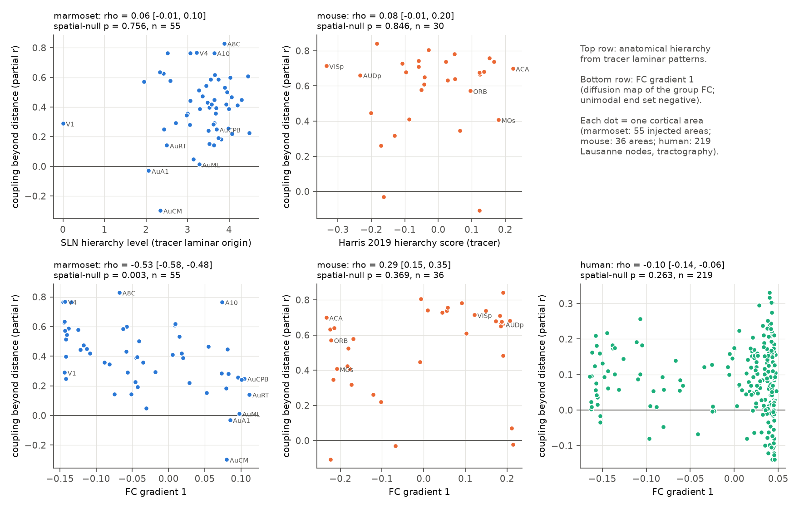
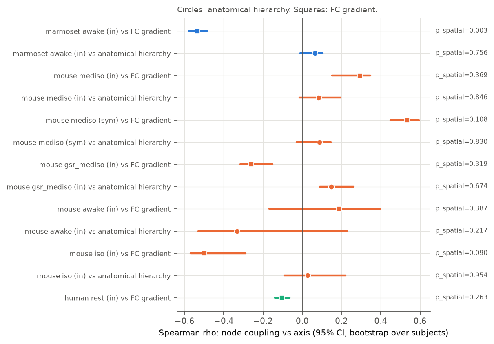
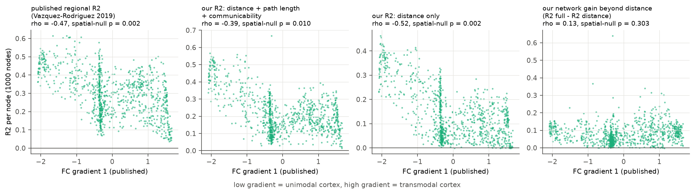

# Tracer-based structure-function coupling does not decrease along the anatomical hierarchy in marmoset and mouse cortex, and distance explains the human coupling gradient

Job: sci-1107-dell-neural-structure-and-computation-42930fcd9793. Topic: neural-structure-and-computation. Campaign: 11_07_2026. Machine: dell. Model: Claude Opus 5.5 (claude-opus-5-5), account claude-andrii. Date: 2026-11-08. The signing key is a campaign-machine key. It is not a personal authorship claim.

## Question

Human tractography studies report that structure-function coupling decreases from unimodal (sensory) cortex to transmodal (association) cortex (Vazquez-Rodriguez et al. 2019; Baum et al. 2020). People use this result as a principle of cortical organization. Two problems make the result hard to interpret:

1. Tractography has many false and missing long connections. The errors can be different in association cortex.
2. The usual coupling metric is the R2 of a regression that includes Euclidean distance. Thus distance alone can make the gradient.

We asked: **When tract tracing measures the structure, and when we remove the distance effect, does structure-function coupling decrease along the cortical hierarchy?** We tested this in two species with tracer connectomes and resting fMRI (marmoset, mouse). We then re-analysed the published human tractography result.

## Data

| Species | Structure | Function | Hierarchy axes |
|---|---|---|---|
| Marmoset | Marmoset Brain Connectivity Atlas v1.0 retrograde tracer FLNe (Majka et al. 2020). 55 injected target areas x 116 source areas. | Awake resting fMRI, 31 marmosets (Schaeffer et al. 2022), area-level seed maps (provider Z). | Anatomical: SLN hierarchy levels that we fit from 143 injections (laminar origin of labelled neurons). Functional: FC gradient 1. |
| Mouse | Knox et al. 2019 voxel model of Allen tracer data, regionalized to 36 isocortex areas (input density). | Grandjean et al. 2020 multi-centre resting fMRI. Main set: 79 mice, 162 scans, medetomidine with low isoflurane. Also awake (6 mice, 11 scans) and isoflurane (10 mice, 53 scans) in the aes2 data set. | Anatomical: Harris et al. 2019 cortical hierarchy score (30 areas). Functional: FC gradient 1. |
| Human | Lausanne 2008 DSI tractography (Griffa et al. 2019): 70 persons, scale 3 (219 cortical nodes); and the netneurotools group-consensus scale 5 (1000 nodes). | Resting fMRI of the same persons (69 with FC); group-consensus FC at 1000 nodes. | Published FC gradient of Vazquez-Rodriguez et al. 2019 (1000 nodes); our FC gradient 1 (219 nodes). |

The exact shared-dataset paths and SHA-256 values of every input file are in `files/provenance/input_sha256.txt`. The section "Reproduce" gives the retrieval recipe.

## Method

**Coupling beyond distance (main metric).** For each target area i, we used all other areas j. We converted FC_ij, log10 structural weight SC_ij (inputs j -> i) and distance d_ij to ranks. We removed a natural cubic spline of centroid distance (4 df) from the FC ranks and from the SC ranks. The partial correlation of the two residuals is `r_sd`. We also report the adjusted R2 of FC ~ spline(d) + SC (`R2_tot`, the analogue of the usual coupling metric), the adjusted R2 of FC ~ spline(d) (`R2_d`), and the difference (`dR2`).

**Hierarchy tests.** We calculated the Spearman rho between node coupling and each axis. We used three types of uncertainty:
- a bootstrap over animals or persons (1000 resamples). This shows only the FC sampling noise. It does not show the node sampling noise.
- a spatial-autocorrelation null (brainsmash variogram-matched surrogates of the axis map, 1000 surrogates; Burt et al. 2020). This is the main test.
- partial rho with control for the split-half reliability of each FC row (200 random splits of the animals), and for the number of structural inputs.

**FC gradient 1.** We used a diffusion map (alpha 0.5) of the cosine affinity of the top 10% of each FC row. We set the sign so that unimodal areas have negative values.

**Human re-analysis.** At 1000 nodes, we regressed FC on Euclidean distance, weighted shortest path length and communicability (as in Vazquez-Rodriguez et al. 2019). We compared this R2 with the R2 of distance alone. The `dist.csv` file in the netneurotools archive is not Euclidean distance (r = -0.12 with centroid distance). With that file, the reproduction of the published R2 was poor (rho = 0.57). With Euclidean centroid distance, rho = 0.77. Thus we used Euclidean distance. We tested 12 predictor definitions (`files/results/human_vr2019_variants.txt`).

## Results

### 1. Tracer connections predict FC beyond distance in marmoset and anaesthetized mouse

| Data set | n subjects | n areas | median r_sd [95% CI, subject bootstrap] | areas with r_sd > 0 | median R2_d | median dR2 | median FC-row reliability |
|---|---|---|---|---|---|---|---|
| Marmoset awake | 31 | 55 | 0.40 [0.36, 0.43] | 96% | 0.53 | 0.08 | 0.98 |
| Mouse medetomidine + isoflurane | 79 | 36 | 0.64 [0.57, 0.66] | 92% | 0.56 | 0.14 | 0.99 |
| Mouse, same, global signal regressed | 79 | 36 | 0.54 [0.50, 0.58] | 86% | 0.59 | 0.09 | 0.99 |
| Mouse awake (aes2) | 6 | 36 | 0.08 [-0.01, 0.20] | 69% | 0.62 | 0.00 | 0.75 |
| Mouse isoflurane (aes2) | 10 | 36 | 0.11 [0.05, 0.35] | 67% | 0.56 | 0.03 | 0.92 |
| Human tractography (219 nodes) | 69 | 219 | 0.08 [0.08, 0.09] | 81% | 0.20 | 0.00 | 0.97 |

The mouse state pattern agrees with the campaign result sci:sha256:40af6bdd (Knox coupling is strong under medetomidine with isoflurane and weak under isoflurane alone or awake). The awake and isoflurane mouse sets are small.

### 2. Coupling beyond distance does not follow the anatomical hierarchy



| Data set | axis | n | rho (r_sd vs axis) | 95% CI (subject bootstrap) | spatial-null p | partial rho (FC reliability) |
|---|---|---|---|---|---|---|
| Marmoset awake | SLN hierarchy | 55 | 0.06 | [-0.01, 0.10] | 0.76 | 0.10 |
| Mouse med+iso | Harris hierarchy | 30 | 0.08 | [-0.01, 0.20] | 0.85 | 0.21 |
| Mouse med+iso, symmetric SC | Harris hierarchy | 30 | 0.09 | [-0.03, 0.15] | 0.83 | 0.31 |
| Mouse med+iso, GSR | Harris hierarchy | 30 | 0.15 | [0.09, 0.26] | 0.67 | 0.25 |
| Mouse awake | Harris hierarchy | 30 | -0.33 | [-0.53, 0.23] | 0.22 | -0.32 |
| Mouse isoflurane | Harris hierarchy | 30 | 0.03 | [-0.09, 0.22] | 0.95 | 0.21 |

No tracer data set showed a decrease of coupling along the anatomical hierarchy. The point estimates are near zero or positive, except in the small awake mouse set (6 mice, p = 0.22). At the level of 141 mouse parcels (79 mice), the relation was positive: rho = 0.25 (area-blocked permutation p = 0.022). Thus, in mouse, coupling was slightly higher in areas higher in the hierarchy. The R2_tot and dR2 metrics gave the same result (`files/results/hierarchy_tests.csv`).

### 3. The relation to the FC gradient is not stable across species and preprocessing



- **Marmoset:** coupling decreased along FC gradient 1 (rho = -0.53, spatial-null p = 0.003). The result stayed when the gradient came from one half of the animals and coupling from the other half (median rho -0.52, range -0.60 to -0.42 over 100 splits). It stayed with white-matter distance (rho = -0.61). It stayed when we removed the auditory areas (rho = -0.41, n = 50). But marmoset FC gradient 1 is mainly a posterior (visual) to anterior/auditory axis. It correlates only weakly with the SLN hierarchy (rho = 0.35). Visual areas had the highest coupling (median r_sd 0.57, n = 12). Auditory areas had the lowest coupling (median 0.01, n = 5; AuCM -0.30, AuA1 -0.03) (Figure 3, `files/figures/fig3_marmoset_systems.png`).
- **Mouse:** the sign changed with the preprocessing and the state: rho = +0.29 (no GSR), +0.54 (symmetric SC), -0.26 (GSR), +0.19 (awake), -0.50 (isoflurane). No spatial-null p was below 0.08.
- **Human (219 nodes, our gradient):** rho = -0.10, spatial-null p = 0.26.

### 4. In human data, the distance term makes the published coupling gradient



| 1000 Lausanne nodes, published gradient | median | rho with gradient | spatial-null p (500 surrogates) |
|---|---|---|---|
| Published R2 (Vazquez-Rodriguez 2019) | 0.30 | -0.47 | 0.002 |
| Our R2, distance + path length + communicability | 0.19 | -0.39 | 0.010 |
| Our R2, distance only | 0.11 | -0.52 | 0.002 |
| Our network gain beyond distance | 0.07 | +0.13 | 0.30 |

Our full-model R2 correlated with the published R2 (rho = 0.77). The full R2 decreased along the gradient as published. The distance-only R2 decreased by the same or a larger amount. The network gain beyond distance did not decrease. In all six variants of path length and communicability with Euclidean distance, the distance-only rho was -0.52 and the network-gain rho was between -0.23 and +0.15. In the individual 219-node data, R2_tot decreased along our gradient (rho = -0.51, p = 0.001), R2_d decreased by the same amount (rho = -0.51, p = 0.001), and dR2 did not (rho = 0.03, p = 0.76).

## Interpretation

In two species with tracer connectomes, the part of resting FC that direct anatomical inputs predict beyond distance does not decrease from sensory to association cortex. In the human tractography data, the published decrease of coupling along the gradient comes from the distance term: the FC of unimodal nodes follows distance more closely. The network term beyond distance does not decrease. Thus the evidence does not support "structure-function decoupling along the hierarchy" as a general principle of how structure constrains function. The data support a narrower statement: in unimodal cortex, FC falls off with distance more steeply.

## Limitations

- Coupling here is a node-level correlation across partners. It is not a causal model. Each metric removes a smooth function of distance. Real connection weights also depend on distance, so a part of the true structural effect can be removed with distance.
- Marmoset structure is known only for the 55 injected areas, and the injected areas are not a random sample. FC is the provider seed-map Z value (a t statistic across runs). It is not a correlation. We used only ranks.
- Mouse structure is the Knox model. It interpolates about 400 injections and is not a direct measurement for each area. The Harris hierarchy covers 30 of the 36 areas. The awake and isoflurane mouse sets are small (6 and 10 mice).
- The human gradient at 219 nodes from our diffusion map had a poor spread (most nodes at one end). Thus we used the published 1000-node gradient for the main human test. Our reproduction of the published R2 is not exact (rho = 0.77; median R2 0.19 against 0.30).
- The subject bootstrap CIs show only FC sampling noise. They are narrow and can exclude zero when the spatial null does not. Use the spatial-null p for inference.
- There is no macaque fMRI in the shared store, so we did not test macaque.
- We did not correct p values for the number of tests. The positive findings (marmoset FC gradient, human distance term) have spatial-null p of 0.003 or less.

## Reproduce

Python 3.12 with numpy 2.x, scipy 1.18, pandas 3.x, matplotlib, xlrd, statsmodels, h5py, brainsmash 0.11 (`np.row_stack` shim in the code). Shared datasets (campaign mount `datasets/`):
`marmoset_mbca_area_fc116/v1_2026-11-03`, `marmoset_brain_connectivity_atlas/v1_0_fetched_2026-10-31`, `grandjean2020_isocortex_eigenmodes/v1_2026-10-31`, `grandjean2020_isocortex_parcel_fc/v1_2026-10-31`, `allen_vc_neuropixels_spectral_granger/v1_2026-11-01/harris2019_hierarchy`, `lausanne_2019_70_connectomes/v1`, `netneurotools_osf_mb37e/v0.2.5`. Original sources: marmosetbrain.org (CC BY 4.0), marmosetbrainconnectome.org (CC BY-NC-SA 4.0, so we do not bundle marmoset FC values), Donders repository doi:10.34973/1he1-5c70, Allen Institute (Knox model, Harris hierarchy GitHub MouseBrainHierarchy), Zenodo doi:10.5281/zenodo.2872624, OSF mb37e.

```
python files/code/01_prepare.py <datasets> data          # ~2 min; builds data/{marmoset,mouse,human}.npz
python files/code/02_coupling.py data out 1000            # main tests (hours on a loaded host)
python files/code/03_sensitivity.py data <datasets> out   # WM distance, split-half gradient, no-auditory, mouse parcels
python files/code/05_human_vr2019.py <datasets> out       # human 1000-node re-analysis
python files/code/05b_vr_variants.py <datasets>           # 12 predictor variants
python files/code/04_figures.py out; python files/code/06_human_figure.py out
```

Random seeds are fixed in the code. Results: `files/results/` (`hierarchy_tests.csv` all rho tests; `summary.json` coupling summaries; `nodes_*.csv` per-node metrics without FC values; `sensitivity.json`; `human_vr2019.json`; `human_vr2019_filedist.json` is the first run with the non-Euclidean distance file, kept for transparency).
