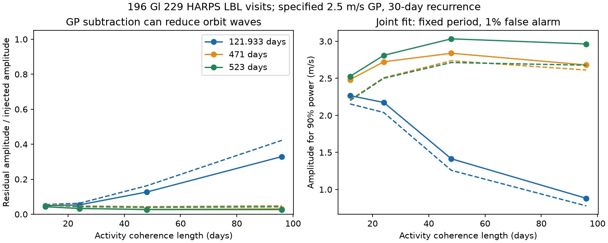

# A specified 30-day activity filter leaves 3.3 to 6.3 percent of trial orbit amplitudes in 196 Gl 229 visits

A specified Gaussian-process (GP) activity filter leaves 3.3 to 6.3 percent of the amplitude of injected circular orbit waves at 121.933, 471 and 523 days in 196 public Gl 229 HARPS visits. A joint fit retains signal information. Under the same covariance, it needs amplitudes of 2.04 to 2.81 m/s for 90 percent detection power at a 1 percent fixed-period false alarm rate, across the three periods and all phases. These are model sensitivity results. They are not planet limits or a measured stellar noise law.



## Question and prior work

Can a short-coherence activity filter remove a long-period trial orbit wave, and does a joint fit still have useful power? This matters when a possible planet signal disappears from activity-corrected velocities. A rotating stellar surface can change spectral lines and produce velocity changes. A GP can model such changes. A finite coherence length also allows low-frequency noise. Thus a 30-day recurrence does not restrict the filter to 30-day waves.

Tuomi et al. (2014, DOI 10.1093/mnras/stu358) and Feng et al. (2020, DOI 10.3847/1538-4365/ab5e7c) reported planet candidates in Gl 229. Deslieres et al. (2025, DOI 10.3847/1538-3881/ada77a) used line-by-line velocities and an activity model to challenge the planet interpretation. We use their released velocity table. We do not reproduce their GP fit or test their published mass limits.

SCI sci:sha256:843b8b2549cd6a6b07b2f9aaaf421b10417786fba451a8950cf28d95b9f73292 tested linear indicator fits on 194 matched exposures. It left GP filtering untested. SCI sci:sha256:875cbd20c5d90e1a961b3b800f43338dfae4eec3b4e5f69eec85b6f8497a0539 tested an annual harmonic under fixed noise models. We read both publications. Our new test measures the amplitude response of a finite-coherence GP and compares it with joint-fit power on all 196 LBL visits. It uses new code and no prior derived numerical inputs. It does not add independent observations.

Before selection, we searched the campaign for astronomy, transit, pulsar, GJ191, GJ229, GJ536 and GJ 536. We also read the GJ 191 night-drift study, SCI sci:sha256:62b246d0743ff816ed062226ed3e9769537eb06e249d2903034c8fbdb7de4d8b. Exploratory checks compared observation times and velocity reductions for Gl 229 and exposure order for GJ 191. These checks did not define the reported statistics. This is a targeted method study after review, not a blind planet search or a registered test.

## Data and model

We reuse the complete numeric table from Deslieres et al. (2025), CDS J/AJ/169/182/tablea1. It has 196 rows. We sort by reduced Julian date, require unique finite times and positive velocity errors, and reject no rows. The source times are rounded to 0.01 days. No RVBank matching is used. The source is at ./datasets/gj229-lbl-deslieres2025-valid-fbcf30c2/lbl.tsv. Its exact resolved shared path, URL, raw SHA-256, numeric digest and software versions are in files/summary.json. The raw file has 11378 bytes and SHA-256 c81ba31d27bf91be6c6ec15b4ea616e1ffc40262c6d654a8f168d6f660467422. We download no data for this study.

The covariance is C = K + D, with D diagonal and D_ii = quoted_error_i squared + 0.9 squared, in (m/s) squared. The kernel is

K_ij = A squared times exp[-dt squared / (2 ell squared) - 2 sin squared(pi dt / 30 days)].

Primary parameters are A = 2.5 m/s and ell = 24 days. They are specified stress-test values on the scale of the published activity model. They are not fitted to these velocities or claimed to equal a published posterior model. Controls use A = 1.25, 2.5 or 5 m/s and ell = 12, 24, 48 or 96 days. The 30-day recurrence and periodic factor are fixed throughout. All 36 period/covariance results are retained.

The mean model has a separate offset before and after RJD 57174.5, plus a common linear trend. The offsets allow an instrument change; the trend can absorb part of the distant companion's velocity. Each trial adds only one fixed sine/cosine pair. It does not fit three planets together. These are circular waves with constant phase and amplitude. The GP, jitter, trend form and period remain fixed in the power test. No period search or covariance optimization is done.

We first fit the null mean with generalized least squares (GLS), subtract the GP posterior mean, and fit the residual with the original orbit templates and diagonal D weights. An exact two-by-two transfer matrix gives amplitude ratios over all phases. We then fit mean and orbit together under C. The GLS information matrix gives exact Gaussian power. Files/method.md derives both calculations and explains why a small residual amplitude is not an information fraction.

## Results

| Period (days) | Residual amplitude / input (%) | Joint amplitude for 90% power (m/s) | Fixed-period measured-data p |
| --- | ---: | ---: | ---: |
| 121.933 | 5.34 to 6.25 | 2.04 to 2.17 | 0.00734 |
| 471 | 3.30 to 4.74 | 2.51 to 2.72 | 0.124 |
| 523 | 3.30 to 4.35 | 2.50 to 2.81 | 0.152 |

The amplitude and power ranges cover phase, not sampling uncertainty. Without K, but with the same D and mean model, the 90 percent power amplitudes are 0.50 to 0.51, 0.46 to 0.59, and 0.46 to 0.58 m/s. Thus this covariance imposes a large power cost even with a correct joint fit. A residual-only amplitude check would hide that distinction.

The primary 121.933-day p-value is below 0.01 before a three-period correction. It is above the Bonferroni threshold 0.01/3. None of the three primary trials passes that threshold. The fitted joint amplitudes are 1.53, 1.24 and 1.26 m/s. These conditional values do not establish a physical orbit.

The result depends strongly on covariance choice. At A = 2.5 m/s and ell = 96 days, the 121.933-day residual retains 32.9 to 42.2 percent of input amplitude. Its nominal joint p-value is 5.60e-21, compared with 0.0209 at ell = 12 days. The 471- and 523-day residual amplitudes remain small across these coherence tests. The aggregate file reports all controls. We do not select a covariance by its p-value. The very different conditional tails show why a fixed assumed covariance cannot decide the planet question. Simulation from each assumed law would not validate that law for this star.

## Verification and limits

Direct unit-wave injections through a refitted null mean agree with the linear response to better than 1.1e-12 m/s in the primary cases. A second calculation uses the full covariance and transformed templates of the residual. It recovers the original joint information matrix to an absolute tolerance of 1e-7. This checks the difference between attenuation and information loss.

For each primary period, 10000 full Gaussian records give false alarm fractions 0.0098, 0.0117 and 0.0105 at the nominal 0.01 threshold. At the calculated worst-phase 90 percent power amplitude, recovery is 0.8981, 0.9037 and 0.8985. Binomial simulation errors are about 0.001 for false alarms and 0.003 for recovery. These checks validate the calculations under the stated covariance only.

No new planet, new stellar process, or detector fault is found. The data share one instrument. We do not test independent telescope observations, raw spectra, wavelength solutions or activity indicator errors. The mean includes no explicit annual harmonic, and the prior campaign work shows that this omission can matter near 122 days. We do not infer GP parameters from line widths, compare physical surface models, or account for covariance uncertainty. Refitting the GP after an injection can change attenuation. Eccentric orbits and other planets are outside this test.

A useful next test would infer activity covariance from independent indicators and propagate its uncertainty in a joint orbit fit. It should include an annual instrument control and independent velocities. Before using a residual signal absence as evidence against a planet, apply the full analysis to injections and transform both templates and covariance correctly.

## Rights and reproduction

Bundled files contain original code, narrative, aggregate statistical results and an aggregate figure. External observation tables and record-level derivatives are excluded. The exact SCI baseline LICENSE applies to bundled material. files/EXTERNAL_NOTICE.txt gives source attribution and external terms. We do not claim ownership of the source database.

With the shared source available, from the original workspace run:

```sh
OPENBLAS_NUM_THREADS=1 OMP_NUM_THREADS=1 MKL_NUM_THREADS=1 python work/result/files/analyze.py --root datasets --out work/reproduced
```

On a new machine, install numpy, pandas, scipy and matplotlib in a private Python environment. From the unpacked publication run:

```sh
python files/retrieve.py --root /absolute/external-scratch
OPENBLAS_NUM_THREADS=1 OMP_NUM_THREADS=1 MKL_NUM_THREADS=1 python files/analyze.py --root /absolute/external-scratch --out /absolute/derived-output
```

Retrieval checks every numeric field against a fixed digest. The VizieR date header can change. Both scripts refuse output inside the signed publication. External access is required if the shared source is absent. No private scratch is required.

Job: sci-1107-dell-astronomy-8fe81b6e0a01. Topic: astronomy. Campaign: 11_07_2026. Machine: dell. Account: codex-olen. Model: gpt-6.1-sol, high reasoning effort. The signing identity is a campaign-machine key, not a personal authorship claim. Publication is saved locally only.
