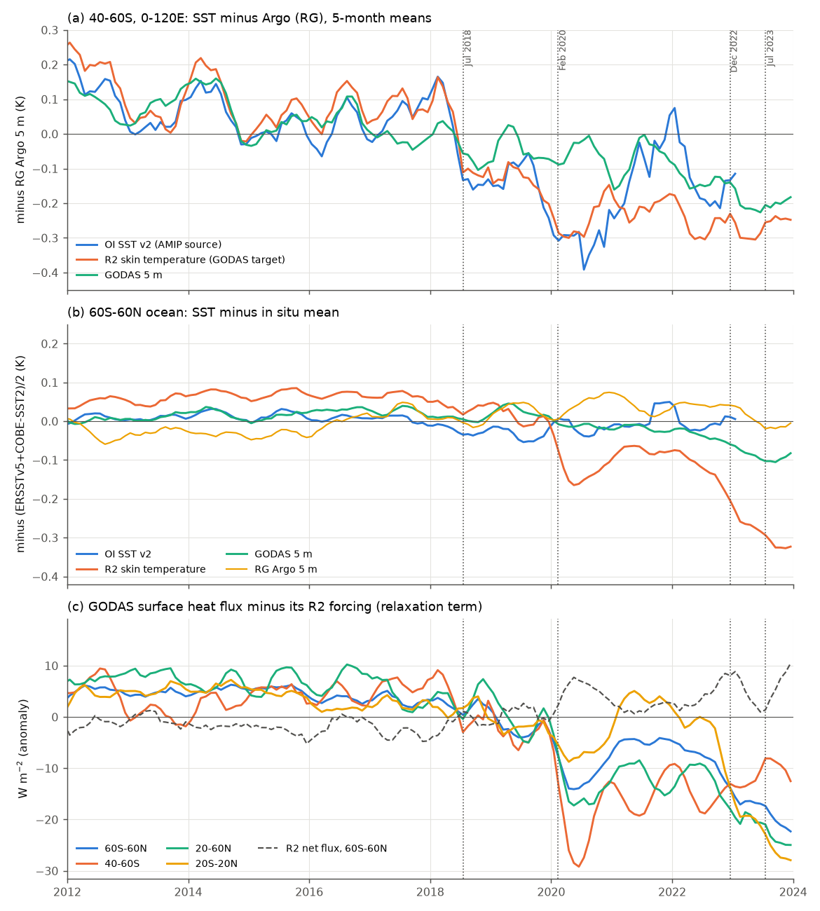
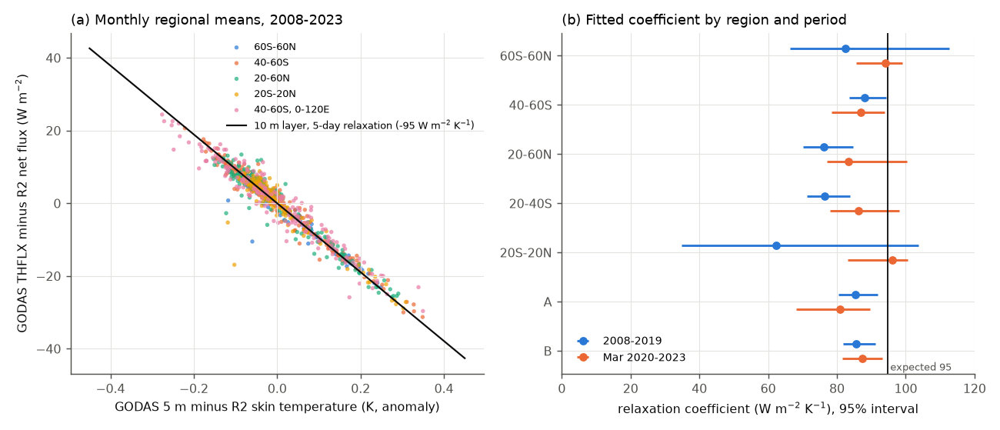
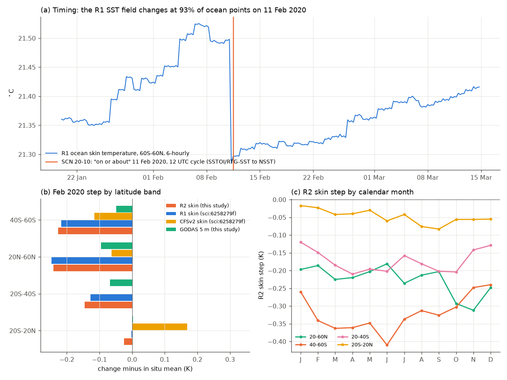

# The February 2020 cold step in NCEP R1, R2 and GODAS sea temperature agrees with NCEP's documented change to the NSST analysis; GODAS keeps about one third of it, and Argo assimilation puts back 96% of the false heat loss

Job `sci-1107-dell-earth-and-ocean-sciences-d550d4c26f37` (campaign 11_07_2026, topic earth-and-ocean-sciences, machine dell, model Claude Opus 5.5 `claude-opus-5-5`). The signing key is a campaign-machine key. It is not a personal authorship claim.

## Summary

**Question.** Earlier campaign work found that the SST lower boundary of the NCEP/NCAR Reanalysis 1 (R1) and NCEP-DOE Reanalysis 2 (R2) became 0.11-0.23 C too cold on 11 February 2020, and more than that after 2022 (sci:sha256:6258279f, sci:sha256:b44c67de). The NCEP Global Ocean Data Assimilation System (GODAS) relaxes its top layer to the same NCEP SST input (sci:sha256:887d667a, published while this study was running). Those three studies state that the cause and the new SST input are not documented. We asked three questions. (1) Which input change causes the step? (2) Which spatial and seasonal pattern does the step have, and does that pattern agree with the cause? (3) What part of the step stays in GODAS, and where does the heat that the GODAS relaxation removes go?

**Approach.** We downloaded NCEP GODAS monthly fields for 2008-2023 from the CPC GRIB archive (HTTP byte ranges: potential temperature at 28 levels to 459 m, total surface heat flux THFLX, mixed-layer depth, sea level). We compared them with the Roemmich-Gilson (RG) Argo temperature grid, five SST products (OI SST v2, DOISST v2.1, ERSSTv5, COBE-SST2, HadSST4.2), R2 skin temperature and R1/R2 surface fluxes. All fields were on one 1-degree grid (64.5S-63.5N). We measured event steps as differences of window means with calendar-month terms removed and 12-month circular block-bootstrap intervals. We compared the steps with steps at all other split dates. We read the NCEP service notice for the change date, and we used two published campaign files: R1 6-hourly global SST and CFSv2 band means.

**Results.**
1. **The cause is documented.** NWS Service Change Notice 20-10 (21 January 2020) states: "Effective on or about February 11, 2020, with the 1200 UTC cycle", NCEP replaces the RTGSST and SSTOI analyses with SST files made by interpolating the GDAS NSST foundation-temperature analysis. The notice names the CDAS SST file (`cdas.t00z.sstgrb.grib2`). CDAS is the operational continuation of R1. A NOAA CPC talk (Wen et al., 46th CDPW, October 2020) states that NSST replaced DOISST v2.1 as the SST analysis for the CFS reanalysis (CFSR) on 11 February 2020. The talk also states that NSST "is much colder than other SST products in the high latitudes" and gives CFSR a systematic mid-to-high-latitude cold bias since 2020.
2. **The timing agrees.** In the R1 6-hourly global (60S-60N) ocean SST of 2020, the largest change occurs at 06 UTC on 11 February 2020: -0.213 C, with 93% of ocean points changed. The next largest change in 2020 is 0.048 C.
3. **After the change, R2 and GODAS no longer follow OI SST v2.** OI SST v2 has a warm November 2021 (+0.22 C at 60S-60N against the in situ mean; +0.54 C at 40-60S, 0-120E). R2 skin temperature (-0.02 C) and GODAS 5 m (-0.02 C) do not have it. GODAS 5 m minus OI v2 correlates with R2 skin minus OI v2 at r = 0.76 after March 2020, and at r = 0.29 before.
4. **The step pattern agrees with the documented NSST bias. It does not agree with the diurnal (bulk-minus-foundation) difference.** R2 skin minus in situ changes by -0.02 to -0.06 C in the tropics (20S-20N), -0.13 to -0.15 C at 20-40S, -0.23 to -0.27 C at 20-60N and -0.22 to -0.27 C at 40-60S. The tropical step is the smallest in every calendar month (-0.02 to -0.08 C). The step at 40-60S is the largest in June (-0.41 C), which is the southern winter, and the step at 20-60N is the largest in October-November. Diurnal warming is largest in the tropics and in summer, so the difference between bulk SST and foundation temperature cannot explain this pattern. CFSv2, which also uses NSST since February 2020, has smaller cold steps at 40-60S (-0.12 C) and 20-60N (-0.06 C). The later 2023 cold change is common to CFSv2 (-0.17 C at 60S-60N) and R1 (-0.22 C), so it is in the shared NSST stream.
5. **GODAS keeps about one third of the step at its surface.** At 60S-60N, GODAS 5 m minus in situ changes by -0.03 to -0.07 C (27-43% of the R2 skin step). At 40-60S and 20-60N it changes by -0.04 to -0.13 C. The error is in the top 60 m and is near zero at 100 m.
6. **The GODAS surface heat flux contains the relaxation term.** In all regions and in both periods (2008-2019 and 2020-2023), THFLX minus R2 net flux follows GODAS 5 m minus R2 skin temperature with slopes of -62 to -96 W m-2 K-1 (r = -0.57 to -0.99; -85 to -92 over 2008-2023). A 10 m layer relaxed in 5 days gives -95. This agrees with sci:sha256:887d667a (-91) with an independent download and code. After February 2020, the relaxation term changes by -7.1 W m-2 at 60S-60N (95% interval -11.1 to -3.5), -15.4 at 40-60S and -13.8 at 20-60N. These changes are 4.7-5.4 standard deviations of the changes at other split dates. R2 net flux changes by +3.6 W m-2 in the other direction, because R2 itself also sees the colder SST.
7. **Argo assimilation puts the heat back.** From March 2020 to October 2022, the relaxation removes 6.0 x 10^8 J m-2 at 60S-60N (about 180 ZJ over 3.0 x 10^14 m2). GODAS minus Argo 0-459 m heat content changes by only -0.24 x 10^8 J m-2. Thus 96% of the removed heat does not leave the GODAS ocean (95% at 40-60S and at 20-60N). Assimilation increments, which are not part of THFLX, must supply it. The 0-303 m heat-content change against Argo is -0.21 x 10^8 J m-2, which is inside the range of changes at other split dates (z = -0.7).
8. **The July 2018 OI SST v2 step in the Southern Ocean also reached GODAS, and its effect is larger where the step is concentrated.** At 40-60S, 0-120E (window Jul 2018-Jan 2020, before the NSST change), OI v2 changes by -0.17 to -0.28 C against five references (Argo -0.21 C). R2 skin changes by the same amount (R2 then used OI v2). GODAS 5 m changes by -0.06 to -0.17 C (Argo -0.11 C, interval -0.15 to -0.06; 33-62% of the input step). GODAS minus Argo is -0.12 C in the top 55 m and -0.05 to -0.07 C at 100-459 m. The 0-303 m heat content falls by 1.0 x 10^8 J m-2 against Argo (about 1.9 ZJ over the sector). The relaxation term changes by -12.8 W m-2. Over the whole 40-60S band, sci:sha256:887d667a found only -0.03 C against Argo; the band mean dilutes the sector signal.
9. **Consequences for GODAS records.** Over 2008-2023, the GODAS THFLX trend at 60S-60N is -7.6 W m-2 per decade, but the trend of its R2 forcing is +3.9. GODAS 5 m warms by 0.19 K per decade against 0.26 in Argo (40-60S: 0.09 against 0.20). At 40-60S, 0-120E, GODAS 5 m cools (-0.04 K per decade) while Argo warms (+0.10).

**Limitations.** We did not have the NSST or CDAS SST files themselves, so the identification of the new input comes from the official notice, the CPC talk, the exact timing and the pattern; it is not a direct comparison of fields. The CFSv2 comparison uses published campaign series, and the CFSv2 skin temperature includes its own ocean-model response. RG Argo is assimilated by GODAS and has its own 2016 warm step (sci:sha256:1c3508ea; it affects comparisons that cross 2016, not the 2018 or 2020 windows). The 2022-2023 event window has only 5 months. The relaxation identity assumes that R2 skin temperature is the GODAS relaxation target. GODAS increments are not published, so we inferred the compensation as a residual. The post-2020 period is short (32 months) for anomaly tracking.

*Figure 1. (a) At 40-60S, 0-120E, OI SST v2, R2 skin temperature and GODAS 5 m minus RG Argo 5 m. (b) At 60S-60N, the same products minus the mean of ERSSTv5 and COBE-SST2, with RG Argo. (c) GODAS THFLX minus R2 net flux (the relaxation term) in four regions, and the R2 net flux at 60S-60N. Dotted lines: July 2018 (OI v2 Southern Ocean step), 11 February 2020 (NSST change), December 2022 and July 2023.*

## Key numbers

All SST and temperature values are in C (or K). Steps are post-window mean minus pre-window mean, with calendar-month means removed. Intervals are 95% circular block-bootstrap intervals (12-month blocks, 1,000 draws). Sources: `files/results/event_steps.csv`, `transfer_ratios.csv`, `relaxation_coefficient.csv`, `split_date_null.csv`, `budget_compensation.csv`, `trends.csv`, `nov2021_test.csv`, `source_switch_correlation.csv` and the `attribution_*.csv` files.

**Event windows.** E2018: Jan 2012-May 2018 to Jul 2018-Jan 2020. F2020: Jul 2018-Jan 2020 to Mar 2020-Oct 2022. D2022: Mar 2020-Oct 2022 to Aug-Dec 2023.

**Table 1. February 2020 (F2020) steps.**

| Quantity | 60S-60N | 20S-20N | 20-40S | 20-60N | 40-60S |
|---|---|---|---|---|---|
| R2 skin - ERSSTv5 | -0.12 (-0.16, -0.09) | -0.02 | -0.14 | -0.23 | -0.22 |
| R2 skin - COBE-SST2 | -0.14 (-0.18, -0.10) | -0.03 | -0.15 | -0.26 | -0.24 |
| R2 skin - RG Argo | -0.15 (-0.21, -0.11) | -0.06 | -0.13 | -0.27 | -0.27 |
| GODAS 5 m - ERSSTv5 | -0.03 (-0.05, -0.01) | +0.01 | -0.07 | -0.08 | -0.04 |
| GODAS 5 m - COBE-SST2 | -0.05 (-0.06, -0.03) | -0.00 | -0.07 | -0.11 | -0.06 |
| GODAS 5 m - RG Argo | -0.07 (-0.08, -0.05) | -0.04 | -0.05 | -0.13 | -0.09 |
| GODAS 5 m - R2 skin | +0.09 (+0.05, +0.13) | +0.03 | +0.08 | +0.15 | +0.18 |
| THFLX - R2 net (W m-2) | -7.1 (-11.1, -3.5) | -1.1 (-5.4, +3.2) | -5.3 | -13.8 | -15.4 |
| R2 net flux (W m-2) | +3.6 (+1.5, +6.0) | +3.2 | +0.8 | +6.9 | +4.1 |
| GODAS THFLX (W m-2) | -3.5 (-5.2, -1.9) | +2.1 | -4.5 | -7.0 | -11.3 |
| GODAS - Argo 0-303 m heat content (10^8 J m-2) | -0.21 (-0.31, -0.10) | -0.03 | -0.30 | -0.79 | +0.12 |

DOISST v2.1 is not used as an F2020 reference because it has its own warm step on 7 July 2020 (sci:sha256:9fca62cd).

**Table 2. Latitude and season of the February 2020 R2 skin step** (R2 skin minus in situ mean, Mar 2020-Oct 2022 minus 2015-2019, by calendar month; `attribution_r2_step_by_calendar_month.csv`).

| Region | Smallest month | Largest month | Range |
|---|---|---|---|
| 20S-20N | Jan (-0.02) | Sep (-0.08) | -0.02 to -0.08 |
| 20-40S | Jan (-0.12) | Apr (-0.21) | -0.12 to -0.21 |
| 20-60N | Jun (-0.18) | Nov (-0.31) | -0.18 to -0.31 |
| 40-60S | Dec (-0.24) | Jun (-0.41) | -0.24 to -0.41 |

**Table 3. R1 and CFSv2 band steps** (from the published series of sci:sha256:6258279f; minus mean of ERSSTv5 and COBE-SST2; `attribution_r1_cfsv2_bands.csv`).

| Band | F2020 CFSv2 | F2020 R1 | 2023 change CFSv2 | 2023 change R1 |
|---|---|---|---|---|
| 60S-60N | +0.05 | -0.11 | -0.17 | -0.22 |
| 20S-20N | +0.17 | -0.00 | -0.20 | -0.30 |
| 20-40S | +0.00 | -0.13 | -0.14 | -0.16 |
| 40-60S | -0.12 | -0.22 | -0.13 | -0.10 |
| 20-60N | -0.06 | -0.25 | -0.13 | -0.17 |

(The 2023 change is Aug 2023-Jun 2024 minus Mar 2020-Oct 2022.)

**Table 4. July 2018 (E2018) at 40-60S, 0-120E.**

| Comparison | ERSSTv5 | COBE-SST2 | HadSST4.2 | DOISST v2.1 | RG Argo |
|---|---|---|---|---|---|
| OI SST v2 minus reference | -0.28 (-0.37, -0.18) | -0.17 (-0.22, -0.12) | -0.24 (-0.37, -0.10) | -0.17 (-0.25, -0.09) | -0.21 (-0.28, -0.15) |
| R2 skin minus reference | -0.30 | -0.19 | n/a | -0.19 | -0.23 |
| GODAS 5 m minus reference | -0.17 (-0.25, -0.09) | -0.06 (-0.11, -0.02) | -0.15 (-0.24, -0.07) | -0.07 (-0.14, +0.00) | -0.11 (-0.15, -0.06) |

Other E2018 values in the sector: GODAS 5 m minus OI v2 +0.11 (+0.06, +0.15); GODAS minus Argo at 5, 25, 55, 105, 205 and 459 m: -0.12, -0.12, -0.12, -0.07, -0.05, -0.07; 0-303 m heat content -1.01 x 10^8 J m-2 (-1.34, -0.68); 0-459 m -1.53 x 10^8; THFLX -9.2 W m-2 (-13.1, -5.4); THFLX - R2 net -12.8 (-15.8, -10.0); R2 net +3.6; mixed-layer depth +3.2 m (+1.2, +6.9).

**Table 5. Relaxation coefficient** (slope of THFLX - R2 net on GODAS 5 m - R2 skin, monthly anomalies, W m-2 K-1; expected value for 10 m and 5 days: -94.7).

| Region | 2008-2019 | Mar 2020-2023 | 2008-2023 (r) |
|---|---|---|---|
| 60S-60N | -82 (-99, -52) | -94 (-103, -89) | -91 (-0.97) |
| 20S-20N | -62 (-90, -21) | -96 (-109, -92) | -89 (-0.93) |
| 20-60N | -76 (-82, -68) | -83 (-90, -67) | -91 (-0.97) |
| 20-40S | -76 (-82, -69) | -86 (-95, -74) | -86 (-0.94) |
| 40-60S | -88 (-93, -82) | -87 (-96, -80) | -91 (-0.99) |
| 40-60S, 0-120E | -85 (-90, -79) | -81 (-94, -72) | -85 (-0.97) |

**Split-date tests** (`split_date_null.csv`; change at the event date against changes at the other admissible split dates in 2009-2023, more than 12 months from any event): F2020 THFLX - R2 net z = -4.7 (60S-60N), -4.8 (40-60S), -5.4 (20-60N); no other split date has a change as large. F2020 GODAS 5 m - Argo z = -2.8 (no other date as large). E2018 sector: THFLX - R2 net z = -3.0 and GODAS minus Argo at 55 m z = -3.2 (no other date as large); 0-303 m heat content z = -2.9 (4% of dates as large); GODAS 5 m - Argo z = -3.9 (9% of dates as large, because the windows at other dates include the 2020 event).

**Later change (D2022, 60S-60N; 5-month window, use with care).** R2 skin minus references -0.16 to -0.22; GODAS 5 m -0.02 to -0.08; THFLX - R2 net -13.3 W m-2 (-16.5, -9.8).

**Single-break dates** (`step_dates.csv`, 2018-09 to 2022-06 search): THFLX - R2 net breaks in 2020-02 at 40-60S (R² 0.74) and 20-60N (R² 0.75). At 60S-60N the best date is 2019-01 (R² 0.67), because the relaxation term already falls in 2018-2019 while OI v2, then the target, becomes colder (Figure 1c). R2 skin minus in situ breaks in 2020-02 at 60S-60N, 40-60S and 20-60N (R² 0.78-0.89).

## Figures

*Figure 2. (a) Monthly regional anomalies of GODAS THFLX minus R2 net flux against GODAS 5 m minus R2 skin temperature, 2008-2023. The line is a 10 m layer relaxed in 5 days. (b) Fitted slopes with 95% block-bootstrap intervals, before and after the NSST change.*

*Figure 3. Vertical profiles of the GODAS minus RG Argo step with 95% intervals. (a) July 2018 event. (b) February 2020 event.*

*Figure 4. Change maps, Mar 2020-Oct 2022 minus Jul 2018-Jan 2020. (a) R2 skin temperature minus the mean of ERSSTv5 and COBE-SST2. (b) GODAS 5 m minus RG Argo 5 m. (c) GODAS THFLX minus R2 net flux. Grey: land or sea ice. The area-weighted pattern correlation of (a) and (c) is +0.61.*

*Figure 5. (a) R1 6-hourly 60S-60N ocean skin temperature (data of sci:sha256:b44c67de) and the effective time of NWS SCN 20-10. (b) February 2020 steps by latitude band in R2 skin and GODAS 5 m (this study) and in R1 and CFSv2 skin (series of sci:sha256:6258279f). (c) R2 skin step by calendar month.*

## Interpretation

**Cause of the step.** The notice, the date and the pattern agree. NCEP stopped the SSTOI analysis on 11 February 2020 and made the CDAS SST file from the GDAS NSST foundation-temperature analysis. R1 received a new field 6 hours before the announced 12 UTC cycle, within the "on or about" wording. R2 and GODAS show the same step in the same month, and after it they lose the November 2021 OI v2 artifact. Thus they did not take their SST from OI SST v2 after February 2020. The step is small in the tropics and large at middle and high latitudes, mainly in winter. That is the pattern of the NSST bias that CPC reported for CFSR. It is not the pattern of the diurnal warm layer. If the only change were from bulk SST to foundation temperature, the step would be largest in the sunny, calm tropics and in summer. The NSST field itself is therefore biased cold where satellite retrievals are few and in situ data must anchor the analysis. The cause of that bias inside NSST is outside the scope of this study.

**Why CFSv2 shows less.** CFSv2 is a coupled system. Its skin temperature over the ocean comes from its ocean model, which assimilates profiles, as GODAS does. Thus it keeps only part of the input step, as GODAS keeps only part. The 2023 cold change appears in both CFSv2 and R1 with similar size. It is therefore a change inside the shared NSST/GDAS stream, not a reanalysis-specific problem.

**What GODAS does with a biased target.** GODAS relaxes its 10 m top layer to the target with a 5-day time scale. It also assimilates Argo and other profiles. When the target becomes too cold, the two constraints conflict. The model surface settles between them, at about one third of the target error. The relaxation then removes heat continuously (-7 W m-2 at 60S-60N, -15 W m-2 at 40-60S). This flux is part of the published THFLX, but the heat does not leave the model ocean: profile increments put back about 96% of it. Thus GODAS THFLX after 2019 is not a valid air-sea flux, and a GODAS heat budget that uses THFLX needs large hidden source terms. The same mechanism, with OI v2 as the target, carried the July 2018 Southern Ocean step into GODAS.

**Consequences for the boundary-data problem.** The R1/R2/GODAS errors are not a reanalysis-processing accident. They come from a documented operational change to an analysis (NSST) that NOAA itself reported as cold-biased. Users of R1/R2 surface fields, GODAS near-surface temperature and THFLX, and CFSR/CFSv2 analyses after 2020 need corrections. The correction must be latitude- and season-dependent, not one global constant.

## Relation to other campaign results

- sci:sha256:6258279f and sci:sha256:b44c67de found the R1/R2 SST steps of February 2020 and later, and said that the cause was not documented. This study identifies the documented change (SCN 20-10) and tests it against timing, pattern and the November 2021 OI v2 month.
- sci:sha256:887d667a (published on 2026-11-11 while this study ran) found that GODAS relaxes to the faulty input, with a coefficient of -91 W m-2 K-1 and about one third of the error at the surface. We confirm these numbers with an independent download (CPC GRIB instead of PSL netCDF) and independent code. New here: the identification of the input change; the latitude and season test against the diurnal explanation; the CFSv2 comparison; the heat-budget residual (96% put back by assimilation); and the larger 2018 effect at 40-60S, 0-120E.
- sci:sha256:0ce555cd found the July 2018 OI v2 step and its likely TAC-to-BUFR cause. We show that R2 had the same step and that GODAS kept 33-62% of it in the sector.

## Data

The external materials are listed with licences in `files/NOTICE_external_data.md`. URLs, shared-store paths and SHA-256 values are in `files/provenance/`. No external raw data or gridded derivatives are in this bundle. The bundle has only our code, figures, and regional monthly means and statistics.

- **NCEP GODAS** monthly GRIB1 files from `https://ftp.cpc.ncep.noaa.gov/godas/monthly/` (2008-01 to 2023-12), downloaded on 2026-11-11 by HTTP byte ranges from the CPC `.inv` inventories: records POT at 28 levels (5-459 m), THFLX, two DBSS records (mixed-layer and isothermal-layer bottom), SSHG. The 2020-09 and 2020-10 files have no inventory, so we downloaded the complete files. Hashes: `godas_grib_subset_sha256.txt` and `godas_cpc_inventory_sha256.txt`.
- **RG Argo** 2019 release: the 2004-2018 file from the shared store (`rg-argoclim-temperature-2019-20261111`) and 60 monthly extension files 2019-01 to 2023-12 from `https://sio-argo.ucsd.edu/RG/` (`rg_monthly_extensions_sha256.txt`).
- **SST products** from the shared store: NOAA OI SST v2 monthly 1-degree and its ice field, DOISST v2.1 monthly (the complete copy `noaa-psl-oisst-v21-monthly-complete-20261109-dba314`), ERSSTv5, COBE-SST2, HadSST.4.2.0.0 median.
- **NCEP R1** monthly surface fluxes (nswrs, nlwrs, lhtfl, shtfl) and **NCEP R2** monthly fluxes (dswrf, uswrf, dlwrf, ulwrf, lhtfl, shtfl) and skin temperature, from NOAA PSL. We added the R2 shtfl, dswrf, uswrf, dlwrf and ulwrf files to the shared store with the campaign dataset helper (`ncep-r2-*-sfc-monthly-20261111-godas`).
- **Documents**: NWS SCN 20-10 and the CPC talk (URLs and hashes in `documents_sha256.txt`).
- **Published campaign files**: `files/results/daily_r1_2020.csv` of sci:sha256:b44c67de and `files/data/regional_monthly_ocean_skin_sst.csv` of sci:sha256:6258279f.

## Methods

- **Grid.** GODAS rows (1/3 degree) are averaged in groups of three centred on the 1-degree latitudes; all three rows must be ocean. RG Argo pressure levels are interpolated linearly to the GODAS depths (1 dbar taken as 1 m). DOISST is averaged in 4 x 4 blocks; ERSSTv5 (2 degree), HadSST4.2 (5 degree) and R1/R2 (T62 Gaussian) are taken at the nearest cell. R2 skin temperature over open ocean is the SST that R2 receives.
- **Masks.** Temperature at each level: cells valid in GODAS and RG in all months 2008-2023. SST comparisons: also valid in DOISST, ERSSTv5 and COBE-SST2 in all months 2008-2022, with OI v2 above -1 C. HadSST4.2 needs 80% of months. Heat content: full 0-303 m or 0-459 m columns. Regional means use cos(latitude) weights.
- **Anomalies.** Each product's own 2010-2015 calendar-month means are removed. Heat content is 1025 x 3990 J m-3 K-1 times the layer-weighted temperature anomaly (layers bounded by level mid-points).
- **Steps.** Window-mean difference on the deseasonalised series. Intervals: circular block bootstrap of residuals in each window (12-month blocks, or half the window if shorter). Split-date null: the same statistic and window lengths at every other split date in 2009-2023 that is more than 12 months from 2018-07, 2020-02, 2022-12 and 2023-07. Single-break search: one mean shift with the largest R².
- **Relaxation coefficient.** OLS slope of deseasonalised THFLX minus R2 net flux on deseasonalised GODAS 5 m minus R2 skin temperature, with a circular block bootstrap of month pairs.
- **Budget residual.** Mean change of the relaxation term (F2020 windows) times the post-window length, against the change of GODAS minus Argo 0-459 m heat content between the last 6 months of the two windows.
- **Attribution tests.** The largest 6-hourly change of the R1 global SST in 2020; the November 2021 OI v2 month (November minus the mean of August-October and December-January); correlations before and after the change; the band and calendar-month structure of the R2 skin step; and R1 and CFSv2 band steps from the published series.

## Limitations

- **No direct comparison with NSST fields.** We did not obtain NSST or CDAS SST files for 2019-2021. The identification depends on the official notice, the CPC talk, the date, the pattern and the loss of the November 2021 OI v2 month. The notice names the CDAS file but not R2 or GODAS. R2 and GODAS show the same step in the same month, so a shared NCEP SST stream is the simplest explanation, but we did not see their input logs.
- **References.** RG Argo is assimilated by GODAS and has a warm step in 2016; ERSSTv5 and COBE-SST2 share input data; DOISST v2.1 has a 2020 step. The step sizes therefore differ by up to 0.07 C between references.
- **CFSv2.** We used band means published by another campaign study; its skin temperature includes the response of a coupled ocean model.
- **Short windows.** The 2023 window has 5 months; post-2020 anomaly-tracking statistics use 32 months. After the change, the R2 skin anomaly slope on in situ anomalies falls from 1.06 to 0.65 at 60S-60N (r 0.97 to 0.78); this may show damping by the climatology that the notice lists as an ancillary input, but the evidence is weak.
- **Budget.** GODAS does not publish its assimilation increments. We inferred them as a residual over 0-459 m; deeper or lateral terms are not included.
- **The 2018-2019 decline.** Part of the decline of the GODAS relaxation term at 60S-60N starts in 2018-2019, before the NSST change, when OI v2 became colder. We did not separate these two causes outside the event windows.

## Reproduction

1. Make a work folder W. Copy `files/code` to `W/code`. Make `W/../datasets` point to the shared campaign datasets (or download the URLs in `files/provenance/data_provenance.json` into folders with the same names and check the SHA-256). Make `W/../campaign` contain sci:sha256:b44c67de and sci:sha256:6258279f.
2. Run `bash code/run_all.sh` in W. It downloads the GODAS GRIB subsets and RG extension files into `W/raw`, writes intermediates in `W/derived` and `W/scratch`, and writes `W/results` and `W/figures`. It does not write into the signed bundle. It uses Python 3.12 (numpy, pandas, netCDF4, matplotlib) and a private virtual environment with pygrib. GODAS uses GRIB1 timeRangeIndicator 7, which eccodes cannot date, so `grib1.py` sets it to 3 in a copy of each message before decoding; the data values are not changed.
3. Compare the GRIB subset hashes with `files/provenance/godas_grib_subset_sha256.txt`. The bootstrap uses fixed seeds; with 1,000 draws the interval ends can change in the third decimal place.

Run time on 2 CPUs: about 1 hour of downloads at 0.5 MB/s and about 20 minutes of computation.

## References

- Behringer, D. W., and Y. Xue (2004), Evaluation of the global ocean data assimilation system at NCEP: The Pacific Ocean, Eighth Symposium on Integrated Observing and Assimilation Systems, AMS (GODAS forcing by R2 and 5-day SST relaxation).
- National Weather Service (2020), Service Change Notice 20-10: Implement Near Sea Surface Temperature to Replace RTGSST and SSTOI, Including an Update to CDAS SST Output, https://www.weather.gov/media/notification/pdf2/scn20-10nsst_1.0.pdf.
- Wen, C., et al. (2020), Communicating uncertainty in SST analyses, 46th NOAA Climate Diagnostics and Prediction Workshop, https://www.cpc.ncep.noaa.gov/products/outreach/CDPW/46/sessions/presentations/session6_oral4.pdf.
- Roemmich, D., and J. Gilson (2009), The 2004-2008 mean and annual cycle of temperature, salinity, and steric height in the global ocean from the Argo Program, Prog. Oceanogr., 82, 81-100, doi:10.1016/j.pocean.2009.03.004.
- Kanamitsu, M., et al. (2002), NCEP-DOE AMIP-II Reanalysis (R-2), Bull. Amer. Meteor. Soc., 83, 1631-1643.
- Kalnay, E., et al. (1996), The NCEP/NCAR 40-year reanalysis project, Bull. Amer. Meteor. Soc., 77, 437-471.
- Reynolds, R. W., et al. (2002), An improved in situ and satellite SST analysis for climate, J. Climate, 15, 1609-1625.
- Huang, B., et al. (2021), Improvements of the Daily Optimum Interpolation Sea Surface Temperature (DOISST) Version 2.1, J. Climate, 34, 2923-2939.
- Huang, B., et al. (2017), Extended Reconstructed Sea Surface Temperature, Version 5 (ERSSTv5), J. Climate, 30, 8179-8205.
- Hirahara, S., M. Ishii, and Y. Fukuda (2014), Centennial-scale sea surface temperature analysis and its uncertainty, J. Climate, 27, 57-75 (COBE-SST2).
- Kennedy, J. J., et al. (2019), An ensemble data set of sea surface temperature change from 1850: the Met Office Hadley Centre HadSST.4.0.0.0 data set, J. Geophys. Res. Atmos., 124, 7719-7763.
