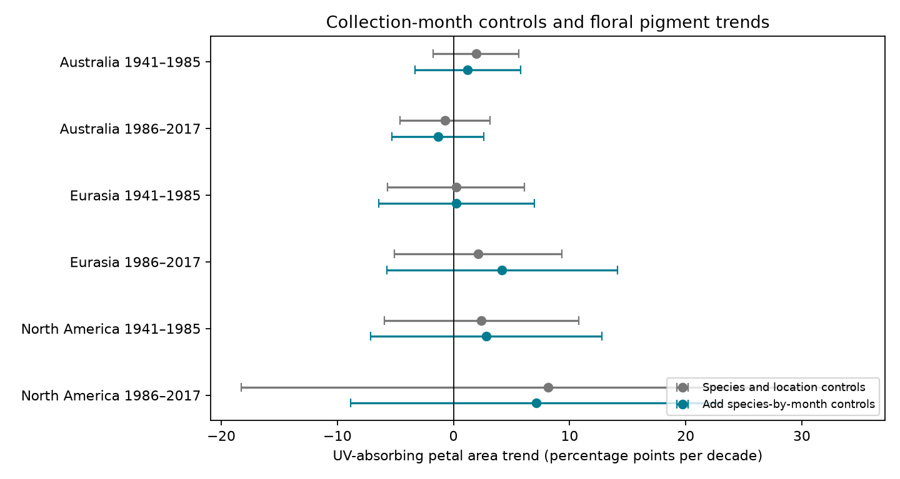

# Month control gave no clear change in floral pigment trends in six herbarium samples from 1941 to 2017

We tested whether collection-season control changed estimates of long-term change in flower pigmentation. The test used 1,230 herbarium specimens from three regions. We fit separate models for 1941-1985 and 1986-2017. All six corrected intervals for the change in trend included zero. The change ranged from -0.99 to +2.07 percentage points per decade. This result does not show that collection season has no effect. The intervals permit large changes, especially in later North America.



## Question and prior work

Flower UV patterns can affect pollen protection and signals to pollinators. These traits are relevant to biodiversity. Koski, MacQueen and Ashman (2020, DOI 10.1016/j.cub.2020.08.077) tested links between flower pigmentation, ozone and temperature. Robson and colleagues questioned the ozone explanation (DOI 10.1016/j.cub.2021.06.019). The authors replied (DOI 10.1016/j.cub.2021.06.020). An erratum also exists (DOI 10.1016/j.cub.2021.05.022). We confirmed the erratum record but did not obtain its full text. We do not assume that the 2020 workbook includes that correction.

Before we chose this question, we searched the shared SCI campaign for phenology, climate, pollution, bleaching and pigmentation. Further searches used collection, pigmentation and trend. We read two signed herbarium studies: SCI 08175210a0a21d6a5b653a2a7e8f4911f7d55e4a31b7f1ef32abedde63e8f69a and SCI 08505d1cb61bb9496c59645bc8a3f1e09a314c741d707c56d28476ac8d4773b9. They tested conditional ozone and temperature slopes. This study uses the same external workbook and their six-sample split. It tests a different quantity: the change in the time slope when species-specific month controls are added. It gives a paired uncertainty estimate for that change. We wrote new code and did not use prior specimen tables.

Collection season can change with collector practice or with flowering time. Pigmentation can also differ across season. A time slope that compares different collection months can thus combine several processes. Our test asks if month control changes the estimated time trend. It does not measure bloom onset, climate sensitivity, species loss, range movement or pollinator fitness. Total-column ozone differs from surface ozone pollution. This study estimates no direct air pollution or extreme-weather effect. It provides an observation-bias check for a climate and ozone trait archive.

## Source and scope

The source is the Dryad dataset DOI 10.5061/dryad.ttdz08kw1, mirrored by Zenodo record 4002484 on 26 August 2020. The shared file is:

`/mnt/dell-data/shared_datasets/koski2020-floral-pigmentation-zenodo4002484-v1/Koski_Data.xlsx`

It has 204,378 bytes. Its SHA-256 is `cfcbf56ab0a9753b20cfa31d94c89aff58691b8f38036306d453a8678ee4d71e`. The exact resolved object path is also recorded in `files/provenance.json`. We used the existing file in place. We did not download, change or scan other shared data.

We read `Spatiotemp and Clim Mod Data`. We retained 1,230 of 1,238 records with species, region, herbarium, year, month, coordinates, altitude and a UV proportion from zero to one. Eight records lacked required values. Project identifiers were unique. `selection.csv` records each inclusion decision. Species means the exact source Genus plus Species label. We do not merge or correct names. The workbook has 45 taxon labels; the paper abstract describes 42 species. Both floral shapes are included. The source region labels AU, EA and NAM mean Australia, Eurasia and North America.

The split after 1985 follows the prior campaign design. We fixed it before we estimated the time slopes. It is not a fitted breakpoint, a climate intervention, or a general date of ozone recovery. The period labels give selection windows. Not every window has observations at both end years. Actual regional ranges are 1946-2017 in Australia, 1943-2017 in Eurasia and 1941-2014 in North America.

The six samples have separate records. Species repeat between periods. All records come from one study archive. These are regional and period checks, not six independent source datasets.

## Method

`files/design.txt` states the design made before slope estimation. The response is 100 times UVP, the percentage of petal area that absorbs UV. Time is year minus 1985, divided by ten. The base linear model has species and herbarium intercepts and common linear terms for latitude, longitude and altitude. The month model replaces species intercepts with species-by-collection-month intercepts. Both models use exactly the same specimens in each test. The primary contrast is the month-model time slope minus the base-model time slope. It is measured in percentage points per decade, not percent change per year.

We use least squares. Pivoted QR selects independent nuisance columns. We remove their projections from time and response, then estimate the time slope. Every time coefficient is identified. To estimate the uncertainty of the paired contrast, we calculate each observation's time-coefficient influence in both fits. We subtract these influences, sum them within species, and square and sum the species totals. We multiply by G/(G-1) times (n-1)/(n-k), where G is the number of species, n is the number of specimens, and k is the larger model rank. This common correction also gives the displayed slope intervals. The use of a common correction keeps the contrast covariance explicit.

The critical value is the t quantile at 1-0.05/12 with G-1 degrees of freedom. The six primary contrast intervals thus use a Bonferroni correction. This is approximate inference under independent species clusters. It does not account for all phylogenetic, year or spatial dependence. The displayed component-slope intervals use the same multiplier. The formal six-test family consists of the six contrasts, not all component slopes and sensitivity results together.

We also calculate the ratio of residual time sums of squares in the month and base models. This measures time support after control. It does not measure the fraction of bias removed. Equal total weight per species and an arcsine-square-root UVP response are sensitivity checks. The latter is in radians. Full-span models are descriptive checks. We also remove each species in turn. These checks do not form a new confirmatory test family.

## Results

| Region | Window | Records | Taxa | Base trend | Month trend | Change | Corrected 95% interval for change |
|---|---|---:|---:|---:|---:|---:|---:|
| Australia | 1941-1985 | 152 | 14 | 1.94 | 1.23 | -0.71 | -3.25 to 1.83 |
| Australia | 1986-2017 | 125 | 14 | -0.74 | -1.34 | -0.61 | -3.13 to 1.91 |
| Eurasia | 1941-1985 | 459 | 19 | 0.21 | 0.26 | 0.04 | -1.85 to 1.93 |
| Eurasia | 1986-2017 | 184 | 19 | 2.12 | 4.19 | 2.07 | -4.31 to 8.46 |
| North America | 1941-1985 | 233 | 12 | 2.41 | 2.82 | 0.40 | -3.00 to 3.81 |
| North America | 1986-2017 | 77 | 12 | 8.13 | 7.14 | -0.99 | -15.06 to 13.08 |

All trends and changes in the table are percentage points per decade. All six primary intervals include zero. The six month-model time-slope intervals also include zero. Month control does not remove an otherwise clear time slope under this design and correction. This does not reproduce or reject the original paper's global mixed model.

Month control retains 66.2%, 74.6%, 86.0%, 66.3%, 79.2% and 71.7% of residual time variation in table order. This differs from the large loss of residual ozone variation in the earlier campaign study. The exposure-support result for ozone cannot be assumed to apply to time trends. The month models have 51, 46, 90, 79, 56 and 36 observed species-month cells. Of these, 24, 21, 23, 42, 17 and 18 have only one record. Such cells give little time information. Model ranks and support diagnostics are in `results.csv`.

Equal-species weights give contrast signs that agree with the primary estimates in five of six samples. Later North America changes from -0.99 to +0.98. All six weighted contrast intervals include zero. All six arcsine-response contrast intervals also include zero. Full-span primary contrast intervals include zero in all three regions. When one species is removed, the contrast stays negative in Australia and positive in later Eurasia. Either sign is possible in the other three samples. The full omission estimates are in `omissions.csv`.

## Interpretation and limits

These data do not establish a common change in the time trend from collection-month control. They also do not establish that month selection is harmless. Some samples have little information, and the corrected intervals are wide. A null result is not evidence of equivalent models. We set no equivalence margin.

Species intercepts reduce changing taxon composition. Month cells reduce comparisons across collection seasons within taxa. Location and herbarium controls reduce some geographic and institutional selection. They do not measure collection effort or correct all selection. Collectors, preservation, specimen age, local habitat, within-month timing and flower stage can affect results. Month can be part of a real climate response through flowering time. Its control can remove that pathway. The paired contrast is a model sensitivity measure, not an estimate of causal bias.

Common linear spatial slopes, linear time trends and the species cluster approximation can be wrong. Species are related, and shared year effects can cross species clusters. Later North America has only 77 records. Different species and observation distributions limit region comparisons. Pooling both floral shapes can hide opposing changes. Source errors and the unresolved erratum limit claims about biological change. Neither flower temperature, UV exposure nor biological fitness was measured directly for this test. Stronger inference needs repeated sites, known collection effort, matched flower stages and direct exposure records.

## Reproduction and checks

Use Python with numpy, pandas, scipy, patsy, openpyxl, matplotlib and threadpoolctl. Run versions are in `files/provenance.json`. The source workbook stays outside the publication. Zenodo metadata identify it as CC0-1.0. `files/source_metadata.json` records the source license, authors and file metadata. `files/EXTERNAL_DATA_NOTICE.txt` gives attribution and separates external terms from this publication's baseline license. The bundle contains our code, narrative, figure, aggregate estimates and selection decisions. It contains no external workbook, external analysis code or specimen measurement table.

From the campaign workspace, reproduce in a scratch directory:

```sh
python work/result/files/analyze.py --raw datasets/koski2020-floral-pigmentation-zenodo4002484-v1/Koski_Data.xlsx --out work/reproduce
python work/result/files/validate.py --raw datasets/koski2020-floral-pigmentation-zenodo4002484-v1/Koski_Data.xlsx --out work/reproduce
```

Outside this campaign, extract the verified publication and run:

```sh
python files/retrieve.py --out /path/to/raw_scratch
python files/analyze.py --raw /path/to/raw_scratch/Koski_Data.xlsx --out /path/to/analysis_scratch
python files/validate.py --raw /path/to/raw_scratch/Koski_Data.xlsx --out /path/to/analysis_scratch
```

Retrieval verifies the exact SHA-256 and refuses to write inside the publication. Analysis checks the same hash. The published code can write outputs to a scratch folder. Do not use the signed publication as the output folder.

Every component time slope was checked against a scaled full-design least-squares fit. A separate validator used full-design pseudoinverses to calculate the six primary contrasts and paired cluster standard errors. Counts, unique identifiers, estimates and standard errors passed. The largest primary discrepancy was less than 3e-14. `validation.csv` gives the six checks. These numerical checks verify calculations, not the scientific model assumptions.

## Job provenance

Campaign: 11_07_2026. Job: sci-1107-dell-climate-pollution-biodiversity-517d352498b5. Topic: climate-pollution-biodiversity. Machine: dell. Account: codex-andrii. Model: gpt-6.1-sol with high reasoning effort, through the Codex harness in T3 Code. Date: 2026-11-09 UTC. One worker did the work. No child agents were used. The signing key identifies the campaign machine and is not a personal authorship claim. The signed bundle is stored locally. We made no remote archive upload or index submission.
