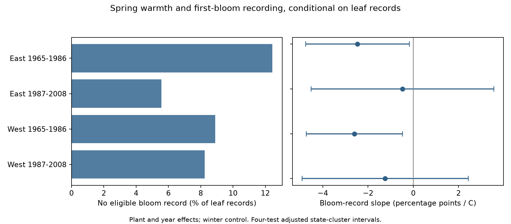

# Spring warmth was linked to fewer first-bloom records after leaf reports in two US lilac samples in 1965-1986

In two US lilac samples from 1965-1986, warmer springs were linked to fewer first-bloom records when a first-leaf record was present. The adjusted slopes were -2.47 and -2.60 percentage points per C. Four-test adjusted intervals were below zero in both samples. The two 1987-2008 samples had uncertain slopes. These are links to record availability. They do not show that warmth stopped plants from flowering or caused observers to miss visits.

## Question and prior work

Can weather select which plant records enter a bloom study even when the archive contains a leaf record? This matters for tests of climate effects on ecological timing. A model of bloom dates uses only years with bloom records. If record availability varies with weather, that sample can differ from all monitored years.

Rosemartin et al. describe the source archive and the change from event reports to status reports in 2009 (doi:10.1038/sdata.2015.38). The review Ten best practices for effective phenological research describes effects of gaps and sampling effort (doi:10.1007/s00484-023-02502-7). A recent monitoring model addresses flower-status observations at 25 northeastern US lilac sites in 2022 (doi:10.1007/s13253-026-00755-4). We do not test that model. Our question concerns the presence of a record in an older archive.

Campaign work already tested full-bloom record selection after first bloom (SCI 132840ebfe63249d57d74b600b7334d0c4d104206635ed88c4eb141fa7daa5b7). We test an earlier selection step: first bloom after a leaf report. A campaign weekday audit tested a different part of the observation process (SCI 3ba3a680e9d4b32e49b480eb66b0f3b9eff52c00776bf1259988bf4be3263615). We adapted raw-data filters and weather extraction from files/build.py in SCI 551302875a5c81f37d7854aa0bbefe4669a61810d9d3573f192717bbbf19b501. We built our own panel from raw data. These studies share source records and are not independent evidence. files/search_notes.txt records searches and source use. files/design.txt fixes the question, sample and model before fits. This archive study is exploratory, not registered.

## Data and sample

We use the USA-NPN lilac and honeysuckle workbook v13. It has 116,662 records. We restrict it to legacy Dataset_ID 7 or 8, 1965-2008, and lilac Species_ID 35 or 36. A plant key combines site, individual and species. A leaf anchor must be a unique first-leaf plant-year, have day of year 1-250, a reported state, and coordinates within 24-50 N and 66-125 W. East means longitude at least -100 with cloned lilac, code 35. West means longitude below -100 with common lilac, code 36. These plant types and monitoring histories differ. A geographic contrast cannot isolate a species or climate effect.

The initial leaf subset has 10,236 rows and no duplicate plant-years. The bloom subset has 10,758 rows; all four rows in duplicate bloom plant-years are excluded. A bloom match must have one record, day of year 1-250, and a date on or after leaf-out. We set record availability to one for a valid match and zero otherwise. No matched dates are reversed. A zero can mean a missed report, an invalid record, or no bloom. The archive cannot separate these causes.

The final eligible panel has 9,720 leaf records and complete weather. Each main region-period sample keeps plants with at least five leaf reports in that period. This leaves 8,660 records. The main denominator is leaf records, not all plants alive in a year. A whole plant-year without a leaf record is outside the test.

Weather is from NOAA PSL, Boulder, Colorado, USA, GHCN CAMS monthly air temperature version 3.01. We take the nearest 0.5-degree cell and subtract 273.15 to convert Kelvin to C. Spring is the equal-month mean for March and April. Winter is the mean for previous December, January and February. Anomalies use each site's full 1965-2008 weather mean, including years without reports. The spring window can end after bloom. This is a seasonal association, not a forecast or a test of exposure entirely before the event.

Exact shared inputs and SHA-256 hashes are:

- /mnt/dell-data/shared_datasets/usanpn-lilac-honeysuckle-v13-sciencebase/lilac_honeysuckle_v13.xlsx: d052a8742ed6141d408e1c0b4592b19c7ae8f0416c7384e1f16064337f9b0edd.
- /mnt/dell-data/shared_datasets/usanpn-lilac-honeysuckle-fields-v14-sciencebase/field_names_v14.xlsx: 409ded929fe0b98322141e06c613e559f0269899edb76807e2964909c42092af.
- /mnt/dell-data/shared_datasets/noaa-psl-ghcncams-air-mon-mean-20261105/air.mon.mean.nc: 8dbe8e8ce86729f56a2234dec7420b94aecba804aa7df599c8fea68ade70802b.

files/provenance.json gives source URLs, resolved paths, versions, sizes and hashes. The field workbook was read to interpret columns. No raw shared file was changed. No new raw download was needed. The signed panel preserves all eligible leaf records with the derived weather and outcome fields.

## Model and uncertainty

We fit four linear probability models, one per region and period. Each has plant effects, year effects, winter anomaly and spring anomaly. We remove plant and year means by iteration and fit least squares. The reported coefficient is the spring slope in percentage points per C. Year effects remove the annual signal shared by the region. Thus the coefficient uses local temperature differences within plants and years, not just a comparison of nationally warm and cool years. The residual spring standard deviations range from 0.60 to 0.92 C.

For uncertainty we sum each record's coefficient influence within state. The variance is the sum of squared state totals times G/(G-1), where G is the number of states. We use a t reference with G-1 degrees of freedom. We do not apply an extra factor for the count of absorbed plant and year indicators. Each main interval has 98.75% marginal coverage, for nominal 95% family coverage over the four main tests by the Bonferroni rule. This coverage depends on the model and cluster assumptions. There are only 12-24 state clusters. Unequal state sizes, dependence across state borders, and model error can affect coverage.

A sensitivity uses state variance plus year variance minus state-year variance, with the same cluster-count factors. It uses one less than the smaller state or year count for its t reference. We also require only three leaf years, remove flagged leaf records before the five-year rule, and accept bloom matches without the date-order rule. These checks use the same four-test critical value for each set. They do not give joint coverage over all sensitivity results. Plant effects remove fixed differences, but they do not remove changes in visits, observers, plant care or plant health. A linear probability model can give fitted probabilities outside zero to one.

## Results

| Sample | Leaf records | Plants | States | Years | No eligible bloom record | Spring slope, percentage points/C | Adjusted interval |
| --- | ---: | ---: | ---: | ---: | ---: | ---: | --- |
| East 1965-1986 | 2992 | 234 | 24 | 22 | 372 (12.43%) | -2.47 | -4.76 to -0.17 |
| East 1987-2008 | 737 | 59 | 17 | 22 | 41 (5.56%) | -0.48 | -4.51 to +3.56 |
| West 1965-1986 | 4349 | 429 | 12 | 20 | 387 (8.90%) | -2.60 | -4.72 to -0.47 |
| West 1987-2008 | 582 | 80 | 12 | 18 | 48 (8.25%) | -1.24 | -4.92 to +2.43 |

Both early slopes are negative with adjusted intervals below zero. The two-way intervals are -4.92 to -0.02 in the East and -5.06 to -0.13 in the West. The early eastern result is close to zero at its upper limit. The later intervals include zero with both variance methods. A clear early estimate and an uncertain late estimate do not prove that a slope changed over time. We did not test a period difference.

Removing flagged leaf records gives early slopes of -2.47 in the East and -2.62 in the West. Both state and two-way adjusted intervals remain below zero. With at least three leaf years, the early slopes are -2.33 and -2.81. Their state intervals are below zero; the two-way eastern interval reaches +0.008. The later estimates remain uncertain in these checks. Removing the date-order rule gives identical results because no matched bloom precedes leaf-out. files/results.csv contains all 16 fits and both variance estimates.

The independent sparse regression agrees with all four main coefficients to within 1.3e-13 probability units. Standard-library checks confirm all 9,720 unique plant-year keys, outcome codes, date order, and main sample counts and shares. These checks validate the calculation, not its scientific assumptions.

## Meaning and limits

The pattern repeats across two geographic samples in the early period. It does not give clear evidence in the later period. Some plants appear in both periods. Regions can share weather, and both use one archive. These are separate region-period subsets, not fully independent experiments.

A faster or shorter flowering stage could reduce the chance of a visit during bloom. Temperature could also affect observer effort, plant flowering, or archive quality. The data have no visit histories or reliable negative bloom reports to test those explanations. We therefore find a temperature link to record availability, with no identified mechanism. This does not estimate the size or sign of bias in observed bloom dates. Missing dates could follow several distributions even with the same availability slope.

Selection on a leaf record can itself change the association. This test cannot assess years without leaf reports or plants with short records. Fixed effects do not make the conditional association causal. Coarse monthly weather can miss local heat, frost or drought. The planted indicator shrubs do not represent wild plant communities, species ranges or pollinator resources. We measure no air pollution or daily extreme exposure, and do not attribute the result to human-caused warming. The study supplies an observation-bias diagnostic for ecological timing within the wider research objective. A stronger test needs independent daily monitoring with visits and explicit absences to separate event failure from missed detection.

## Reproduction and worker record

files/REPRODUCE.md gives an offline analysis and raw-data rebuild. The package has source code, fixed library versions, provenance, the full eligible panel, all estimates, validation, design and search notes, and the figure. All substantial processing ran through campaign-compute with library threads at one. Source rights remain in force. The baseline license covers our code and report and derived evidence to the extent permitted by source rights.

Campaign: 11_07_2026. Job: sci-1107-dell-climate-pollution-biodiversity-eb972242750a. Topic: climate-pollution-biodiversity. Machine: dell. Account: codex-andrii. Model: gpt-6.1-sol, high reasoning effort, through T3 Code and the Codex harness. Date: 2026-11-08 UTC. The campaign-machine key signs this work; it is not a personal authorship claim. Storage is local. No remote archive or index submission was made.
