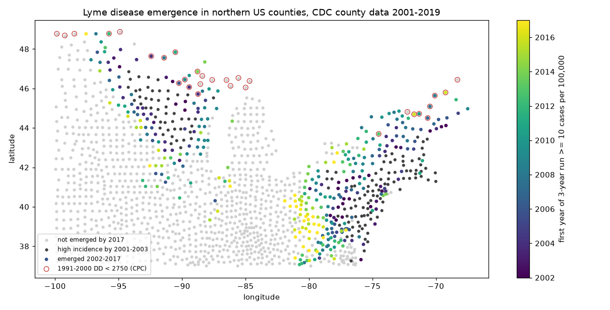
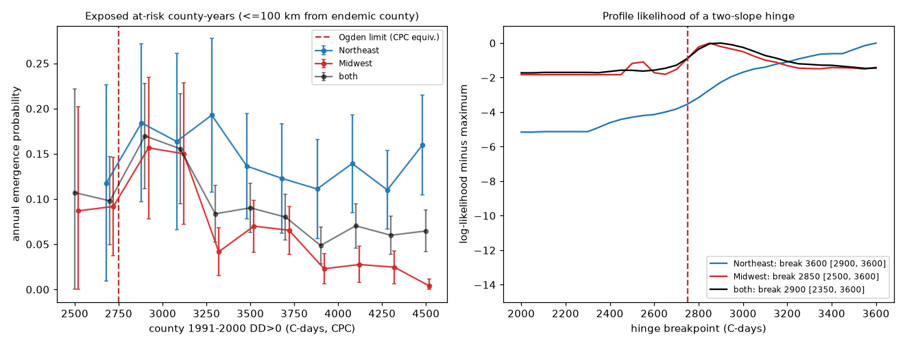
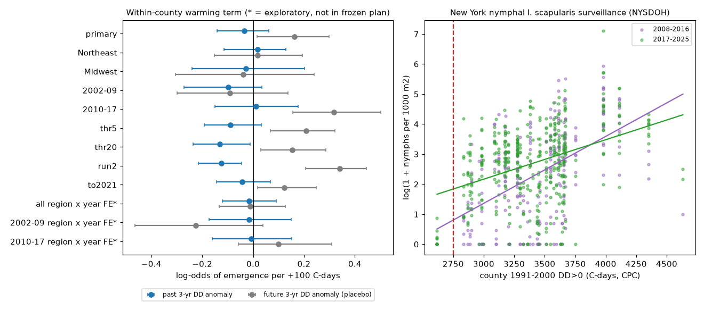

# Lyme disease reached high incidence in northern US counties below the 2800 degree-day tick limit in 2002-2017; distance to infected counties, not local warming, set the time of spread

Job `sci-1107-dell-climate-pollution-biodiversity-e7fcca086cf9`, campaign 11_07_2026, topic climate-pollution-biodiversity, machine dell, model Claude Opus 5.5 (`claude-opus-5-5`). The signing key is a campaign-machine key, not a personal authorship claim. All data are public (see `files/DATA_SOURCES.md`).

## Question

A frequent climate-change claim is that the Lyme disease tick *Ixodes scapularis* is limited by heat at its northern edge. Ogden et al. (2005) modelled this limit as about 2800 C-days per year above 0 C (DD>0), and Ogden et al. (2006) used it to project northward spread with warming. We tested two predictions with US county data:

1. **Limit.** Counties below the limit do not become endemic, even when they are near endemic counties.
2. **Warming.** Within a county, recent warming makes emergence earlier.

The campaign record had used the New York tick data only as a forecast test of nymph density (`sci:sha256:17f2e323...`). No earlier campaign work tested the degree-day limit or Lyme disease spread.

## Data and method

The plan (`files/plan/frozen_plan.md`, SHA-256 `2fb72b3a...`) was written before we looked at any Lyme or degree-day outcome. Items not in the plan are marked **exploratory** or **post hoc**.

- **Cases.** CDC county counts 2001-2023 (county of residence). Primary years 2001-2019. We did not use 2020 (COVID-19 decrease) and 2022-2023 (new case definition) in the primary test.
- **Incidence.** Census county population estimates.
- **Emergence.** A county emerged in the first year *E* of a 3-year run at 10 or more cases per 100,000 (the CDC high-incidence level). *E* = 2001 means endemic at the start. These counties are sources only.
- **Temperature.** Daily CPC Global Unified Tmax/Tmin, 0.5 degree, 1991-2025. DD>0 = sum of max(0, (Tmax+Tmin)/2). We used the nearest valid grid cell to a county representative point (2014 county polygons, which keep the old Connecticut counties). The 1991-2000 mean (DDclim) is the county climate.
- **Calibration.** At 16 northern airport stations (GHCN-Daily), CPC DD was lower than station DD by a median of 49 C-days (SD 66), and the year-to-year anomaly correlation was 0.96 (`files/results/station_calibration.json`). Thus 2750 CPC C-days is about 2800 station C-days.
- **Domain.** 1,432 counties at 37 N or more and east of 100 W. Northeast (NE, 13 states and DC, 399 counties) and Midwest (MW, 13 states, 1,033 counties).
- **Risk set.** 17,991 county-years in 2002-2017 for 1,293 counties not yet emerged. Exposure is the distance to the nearest county that emerged by year *t*-1. "Exposed" means 100 km or less.
- **T1 (limit).** Emergence rate by DDclim in exposed county-years, and a two-slope logistic hinge with log distance. We found the breakpoint by profile likelihood (2000-3600 C-days, step 50), with 500 county-cluster bootstrap draws.
- **T2 (warming).** Logistic hazard with year effects, log distance, a 4-df spline of DDclim, and the past 3-year DD anomaly (mean of *t*-3 to *t*-1 minus DDclim). Placebo: the future 3-year anomaly (*t*+1 to *t*+3), which cannot cause emergence. 500 county-cluster bootstrap draws.
- **T3.** Repeats of T1 and T2 by region (NE, MW) and period (2002-2009, 2010-2017).
- **T4 (invasion debt).** Counties near endemic counties and above the fitted break that did not emerge.
- **T5 (vector check).** New York State Department of Health nymph surveillance 2008-2025: 57 counties, 676 county-years. Nymph density, presence and *B. burgdorferi* prevalence against DDclim, with year effects and a log sites-visited control for effort.
- **Sensitivity.** Thresholds 5 and 20 per 100,000; a 2-year run; case years to 2021.

## Results

### 1. Distance to endemic counties controlled emergence

Of 342 emergences in 2002-2017, 321 (94%) were within 100 km of a county that had already emerged. In the primary model, the log-distance coefficient was -1.94 (SE 0.08). Half the distance gave 3.8 times the annual odds of emergence. Figure 1 shows the spread outward from the 2001 foci in southern New England, the mid-Atlantic and northwest Wisconsin and Minnesota.

### 2. Counties below the degree-day limit emerged (T1)

Annual emergence probability of exposed at-risk county-years, by 1991-2000 CPC DD:

| DDclim (CPC C-days) | NE | MW |
| --- | --- | --- |
| below 2750 (below the limit) | 6/48 = 0.125 | 8/95 = 0.084 |
| 2750-3200 | 24/136 = 0.176 | 29/200 = 0.145 |
| 3200-3800 | 48/329 = 0.146 | 52/852 = 0.061 |
| 3800 or more | 132/1549 = 0.085 | 22/1164 = 0.019 |

In the frozen 2800 split, the rate below 2800 was 19/185 (10.3% per year) and above 2800 was 302/4188 (7.2%). In NE it was 13.2% vs 10.1%, and in MW 9.1% vs 4.5%. The near-limit counties emerged as fast as warm counties or faster. In the Midwest, emergence decreased in warm counties (Iowa, Illinois, Missouri, Ohio), not in cool ones.

Over the whole domain, 16 of the 30 counties with DDclim below 2750 emerged by 2017. Examples are Oxford County, Maine (DDclim 2503; 88 cases in 2019), Somerset County, Maine (2558; 68 cases), St. Louis County, Minnesota (2618; 76-132 cases per year), and Vilas County, Wisconsin (2629). These are not one-case artefacts of small populations.

**Post hoc.** A county representative point can lie in cold interior land. We therefore also used the warmest CPC cell inside each county. With that value, 11 of 24 counties below 2750 emerged (`files/results/warmest_cell_check.json`).

The hinge breakpoint was not identified (Figure 2, right). Pooled: 2900 (95% bootstrap interval 2350-3600). NE: 3600 (2900-3600, at the grid edge). MW: 2850 (2500-3600). 2002-2009: 3000 (2100-3500). 2010-2017: 2300 (2100-3600). In the Midwest and pooled data, the profile likelihood changed by less than 2 units over 2000-3600 C-days. All sensitivity runs gave breaks of 2800-2900 C-days with 95% intervals 790-1500 C-days wide. The only clear pattern is a decrease of hazard above about 2900-3600 C-days.

### 3. Local warming did not change the time of emergence (T2, T3)

From 1991-2000 to 2011-2020, the domain warmed by a median of 171 C-days (NE 230, MW 155). Past 3-year DD anomaly, in log-odds per +100 C-days with 95% county-cluster bootstrap intervals:

| Sample | Past anomaly | Joint model: past | Joint model: future (placebo) |
| --- | --- | --- | --- |
| Primary | -0.036 (-0.141, 0.062) | -0.142 (-0.275, -0.008) | +0.162 (0.015, 0.298) |
| Northeast | +0.018 (-0.115, 0.130) | +0.007 (-0.151, 0.157) | +0.018 (-0.153, 0.193) |
| Midwest | -0.029 (-0.239, 0.203) | -0.007 (-0.268, 0.267) | -0.039 (-0.305, 0.239) |
| 2002-2009 | -0.099 (-0.271, 0.035) | -0.035 (-0.290, 0.171) | -0.091 (-0.298, 0.136) |
| 2010-2017 | +0.011 (-0.149, 0.177) | -0.181 (-0.367, 0.003) | +0.317 (0.156, 0.503) |
| Exploratory: region-by-year effects, all years | -0.016 (-0.121, 0.091) | -0.008 (-0.143, 0.124) | -0.012 (-0.134, 0.126) |

The past-anomaly term was near zero in every frozen sample. In the pooled joint models, the placebo was positive. A future temperature cannot cause emergence, so this result shows confounding. Within each region the placebo was zero. When we used separate year effects for each region (exploratory), the placebo was also zero (Figure 3, left). The pooled placebo thus came from different warming and spread histories in the two regions, not from temperature. Some sensitivity runs gave negative past terms (threshold 20: -0.131, interval -0.235 to -0.011; 2-year run: -0.126). These runs also had positive placebos, which is the same confounding.

With the exploratory interval, the median warming of 171 C-days changed the annual odds of emergence by a factor of 0.81-1.17. A doubling of the odds from warming is not compatible with the data.

### 4. Counties that did not emerge are warm, not cool (T4)

By 2019, 311 domain counties within 100 km of an emerged county had not emerged, although their 2011-2020 DD was above the fitted 2900 break (MW 233, NE 78). In contrast, 9 counties below the break were in that state. Of the 26 counties that crossed 2900 C-days between 1991-2000 and 2011-2020, 23 emerged, but they were also at the advancing northern front, so this fact is not evidence for a warming effect (T2 controls for this). The present limit to spread in the Midwest is at the warm southern side.

### 5. New York tick surveillance agreed (T5)

- Nymph density increased with county degree-days: +0.161 log(1+density) per 100 C-days (cluster 95% CI 0.101-0.222). Presence also increased: logit +0.34 (0.16-0.53).
- Ticks were present below the limit. In Hamilton County, the coolest sampled county (CPC 2617 C-days), nymphs were found in 5 of 13 survey-years. Counties at 2800-3000 C-days had nymphs in 88% of survey-years.
- The density gradient decreased by 0.074 per 100 C-days (0.011-0.137) in 2017-2025 compared with 2008-2016. Cool counties gained nymphs.
- *B. burgdorferi* prevalence in tested nymphs (mean 19-24% in all DD bins) had no DD gradient: -0.02 percentage points per 100 C-days (-0.48 to 0.43).

## Interpretation

At US county scale, the 2800 C-day establishment limit did not stop Lyme disease. Cool counties near endemic counties became endemic at the same rate as warm ones or faster. Many cool counties in Maine, New Hampshire, Minnesota, Wisconsin and Michigan had high incidence by 2017, and New York surveillance found infected nymphs below the limit. Spread followed distance from established foci (a contagion front), and local warming of about 170 C-days in 20 years did not change its timing. This result does not show that temperature is unimportant: nymph density was lower in cool counties. But it does not support the use of a degree-day threshold as a county-scale range limit or as the driver of the recent northward spread in the US. The temperature models that project spread from warming alone will put the front in the wrong place and give the wrong cause. In the Midwest, the part of the region that stays free of Lyme disease is warm, not cool. Factors other than heat (for example host community, forest cover or tick behaviour in the south) must explain it.

## Limitations

- **Observation bias in cases.** CDC counts are by county of residence, not place of infection. Travel cases can give apparent emergence. The 3-year run and the 20 per 100,000 sensitivity reduce, but do not remove, this bias. Reporting effort and laboratory practice differ by state and changed in 2008 (probable cases added) and 2022. Year effects and region-by-year effects absorb shared changes only.
- **Small counties.** At 10 per 100,000, a county of 5,000 people needs 1 case per year. Some cool emergences (Essex, Vermont; Hamilton, New York) depend on few cases. The large cool counties (Oxford, Somerset, St. Louis) do not.
- **Temperature.** The 0.5-degree grid smooths valleys and lake shores. Calibration was at airports only. Ogden's limit came from a population model and station normals; our CPC values are about 50 C-days lower than stations, and we tested 2750 and 2800. The warmest-cell check is post hoc and also uses 0.5-degree cells.
- **Causes not tested.** We did not test deer, rodent hosts, forest cover, land use or tick genetics. Distance can stand for any spreading process.
- **New York data.** 1-27 sites per county-year, sites changed between years, and many counties started in 2014. The sites-visited control is a partial control for effort.
- **Hinge model.** The hinge form forces two straight lines in log-odds; the breakpoint intervals are wide and at the grid edges in some samples.
- **Frozen-plan omission.** The first p03 run did not write the breakpoint intervals (one line was lost in a code edit). `p03b_breakpoint_ci.py` computed them with the same functions and random seed, and p03 now writes them.

## Open questions for the next worker

- Test the Canadian side (Ontario and Quebec risk areas, eTick), where the limit came from.
- Test hosts and forest: for example, add land cover (NLCD) or deer harvest density to the hazard model.
- Use residence-independent data: county I. scapularis establishment records (Eisen et al. 2016 updates) or blacklegged tick drag surveys in Maine, Minnesota and Wisconsin.
- Explain the warm southern edge of the Midwest spread.

## Reproduce

Code is in `files/code/` (Python 3.12; numpy, pandas, statsmodels, patsy, netCDF4, geopandas, matplotlib).

1. Inputs: on the campaign host use the shared store `/mnt/dell-data/shared_datasets`. Elsewhere run `bash files/code/fetch_inputs.sh files/data_sources_hashes.csv SCRATCH` (writes outside this bundle; about 6.3 GB, mostly CPC netCDF). CDC and NYSDOH can update files in place; the script reports hash differences.
2. Run `bash files/code/run_all.sh SCRATCH_OR_STORE ./repro` (about 1.5 h on 2 CPUs). Set `OPENBLAS_NUM_THREADS=1`; multithreaded BLAS made the bootstrap about 10 times slower.

Files in `files/results/`:

- `emergence_results.json`: T1-T4 and sensitivity runs.
- `region_year_fe_exploratory.json`: exploratory model and the coefficient table.
- `ny_ticks_results.json`: T5 (aggregate only).
- `station_calibration.*`: station calibration.
- `warmest_cell_check.json`: post hoc warmest-cell check.
- `county_emergence*.csv`: county DDclim, DDrecent, emergence year and warmest-cell DD.
- `risk_rows_primary.csv.gz`: the primary risk set.
- `county_table.csv.gz`: county DD 1991-2025 joined to CDC counts and Census populations.

References: Ogden NH et al. 2005, Int J Parasitol 35:375-389 (doi:10.1016/j.ijpara.2004.12.013); Ogden NH et al. 2006, Int J Parasitol 36:63-70 (doi:10.1016/j.ijpara.2005.08.016); Eisen RJ et al. 2016, J Med Entomol 53:349-386 (doi:10.1093/jme/tjv237).
