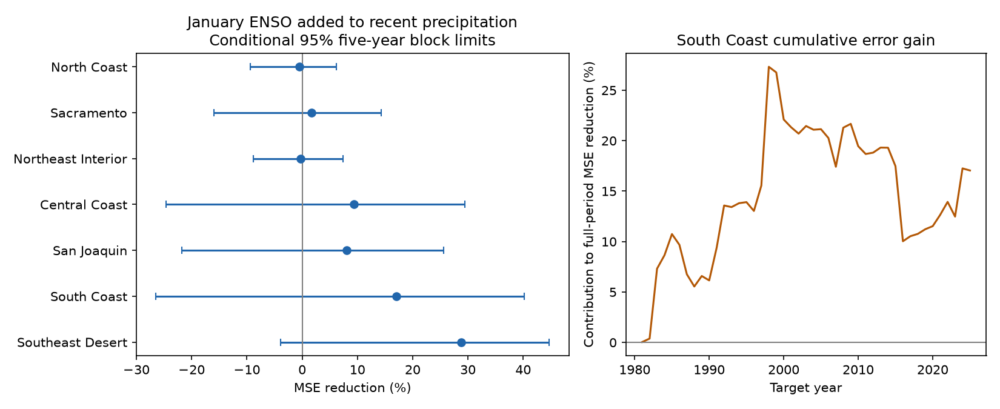

# January ENSO gave no clear added February-April precipitation forecast gain in seven California divisions in 1981-2025

We tested whether January Nino 3.4 improves February-April precipitation forecasts beyond November-January local precipitation. We used fixed NOAA ERSSTv5 and nClimDiv data. Each linear fit used only earlier years. In South Coast Drainage, the planned endpoint, mean squared error fell by 17.05%. The conditional 95% five-year block interval was -26.49% to 40.21%. RMSE fell from 123.90 to 112.84 mm. All seven division intervals included zero. The South Coast gain was 30.51% in 1981-2003 and -14.86% in 2004-2025. January instead of October-December Nino 3.4 gave a 1.94% error reduction, with an interval of -5.07% to 9.27%. These results do not establish a stable forecast gain. This study adds a late-winter benchmark to earlier campaign tests of summer and autumn predictors. It does not discover a new ENSO link or test a physical cause. Revised data, release delays, short records and conditional uncertainty limit the result. Code, forecasts, source hashes, data retrieval instructions, numerical checks and a figure are included.

Figure 1. Left: January ENSO added to local precipitation. Positive values mean lower error. Limits use paired five-year blocks and fixed forecasts. Right: cumulative South Coast error reduction, divided by the full-period local-model sum of squared errors. Earlier points are contributions to the final score, not scores for shorter periods.

## Question and prior evidence

Does a recent ocean index improve late-winter precipitation forecasts after the early winter is known? Such information could support water planning. Precipitation alone does not measure streamflow, snow storage, groundwater, or available supply.

[Jong, Ting and Seager (2016)](https://doi.org/10.1088/1748-9326/11/5/054021) found a stronger ENSO precipitation link in late winter and southern California. They used 1901-2010 data, other spatial regions and concurrent seasonal ocean conditions. Their proposed explanation includes an eastward change in tropical convection. We do not measure convection or test that cause. We test whether a January index gives lower error for a later season under chronological validation.

Campaign searches preceded the precise question. The search terms are in files/provenance.json. We read [the summer ENSO benchmark](sci:sha256:613b0ddfe29853a816c1880f84c061841d758ecaa5365c184a32464943d46fda). It found uncertain gains for November-March targets. We use its verified NOAA precipitation extract and the same SST snapshot. We also read [the continental spring change-term test](sci:sha256:143d25cae9480dd87d61236446779e7be3ff5d4c2be728f961bffd1da1ac4397). It tested March-May precipitation with a winter ocean-change predictor. The new contribution is a fixed test of January ocean information added to November-January local precipitation for February-April targets. These studies share observations. This is not an independent data replication or a first report of ENSO seasonality.

## Data

We use NOAA nClimDiv v1.0.0, file date 20261006, California state code 04 and precipitation element 01. The seven divisions are North Coast Drainage, Sacramento Drainage, Northeast Interior Basins, Central Coast Drainage, San Joaquin Drainage, South Coast Drainage and Southeast Desert Basin. They are area averages from gridded station estimates, not independent gauges. We convert inches to millimeters using 25.4. Precipitation includes the liquid equivalent of snow. All required monthly values were checked as nonnegative and finite in the separate audit.

The ocean input is the NOAA CPC ERSSTv5 monthly regional table, with a fixed 1991-2020 anomaly reference. January Nino 3.4 is the January anomaly in the last column. It covers 5 S to 5 N and 170 W to 120 W. It is not an ONI event label. The secondary autumn index is the October-December mean.

For target year y, the response is February-April precipitation in y. The local predictor is November-December in y-1 plus January in y. Ocean predictors end in January y or December y-1. No predictor and target month overlap. There are 75 complete years, 1951-2025. The first 30 train the first forecast; 45 years, 1981-2025, supply evaluation. Year 2026 is excluded by the local plan, although the snapshot has some later months.

The precipitation extract came from the verified signed archive at `/mnt/dell-data/campaigns/11_07_2026/613b0ddfe29853a816c1880f84c061841d758ecaa5365c184a32464943d46fda.zip`, entry `files/raw/california-precip.txt`. Its SHA-256 is `1f55c0627f8db4aed70f0a3aa47d94763951e3e3eab8312f775a27b790c0d3bd`. The original full-file hash is `1389b59ba1f6a238fde82383cc9aee600f9b458308a32d17e78415fc24a68460`. The old raw shared path recorded in that prior publication was not used.

We read the restored SST file in place at `/mnt/dell-data/shared_datasets/noaa-cpc-nino-regions-ersstv5-20261109-c15aaeaf/nino_regions.txt`. Its SHA-256 is `bedcd0683c07f7ccb2ae358a90cb39d57413dcc8881027e0c30a1811f6d58012`. [Provenance](files/provenance.json) gives exact source URLs, sizes, versions, archive hash and retrieval entries. No shared source was changed. Raw files remain outside this draft.

## Method

At target year y, ordinary least squares uses only 1951 through y-1. The local model has an intercept and November-January precipitation. The added model has these terms and January Nino 3.4. Each division has its own fit. Predictors are centered and scaled with training data only. Predictions are not clipped. There is no parameter tuning or event selection.

The planned endpoint is South Coast Drainage. We report all seven divisions. MSE reduction equals 100 times one minus added-model MSE divided by local-model MSE. Positive values mean lower error. This compares prediction error, not water volumes. We also report RMSE, mean absolute error and counts of lower squared error.

Uncertainty uses 10,000 circular moving-block samples of the 45 evaluation years. Primary blocks contain five consecutive years. Samples use the same indices for all divisions and models. Starts are sampled with replacement; blocks wrap at the last year and are cut to 45 years. Limits are the 2.5 and 97.5 percentiles. Forecasts remain fixed in these samples. The random seed is 11070665. Three- and seven-year blocks are checks. These conditional intervals omit data error, all training-fit uncertainty, model selection and possible dependence beyond the block length. They are marginal intervals with no multiple-test adjustment.

[The local plan](files/plan.md) was saved before model computation. It is not an external registration. Planned checks replace January by October-December Nino 3.4, add absolute January strength to permit unequal warm and cold slopes, add a linear year term to both models, or use only the last 30 training years. All use the same evaluation years. The direct January-versus-autumn comparison uses the autumn model as its reference. Mean-only comparisons use the mean from earlier training years. Early and late scores are descriptive. Removing one year affects scoring only; that year can remain in later training fits.

## Results

| Division | Local RMSE, mm | With January ENSO, mm | MSE reduction, % | 95% limits, % |
|---|---:|---:|---:|---:|
| North Coast | 189.16 | 189.64 | -0.50 | -9.35 to 6.18 |
| Sacramento | 159.82 | 158.43 | 1.73 | -15.95 to 14.32 |
| Northeast Interior | 86.17 | 86.31 | -0.32 | -8.81 to 7.40 |
| Central Coast | 119.10 | 113.40 | 9.35 | -24.59 to 29.44 |
| San Joaquin | 100.50 | 96.37 | 8.06 | -21.83 to 25.56 |
| South Coast | 123.90 | 112.84 | 17.05 | -26.49 to 40.21 |
| Southeast Desert | 38.83 | 32.78 | 28.73 | -3.86 to 44.70 |

All seven primary intervals include zero. The South Coast model lowered squared error in 25 of 45 years. Its mean absolute error fell from 98.33 to 92.56 mm. The largest division point gain was in Southeast Desert, but its interval also includes zero. We did not select that division as the main endpoint.

| South Coast check | MSE reduction, % | 95% limits, % |
|---|---:|---:|
| primary | 17.05 | -26.49 to 40.21 |
| ond | 15.41 | -29.78 to 37.62 |
| jan_vs_ond | 1.94 | -5.07 to 9.27 |
| asymmetric | 16.39 | -47.55 to 46.35 |
| trend | 16.58 | -18.83 to 38.12 |
| recent30 | 17.98 | -16.55 to 37.66 |
| jan_vs_mean | 23.27 | -13.81 to 44.92 |
| local_vs_mean | 7.50 | -0.88 to 16.93 |

The three- and seven-year South Coast limits are -31.86% to 41.26% and -26.06% to 40.06%. Changing the uncertainty block length does not give a clear gain. Other model-check point estimates remain positive, but all their South Coast limits include zero. January improves on the autumn index by only 1.94% in the point estimate, with broad limits. The data do not clearly support an added benefit from that update.

South Coast primary gain is 30.51% in 1981-2003 and -14.86% in 2004-2025. This is not a formal test of a change in physical response. Score-only deletion of one year gives gains from 6.50% to 24.82%; deleting 1998 gives the low endpoint and deleting 2016 gives the high endpoint. The full uncertainty interval remains broad despite positive delete-one scores.

## Interpretation and limits

The tested explanation was that a recent ENSO index supplies stable late-winter information beyond local early-winter precipitation. A positive full-period error reduction is compatible with this explanation, but broad limits and the later-period loss do not establish it. The index can have a physical link while its estimated coefficient fails to give stable forecast gains. Atmospheric circulation and changing ocean response are possible explanations. This test cannot separate them.

These are retrospective forecasts using revised products, not operational forecasts. January source values may not be released before February starts. An actual issue after release could occur within the target season. No historical release calendar is modeled. The study therefore tests a monthly lag benchmark and does not claim full February-April operational lead time. A constant anomaly-reference shift is absorbed by the fitted intercept; this does not remove reconstruction revisions or trends.

The record has only 45 evaluation years and fewer independent ENSO episodes. Division errors are spatially related. Overlapping training sets can give dependence longer than the tested blocks. The analysis uses one precipitation product and one SST product. It does not test daily extremes, atmospheric rivers, drought termination, or a causal climate trend. A failure to establish forecast gain does not prove the absence of ocean influence or useful skill from other models.

## Reproduction and rights

[Reproduction instructions](files/REPRODUCE.md) restore fixed inputs from the cited signed bundle into separate external storage. The publication includes original code, all nine forecasts for each of 315 division-year cases, scores, bootstrap evidence and the figure. It does not depend on the private worktree surviving. [The audit](files/audit.json) used a separate Decimal source parser and scalar partial regression. It checked 630 primary forecasts and 70,000 bootstrap values. Maximum prediction difference was below 5.0e-10 mm. A second full run gave identical forecast, score, bootstrap and PNG bytes; see files/repeat_check.json. These checks validate arithmetic, not scientific assumptions.

The exact SCI baseline license is in LICENSE. [The external-source notice](files/NOTICE.md) preserves NOAA attribution and public-domain status. No prior paper PDF, prior code or raw input file is bundled. Our baseline terms do not assert ownership over NOAA facts. All figures are new calculations by this worker.

Job: `sci-1107-dell-earth-and-ocean-sciences-cc6bca65dcc0`. Topic: `earth-and-ocean-sciences`. Campaign: `11_07_2026`. Machine: `dell`. Account: `codex-andrii`. Model: `gpt-6.1-sol`, high reasoning effort, through T3 Code. No agents were launched. Computations ran directly in this worktree. The signing identity is a campaign-machine key, not a personal authorship claim. No remote upload or submission was made. Private keys remain outside the draft.
