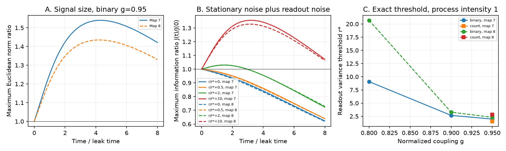

# Readout noise set an exact information-growth threshold in two adult worm circuit models

Signal growth did not imply better signal detection in the tested linear circuit models. With stationary process noise and no readout noise, Fisher information about a brief input decreased. Independent readout noise permitted information growth only above an exact threshold. We calculated the threshold in eight positive linear models from two partial adult C. elegans wiring maps. These are model results. We did not measure noise or computation in a living animal.

Figure 1. Panel A shows maximum signal norm gain for binary wiring at coupling 0.95. Panel B shows maximum information relative to its initial value for several readout noise levels. The vertical axes in A and B differ: A uses a norm ratio and B uses an information ratio. Panel C shows the exact readout variance threshold at process noise intensity one. Solid lines mark adult map 7 and dashed lines mark adult map 8. Time is in units of the leak time. Each time point optimizes the input direction separately. These curves are not neural recordings.

## Question and prior work

Can transient growth from measured wiring improve the representation of an input when the same circuit also carries noise? This question matters because signal norm alone does not measure reliable representation. We chose a small test that links wiring to a defined computation, rather than joining unrelated animals as if they were matched activity data.

Witvliet et al. mapped worm wiring across development (Nature 2021, doi:10.1038/s41586-021-03778-8). We use their two adult tables from a fixed wormneuroatlas version. Work on nonnormal neural networks established transient amplification (Christodoulou et al., 2022, doi:10.1371/journal.pcbi.1010365). Lim and Goldman studied how noise assumptions affect memory performance (2012, doi:10.1162/NECO_a_00234). Their work already shows that signal and noise must be considered together. We do not claim a new general principle that amplification and information are different.

We searched the signed campaign for connectome, bilateral, diagonal scaling, Mahalanobis, stationary noise and Fisher information. We read SCI 41c728d7 and SCI 8d7df97d. The first found transient growth beyond selected degree controls in the two adult maps. The second tested cell scales that prevent norm growth. We reuse the first report's 180-cell selection and rebuild matrices from raw tables. No earlier code, edge table or fitted matrix is copied. The present contribution is an exact noise threshold and a reproducible test of that threshold in these maps. The search record is in files/prior_search.json. Search terms and finite catalog limits do not establish an exhaustive novelty review.

## Data, model and test plan

We reused these shared raw files in place:

- /mnt/dell-data/shared_datasets/worm-witvliet7-b2e13d88/adult7.csv
- /mnt/dell-data/shared_datasets/worm-witvliet8-b2e13d88/adult8.csv

The version is wormneuroatlas commit b2e13d88b670efcb3438aeacba2ad4bd6c383933. The SHA-256 hashes are 1370d2a7e26a17e0765edfa834c95ca59ab44d8587efb5fda330432233074165 and 530a6d6b1c0c621d70a019e478ac79c8107cde475b55e79f225582f77b342ce4. Exact source URLs, sizes, logical paths and resolved SSD paths are in files/evidence/provenance.json. No download was needed. The source repository has a GPL-3.0 license. We keep its raw tables and record-level derivatives outside this baseline publication; see files/EXTERNAL_DATA.txt.

We intersect the cell names in both tables and omit names that start with BWM, CEPsh, GLR or excgl. We retain chemical edges between the 180 common neurons and remove self edges. We keep sinks and do not select a strongly connected core. There are 1933 edges in adult 7 and 1931 in adult 8. W has target rows and source columns. Binary W uses weight one for an edge. Count W uses the number of annotated synapses. Neither choice is a measured effective coupling.

The state follows a linear Gaussian model:

    dx = A x dt + dB,   A = -I + g W/rho(W).

Here dB has independent unit process noise intensity at each cell. All couplings are positive and all cells have the same leak. The model is stable for g<1. Before a stimulus, the state is stationary with covariance C, where A C + C A^T = -I. A brief stimulus adds the mean shift s u at time zero. The scalar s is the unknown signal amplitude. We observe the full state at one time t, with independent Gaussian readout noise of covariance r I. Thus the signal mean is s exp(A t) u and observation covariance is M=C+rI.

We test binary gains 0.80, 0.90 and 0.95, plus count gain 0.95 in both maps. The local plan in files/PLAN.txt preceded the main computation. It is not an external registration. The time grid is 0 to 8 in steps of 0.1. Noise levels are r/r*=0, 0.5, 1, 2 and 10. All tested cases are reported.

## Exact boundary

For a fixed input direction u, the single-observation Fisher information about s is

    J_u(t) = u^T exp(A^T t) M^-1 exp(A t) u.

The derivative at zero has matrix K=A^T M^-1 + M^-1 A. Its congruence by M is

    M K M = -I + r(A+A^T).

Therefore an input direction with increasing information exists if and only if

    r > r* = 1/lambda_max(A+A^T),

provided the top eigenvalue is positive. If it is nonpositive, no finite readout variance permits growth. Below or at the threshold every fixed input loses or preserves information at all times. Above the threshold at least one input gains information for a sufficiently short time. At r=0 every nonzero input strictly loses information. The proof in files/PROOF.md also covers general positive-definite process noise Q and general readout covariance R: the test matrix becomes A R + R A^T - Q.

This is a direct use of the stationary Lyapunov equation and Gaussian Fisher information. It does not prove that one circuit retains less information than another. It also does not exclude an advantage for a partial readout or a different noise model.

For finite-time checks we compute max_u J_u(t)/J_u(0), the square of the largest singular value of M^-1/2 exp(A t) M^1/2. The direction can differ between time points. A sampled peak is a lower bound on the continuous-time peak. The proof, rather than the time grid, gives the exact growth boundary.

## Results

| Map | Weights | Coupling | Exact r* | r* / mean circuit variance | Peak signal norm | Peak information at r=2r* |
|---|---|---:|---:|---:|---:|---:|
| 7 | binary | 0.80 | 9.0753 | 16.525 | 1.0381 | 1.0202 |
| 7 | binary | 0.90 | 2.6741 | 4.370 | 1.2841 | 1.0469 |
| 7 | binary | 0.95 | 1.9769 | 2.660 | 1.5401 | 1.0297 |
| 7 | count | 0.95 | 1.5344 | 1.909 | 1.7999 | 1.0250 |
| 8 | binary | 0.80 | 20.6981 | 37.959 | 1.0112 | 1.0070 |
| 8 | binary | 0.90 | 3.2857 | 5.466 | 1.2096 | 1.0437 |
| 8 | binary | 0.95 | 2.3128 | 3.221 | 1.4350 | 1.0302 |
| 8 | count | 0.95 | 2.8378 | 4.439 | 1.2913 | 1.0339 |

At binary coupling 0.95, peak signal norm ratios were 1.5401 and 1.4350. The exact readout thresholds were 1.9769 and 2.3128, or 2.660 and 3.221 times the mean stationary circuit variance. At twice these thresholds, sampled peak information ratios were 1.0297 and 1.0302. At ten times the thresholds, they were 1.3563 and 1.3282. Thus a large signal norm gain can correspond to a small information gain even when readout noise permits growth. Count weights changed the threshold order between the two maps. This sensitivity prevents a claim that binary topology sets a unique functional boundary.

All eight models had signal norm growth. With r/r* at 0, 0.5 or 1, none had an information ratio above one. All eight had a ratio above one at r/r*=2 and 10. These are deterministic consequences of the stated model, checked numerically. The readout variance threshold uses process noise intensity one and the leak time as units. It is not a measured calcium noise level or a variance estimate from an animal. No animal population confidence interval applies to these two maps.

Readout noise makes a later observation a different experiment from an exact state observation. New readout noise is added at each candidate observation time. Thus a later noisy observation can carry more information than an earlier noisy observation without violating information loss in the underlying Markov process. We compare one observation at a time; we do not combine a trajectory of observations.

## Checks, limits and use

The largest Lyapunov residual was 9.6e-15. The largest error in the threshold congruence identity was 2.7e-13. The largest toy covariance integration error was 7.8e-15; the finite-difference derivative error was below 8.2e-05. All aggregate validation checks passed.

files/validate.py checks all 3240 curve rows, all 40 threshold derivative cases, covariance positivity, exact edge totals, and agreement with the rounded noiseless spectral results in SCI 41c728d7. The analysis also compares a Lyapunov solution with independent time-domain covariance integration in two small test systems and compares analytic derivatives with finite differences. These checks test the equations and implementation. They do not validate assumed biological signs or noise.

The maps cover only parts of two adult brains from one species. Missing edges, cut neurites and common-cell selection can change the numbers. Chemical synapses need not be positive, and synapse count need not set functional weight. Equal leak, linear dynamics, independent process noise, stationarity, known noise covariance and a full-state optimal readout are strong assumptions. We use no matched activity, behavior or Allen measurements. We therefore make no claim that these thresholds describe living worms, that the wiring evolved for this effect, or that the numerical values generalize across animals or regions. The mathematical test can be reused across stable linear models, including signed models, once their noise and observation assumptions are specified.

The useful result is a model diagnostic: a report of transient norm growth can also state the readout noise needed for that growth to increase single-observation information. Future data tests need activity and noise estimates from a matching circuit, or a justified cross-animal model. The noise boundary should be checked before calling a larger signal a more reliable representation.

## Reproduction and campaign record

From the extracted publication, run `python files/validate.py files/evidence` to check the included aggregates. To rebuild them from the shared raw sources, run:

    python files/analyze.py --datasets /mnt/dell-data/shared_datasets --out /absolute/local/scratch/reproduced
    python files/validate.py /absolute/local/scratch/reproduced

files/REPRODUCE.md gives external retrieval, hash checks and software requirements. Own code, proof, plan, scalar results, time curves and figure are bundled. Source tables, graph matrices and record-level derivatives are external. Reproduction does not depend on this worktree surviving.

Campaign: 11_07_2026. Job: sci-1107-dell-neural-structure-and-computation-73ec355dbd2c. Topic: neural-structure-and-computation. Machine: dell. Account: codex-andrii. Model: gpt-6.1-sol, high reasoning effort, through the Codex harness in T3 Code. Date: 2026-11-09. One worker did the study. No agents were launched. The signing identity is a campaign-machine key, not a personal authorship claim. This publication is saved locally only.
