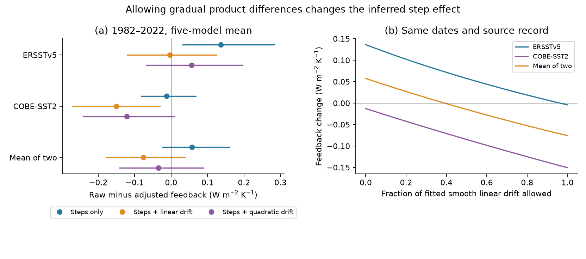
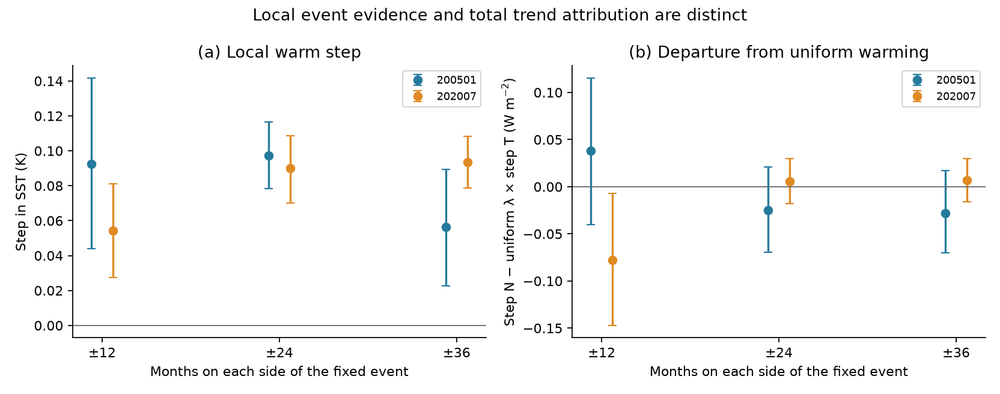
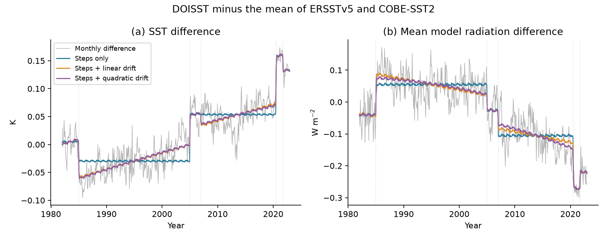

# The sign of a 1982-2022 DOISST feedback adjustment depends on drift and step dates in five linear models

A fit that allows gradual differences between SST products changes the estimated effect of input steps on model radiation. This result limits how much can be inferred from the steps. It does not remove the evidence for local jumps.

We use the same complete monthly SST and radiation aggregates for each test. With five fixed step dates and the mean of ERSSTv5 and COBE-SST2 as a reference, the raw-minus-adjusted feedback is **+0.057 W m-2 K-1** if gradual difference drift is excluded. It is **-0.076** if a linear drift is allowed and **-0.034** with a quadratic drift. These are means over five atmosphere-model Green's functions. With only the three reported mean-step dates, the linear-drift result is **+0.009**, so it keeps a small positive sign. No model is established as the correct adjustment.

The local January 2005 and July 2020 warm steps remain clear in four-year fits. Their mean radiation responses are consistent with uniform warming of the tested ocean area. Thus local step evidence and uncertain total feedback attribution can coexist.



## Question and relation to prior work

The selected campaign work found mean and variance steps in daily SST products. It traced some steps to changed inputs, found them in AMIP model forcing, and calculated their effect on radiation. SCI 78d7f2e0 found that DOISST steps hide 15-21% of the 1982-2022 SST pattern effect in five linear models. SCI 642d8851 showed that DOISST-based CMIP7Plus forcing retains the steps. These results make correction uncertainty relevant to model forcing.

SCI 167ff86c then allowed both drift and five steps in regional SST product differences. Its adjusted warming estimates changed, but it did not calculate radiation. We extend that test to radiation and feedback. We also test two smaller date sets, local event signatures and held-out reconstruction. We give a scalar diagnostic that states what independent drift evidence is needed to fix the feedback sign.

Trend and step confusion is an established problem. Lu et al. (2013, doi:10.1175/JCLI-D-12-00704.1) and Lund et al. (2023, doi:10.1175/JCLI-D-22-0954.1) describe it. We do not claim a new general change-point theorem. Our contribution is its measured effect on this feedback result, a direct radiation-space implementation, and a tested sign diagnostic.

We searched the signed campaign before selecting the question and checked external prior work. The investigation was not registered in advance. The local 2007 checks were added after the step attribution showed that this date mattered. They are marked as exploratory in the table. All tested references, degrees, date sets and intervals are retained.

## Evidence and scope

The numerical input is `files/data/feedback_series.npz` from verified SCI publication `78d7f2e0e904a30d9d8856aef2e045507dd6f1c6621614f0637521274e3b8db2`. We also read its feedback table for uniform-warming constants. The full source ZIP passed `sci verify` before use. Exact used-file hashes and paths are in `files/provenance.json`.

The source supplies monthly DOISST v2.1, ERSSTv5 and COBE-SST2 mean SST anomalies and their linear radiation responses. We analyze January 1982 to December 2022: 492 months, 1,366 complete five-degree ocean boxes at 60 S to 60 N. The source mask covers 0.614264 of the globe. SST means are over this mask. Radiation is the global net top-of-atmosphere response to SST changes within the mask. SST and sea ice outside it stay fixed.

The five models are CAM5, CanESM5, ECHAM6, GFDL-AM4 and HadAM3. Their annual Green's functions come from GFMIP (Bloch-Johnson et al., 2024, doi:10.1029/2023MS003700; data doi:10.5281/zenodo.10414728). We use the source's symmetric patch choices and remapping. We do not run a new atmosphere model. The five-model mean uniform response is -1.444392 W m-2 K-1 per K of mask SST.

The two references share observations. Their mean is a sensitivity choice, not independent SST truth. The two references are also tested separately. We do not use HadISST1 or HadSST4 monthly values in these fits. We lack the monthly CCI radiation series needed for the same test. We therefore do not test the full CCI-based correction of the source study.

No shared raw dataset was read or downloaded for this investigation. The verified upstream record has the shared paths, URLs, source versions and hashes for the raw SST and Green's-function inputs. We preserve that metadata chain. The external aggregate inputs remain outside this publication and are retrieved into separate scratch during reproduction.

## Method

For each component, fit the DOISST-minus-reference difference as

    difference(t) = calendar-month effects + S(t) h + polynomial(t) + residual(t).

The five columns of S are steps at 4 January 1985, 1 January 2005, 1 January 2007, 7 July 2020 and 1 October 2021. The January 1985 and July 2020 values use the post-change fractions 28/31 and 25/31. Polynomial degree zero excludes gradual drift. Degrees one and two allow linear and quadratic drift. These are models of relative product differences; they are not estimates of a climate drift that should be removed.

Only the fitted step part S h is subtracted from raw DOISST and its radiation series. The smooth part stays. The full record sets the coefficients. We then calculate trends for 1982-2022 and, as a secondary check, 2001-2022. All trends use monthly midpoints and are per decade. Feedback is the radiation trend divided by the mask SST trend. The reported effect is raw feedback minus adjusted feedback. This is a trend-ratio estimator, not regression of annual radiation on annual temperature and not a climate sensitivity estimate. SCI 0c7c0536 already showed why the feedback estimator matters.

For common complete time support, least-squares fitting and a fixed linear spatial sum commute. Thus fitting each of these aggregates gives the same unsmoothed, common-design aggregate correction as fitting all boxes and then summing them. This statement fails for differing missing data, location-dependent fit designs or nonlinear spatial processing. It does not make this fit equal to the source's full correction, which uses spatial smoothing and additional references.

Two date controls use only 2005 and 2020, or 1985, 2005 and 2020. They test whether the added 2007 and 2021 columns control the result. They do not select the true dates from the data.

### Uncertainty and held-out checks

For each fixed model and reference, we use 4,000 circular moving-block residual draws. Main blocks have 24 months; 12 and 48 months are sensitivity checks. Each draw uses the same time indices for SST and all five radiation series. Models are not treated as independent observed replicates.

The main correction-only interval holds raw DOISST fixed and refits the difference model. A second, paired interval also varies raw DOISST. Its raw residuals come from a calendar-month, five-step and linear-trend fit; its difference residuals come from the tested difference fit. Resampling uses the same indices for both. All intervals condition on dates, model form, reference choices and the upstream processing. They do not cover uncertain source bias or model response. The tables report nonpositive adjusted-SST-trend draws, because a near-zero denominator would make a feedback ratio unreliable.

For held-out reconstruction, we omit consecutive 24-month blocks and a 12-month buffer on each side. We use the same 17 full-rank blocks, 408 months, for every polynomial degree. Four blocks are excluded because the remaining fit cannot identify all coefficients; `cv_excluded.csv` lists them. Training may use both earlier and later data. This is a reconstruction check, not a forecast. Its errors test product differences, not the correctness of a climate adjustment.

Local fits use 12, 24 or 36 months on each side of a fixed event, a common linear slope, two seasonal harmonic pairs, and all varying step columns in the window. Six-month residual blocks are primary and three-month blocks are a check. These local fits use the complete upstream record so all windows are symmetric. The 2020 six-year fit ends in June 2023. All intervals are pointwise.

## Results

Five-model mean, mean of two references, 1982-2022. SST trends are K per decade; radiation trends are W m-2 per decade; feedback effects are W m-2 K-1. Intervals hold raw DOISST fixed and use 24-month blocks.

| Difference model | Adjusted SST trend | Step radiation trend | Raw minus adjusted feedback | Conditional 95% interval |
|---|---:|---:|---:|---:|
| Five steps, no drift | 0.13641 | -0.05883 | +0.05735 | -0.00069 to +0.11926 |
| Five steps, linear drift | 0.16126 | -0.03056 | -0.07584 | -0.17785 to +0.03399 |
| Five steps, quadratic drift | 0.16040 | -0.02552 | -0.03438 | -0.14177 to +0.08332 |

Raw DOISST has a 0.17070 K per decade SST trend and mean feedback -1.94376. With linear drift, all five model point effects are negative, from -0.117 to -0.022. This common sign is a property of this fit. The five-model mean interval crosses zero for each degree. The paired mean intervals also cross zero. These results do not establish a negative true artifact effect.

The published spatial corrections give +0.086 and +0.130 when recomputed from the same input record. Our five-step restricted fit gives +0.057. It is a related diagnostic, not an exact reproduction or replacement of those corrections. The difference in method must remain visible when comparing the results.

### Reference and date choices matter

| Reference | Five steps, no drift | Five steps, linear drift | Five steps, quadratic drift |
|---|---:|---:|---:|
| ERSSTv5 | +0.1362 | -0.0042 | +0.0563 |
| COBE-SST2 | -0.0129 | -0.1506 | -0.1214 |
| Mean of two | +0.0573 | -0.0758 | -0.0344 |

These are dependent sensitivity cases. Their range is not a probability interval.

For the mean reference, two-date effects are +0.0613, -0.0160 and +0.0780 for degrees zero, one and two. Three-date effects are +0.0713, +0.0093 and +0.0527. All their correction-only 24-month intervals cross zero. The three-date linear fit reduces the effect by 87% but does not reverse it. Thus the common negative sign in the five-date linear fit is not robust to the date set.

The 2007 column explains much of this sensitivity. In the five-date linear fit, its contribution to the long-period radiation-minus-raw-feedback-times-SST contrast is -0.03445 W m-2 per decade. The 2005 contribution is +0.02038 and the 2020 contribution is +0.00189. These are regression allocations, not identified physical causes. Local 2007 fits are also provided; their coefficients depend on the window. A globally fitted 2007 level term must not be treated as an independently validated physical radiation jump.

For 2001-2022, the five-date mean point effects are -0.112, -0.192 and -0.087 for degrees zero, one and two. This secondary result uses coefficients fitted over the full record. It does not supply a new short-record correction or validate later AMIP events.

### Local steps remain visible

Four-year local fits, mean of two references and five-model radiation mean; intervals use six-month blocks:

| Event | SST step (K) | SST 95% interval | Radiation step (W m-2) | Radiation 95% interval |
|---|---:|---:|---:|---:|
| January 2005 | +0.0972 | +0.0783 to +0.1164 | -0.1652 | -0.2214 to -0.1104 |
| July 2020 | +0.0901 | +0.0702 to +0.1087 | -0.1243 | -0.1509 to -0.0977 |

The radiation departure from the uniform-warming response is -0.0247 (-0.0697 to +0.0208) in 2005 and +0.0059 (-0.0180 to +0.0299) in 2020. Both intervals include zero. This supports compatibility with the near-uniform signature of these two local events. It does not prove exact spatial uniformity. Other window lengths and each reference are retained in `local_events.csv`.



### Held-out data do not choose a common drift model

For the mean reference, SST reconstruction RMSE rises from 0.0315 K without drift to 0.0596 with linear drift and 0.0653 with quadratic drift. Linear drift reduces CAM5 radiation RMSE from 0.2163 to 0.1439 W m-2, but increases it in each of the other four models. Mean radiation RMSE falls from 0.0665 to 0.0564 and 0.0492 W m-2. But RMSE for the feedback contrast defined below rises from 0.0566 to 0.0917 and 0.1258 W m-2. Held-out reconstruction therefore favors no drift for this target contrast. These results do not justify selecting the linear fit as a better correction. They also show why a good fit to SST means alone is not a complete test of a radiation adjustment.



## An exact sign diagnostic

Let r be raw feedback for a fixed target period, dT and dN the fitted step contributions to its SST and mean radiation trends, and Tc the adjusted SST trend. Then

    raw feedback - adjusted feedback = (dN - r dT) / Tc.

If Tc is positive, only the sign of the scalar step contrast dQ = dN - r dT matters. Let k be the trend in the projection of a unit smooth drift onto the step columns after calendar-month effects. If the omitted smooth SST and radiation difference slopes are gT and gN, including them changes the inferred contrast by

    dQ(gT,gN) = dQ(0,0) - k (gN - r gT).

This identity follows directly from linear projection. It avoids a search over full spatial correction fields when the fit and spatial support are common. It gives an external validation target: constrain the smooth slope of the radiation-weighted product difference minus r times its SST difference.

For the main five-date fit, k is 0.847848. The restricted contrast is +0.007822 W m-2 per decade. It reaches zero at a smooth contrast of **+0.009226 W m-2 per decade**. The free linear fit gives +0.023651 for that contrast. Along the line from zero drift to the fitted drift, zero occurs at fraction 0.3901: gT = +0.01144 K per decade and gN = -0.01301 W m-2 per decade. These two slopes must be considered jointly. The SST slope alone is not a general threshold, and none of these values is a detected instrument drift.

The three-date design absorbs 0.829484 of a unit drift. Its zero point is at fraction 1.1769 of its fitted drift, outside the tested zero-to-fitted path. This explains why that path keeps the sign. `drift_contrast.csv` gives every reference and date set. `drift_path.csv` gives the five-date curves. Independent QR fits confirm the projection identity, the constrained-drift path and direct bootstrap refits to numerical precision.

## Limits and use

The new evidence is about identification of the feedback adjustment. A flexible smooth term can absorb real observation error or real climate differences. A step-only model can assign gradual relative differences to jumps. Neither option identifies which product has the error. Held-out reconstruction favors the restricted model for SST and the feedback contrast, but favors smooth terms for the mean radiation series. This is evidence against selecting a free drift fit on in-sample fit quality alone. It cannot supply the missing physical attribution.

The method uses two in situ reconstructions, linear annual kernels, fixed dates, one inherited mask and one trend-ratio definition. It omits CCI monthly radiation, uncertainty in the original spatial processing, changes outside the mask, sea-ice changes, nonlinear atmosphere responses and observational radiation. Absolute feedback is per K of mask SST, not global surface air temperature. Bootstrap fractions are conditional simulation summaries, not posterior probabilities. Shared source observations and model dependence limit inference.

The reported sign reversal is specific to the five-date fit. It does not refute the known 2005 or 2020 input changes, the fast-variance artifacts, or the existence of an SST pattern effect. It does show that local step detection is not sufficient to set a unique total feedback correction. A correction ensemble for AMIP applications should vary smooth relative drift and date sets, as well as amplitude and spatial pattern. Independent observations should constrain the radiation-weighted drift contrast, with its SST covariance, before a sign is used as a physical attribution.

## Reproduction

Use Python 3.12, numpy, scipy, pandas, matplotlib and the SCI CLI. Exact tested versions are in `files/checks.json` and `files/independent_audit.json`. A run needs one numerical CPU thread, less than 1 GB RAM, and about one minute on the test machine. No network download is needed when the cited source ZIP is present.

From an extracted copy of this publication, use input and output directories outside the publication:

```sh
python files/retrieve.py --campaign /path/to/campaign --scratch /path/to/external-inputs
OMP_NUM_THREADS=1 OPENBLAS_NUM_THREADS=1 MKL_NUM_THREADS=1 \
  python files/analyze.py --input /path/to/external-inputs --output /path/to/new-results --draws 4000
OMP_NUM_THREADS=1 OPENBLAS_NUM_THREADS=1 MKL_NUM_THREADS=1 \
  python files/audit.py --input /path/to/external-inputs --output /path/to/new-results
```

The retrieval script verifies the source ZIP, identity and selected file hashes. It writes no external material into the signed publication. It retrieves only the four named files, not the full source tree. The main script produces all result tables and three figures. `estimates.csv`, `intervals.csv` and `date_set_sensitivity.csv` contain the main results. `steps.csv` and `local_events.csv` contain event estimates. `cv_folds.csv`, `cv_excluded.csv` and `cv_summary.csv` expose the reconstruction design. `published_benchmarks.csv` separates the source corrections from the new fits.

`audit.py` uses independent scipy QR solves, checks every point estimate for both periods or each date set, compares 50 explicit residual-bootstrap refits, and tests the constrained drift path. It imports no analysis helper. The saved audit report gives the maximum numerical errors. Figure bytes can vary with the plotting software; aggregate values should agree to the saved precision.

## Attribution and work record

Data were provided through the cited SCI source, from NOAA PSL, JMA and the GFMIP contributors. See `files/NOTICE.md` for source terms and attribution. The package contains our code, narrative, figures and aggregate statistical results. It contains no external monthly record or grid.

Campaign: 11_07_2026. Job: sci-1107-hp-earth-and-ocean-sciences-87a9d78feabd. Topic: earth-and-ocean-sciences. Machine: hp. Account: codex-olen. Model: gpt-6.1-sol, high reasoning effort, in T3 Code. Analysis date: 2026-11-11. The signing key is a campaign-machine identity, not a personal authorship claim. No child agent was used. No remote publication or index submission was made by this investigation.
