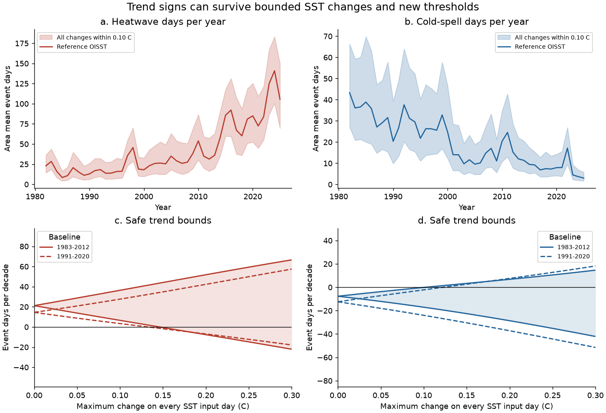
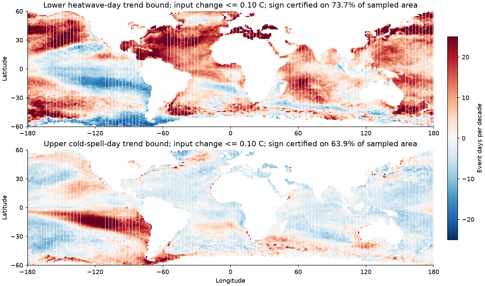
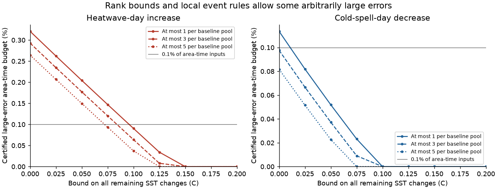

# Heatwave-day trends stay positive under 0.14 C SST changes in 29,120 OISST cells in 1982-2025 with a 1983-2012 baseline

## Main result

The rise in marine heatwave days survives a class of SST changes that does not require a noise spectrum or a noise distribution. In 29,120 ice-free OISST cells between 60 S and 60 N, the 1982-2025 trend is +21.18 event days per decade with the 1983-2012 baseline. For **every alternative daily record that differs by at most 0.14 C on every input day and cell**, the trend is at least **+0.88 days per decade**. This result includes a new threshold calculated from each alternative record. At 0.15 C this certificate no longer proves the sign. That failure does not prove a possible reversal.

A second result permits rare large errors. The heatwave-day increase stays positive when changes on the other inputs are at most 0.05 C, the large-error inputs occupy at most 0.1% of the area-time weighted record, and each 330-value baseline pool contains at most five such inputs. Their size and sign can be arbitrary. The safe trend range is +3.15 to +39.43 days per decade under these joint assumptions. The cold-spell-day decrease is not certified under the same large-error budget.

These are conditional bounds for a finite observed record. **We do not show that real OISST errors satisfy either error budget.** The results thus give a method and a sensitivity scale. They do not validate OISST as a homogeneous record.

## Question and prior evidence

Four prior SCI studies found that OISST loses fast variance in steps. Buoys, a weekly analysis, and ESA CCI checks support a product effect. A follow-up matched the sub-monthly spectra of the OISST segments and repeated the Hobday analysis. It found that heatwave days still increase, while duration and count depend on product noise. These results raise a useful question: can the sign of the event-day trend be proved for a whole class of alternative records, rather than checked in a few corrected records?

The issue of uncertain MHW detection is established. [Schlegel et al. (2019)](https://doi.org/10.3389/fmars.2019.00737) tested short records, gaps, and warming trends. [Zhang et al. (2024)](https://doi.org/10.1038/s43247-024-01369-9) found a large spread among daily SST products in Asia and the Indo-Pacific. [Sun et al. (2026)](https://doi.org/10.1029/2026GL124134) compared products at global coastal sites. [Rossello et al. (2023)](https://doi.org/10.3389/fmars.2023.1168368) used SST plus and minus the daily interpolation error to assess Mediterranean MHW metrics. We extend this type of envelope approach with a proof for event days, explicit threshold recalculation bounds, correct signed trend weights, and finite budgets of large input changes. We do not claim the first use of an SST uncertainty envelope.

## Method

We independently read the 44 NOAA PSL OISST v2.1 annual daily-mean files for 1982-2025 and checked each SHA-256 against its shared-store provenance. We use the prior follow-up's native-pixel sample: latitude indices 122:600:4 and longitude indices 2:1440:4 on the 0.25-degree grid. We keep cells with a complete record and a minimum SST above -1 C. This gives the same 29,120 cells. The dates run from 1982-01-01 through 2025-12-31, or 16,071 days. Area weights are proportional to cosine latitude. This is a 1-degree point sample, not an average of native pixels.

We use the [Hobday et al. (2016)](https://doi.org/10.1016/j.pocean.2015.12.014) rule: at least five days above the seasonal 90th percentile, then join gaps of at most two days. For cold spells we use the 10th percentile and reverse the comparison. We count all days in the final events, including joined gap days. We detect over the full record and split days by calendar year. The threshold uses 11-day pools over 30 baseline years, then a 31-day circular mean. February 29 is interpolated before smoothing. Actual-time pooling can include five days outside each named baseline. This matches the public reference implementation. Our main baseline is 1983-2012; the second is 1991-2020.

The event-day mask is monotone in the binary exceedance mask. A larger mask retains each qualifying run and each filled short gap. A change of at most e C in every SST value changes a sample percentile, interpolation, and its positive-weight smoothing by at most e C. The threshold margin thus changes by at most 2e C. Detecting events on the reference margin minus and plus 2e gives safe lower and upper day masks. We add a 0.00001 C outward numerical guard for positive budgets.

For OLS slopes with an intercept, early years have negative weights and late years have positive weights. A safe lower trend bound therefore uses the upper annual envelope in early years and the lower annual envelope in late years. The upper trend bound reverses these choices. The slopes of the two annual envelope curves are not valid trend bounds. The bounds are conservative because their yearly and threshold extrema need not occur in the same alternative record.

For the large-error extension, we shift each percentile interpolation rank by plus or minus r in its 330-value pool. These rank bounds allow at most r arbitrary replacements, with all other changes bounded by e. The event rule has a six-day input radius: the five-day run filter has radius four, and the gap join adds radius two. Thus one bad input can change at most 13 event-day labels. If a fraction rho of area-time weighted input days can be bad, we widen each slope bound by 13 times the largest absolute OLS year weight times rho times the record length. Here that penalty is 6,331 times rho days per decade. Both the per-pool and total area-time conditions must hold. Full proofs and assumptions are in [method.md](files/method.md).

## Amplitude results

All ranges below are safe outer ranges, not confidence intervals. The tested amplitude grid is 0 to 0.50 C in 0.01 C steps. The largest passing value is a lower bound on a true robustness radius; the next failed value is not an upper bound on that radius.

| Baseline | Event | Trend years | Reference days/decade | Largest passing tested change (C) |
| --- | --- | --- | --- | --- |
| 1983-2012 | Heatwave | 1982-2021 | +16.20 | 0.11 |
| 1983-2012 | Heatwave | 1982-2025 | +21.18 | 0.14 |
| 1983-2012 | Cold spell | 1982-2021 | -8.14 | 0.09 |
| 1983-2012 | Cold spell | 1982-2025 | -7.70 | 0.10 |
| 1991-2020 | Heatwave | 1982-2021 | +9.77 | 0.09 |
| 1991-2020 | Heatwave | 1982-2025 | +14.55 | 0.13 |
| 1991-2020 | Cold spell | 1982-2021 | -13.34 | 0.10 |
| 1991-2020 | Cold spell | 1982-2025 | -12.45 | 0.12 |

At 0.10 C, the 1983-2012 baseline gives safe ranges of +6.57 to +36.41 heatwave days per decade and -17.08 to -0.15 cold-spell days per decade. The 1991-2020 baseline also certifies both signs at this budget. For the main baseline, local positive heatwave-day trends are certified on 73.7% of sampled area, and local negative cold-spell-day trends on 63.9%. These are finite-record bounds, not significance areas.

The heatwave increase is certified at 0.10 C in each of three latitude bands with either baseline. The cold-spell decrease is weaker in the south and tropics: its main-baseline upper bounds are +0.66 and +0.01 days per decade there, so those regional signs are not certified. All four 2-degree sampling phases give the same largest passing grid value as the full sample for each baseline and tail over 1982-2025. These phases are parts of one dataset, not independent observations. The no-gap-join and simple-exceedance controls use a coarser seven-budget grid. Their full results are preserved, including failures.

Ending the trend in 2021 reduces the heatwave-day radius from 0.14 to 0.11 C for the main baseline, and from 0.13 to 0.09 C for the later baseline. The recent warm years thus strengthen the finite-record guarantee. The earlier record still gives positive certified trends at smaller budgets. This check does not assign causes to the 2021 input change or to later warming.

Figure 1. The upper panels show annual outer envelopes for all changes within 0.10 C, with the 1983-2012 baseline. The lower panels show safe 1982-2025 trend bounds for both baselines. Bounds include threshold recalculation. A range across zero means this method does not certify the sign.

Figure 2. Local lower heatwave-day and upper cold-spell-day trend bounds at a 0.10 C input budget. A positive lower heatwave bound, or a negative upper cold-spell bound, certifies the corresponding sign. Blank cells are outside the sample. No coastline dataset is used.

## Large-error results

The following table fixes the ordinary input bound at 0.05 C and allows large changes on 0.1% of area-time weighted inputs. This is about 16.1 weighted days per cell over the full record; it is a global weighted budget, not a per-cell allowance. The additional per-pool cap must also hold.

| Large changes per 330-value baseline pool | Event | Safe days/decade range | Certified sign |
| --- | --- | --- | --- |
| 1 | Heatwave | +6.60 to +35.96 | Increase |
| 1 | Cold spell | -19.02 to +3.05 | Not certified |
| 3 | Heatwave | +4.88 to +37.71 | Increase |
| 3 | Cold spell | -20.14 to +3.97 | Not certified |
| 5 | Heatwave | +3.15 to +39.43 | Increase |
| 5 | Cold spell | -21.25 to +4.89 | Not certified |

The heatwave increase is certified in all three tested per-pool cases. The cold-spell decrease is not. This is an asymmetry in the strength of these finite-record guarantees; it does not show that actual cold-spell trends reverse. The curves also give other joint budgets. Values shown as zero in `max_certified_fraction` mean no positive large-error budget is certified. A positive value is a limiting budget, and a strict sign guarantee requires a fraction below it.

Figure 3. Limiting large-error area-time fractions from the certificate for r = 1, 3, and 5 replacements per baseline pool. All other changes are bounded by the horizontal-axis value. Zero can also mean that the sign fails already at zero large-error fraction. The two panels have different vertical scales.

## Why endpoint slopes can mislead

For heatwave days with the main baseline and e = 0.20 C, the slopes of the lower and upper annual envelope curves are both positive: +9.02 and +35.18 days per decade. But the valid trend envelope is -7.63 to +51.83. Using the two endpoint slopes as lower and upper trend bounds would therefore claim more than the day envelopes prove. This is a limitation of that calculation, not a claim that an actual alternative SST record attains the negative bound. `endpoint_slope_audit.csv` preserves this comparison for every tested amplitude.

The event-day proof also does not give bounds on event count or mean duration. The binary audit gives explicit examples where an added exceedance reduces either quantity. Their non-monotone response remains a reason to test those metrics separately.

## Descriptive recent-period check

As a post-selection descriptive comparison, we compare mean heatwave days in 2023-2025 with every earlier three-year window that ends by 2022. The reference main-baseline values are 123.78 days for 2023-2025 and 81.68 for the largest earlier window. Under the 0.05 C envelope, the recent lower value is 103.69 and the largest earlier upper value is 99.51. Their difference remains positive at +4.18 days. The second baseline gives +6.63 days. At 0.10 C neither comparison is certified. No probability, return period, or climate attribution follows from this selected-period check. The recent window does not overlap any comparator; comparator windows can overlap each other.

## Validation

- All 65,536 binary records of length 16 agree with an independent run-list detector. All 524,288 directed one-bit edges pass monotonicity and six-day locality checks. All records pass annual counting checks across synthetic year boundaries.
- One hundred random SST changes with recalculated thresholds pass the amplitude enclosure checks. Thirty records with arbitrary replacements pass the rank and local-influence checks. The random seed is fixed.
- The pinned external Hobday implementation gives identical event masks in 48 comparisons: 12 fixed random ocean cells, two baselines, and both tails. Threshold differences are below 1e-10 C. The audit records its source hash and the two numpy compatibility changes. External source code is not bundled.
- The saved annual and cell evidence passes 612 separate aggregate arithmetic checks. Plotting files meet the static PNG display limits.

These tests support the implementation. The proofs establish the general bounds. They do not establish the physical error assumptions.

## Limits and interpretation

1. The key amplitude budgets are assumed sensitivity scales. An OISST pointwise interpolation standard error is not a simultaneous bound on all errors. A Gaussian error model also permits arbitrarily large values. We do not infer a true error radius from buoy differences or from the OISST error field.
2. The large-error result also needs the cap in every baseline pool. A small global error fraction alone does not prevent large threshold changes concentrated in a few seasons or cells. The package does not estimate these caps from observations.
3. The bounds permit arbitrary temporal and spatial dependence and systematic drift within the budgets. This is broad but conservative. Some endpoint masks and yearly extrema cannot occur together after one threshold recalculation. We do not find the sharp minimum change needed to reverse a trend.
4. The raw SST source and the grid sample overlap the prior work. This is not an independent observational replication. The method adds a new class-wide guarantee conditional on explicit bounds. It cannot exclude an artifact larger than those bounds, or show that the prior spectral corrections fall inside them.
5. The ice-free sample excludes polar and ice-edge waters, and it samples native pixels rather than all 0.25-degree cells. Its fixed mask and weights are part of the tested scope. A different event definition, missing-data rule, or grid requires a new calculation.
6. These are descriptive slopes over a fixed record, with no superpopulation confidence interval. The result does not show a change in ocean memory, the physical cause of warming, future rates, event severity, subsurface heat, or ecological effects. The prior concern about duration and count trends is not resolved by a day-total guarantee.

The evidence therefore strengthens a limited conclusion that survived the prior spectral corrections: more days meet a fixed historical heatwave definition in this sample. It also gives a reusable way to state exactly which bounded data changes cannot remove that increase. The smaller cold-spell trend has a weaker guarantee when rare large changes are allowed.

## Reproduction, data rights, and identity

See [reproduce.md](files/reproduce.md) for a quick inspection using only bundled evidence, full raw-data regeneration, and the external reference check. Source URLs, exact shared paths, versions, byte counts, and hashes are in [sources.json](files/provenance/sources.json). No raw daily SST or daily SST extract is in this package. All code, proof text, figures, and aggregate evidence needed to inspect the result are included. Exact recomputation of the daily analysis needs the external raw files. A revised source snapshot must not be treated as an exact replay.

The SCI baseline license in `LICENSE` applies to the original bundled work. [External-material notices](files/provenance/external_materials.md) identify NOAA data and the unbundled reference code. This research output does not imply NOAA approval. No third-party license was replaced.

Campaign 11_07_2026. Job **sci-1107-hp-earth-and-ocean-sciences-4751c579f2cd**. Topic **earth-and-ocean-sciences**. Machine **hp**. Account **codex-myxtap**. Model **gpt-6.1-sol**, high reasoning effort. Analysis date: 2026-11-10 UTC. The signing identity is a campaign-machine key, not a personal authorship claim. Package and tool versions are in `files/provenance/run.json`. This publication was saved and verified locally; this worker did not upload or submit it.
