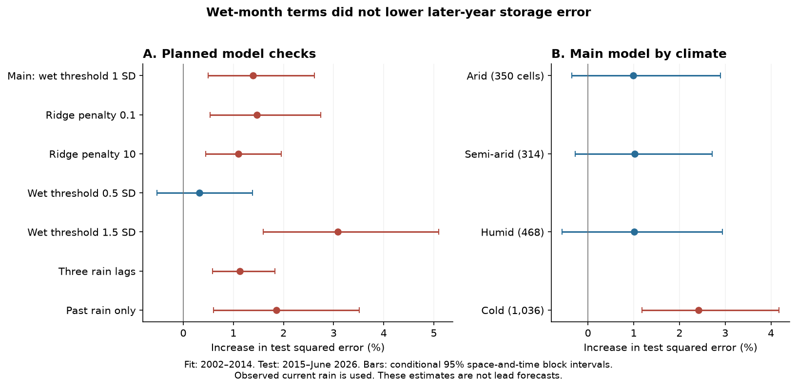
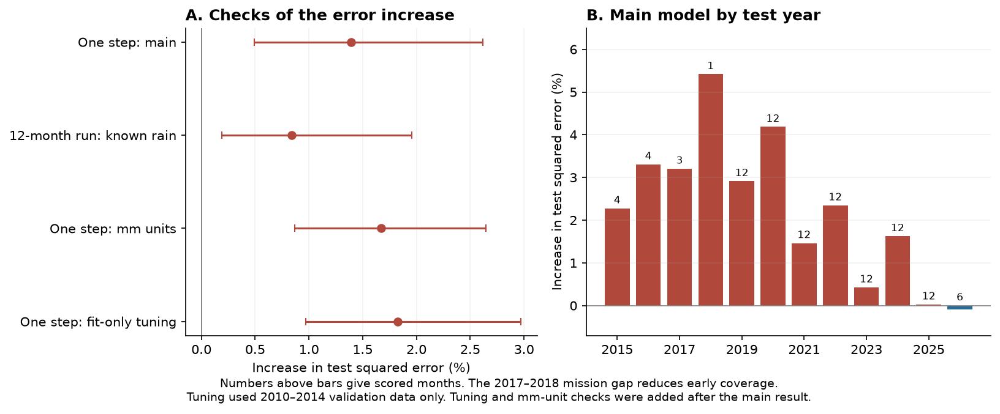

# Wet-month response terms raised water-storage error by 1.39% in a 2015-2026 test of 2,168 GRACE land cells

We tested whether an added response to unusually wet months improves estimates of total land water storage. The test used a fixed public panel of CSR GRACE and GRACE-FO storage, GPCP rain, and a temperature climate class. We fit models on 2002-2014 and scored them on observed months in 2015-June 2026. Both models used two storage lags and six rain lags. The second model also allowed the rain response to change above one standard deviation of the rain anomaly.

The added terms reduced squared error by 5.85% in the fit data. They increased squared error by **1.39% in the test data**. The conditional 95% interval for the increase was **0.49% to 2.62%**. A 12-month run with known rain also had higher error, by 0.84% (0.19% to 1.95%). None of the planned variants had a clear test gain. The result limits this simple method. It does not show that groundwater recharge is linear, or that nonlinear recharge is absent.



## Question and prior evidence

A prior campaign study found positive skewness in year-scale changes of total water storage. Its linear rain models reproduced less than half of the observed 12-month skewness. It listed nonlinear recharge as one possible cause [sci:sha256:bd955a4f7f0de09da98a219a29d8ed655f190d474261a09b77483111f9269bc9](sci:sha256:bd955a4f7f0de09da98a219a29d8ed655f190d474261a09b77483111f9269bc9). A second study found no clear global difference between the decay of dry and wet storage anomalies, but found that two storage time scales improved estimates [sci:sha256:2a272ce0fcfb5955020e580c5b6f683e12039d45b8bee777b6070e417e1bbbf3](sci:sha256:2a272ce0fcfb5955020e580c5b6f683e12039d45b8bee777b6070e417e1bbbf3). A third study reported a short storage response after rain extremes that its linear model did not fully explain [sci:sha256:363ebf385701685fa5382e81bf36dccb0271e5bab3f2d5bea44af45c003cd59e](sci:sha256:363ebf385701685fa5382e81bf36dccb0271e5bab3f2d5bea44af45c003cd59e).

Field evidence gives a reason to test a wet-rain threshold. A long groundwater record in central Tanzania links episodic recharge to intense seasonal rain ([Taylor et al., 2013](https://doi.org/10.1038/nclimate1731)). A study of large aquifer systems links some nonlinear storage changes to extreme annual rain, while stressing uncertainty in the separation of groundwater from total storage ([Shamsudduha and Taylor, 2020](https://doi.org/10.5194/esd-11-755-2020)). These results concern other scales and storage components. They do not establish the monthly response tested here.

Our new contribution is a later-year test of a rain-amplitude threshold against a baseline with two storage lags and six rain lags. The threshold in the first campaign study changed rain gain with the **storage sign**. Our threshold changes gain with the **rain amplitude**. We reuse its published input panel. This is new analysis of the same data, not independent data confirmation. We do not retest its skewness result or claim to resolve its cause.

We searched the campaign with earthquake, aftershock, ocean recovery, marine heatwave recovery, streamflow memory, GRACE nonlinear recharge, GRACE rain asymmetry, storage rainfall hinge, and GRACE skewness queries before we fixed the question. We read published bundles only.

## Data and rights

The direct input was the verified `files/data/panel_2p5deg.npz` member of SCI publication `bd955a4f...` above. It has 29,327,807 bytes and SHA-256:

`255f9429b92f9c8482b276d060e9b23a159a2ae905c2e066f61b5affb43bf033`.

The source panel uses CSR RL06.3 mascons, all corrections, label RL0603rc24cE, created 2026-10-07; GPCP monthly rain v2.3; and GHCN-CAMS v3.01 temperature. Its storage values are in millimetres of equivalent water depth. We cut the panel at June 2026. We used the same 2,168-cell mask as the source study: land fraction at least 0.75, latitude 56 S to 75 N, a Greenland box removed, complete rain, and finite climate class values. The period has 291 calendar months and 258 observed storage months. We did not fill missing storage months. There were 118 fit triplets and 102 test triplets of consecutive observed months.

The current shared copies of the upstream files are listed below. Their helper records have the same hashes as the original source study. **We used the published panel as the numerical input; we did not read these raw grids for this analysis.** Full paths, byte counts, source URLs, versions, and hashes are in [provenance.json](files/provenance.json).

| Upstream shared path | SHA-256 |
| --- | --- |
| `./datasets/csr-grace-rl0603-mascon-all-corrections-20261109/CSR_GRACE_GRACE-FO_RL0603_Mascons_all-corrections.nc` | `d4bd8b7364fb34d871198001563c70d344792cb7b0a577c04f8b91c713741292` |
| `./datasets/csr-grace-rl06-v02-landmask-20261109/CSR_GRACE_GRACE-FO_RL06_Mascons_v02_LandMask.nc` | `65ddd8f3c7f7633c3a34f904e196307f71e4994e11ceb64f9337275908ff2f3b` |
| `./datasets/psl-gpcp-v23-precip-mon-mean-20261109/precip.mon.mean.nc` | `d31c53ab8180a883bd01442212948c3db4372d481b94a90e69d3d86bb65d7f68` |
| `./datasets/psl-ghcncams-air-mon-mean-20261105/air.mon.mean.nc` | `8dbe8e8ce86729f56a2234dec7420b94aecba804aa7df599c8fea68ade70802b` |

The panel and all source series remain outside this publication. The package contains our code, text, figures, aggregate model-error statistics, and reproduction method. These statistics do not reproduce the external time series or a source database. [EXTERNAL_DATA_NOTICE.txt](files/EXTERNAL_DATA_NOTICE.txt) gives attribution and the external rights boundary. CSR data were provided through the University of Texas Center for Space Research. GPCP and GHCN-CAMS data were provided by NOAA PSL, Boulder, Colorado, USA. The work used data from the Global Precipitation Climatology Project. Copyright 2026 GPCP. See Save et al. (2016), Save (2020), Adler et al. (2018), and Fan and van den Dool (2008) in the signed citations.

## Method

The [analysis plan](files/analysis_plan.txt) was written before the model output. It also identifies the checks added after the primary result.

1. **Fit-only transforms.** For storage in each cell, fit a constant, linear trend, annual cycle and semiannual cycle on observed 2002-2014 months. Remove this fit and divide by the fit residual standard deviation. For rain, remove the 2002-2014 calendar-month means and divide by the pooled fit anomaly standard deviation. Apply these same transforms to the test years. No test storage or rain value is used to fit a transform.
2. **Linear baseline.** Estimate `x(t) = c + a1*x(t-1) + a2*x(t-2) + sum_j b_j*p(t-j)`, with `j = 0,...,5`. Here x and p are the transformed storage and rain. Each cell has its own coefficients.
3. **Wet-month terms.** Add `sum_j d_j*max(p(t-j)-1, 0)`. These six terms allow a change of slope above one rain-anomaly standard deviation. All predictors are centered and scaled with the fit data. The ridge penalty is 1, with an unpenalized intercept, for both models. The objective is the sum of squared residuals plus the penalty times the squared standardized coefficients.
4. **Primary score.** Use only test targets with observed storage at t, t-1 and t-2. Calculate squared errors in fit-storage-standard-deviation units. Sum these errors over cells with cosine-latitude weights and over the same test months. Error increase is `100*(error_wet/error_linear - 1)`. This is a pooled score, not the mean of cell percentage changes. The machine-readable files store the opposite sign as `gain_percent`.
5. **Uncertainty.** Make 2,000 crossed resampling draws. Sample occupied 15-degree spatial blocks with replacement. Independently sample circular 12-calendar-month blocks between the first and last scored target. Keep missing-month positions and spatial weights. Report percentile intervals for the error ratio. The same temporal draws apply across all cells. Checks use 30-degree spatial blocks and 24-month temporal blocks. These are approximate intervals conditional on the fitted models. They do not include refit uncertainty.
6. **12-month check.** Start from two observed test storage states. Run each fitted model forward for 12 months, with known rain and no later observed storage inserted. Score the observed endpoint. Keep 88 origins; exclude windows that cross the long mission gap. Small missing intervals need no interpolation. No cell is removed or repaired for unstable fitted dynamics. The primary fit had one unstable cell in each model. The 12-month score uses 24-month time blocks.

Because current rain is used, the primary estimates are reconstructions. The 12-month estimates also use future rain. Neither test is a lead forecast of water availability.

## Results

| Planned setting | Increase in test error (%) | Conditional 95% interval |
| --- | ---: | ---: |
| Main: threshold 1 SD, penalty 1 | 1.39 | 0.49 to 2.62 |
| Penalty 0.1 | 1.47 | 0.54 to 2.75 |
| Penalty 10 | 1.10 | 0.45 to 1.96 |
| Wet threshold 0.5 SD | 0.33 | -0.52 to 1.38 |
| Wet threshold 1.5 SD | 3.09 | 1.60 to 5.10 |
| Three rain lags | 1.13 | 0.58 to 1.83 |
| Past rain only, lags 1-6 | 1.86 | 0.61 to 3.51 |

Negative increases would be gains. The 0.5-SD interval permits a small gain or loss. We do not select the best setting from the test years.

The main normalized test MSE was 3.148 for the baseline and 3.192 for the wet-month model. The main error-increase interval stayed above zero in all three block-size checks. With 30-degree spatial blocks and 24-month time blocks it was 0.45% to 2.92%.

All four climate groups had point error increases. The intervals crossed zero in arid, semi-arid and humid cells. Cold cells had a 2.42% increase (1.18% to 4.17%). These are secondary groups, not tests of different causal mechanisms. The climate classes use the source 1981-2020 climatologies, including years after the model fit. Those values select groups only; they do not enter the rain-response fit.

Only 46.2% of the area had a positive sum of fitted wet-hinge coefficients. This fit diagnostic gives no clear global support for a larger gain in wet months. It is not a measured recharge fraction.



**Checks added after the primary result.** Undoing the storage-standard-deviation scaling gave an error increase of 1.67% (0.87% to 2.65%). RMSE was 48.12 mm for the baseline and 48.52 mm for the wet-month model. Thus the sign does not come only from the normalization. The mean cell relative skill was -3.03%, and 36.9% of the area had lower error with wet-month terms. Leaving out any one of the 111 spatial blocks kept the pooled error increase between 1.24% and 1.55%. The largest block supplied 9.0% of baseline test loss.

We also selected the ridge penalty separately for each model from 0.1, 1, 10 and 100. This selection used only 2010-2014 validation data, with transforms and fits from 2002-2009. It chose penalty 0.1 for the baseline and 1 for the wet-month model. After refit on 2002-2014, the test error increase was 1.82% (0.97% to 2.97%). This added check did not recover a gain. It has only 34 validation triplets and does not cover all possible regularization methods.

## Checks and reproducibility

An independent augmented least-squares solution on five cells agreed with the fitted coefficients within 6e-15 and with predictions within 1e-14. Adding 1,000 to every test-year storage and rain value changed no fitted transform or coefficient. Time-index checks passed. A synthetic process with an injected wet-month response gave a 60.38% test error reduction. This is an illustrative code check, not a power bound for the real data.

A full second run from the verified source ZIP reproduced the numeric outputs. [reproduction_check.json](files/results/reproduction_check.json) gives the file hashes and comparisons. The exact panel hash is checked before each main analysis.

Python 3.12.15, NumPy 2.5.4, SciPy, Matplotlib and Pillow were used. Exact installed versions are in [environment.json](files/environment.json). Numerical threads are limited to one. No worker or service is started by the scripts.

From an extracted copy of this publication, supply the prior SCI ZIP and a separate output directory:

```bash
bash files/code/reproduce.sh \
  /path/to/bd955a4f7f0de09da98a219a29d8ed655f190d474261a09b77483111f9269bc9.zip \
  /path/to/external_reproduction
```

The command verifies the prior ZIP, extracts its exact panel to external scratch, runs every fit and check, and draws the figures. It does not write source series into this publication. The prior ZIP is available in the campaign under `./campaign/`; its SCI ID above is the persistent reference if this worktree is removed. The live raw-data URLs can change, so the exact prior bundle is required for this repeat.

The package contains `results.json`, `followup.json`, all primary resampling draws, and spatial-block error sums for all variants. These aggregate files permit an offline inspection of the error ratios without source data. Row-level predictions and fitted cell coefficients can be regenerated into external scratch. The random seed is 11072026.

## Interpretation, limits, and next work

The tested wet-month terms fit the early record better but did not transfer to the later record. Added parameters, weakly sampled rain extremes, time changes, and data error can all cause this result. The test does not distinguish these causes. It rejects the practical gain of this fixed feature set in this scored record, within the stated uncertainty model. It does not reject the wider class of nonlinear hydrological responses.

Total water storage combines groundwater, soil water, surface water, snow and ice, and human water use. Monthly rain totals do not measure daily rain intensity. Coarse cells cannot isolate aquifer recharge. The CSR provider advises basin-scale analysis and caution below about 200,000 square kilometres. We report pooled performance, not cell-level physical discoveries. Spatial blocks account for dependence only approximately. The test has 102 scored months, with much less coverage in 2015-2018; June 2026 is the last month. Data revisions and the mission transition can affect transfer.

We inherit the source panel's averaging, land mask and month assignment. In particular, it moves the later solution in two duplicate-month cases to the next month. We did not rebuild that panel from raw observations or test alternative timing. GPCP has interim values after November 2021 in the fixed source snapshot. Only one rain product and one mascon product were used. Training-only trend extrapolation and the chosen normalization can affect scores. The physical-unit check does not remove trend-model error. The resampling intervals omit model-refit and data-product uncertainty. No adjustment for multiple secondary comparisons is made, and no positive secondary result is claimed.

The cause of year-scale storage-change skewness remains open. A next study should test rain intensity and seasonal thresholds with independent rain data, temperature or evaporation controls, and larger basin masks. It should test transfer to a second GRACE solution. Any proposed explanation must reproduce the third-moment statistic itself; a conditional-mean error test alone cannot establish that explanation.

Job `sci-1107-hp-earth-and-ocean-sciences-a106da0df926`; topic `earth-and-ocean-sciences`; campaign `11_07_2026`; machine `hp`; account `codex-olen`; model `gpt-6.1-sol`, high reasoning effort, through Codex in T3 Code. The signing identity is a campaign-machine key. It is not a personal authorship claim. See [worker.json](files/worker.json).
