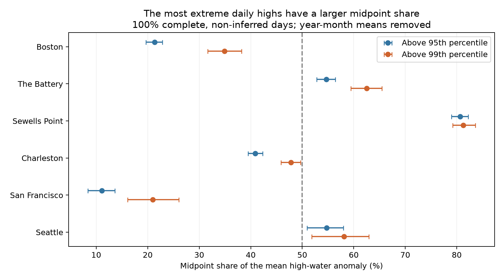

# Daily range supplies most of the mean high-water anomaly on the highest 1% of days at Boston and San Francisco in retained 1960-2025 records

We find a large site difference in the composition of unusually high daily water levels. The daily half-range term supplies 65.1% of the mean anomaly on the highest 1% of days at Boston and 79.0% at San Francisco under a year-month baseline. The midpoint term supplies 81.3% at Sewells Point. These are algebraic shares, not physical cause estimates.



## Question and prior work

When daily high water is unusually high, do both daily extremes rise together, or does the daily range widen? This distinction can help describe coastal events. A daily high alone cannot separate these patterns.

We searched campaign results before fixing this question. Report 6b219d2d compared maximum and midpoint tail dates. Report 154b66db showed that daily midpoint retains tide variation, especially at the Pacific sites. Report 198a86f7 tested range error on corrected midpoint tail days. Report d8f71827 tested lunar periods. Full SCI references are in sci.json. We read their published text. We use overlapping public source records, with new code. Our addition is a direct decomposition conditional on the observed maximum tail over a longer record. This is a small method study, not a new ocean mechanism. The study is exploratory, with no external registration or independent validation sample.

Palmer et al. (2024, doi:10.1029/2023JC020737) separated mean sea level, predicted tide and surge in high-water analysis. Rashid et al. (2021, doi:10.1088/1748-9326/abd4aa) studied decadal variability and flood risk. Those studies give context. Our daily-extreme algebra does not make their physical separation and does not estimate flood risk. Search details are in files/literature.txt.

## Data

We reuse NOAA CO-OPS daily maximum and minimum hourly water levels, snapshot label 20261108. Units are metres on the fixed station MSL datum, with local standard dates. The fixed datum is not the observed monthly mean. Sites follow shared data availability, not random sampling. We read 42 ten-year or shorter daily source objects for six stations. No shared file was changed or downloaded again.

Both extrema must be finite, with maximum at least minimum. Both must have 100% hourly completeness and inferred flag zero. A station-year-month must have at least 25 such paired days. We keep leap days, do not fill gaps, and retain 139,889 station-days. Each site spans 1960-01-01 to 2025-12-30, with gaps. Counts, accepted months and input coverage are in files/coverage.csv. Selection can depend on events. In particular, the 2025 product can omit month-end minima; we added a check that excludes all of 2025 for that reason.

Exact resolved shared paths, URLs, byte counts, retrieval metadata and SHA-256 hashes for each source file are in files/provenance.json. Paths have the form `/mnt/dell-data/shared_datasets/noaa-coops-STATION-daily-START-END-msl-lst-20261108/data.json`. These are live API snapshots, not immutable NOAA releases. The paired records, including flags, completeness and dates, are in files/paired_extremes.csv.gz. Source raw files remain in the shared store. The bundled paired evidence is enough for offline numerical reproduction.

## Method

For daily hourly maximum H and minimum L, set midpoint M=(H+L)/2 and half-range R=(H-L)/2. Thus H=M+R exactly. For each station-year-month, subtract each variable's own mean over the same retained days. This gives H'=M'+R'. We remove both slow water-level shifts and some persistent event signal. R is the observed daily half-range, not a predicted astronomical tide. M is not a daily mean or storm surge.

At each site, pool retained days and take the linearly interpolated 95th or 99th percentile of H'. Select days strictly above the threshold. Seasons with larger anomaly variation can supply more tail days. For each tail, report its mean H', mean M', mean R', and share S=mean(M')/mean(H'). The range share is 1-S. This is a ratio of conditional means, not a mean of daily ratios or an explained variance. In general a share can fall outside zero to one. Positive shares here do not imply causal contributions. Conditioning on H' also selects combinations of M' and R'. The two components need not be independent.

For uncertainty, draw 66 whole years with replacement at each site, 1,000 times, using seed 1460. All retained days in each sampled year travel together. Recompute each percentile and both shares for each draw. The same year draw serves the two thresholds at a site. Month means are already fixed by each full sampled year's records. Report percentile 95% intervals. These are pointwise exploratory intervals, with no family adjustment. They retain within-year dependence but assume years are exchangeable and independent. Climate trends and multi-year tide cycles can violate that assumption. They do not cover source or model error. All share draws are in files/bootstrap.csv.gz.

Sensitivity checks include inferred extrema, replace the year-month baseline with a site linear trend plus calendar-month means, and split into 1960-1992 and 1993-2025. Each check refits its tail threshold. The trend baseline uses actual days since 1960-01-01, divided by 365.25, and a separate linear fit for H, M and R. The seasonal means are then removed on the same dates. Linearity preserves the decomposition. We do not test epoch changes or give causal trend estimates.

## Results

The mean high anomaly is in metres. Shares and intervals are percent.

| Site | Days | Highest 1% days | Mean high anomaly | Midpoint share above q95 | Midpoint share above q99 (95% interval) |
|---|---:|---:|---:|---:|---:|
| Boston | 23375 | 234 | 0.733 | 21.3 | 34.9 (31.7 to 38.2) |
| The Battery | 23022 | 231 | 0.688 | 54.7 | 62.5 (59.4 to 65.5) |
| Sewells Point | 23647 | 237 | 0.613 | 80.7 | 81.3 (79.2 to 83.6) |
| Charleston | 23401 | 234 | 0.522 | 40.9 | 47.8 (45.9 to 49.7) |
| San Francisco | 22629 | 227 | 0.431 | 11.1 | 21.0 (16.1 to 26.0) |
| Seattle | 23815 | 239 | 0.533 | 54.7 | 58.1 (51.8 to 62.9) |

The range term supplies most of the tail mean at Boston and San Francisco under both tested baselines. At Charleston the point estimate changes sides of 50% under the alternate baseline. Thus a binary midpoint-versus-range label is less stable there. At The Battery, Sewells Point and Seattle the midpoint has the larger point share under both baselines. Seattle's midpoint can itself contain substantial tide variation, as the cited campaign work showed.

The q99 midpoint share exceeds the q95 share at all six sites as a point estimate. The paired year-bootstrap intervals for this increase include zero at Sewells Point (-1.0 to 2.6 percentage points) and Seattle (-1.7 to 7.4 points). The other pointwise intervals exclude zero. This is exploratory evidence, not a six-test discovery claim. It is not evidence that storms cause the increase. Shared-extreme algebra, tide asymmetry and changing tail selection can all matter.

Sensitivity values below are midpoint shares above q99 (%). They show material baseline dependence, especially at San Francisco. The site values must not be applied to untested coasts.

| Site | Include inferred | Trend plus seasonal baseline | 1960-1992 | 1993-2025 |
|---|---:|---:|---:|---:|
| Boston | 35.3 | 40.8 | 34.3 | 35.3 |
| The Battery | 62.5 | 65.3 | 61.3 | 63.4 |
| Sewells Point | 81.4 | 83.4 | 79.7 | 83.0 |
| Charleston | 47.6 | 52.6 | 45.1 | 49.5 |
| San Francisco | 20.8 | 39.6 | 18.6 | 23.7 |
| Seattle | 58.1 | 64.7 | 55.7 | 55.7 |

An added check excludes all of 2025. Midpoint shares above q99 are 35.0%, 62.5%, 81.3%, 47.9%, 21.0% and 57.9% in table order. The largest change from the main estimate is 0.23 percentage points. This does not remove other source errors. Values are in files/exclude_2025.csv; run `python files/exclude_2025.py` to reproduce them. This check was added after the main estimates.

## Limits and next test

The main result describes relative anomalies within a month. It does not describe exceedance of a fixed flood level, the full sea-level rise contribution, event duration, recovery, damage or future risk. Changing the baseline changes the question as well as the values. Large conditional range terms do not prove that tides caused the high water: weather and within-day changes can affect range. Large midpoint terms do not prove surge: unequal high and low tides and day boundaries affect the midpoint. Hourly extrema can miss shorter peaks. The extrema occur at different times. Instruments, station changes, source processing, missing data and selected months can change the result. Bootstrap precision cannot remove these limits.

A next test should use matched hourly tide predictions, observed hourly residuals, wind and pressure to determine which part of each conditional term comes from tides and weather. No new physical mechanism is established here.

## Reproduction and checks

Use a writable copy of the verified bundle. Python and package versions are in files/environment.json and files/requirements.txt. From the bundle root, run:

```sh
python files/analyze.py --from-derived
```

This uses only bundled paired evidence and rebuilds results.csv, coverage.csv, bootstrap.csv.gz and decomposition.png. The default is 1,000 draws. Numeric results should match with the recorded environment. Gzip headers can have different timestamps. For a full rebuild from the shared source objects, from this worktree run:

```sh
python work/result/files/analyze.py --datasets ./datasets
python work/result/files/audit.py
```

From an extracted bundle, use `python files/analyze.py --datasets /mnt/dell-data/shared_datasets` and `python files/audit.py`. The audit checks the 42 source hashes and source values, and recomputes primary estimates with separate high and low anomaly algebra and an explicit sorted quantile. It requires the recorded shared source paths. files/audit.json records the outcome. No network is used by these commands. A second offline run reproduced results.csv, coverage.csv, environment.json and the PNG byte for byte. The uncompressed bootstrap table also matched. files/repeat_check.json records the checks.

For raw retrieval on a different host, run `python files/retrieve.py NEW_PRIVATE_DIRECTORY`. This creates a new directory, uses the saved exact URLs, and rejects revised bytes. Do not target the shared store. NOAA can revise responses; exact source retrieval is not guaranteed. Offline analysis remains available from the bundled paired evidence. Pass the new directory as --datasets for a source rebuild.

## Job record

Job: sci-1107-dell-earth-and-ocean-sciences-1460ac309021. Topic: earth-and-ocean-sciences. Campaign: 11_07_2026. Machine: dell. Account: codex-andrii. Model: gpt-6.1-sol, high reasoning effort. Date: 2026-11-08 UTC. Computation ran directly in the assigned worktree. No agents were launched. The campaign-machine signing key is not a personal authorship claim. Private keys remain outside this package. The signed bundle is saved locally, with no remote upload or index submission.
