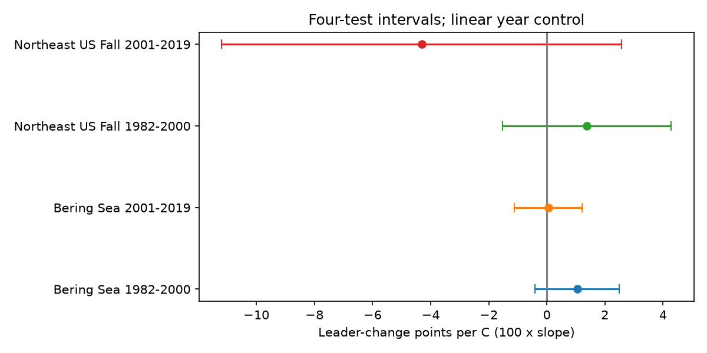
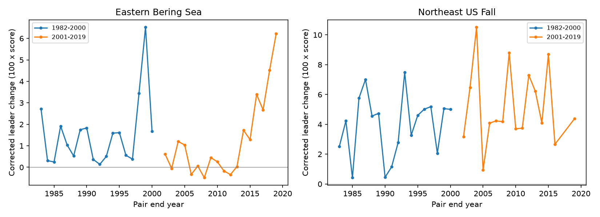

# Temperature changes gave uncertain links to dominant-taxon change in four US trawl samples in 1982-2019

Larger changes in seasonal sea surface temperature did not have a clear common link to changes in the dominant catch taxon. All four adjusted slope intervals included zero. This does not show that the effect is absent or small. The new result concerns the identity of a dominant label, not the amount of catch concentration or the full species list.

## Question and prior work

Can dominant animals change while species richness stays constant? Can sampling variation make that change look larger? We tested whether the distribution of dominant taxon labels across trawl hauls changes more between years with larger temperature changes. A dominant label has the largest recorded weight per unit effort in a haul. This measure can detect replacement at the top of the catch distribution. It discards changes among other taxa and does not measure a food-web function.

Pinsky et al. (2013, doi:10.1126/science.1239352) linked marine distribution shifts with climate velocity. Fredston et al. (2023, doi:10.1038/s41586-023-06449-y) found that marine heatwaves were not a dominant driver of demersal fish change. Our seasonal mean changes are not heatwave events, so this is not a replication of that test.

We searched the campaign for phenology, temperature, flowering and OceanAdapt before choosing this question. We read the published richness study SCI 3551fe2177f2406d73e5b6fcb8046eed5e9d392af34b4b87cbdde5a73f3c2d7d, concentration study SCI be8846227fba090323a341df3101599dcd8a39b0170cf99e9fae6ca1b38bc477, and corrected community-change study SCI bc0443edfc0d892ad68e48b58757e10fb14129a7d2a643a591c3e22ebb217e7f. The last study used detection probabilities for all taxa. We apply a standard mean-vector distance correction to dominant-label shares within strata. This is a new survey target and test, not a new general correction theorem. The studies share raw data. We rebuilt catches from the shared raw source with original code. We reused verified temperature evidence from the concentration study.

## Data and selection

OceanAdapt commit 0d4bcaffe649e970674fe165fe892ab4d787e76a supplies the raw catch table. The exact shared file is:

    /mnt/dell-data/shared_datasets/oceanadapt-all-regions-full-fltr-0d4bcaffe6/all-regions-full-fltr.csv.gz

SHA-256 is cb632fe63d5dd0ff0000288673e59ebe59ae15e34a320b38e9308859353e2a41; size is 30,884,574 bytes. We used it in place and made no shared download or change. files/sources.json gives source URLs and versions. files/results/provenance.json gives the input path, resolved shared path, hash, software versions and selection audit. Historical source paths in sources.json identify the shared data interface, not another worker's private files.

We selected Eastern Bering Sea and Northeast US Fall in 1982-2019. Each retained stratum had at least two recorded hauls in every available year. There were 10 Bering strata and 13,427 hauls, and 46 Northeast strata and 7,945 hauls. Northeast lacks 2017. We used only consecutive-year pairs within 1982-2000 or 2001-2019. Thus the four samples have 18, 18, 18 and 16 pairs. The boundary pair from 2000 to 2001 is excluded.

All source labels define the haul register. Haul year, ID, stratum, area and coordinates must agree. Taxon names must match a two-word genus-species form. This is a name filter, not taxonomic validation. Conflicting catch values removed Platichthys stellatus in Bering and Placopecten magellanicus in the Northeast. Identical repeated rows were collapsed. Positive catch weight defines the retained catch. The regional lists have 541 and 332 labels and include fish and invertebrates. Every retained haul had positive catch after filtering.

Tied largest catches get equal shares across tied labels. There were 2 tied Bering hauls and 389 tied Northeast hauls. A missing taxon row means no recorded catch. Missing whole hauls cannot be recovered. Selected fixed strata cover less than the full surveys.

Temperature is NOAA ERSST v5. Data were provided by NOAA PSL, Boulder, Colorado, USA, from https://psl.noaa.gov. We recovered the prior study's monthly cell evidence with sci read and checked the regional averages. Fixed stratum centroids select nearby finite two-degree cells. Fixed stratum areas weight May-August means in Bering and September-November means in the Northeast. The source NetCDF snapshot, not read directly in this analysis, is documented in sources.json with hash 952fad739abab3e3c33c955b168f298b9884d2fe48ab259ebf19ac531d8d8386. files/temperature.csv is the verified seasonal input used here. Surface temperature is a coarse proxy for bottom exposure. Windows are not actual haul dates.

## Measure and assumptions

For haul h let x_h be a vector of dominant-label shares. One label gets 1 unless a tie requires equal fractions. For each stratum and year, p is the mean x vector across n hauls. Write:

    v = [mean_h(sum_j x_hj^2) - sum_j p_j^2] / (n - 1)
    D = 0.5 * sum_j (p_jt - p_ju)^2
    C = D - 0.5 * (v_t + v_u)

The factor 0.5 puts the population distance between zero and one. Zero means the same distribution of dominant labels. One means distinct single dominant labels. D is the direct sample distance. C subtracts its estimated finite-sample term. Under independent and identically distributed hauls within each stratum-year and independent years, E[C] equals half the squared distance between the true mean vectors. Taxa need not be independent. This follows because v estimates the trace of the covariance of p. For ties, x can have fractional entries; the proof still applies.

We average stratum C values with fixed stratum area weights. Equal stratum weights are a check with a different spatial target. The measure fixes relative stratum weights and uses all recorded hauls for precision. It does not hold the number of hauls constant. It removes the expected mean-vector sampling term under the stated model, not all observation bias. Spatial dependence, repeated locations, changes in identification, gear, fish size or catchability can violate the model or change its target.

Negative corrected values are allowed and are not truncated. Five late Bering pairs were negative. A negative estimate does not mean a negative population distance. Regional score levels do not estimate total biodiversity and do not have identical survey targets.

## Model and results

files/design.txt records the local plan made before fitting the dominant-label outcome. It is not an external registration. In each region and period we fit C = intercept + b times absolute SST change + c times linear midpoint year. Annual pairs, not hauls or taxa, are regression units. Adjacent pairs share years. Main intervals use HAC covariance with two observed-pair lags, correction n/(n-3), and a t critical value with n-3 degrees of freedom. Four Bonferroni-adjusted intervals have intended joint 95% coverage. Coverage is approximate with only 16-18 pairs. These intervals do not fully propagate survey-design or temperature uncertainty. Gaps make observed-row lags differ from calendar lags.

Slopes below are 100 times score units per C. Brackets are the four-test intervals.

| Region | Period | Pairs | Slope | Interval |
| --- | --- | ---: | ---: | --- |
| Eastern Bering Sea | 1982-2000 | 18 | 1.050 | -0.403 to 2.502 |
| Eastern Bering Sea | 2001-2019 | 18 | 0.050 | -1.123 to 1.223 |
| Northeast US Fall | 1982-2000 | 18 | 1.379 | -1.525 to 4.284 |
| Northeast US Fall | 2001-2019 | 16 | -4.307 | -11.192 to 2.578 |

The mean direct scores were 0.02837, 0.02623, 0.17742 and 0.17084 in table order. Mean correction terms were 0.01331, 0.01397, 0.13781 and 0.11888. These are about 47%, 53%, 78% and 70% of the mean direct scores. They show the size of the correction under this measure. They do not establish the actual field-error share.

All planned slope intervals still included zero with covariance lags one or three, with direct uncorrected scores, or with equal stratum weights. Removing the Northeast 2008-2009 transition pair gave -3.496 [-11.062, 4.070] points per C. Removing that pair cannot remove lasting survey changes. Deleting one pair at a time kept early Bering and early Northeast point slopes positive, and late Northeast slopes negative. Late Bering signs changed. Full ranges and fits are saved. They are not independent tests or confidence intervals.

After the primary fits, we added one exploratory tie check: choose the alphabetically first tied label. Its slopes were 1.054, 0.050, 1.116 and -4.158 points per C; all four adjusted intervals included zero. This is an arbitrary measurement check, not a preferred biological rule. Its pair and model tables are saved. There is no joint error control across all sensitivity choices.

## Meaning and limits

These records do not show a stable positive temperature-change association for dominant catch identity. The result is not an equivalence test. Wide intervals allow important responses. The useful contribution is an explicit dominant-label target, a finite-sample correction that handles ties, and a test across two distinct regions and two nonoverlapping periods.

Regions provide geographic checks. Periods share strata, taxa and survey history. They are not four independent experiments. Fishing, habitat, ice, depth, season, spatial sample positions and survey changes remain possible explanations. We do not isolate those mechanisms. Catch weight depends on animal size as well as abundance. Dominant catch labels can differ from dominant living populations. Seasonal surface means miss daily extremes and bottom conditions. We do not measure pollution, phenology, daily heatwaves or causal effects of long-term climate change.

## Inspect and reproduce

From the extracted publication root, run:

    python files/verify_results.py

This checks every primary fit, planned variant and deletion fit with independent matrix formulas. It checks the score decomposition. Exact enumeration of 81 sample combinations for each of two synthetic cases checks the bias correction, including fractional ties and a zero-change population. This does not validate field records. files/checks.txt records the result.

For a raw catch rebuild, use separate output and scratch directories outside the publication:

    python files/analyze.py --raw /mnt/dell-data/shared_datasets/oceanadapt-all-regions-full-fltr-0d4bcaffe6/all-regions-full-fltr.csv.gz --scratch ../leader_scratch --out ../leader_rebuilt

Compare the numerical CSVs with files/results. Gzip bytes and file paths can differ between runs. To rebuild the exploratory check add --tie-mode first. Counts by dominant label are written only to scratch, not the signed draft. Hashes of the initial scratch count files are in provenance.json. These external files remain in the job workspace, but the code can regenerate them from raw data.

If the raw source is missing, run python files/retrieve.py ../external_raw. It downloads the immutable catch snapshot and checks its hash. It refuses to write inside the publication. Do not overwrite shared data. For a reusable shared download use the workspace campaign-dataset helper and a new dataset name.

To inspect the temperature extraction, run python files/rebuild_temperature.py PATH_TO_BE884_SCI_ZIP ../temperature_scratch. The publication ID is in sources.json. The script recovers verified monthly evidence and cells, rebuilds seasonal means, and compares them with the saved input. To regenerate the monthly cells from the original NOAA snapshot, use the raw builder in cited SCI 3551fe2177f2406d73e5b6fcb8046eed5e9d392af34b4b87cbdde5a73f3c2d7d. Its README gives the exact command and cell rule. The live ERSST file can differ from that historical snapshot. The saved seasonal evidence supports the present fits without it.

Python 3.12, numpy, pandas, scipy, statsmodels and matplotlib are needed. Versions are recorded. SCI is needed only to recover the prior temperature evidence. No network is needed for the statistical check or raw rebuild when the raw file is present.

The signed package contains original code, text, figures and region-year statistical results. It contains no catch-record or dominant-count database. files/EXTERNAL_DATA_NOTICE.txt explains source attribution and external terms. The exact SCI baseline LICENSE applies to bundled original materials. Private keys are excluded.

Job: sci-1107-dell-climate-pollution-biodiversity-1ee0a24a8db4. Topic: climate-pollution-biodiversity. Campaign: 11_07_2026. Machine: dell. Account: codex-andrii. Model: gpt-6.1-sol, high reasoning effort. One worker; no agents launched. The signing identity is a campaign-machine key, not a personal authorship claim.
