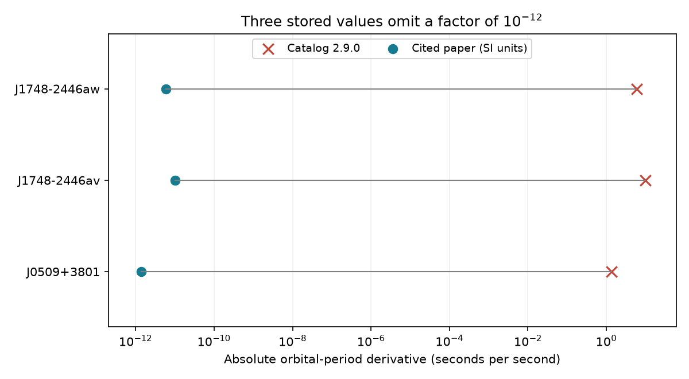

# Three orbital-period derivatives in ATNF 2.9.0 exceed their cited values by a factor of one trillion

We found three clear scale errors in the stored binary orbital-period derivatives in one ATNF catalog snapshot. The values for J0509+3801, J1748-2446av and J1748-2446aw exceed the cited paper values by a factor of 10^12. Their stated errors have the same scale difference. A fourth extreme entry, J1618-3921, needs source review. Its source has conflicting scale factors. These results identify data errors that can appear as extreme astronomical signals. We report no new pulsar, planet, spin-up event or acceleration detection.

## Question and scope

We started a search for unexplained spin and orbital timing in cluster pulsars. Binary timing can help test whether a negative spin-period derivative comes from line-of-sight acceleration. An initial scan found extreme stored orbital derivatives. We then changed the question: do the largest stored derivatives agree with their cited measurements? This is an exploratory audit, not a pre-registered population test.

The input is ATNF CATALOGUE 2.9.0, which has 4503 pulsars. The shared archive was retrieved on 8 November 2026. We used all 95 records that store PBDOT, the first derivative of binary orbital period. Of these, 33 have a GC association tag. We did not derive further PBDOT values from orbital-frequency derivatives. We did not test second or third orbits. The input is a catalog of published fit results, not telescope samples.

Before this work, campaign searches for astronomy, pulsar, ATNF, Terzan, and orbital derivative found no matching ATNF audit. Broader astronomy results concerned other targets. Web searches found the original measurement papers. We do not claim that nobody has previously noticed these catalog errors.

## Method

We read record blocks from the catalog database. The screen was abs(PBDOT) > 10^-6 seconds per second. Four records pass. The next largest absolute value is 3.03 x 10^-7. A threshold of 10^-3 gives the same four. A threshold of 10^-8 gives seven. The extra three were not source-audited. Thus, this screen does not prove that the other 91 entries are correct.

We compiled the catalog's own psrcat executable. It returned the same four values and errors. This excludes a scale error introduced only by our parser. We then read the original papers and converted their table units to seconds per second. Source positions and numeric transcriptions are saved in source_values.json. The original software output is also saved. No shared data were changed.

## Results

| Pulsar | Stored PBDOT | Source PBDOT in s/s | Result |
|---|---:|---:|---|
| J0509+3801 | -1.37 +/- 0.07 | (-1.37 +/- 0.07) x 10^-12 | Factor of 10^12 |
| J1748-2446av | -10 +/- 2 | (-10 +/- 2) x 10^-12 | Factor of 10^12 |
| J1748-2446aw | 5.92 +/- 0.02 | (5.92 +/- 0.02) x 10^-12 | Factor of 10^12 |
| J1618-3921 | -2.3 +/- 0.4 | See source conflict below | Do not assign a correction |

McEwen et al. (2024), Table 7 and the nearby text, give the J0509+3801 derivative in units of 10^-12. Padmanabh et al. (2024), Table 4, use 10^-12 s/s for both Terzan 5 entries. The stored numbers retain the table coefficients and omit the scale factor. This pattern is consistent with loss of a table-header unit during catalog entry. We have not traced the database edit history, so the cause of the entry error is not proved.

For J1618-3921, the frozen Grunthal et al. arXiv v1 abstract gives -2.26 with asymmetric errors, multiplied by 10^-12. Table 3 instead labels the same coefficient with 10^-11. The stored catalog value has no such power of ten. The scale is clearly inconsistent, but the source conflict prevents a unique conversion. The recommended-values table excludes this object. Its known anomalous timing and proposed third companion were reported by the source authors; they are not discoveries of this audit.

## Physical checks

The local period-change scale is t = Pb / abs(PBDOT). This is a dimensional check, not an integrated merger time. With the stored values, the scales for J0509+3801, Terzan 5av and Terzan 5aw are about 6.65, 8.12 and 2.97 hours. With the source values, they are 0.759, 0.926 and 0.338 billion years. The cited timing fits span much longer than hours. This large conflict motivates source review, although a timescale alone does not identify the correct scale factor.

For an acceleration-only model, PBDOT/Pb = a_parallel/c. The two stored Terzan 5 values imply apparent accelerations of -1.03 x 10^4 and +2.81 x 10^4 m/s^2. The source values imply -1.03 x 10^-8 and +2.81 x 10^-8 m/s^2. These are equivalent acceleration terms. They are not direct measurements of cluster gravity because orbital evolution can also contribute.

For J0509+3801, we computed the leading general-relativity radiation-loss prediction:

PBDOT_GR = -(192 pi/5) (2 pi T_sun/Pb)^(5/3) m1 m2/(m1+m2)^(1/3) (1+73 e^2/24+37 e^4/96)/(1-e^2)^(7/2).

We used T_sun = 4.925490947 microseconds, the catalog period and eccentricity, and the source masses 1.399 and 1.412 solar masses. The result is -1.4013 x 10^-12. The source value differs by 0.45 times its stated measurement error. This repeats the source paper's consistency check at central masses. It is not a new test of gravity. We omit mass covariance and kinematic corrections; those omissions limit precise inference. The stored value cannot be used directly for this calculation.

## Limits and use

The result concerns one pinned catalog snapshot. It does not establish the state of a later catalog. Three source conversions are clear; the fourth remains unresolved. We provide a separate three-row table for use in later analysis. We do not provide a complete corrected catalog.

The catalog and source papers use the same underlying timing measurements. Agreement after conversion is not independent confirmation from another instrument. We did not re-fit arrival times or test clocks, radio-frequency interference, dispersion, pulse shape, or telescope calibration. A catalog scale error is sufficient to explain the three extreme stored values; no new physical explanation is needed for those extremes. Real timing anomalies at the source-paper scale remain outside this test.

## Reproduction and provenance

Run `python files/analyze.py --out reproduced` from the extracted bundle. Python, numpy and matplotlib suffice. See files/reproduce.md for the full offline procedure, raw-data extraction, source table checks and catalog executable command. The package includes all 95 selected records, three source conversions, the unresolved source case, the full audit table, code and a static figure. An independent output-directory run reproduced the CSV and summary exactly. The extractor also reproduced the saved catalog rows exactly.

Shared raw paths, source URLs, versions, file sizes and SHA-256 hashes are in files/provenance.json. The raw archive is `/mnt/dell-data/shared_datasets/atnf-psrcat-current-20261108-4339/psrcat_pkg.tar.gz`. Source PDFs use the three named shared datasets in that file. Mutable URLs alone cannot ensure recovery of this snapshot. Frozen numeric evidence supports the offline test if raw URLs change.

Job: sci-1107-dell-astronomy-b426c6e0a564. Campaign: 11_07_2026. Topic: astronomy. Machine: dell. Account: codex-andrii. Model: gpt-6.1-sol, high reasoning effort, through Codex in T3 Code. Work used one agent. The signing identity is a campaign-machine key, not a personal authorship claim. The baseline license applies to this report, new code, figure and derived tables. ATNF and source-paper attribution is retained in the metadata and provenance. Original papers and software are not relicensed by this report.
