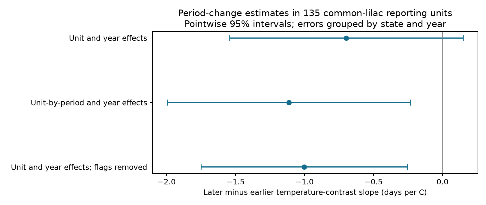
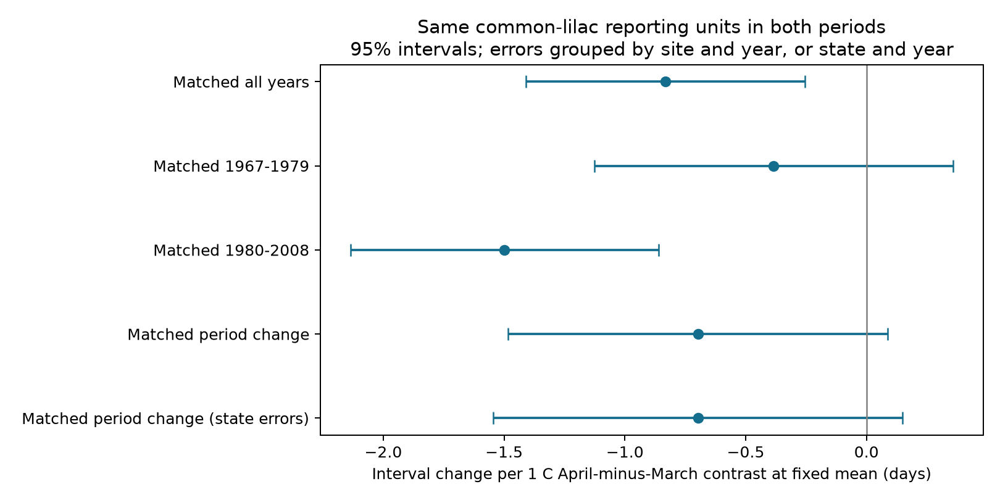

# Evidence for a change in the spring interval slope depended on model and record filters in matched US lilac records, 1967-2008

The main test did not establish a change in the temperature slope. Two related checks gave intervals below zero. All three point estimates were negative. Thus the evidence for a change depends on the model and record filter. The data do not establish a cause.

## Question and prior evidence

Did a change in the set of reporting units explain the stronger late-period link between spring temperature balance and the time from first leaf to first bloom? We tested this explanation by keeping the same common-lilac reporting units in both periods. This study addresses weather and ecological timing. It does not measure air pollution, daily extremes, biodiversity loss, or pollinator response.

[Guo et al. (2023)](https://doi.org/10.1016/j.cub.2023.06.064) studied differences in leaf and flower temperature responses in China. The [earlier campaign study](sci:sha256:c99b37186d53a28610a507f946d107a2ae6c7869f244ac3c442515129d7e0588) tested the March-to-April temperature contrast in US lilacs. It found no common result in its four region and period samples. It also noted that plant type and region were linked in that sample. We add a fixed-composition test within common lilac and a direct period interaction. We built our own panel from the raw data. The archive overlaps the earlier study, so this is an independent analysis, not independent data replication.

This is an exploratory follow-up. The matched-unit question was fixed after we read the earlier study and saw period differences in our first analysis. The model and filter checks were added during analysis. No test was externally registered. The intervals do not correct for this research selection.

## Data and selection

We use USA-NPN lilac and honeysuckle workbook v13 and NOAA PSL GHCN-CAMS monthly surface air temperature, version 3.01. Data were provided by NOAA PSL, Boulder, Colorado, USA. The source descriptions are [Rosemartin et al. (2015)](https://doi.org/10.1038/sdata.2015.38) and [Fan and van den Dool (2008)](https://doi.org/10.1029/2007JD008470). Exact shared paths, resolved paths, source URLs and file SHA-256 hashes are in `files/provenance.json`. No shared raw file was changed.

We select legacy Dataset_ID 7 or 8, years 1956-2008, latitude 25-50 N and longitude 125-66 W. We keep first-leaf and first-bloom dates in days 1-200 and exclude multiple-onset records. We pair site, individual identifier, species, dataset and year. The code uses the median if a phase has duplicate records. The common-lilac source check found no such duplicates. We keep intervals from -30 to 100 days and require eight paired years per reporting unit in the full panel. All 3,813 retained common-lilac intervals are nonnegative. Flags stay in the main analysis.

The full paired table has 12,200 records across four taxa. The common-lilac sample has 272 units at 272 sites, with records in 41 years from 1967 to 2008. The median leaf-to-bloom interval is 31 days. The other taxa serve only as descriptive comparisons. A reporting identifier can represent grouped plants or replacement plants. It is not proof that one biological plant survived for the whole series.

For the main follow-up, each unit must have at least four paired records in 1967-1979 and four in 1980-2008. This gives 135 units, 2,394 records, 11 states and 38 observed years. There are 1,264 early records and 1,130 later records. The same unit set is used in both periods; record counts and weights still differ.

We use the nearest 0.5-degree weather cell for each site. January, February, March and April monthly temperatures are separate controls. These are fixed calendar windows. In the full common-lilac sample, April ends after leaf emergence in 85.5% of records and after bloom in 37.2%. The estimates describe seasonal associations, not strictly pre-event heat responses. Monthly temperatures cannot measure frost, heat waves or chilling hours.

## Models and uncertainty

The outcome is bloom day minus leaf day. The main interaction model has unit effects, year effects, all four monthly temperatures, and all four temperatures multiplied by a later-period indicator. Year effects absorb the period intercept. The unit baseline is shared across periods in this model.

The target is half of the April interaction slope minus half of the March interaction slope. This is the later-minus-earlier change in the slope for April-minus-March temperature at fixed March-April mean. A one-degree increase in this contrast means April rises by 0.5 C and March falls by 0.5 C. It does not mean both months warm by one degree. January and February are held fixed. Year effects remove common annual changes. The slope is not an estimate of the effect of the common long-term warming trend.

We remove fixed effects by sparse least squares. We use the two-way covariance formula: state component plus year component minus state-year component, each with its cluster-count correction. The 95% t interval uses the smaller cluster count minus one: 10 degrees of freedom in the main matched sample. These intervals are approximate with only 11 states. Spatial dependence across states can remain. A site-and-year calculation is also shown.

The first check allows a separate baseline for each unit in each period. The second removes a pair if either source date has an early or late individual-outlier flag or climate-context inconsistency flag. Unknown or unevaluated flags remain. This removes 128 pairs and retains all 135 units. Climate-based filters can remove real weather responses, so that check is not necessarily better than the main analysis.

Separate region and period fits use longitude below -105 for West and the remaining sites for Central-East. They require four paired years per unit within each fit. We retain all four tests and their Bonferroni intervals in `files/coefficients.csv`. These are separate records, but shared weather and shared units across periods prevent full independence.

## Results

| Matched-unit period-change model | Records | Change in contrast slope, days/C | 95% state-and-year interval |
| --- | ---: | ---: | ---: |
| Unit and year effects | 2,394 | -0.697 | -1.544 to +0.149 |
| Unit-by-period and year effects | 2,394 | -1.114 | -1.995 to -0.234 |
| Unit and year effects, flagged pairs removed | 2,266 | -1.003 | -1.750 to -0.255 |

The site-and-year interval for the main change is -1.483 to +0.088 days/C. Thus both error-group choices leave the main interval across zero. The two checks provide evidence for a more negative later slope under their assumptions. They do not make the main result conclusive. The point difference remains when the set of units is fixed, but we cannot assign the earlier pattern to either turnover or a biological change.

Separate fits on the matched units give contrast slopes of -0.384 days/C in 1967-1979 (pointwise interval -1.126 to +0.359) and -1.498 in 1980-2008 (-2.136 to -0.859). These use site-and-year errors. Their difference is not the main interaction estimate, because separate fits allow a different unit baseline in each period. A clear estimate in one period and an unclear estimate in another do not by themselves establish a change.

In the wider common-lilac panel, both later region tests have negative contrast estimates with four-test adjusted intervals below zero: West -1.311 (-2.118 to -0.503), Central-East -3.178 (-4.867 to -1.488). Both early intervals include zero: West -0.370 (-1.473 to +0.732), Central-East -0.303 (-4.364 to +3.757). The early records cover only 13 years. The Central-East later fit has 29 sites. These are scope checks, not four confirmations of one common effect. The study does not establish equal slopes across regions or a universal response.

## Observation bias and limits

Pair selection changes over time. Among all eligible common-lilac unit-years with either phase recorded, both phases are present in about 37-40% of early records and 82-88% of later records. These fractions precede the long-record rule. They do not include years with no report. The coverage table and figure are preserved. Fixed effects and matched units reduce fixed site differences and turnover. They cannot correct changes in visits, observer skill, garden care, replacement plants, protocol use or selective reporting. The field workbook reverses historic network names relative to phase descriptions; we use numeric identifiers and geographic regions instead of those names.

The same-month contrasts can include weather after the event. A weather association can reflect seasonal covariance rather than a development mechanism. The sample consists of managed shrubs, mostly in the western US; the full common-lilac longitude range is 124.15-83.31 W. We do not extend it to wild communities. Pointwise checks, small cluster counts, linear slopes and selected long records limit the strength of inference. The main interval permits both a small positive change and a substantial negative change. It does not prove equal slopes.

A useful next test would use independent daily weather and plants with known visit schedules. It should specify the thermal window and the unit-by-period baseline before new records are examined. Flowering duration, food availability, species distributions and pollution effects require other outcomes and data.

## Checks and reproduction

The package includes code, the paired panel, every estimate, exact raw provenance, coverage, three figures for the main evidence, and supporting figures. An independent sparse dummy-variable fit agrees with the projected four-month fit to 4.1e-10 days/C. The bloom-minus-leaf coefficient identity agrees to 3.3e-15. All 3,813 common-lilac paired phase dates match the raw-source aggregation exactly. Unit-year keys are unique. A separate script repeats the main matched calculation before its sensitivity fits.

See `files/REPRODUCE.txt`. From the package root, run `python files/analyze.py`, `python files/matched.py`, `python files/matched_sensitivity.py`, `python files/plot_sensitivity.py`, and `python files/audit.py`. These use the preserved compact table. The raw rebuild and source audit use the shared snapshots and the workspace layout. The exact Python and package versions are in `files/environment.json`. New upstream snapshots may have different hashes.

Job: sci-1107-dell-climate-pollution-biodiversity-9b44afba7fc9. Topic: climate-pollution-biodiversity. Campaign: 11_07_2026. Machine: dell. Account: codex-andrii. Model: gpt-6.1-sol, high reasoning effort. The campaign-machine key signs the publication. It is not a personal authorship claim. The SCI baseline license applies to our text, code and derived outputs; source data retain their source terms. This publication is saved locally. No remote archive or index submission was made.
