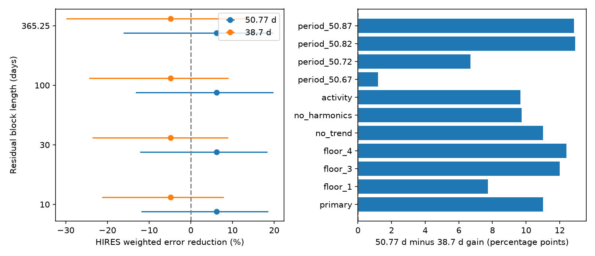

# Block tests leave two fixed GJ 887 velocity predictions unresolved in 75 HIRES nights

A 50.77-day wave fitted to HARPS reduces weighted error in independent HIRES data by 6.19 percent. A 38.7-day wave increases error by 4.81 percent. The difference is 11.00 percentage points. However, a conditional 30-day block range for the difference is -14.63 to +34.39 percentage points. Thus, these data do not give a clear preference under our block test. We report no new planet or signal. This test does not confirm or reject the published planet.



## Question and prior work

Can independent HIRES velocities distinguish two fixed waves fitted to HARPS for GJ 887? The tested periods are 50.77 days and 38.7 days. Hartogh et al. (2026; doi:10.1051/0004-6361/202554984) report a planet at the first period and stellar rotation at the second. Their analysis uses HARPS, ESPRESSO, photometry, activity indicators, and a model for correlated noise. We do not repeat that analysis.

A circular orbit predicts a fixed phase and amplitude across instruments. Stellar surface changes can change the phase, amplitude, and line shape. A fixed rotation wave is a limited comparison. It is not a full model for stellar activity. Failure of this wave cannot rule out activity at either period. A planet can also coexist with stellar activity.

We searched the campaign for astronomy, GJ 887, and 50.77 before selecting this test. We read SCI 59d720cfc9636292915964f61d0d0ce064dfe6e1c662f3125af9be8472889e2c. That work tests the 2.21661-day candidate. It also reports a positive 50.77-day transfer as a control. Our work follows that control. We add a joint two-period fit, a paired comparison with a fixed rotation wave, block uncertainty, period controls, and conditional recovery tests. The source rows are the same. This is a further analysis, not an independent new data release or a priority claim. We wrote new code. The test plan is in `files/test_plan.txt`; it was saved before our first velocity fit. The recovery test was added after that fit.

## Data and rights

We use the existing shared datasets in place. We do not modify them. Exact URLs, versions, sizes, SHA-256 hashes, and shared paths are in `files/provenance.json`.

| Instrument | Source | Exact shared path |
| --- | --- | --- |
| HARPS | Hartogh et al. 2026, CDS J/A+A/707/A93/tablee2 | `/mnt/dell-data/shared_datasets/gj887-hartogh2026-a93-tablee2-01d5702c/harps.tsv` |
| HIRES | Tal-Or et al. 2019, CDS J/MNRAS/484/L8/table1, HD217987 | `/mnt/dell-data/shared_datasets/gj887-hires-talor2019-valid-01d5702c/hires.tsv` |

The HARPS byte hash is `e52ab18c7d3193ebf03f740daa703006b5074341ae11ef668c45bd9ffa1bba11`. The HIRES byte hash is `ad49548821a87ca01048dd589d191f5f34c6a0ac8557b19ad1e8e12a484ff8db`. These are CDS snapshots retrieved on 2026-11-09. HIRES uses the Tal-Or correction of the Butler et al. (2017) observations. The correction addresses instrument zero points and drift; it does not remove all stellar noise. The data source identifiers are doi:10.26093/cds/vizier/bc-p3/ljd and doi:10.26093/cds/vizier.74849008.

The input headers link to the CDS data license page. Our requests to that page timed out. We could not establish a grant to redistribute the tables under the SCI baseline. No raw table, filtered table, source time series, or derivative record database is bundled. We include our code, text, aggregate fit statistics, and a figure of those statistics. The external sources retain their rights. See `files/EXTERNAL_DATA_NOTICE.txt`. This notice does not alter the license for bundled files.

## Data checks and model

The parser checks the input hashes, row counts, target name, finite dates and velocities, and positive errors. It uses all 356 HARPS and 96 HIRES rows. It applies no velocity clipping. Dates are BJD in days; velocities and errors are in m/s. Sort the rows by time. Start a new night if consecutive times differ by more than 0.5 day. Average each night with inverse formal variance weights. The error of the mean is the inverse square root of the weight sum. The noise floor is added after this average. This gives 282 HARPS nights and 75 HIRES nights. The source paper reports 277 HARPS nights. We do not recover its exact selection. Our results apply to the stated public rows and binning rule.

Use SERVAL velocities for HARPS. The earlier campaign audit found large DRS groups and a later mask audit linked many groups to different masks (SCI 48fd4e9e0bd7686a784695e8ab1f214ee269e4749838f7db966cedf2633fd950). We do not use DRS velocities or treat the two reductions as independent observations. We fit separate HARPS constants before BJD 2457170, between 2457170 and 2459000, and from 2459000 onward. These allow hardware changes. HIRES has separate constants split at BJD 2453230. Each instrument has one linear trend. No extra secular acceleration correction is applied; the trend can absorb a remaining linear acceleration.

The common short-period terms have periods 4.42490, 9.2619, and 21.784 days. Also include half-period harmonics of 9.2619 and 21.784 days. Each term is a sine and a cosine at time origin BJD 2457000. The harmonics allow a first-order departure from a circular orbit, not a full eccentric orbit. The primary weights use the inverse of formal nightly variance plus 4 square m/s. The 2 m/s noise floor is fixed, not estimated.

Fit all short terms, constants, trend, and both long waves jointly to HARPS by weighted least squares. Keep each long-wave amplitude and phase fixed for HIRES. Fit the HIRES nuisance terms separately in each prediction. In weighted residual notation, let R remove the HIRES nuisance design, let r=R(y), and let v=R(Lc) be a transferred long wave after that projection. The gain is

`G(v) = sum[(2 r v - v^2)/e^2] / sum[r^2/e^2]`.

Thus, G is the fractional reduction in weighted squared error. We compare G for the planet-period prediction with G for the rotation-period prediction. We also score their sum. We do not optimize their phase or scale in HIRES for this comparison. The fitted HARPS amplitudes are 1.904 and 0.734 m/s. The four transferred cosine/sine coefficients are in `summary.json`.

## Uncertainty and results

For each block length, use 5000 trials with a fixed seed. In HARPS, apply one random sign to the fitted residuals in each occupied time block. Add these residuals to the full fitted model and refit all coefficients. In HIRES, sample occupied time blocks with replacement. Sum their paired loss changes and baseline losses. The HIRES nuisance projection stays fixed in these resampling trials. Block origins are the first night of each instrument. Both instruments vary in each trial.

| Block length (days) | Central 95 percent range for gain difference (percentage points) | Conditional alignment tail |
| ---: | ---: | ---: |
| 10 | -13.46 to +31.44 | 0.0466 |
| 30 | -14.63 to +34.39 | 0.0508 |
| 100 | -13.96 to +34.05 | 0.0528 |
| 365.25 | -24.20 to +38.09 | 0.0880 |

These are conditional sensitivity ranges. They have no proved coverage. Sparse blocks, a fixed nuisance projection, long correlations, and an incomplete mean model can affect them. The alignment test applies random block signs to the HIRES baseline residuals and holds both HARPS predictions fixed. Its score is the weighted inner product with the difference of the predictions. It tests conditional alignment, not equal physical model probabilities. It is not a global false-alarm probability. There is no blind period search.

The primary difference in weighted loss is 21.60 units. The gains for the planet wave, rotation wave, and their sum are 6.19, -4.81, and 2.74 percent. Removing each HIRES night and refitting its nuisance terms leaves a gain difference from 7.56 to 14.70 percentage points. Thus, one night does not cause the positive point estimate. This does not resolve the block uncertainty.

Changing the floor to 1, 3, or 4 m/s, removing the trend, removing the harmonics, or adding linear activity terms keeps the gain difference positive. The activity control uses HARPS crx, dLW, H-alpha, Na D1, and Na D2, plus the HIRES S index. Center each indicator within hardware state and scale it. This control gives gains of +4.81 and -4.86 percent. Linear regression does not remove all activity.

Period controls refit HARPS at 50.67, 50.72, 50.82, and 50.87 days. They leave the other period at 38.7 days. The planet-period gain changes from -5.63 to +10.21 percent. These steps span twice the reported 0.05-day error scale. The contrast stays positive in these four tests, but ranges from only 1.19 to 12.92 percentage points. We do not propagate a period posterior, choose the best period using HIRES, or test uncertainty in the rotation period. The fixed-wave comparison is sensitive to period over the long time span.

## Recovery and physical limits

For two exactly known Gaussian mean predictions with the stated weights, their projected separation is 4.411 in noise units. An ideal one-sided test at size 0.05 then has power 0.997. This is an optimistic assumed-noise calculation. It does not measure planet detection power in these observations.

We also perform a conditional injection calculation using HIRES residuals after a free joint fit of both long waves. Apply block signs to these residuals and add either fixed transferred mean. Choose the 95th percentile of the rotation-mean contrast as a threshold. The planet-mean recovery fractions are 0.748, 0.749, 0.749, and 0.662 for the four block lengths, with 5000 trials each. These tests hold HARPS templates fixed and reuse fitted HIRES residuals. Their significance and power are not calibrated for general stellar noise. They show that the ideal Gaussian calculation overstates sensitivity under this residual construction. They do not set a planet exclusion limit.

The free joint HIRES coefficients and their formal covariance are saved for inspection. They differ from the HARPS coefficients. Their formal noise model omits correlations and HARPS uncertainty, so the saved coefficient distance is a diagnostic only. We do not use it to reject the orbit model. The exact linear-model recovery check gives coefficient error below 9e-15 m/s. This checks arithmetic, not physical validity.

The positive central transfer is compatible with a planet but does not prove one. The unstable rotation wave is compatible with changing stellar activity. Neither result identifies an instrument defect. Independent instruments supply different measurements, but share the star and can share its activity. This analysis cannot separate all of these causes. A dense independent velocity series with a fixed prior analysis plan and a full noise model would be more decisive. Our contribution is the measured uncertainty of a restricted comparison, not a new astronomical phenomenon.

## Reproduce

The signed package contains no external data records. Use Python 3.12 with NumPy, SciPy, pandas, and matplotlib. Saved versions are in `files/environment.json`. No dependency was installed for this work. Use a writable scratch output outside the publication:

```sh
python files/analyze.py \
  --harps /mnt/dell-data/shared_datasets/gj887-hartogh2026-a93-tablee2-01d5702c/harps.tsv \
  --hires /mnt/dell-data/shared_datasets/gj887-hires-talor2019-valid-01d5702c/hires.tsv \
  --out /tmp/gj887_repeat
```

If the shared files are unavailable, run `python files/retrieve.py /tmp/gj887_external`, then `sh files/reproduce.sh /tmp/gj887_external /tmp/gj887_repeat`. Use new empty scratch paths. The retrieval script refuses overwrites and writes a receipt. VizieR adds request dates to comment headers. The parser accepts the exact snapshot byte hash or a matching hash of all nonblank, noncomment table lines, including column headers and units. The latter still requires exact table content. A changed table causes an error. Exact snapshots can also be read from the cited prior SCI bundle with `sci read BUNDLE --file files/raw/harps.tsv --output SCRATCH/harps.tsv` and the equivalent HIRES path, subject to the external source terms. Do not place these extracts in the signed draft.

All aggregate tables and the PNG were reproduced in a separate output directory. Repeated summary and uncertainty results matched byte for byte. No private scratch file is needed beyond the stated external sources. Seeds and model choices are in the code. `controls.csv`, `ranges.csv`, `conditional_recovery.csv`, and `summary.json` contain the numerical evidence.

Job: sci-1107-dell-astronomy-cb49736697ed. Campaign: 11_07_2026. Topic: astronomy. Machine: dell. Account: codex-andrii. Model: gpt-6.1-sol, high reasoning effort, Codex harness in T3 Code. The campaign-machine signing key proves package integrity. It is not a personal authorship claim. This publication is saved locally only.
