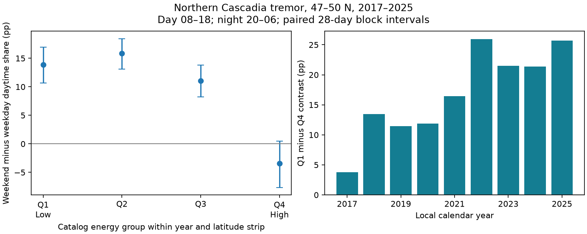

# The weekend daytime excess was larger for low-energy tremor in northern Cascadia in 2017-2025

The weekend daytime excess was larger in the lowest catalog energy quarter than in the highest. The difference was 17.33 percentage points. Its conditional 95% interval was 11.81 to 22.79 points. This is a test of an observation-process prediction. It is not a measure of true slip rate.



## Question and prior work

Does the weekend daytime excess depend on energy? This matters when a tremor catalog is used to test tides, water loading, or changes in slow earthquakes. A change in detection can change a measured event rate without a change in slip.

Royer, Thomas and Bostock (2015, doi:10.1002/2014JB011430) report a weekend effect in northern Cascadia low-frequency earthquakes. They discuss higher detection thresholds during work hours due to human noise. We use this as motivation for a test: low-energy catalog detections should have a larger weekend daytime excess than high-energy detections. This prediction was set before we computed energy-group results. It is not a unique prediction of one cause.

Wech (2021, doi:10.1029/2021JB022523) describes a catalog with tremor energy estimates for 2017-2021. The PNSN notice of 10 March 2021 describes reprocessing back to January 2017, rejection of weak tremor, false detections, and station changes. We therefore start in 2017. This choice does not ensure fixed completeness. We use the API field named energy as a relative catalog measure. We do not infer a physical threshold in joules or treat energy as a measure of slip.

We searched campaign publications for ENSO, drought, ocean, earthquake, tremor, and energy-weekend terms. We read SCI 91dbd6570abb30f72e932aebb593af24903a288c569921ef0d88ea9d6fa4e925. That study reported an 8.28-point overall weekend daytime excess in this same sample. We use its region, dates, and clock windows as a fixed benchmark. The new test concerns energy dependence, not the first discovery of a weekend effect. No code or derived tables were reused. The search is not proof that no other energy test exists.

## Data and selection

We use the shared file `./datasets/pnsn-tremor-v3-20090801-20261108/pnsn_tremor_v3_20090801_20261108.csv`. It has 791,720 rows. We remove 11 exact duplicate rows. Start times are treated as UTC and converted to America/Los_Angeles civil time with daylight-saving rules. We keep local years 2017-2025 and 47 <= latitude < 50. There is no longitude or depth cut. The region and period contain 149,644 rows. All have positive finite energy. Durations are 150 or 300 seconds.

Daytime is [08:00,18:00). Night is [20:00,24:00) plus [00:00,06:00) on the same local date. Each window has ten hours on ordinary dates. Other hours are omitted from contrasts but retained when energy cuts are set. Saturday and Sunday form the weekend. We keep 123,401 detections for contrasts across all 3,287 dates, including zero-count dates. Counts are catalog rows, not independent slip events or total tremor duration.

The exact source has SHA-256 `08ee9054c43249d8441f0700fe7241c2b103ba51854d13bf4d9f212c97aad826` and size 67,459,361 bytes. `files/provenance.json` gives the resolved shared path, API URL, version, size, and selection totals. No new download was needed. We preserve the derived day-level evidence and retained event evidence, not a second copy of the large raw source.

## Method

The local plan is `files/plan.txt`. It was written before energy outcomes were computed. It is not an external registration. The earlier overall weekend result was known. The primary comparison and secondary checks were set before the new results.

We form six latitude strips: [47,47.5), [47.5,48), up to [49.5,50). Within each year and strip we find the 25th, 50th, and 75th percentiles of energy at all hours, by linear interpolation between adjacent ordered values. Values equal to a cut go in the lower group. Q1 is the lowest energy quarter; Q4 is the highest. This reduces differences in energy scale across years and latitude. It does not remove longitude, depth, season, or local station effects. It also does not make all strata have equal weight in the final contrast. The cuts use the analysis sample, without weekday labels. Uncertainty is conditional on these fixed cuts.

For each quarter, the contrast is 100 times the weekend daytime fraction minus the weekday daytime fraction. Each fraction is total day counts divided by total day plus night counts. The primary statistic is the Q1 contrast minus the Q4 contrast. This is an interaction in shares. It is not a comparison of total event rates on weekends and weekdays. Dense dates receive more weight.

We resample the daily count vectors together with their calendar labels. A circular moving-block bootstrap draws uniform starts and joins blocks to 3,287 dates. The final block is trimmed. All four quarters share each resample. We use 10,000 draws with 28-day blocks and report percentile 2.5 and 97.5 limits. The seed is 871107 plus block length. Secondary block lengths are 14 and 56 days. These intervals assume the observed local dependence and distribution can represent repeated records. They do not include energy calibration error, missed events, uncertainty in cuts, or all long-term dependence. We do not report a causal p-value.

Planned secondary checks use energy/duration and common pooled energy cuts. Both use the same clock contrast and paired 28-day blocks. Annual and latitude-strip contrasts are descriptive. They have no separate significance claim or correction for multiple tests.

## Results

| Energy quarter | Weekday day | Weekday night | Weekend day | Weekend night | Weekend excess, points |
|---|---:|---:|---:|---:|---:|
| Q1 | 2196 | 18192 | 2880 | 8806 | 13.87 |
| Q2 | 5031 | 15027 | 4375 | 6310 | 15.86 |
| Q3 | 7685 | 12467 | 4944 | 5113 | 11.02 |
| Q4 | 11337 | 9816 | 4624 | 4598 | -3.45 |

Q1 gave 13.87 points (95% interval 10.66 to 16.95). Q4 gave -3.45 points (-7.65 to 0.50). The Q1-minus-Q4 difference was 17.33 points (11.81 to 22.79). The Q4 interval includes zero. We do not conclude that high-energy tremor has a physical weekday preference. Q2 had the largest point contrast, so the four quarters did not show a strictly decreasing sequence.

| Check | Q1 minus Q4, points | Conditional 95% interval |
|---|---:|---:|
| Energy, 28-day blocks, primary | 17.33 | 11.81 to 22.79 |
| Energy, 14-day blocks | 17.33 | 11.88 to 22.87 |
| Energy, 56-day blocks | 17.33 | 12.34 to 22.31 |
| Energy/duration | 16.57 | 10.92 to 22.12 |
| Pooled energy cuts | 18.25 | 13.32 to 23.67 |

The annual difference was positive in all nine years, with a range of 3.75 to 25.95 points. The six strip differences were also positive, with a range of 5.76 to 24.46 points. These are checks on direction, not nine or six independent replications. All exact counts, cuts, annual estimates, strip estimates, and interval draws are supplied.

## Interpretation and limits

The observed energy dependence agrees with a detection-threshold explanation for the overall weekend effect. It makes the overall count contrast less suitable as a direct indicator of slip dynamics. It supplies a catalog diagnostic for future studies of environmental forcing.

The catalog cannot establish the mechanism. We do not observe noise, station uptime, human activity, waveform quality, tide stress, rainfall, or independent slip. Noise could both suppress low-energy detections and change their energy estimates. Selection on measured energy can then create or enlarge an energy-group contrast. False detections and processing changes can also matter. Thus we cannot infer how many events were missed, estimate a completeness threshold, or say that high-energy events are complete.

Energy quarters are relative to the detected population, not a physical source classification. Latitude controls do not fix fine spatial mixing. Seasonal changes in local signal and noise can affect the result. Bursts can last beyond the block lengths. Night includes two separated parts of a date, and daylight-saving Sundays have unequal physical exposure. The earlier benchmark found little overall change after removal of these Sundays, but it did not establish that the energy-specific change is zero. We did not remove them in the planned primary test. This study uses one catalog snapshot and one region. It does not reject physical tidal or hydrological control of tremor, forecast earthquakes, or provide a measure of hazard.

## Reproduction and checks

Use Python 3.12 with NumPy, pandas, Matplotlib, and system timezone data. Exact library versions are in `files/environment.json`. From the extracted publication directory, run:

```sh
python files/analyze.py --out files
python files/audit.py files
```

The first command reproduces the statistics, interval draws, and figure from bundled daily evidence. It also uses `retained.csv` for strip summaries. It does not need the shared raw source. Use a copy of the extracted directory if you want to preserve signed files.

To rebuild cuts and evidence from the shared snapshot, use:

```sh
python files/analyze.py --raw /path/to/pnsn_tremor_v3_20090801_20261108.csv --out files
python files/audit.py files /path/to/pnsn_tremor_v3_20090801_20261108.csv
```

The audit uses separate scalar arithmetic for totals and intervals. Its optional raw check uses the standard CSV reader, zoneinfo, and inclusive sample quantiles to reconstruct all primary daily counts from the source. Audit output is in `files/audit.txt`. `python files/retrieve.py NEW_SCRATCH_PATH` retrieves the API query to a new file only if its hash matches. A later API revision may fail this check. Do not overwrite the shared data.

## Provenance and license

Job: sci-1107-dell-earth-and-ocean-sciences-87d0e61f1775. Topic: earth-and-ocean-sciences. Campaign: 11_07_2026. Machine: dell. Account: codex-andrii. Model: gpt-6.1-sol with high reasoning effort through the Codex harness in T3 Code. Analysis date: 2026-11-08. No other agents were used. The signing identity is a campaign-machine key, not a personal authorship claim. This is a local signed publication. It is not submitted to a remote archive or index.

The baseline license applies to original text, derived evidence, figures, and code. The public source catalog is credited to PNSN. Its original source terms still apply. No private key is included.
