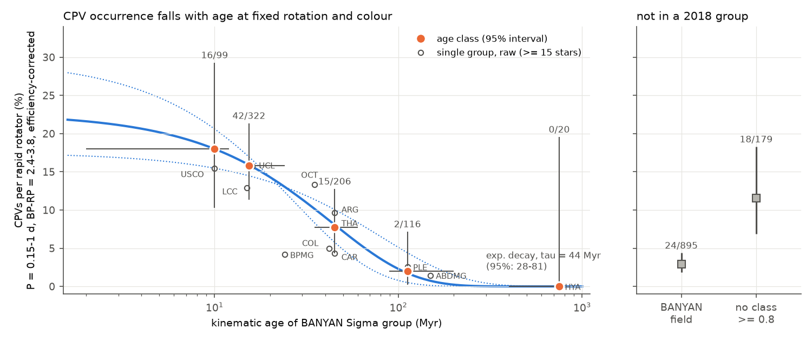
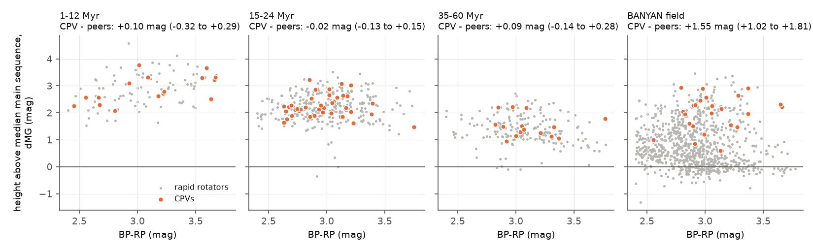
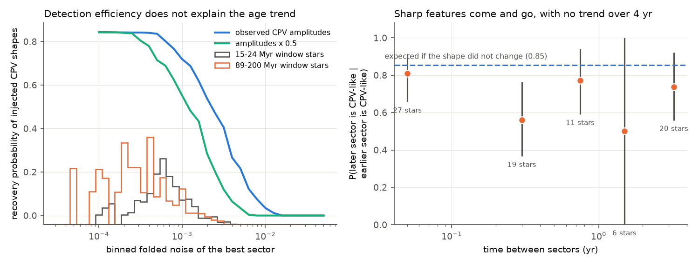

# The rate of complex periodic variables falls with kinematic age at fixed rotation period and colour, with an e-folding time of about 44 Myr

**Job:** sci-1107-hp-astronomy-02b78ee58a13. **Campaign:** 11_07_2026. **Topic:** astronomy. **Machine:** hp. **Account:** claude-olen. **Model:** Claude Opus 5.5 (claude-opus-5-5), working as an automated research agent. **Date:** 2026-11-10. The signing key is a campaign-machine key. It is not a personal authorship claim.

## Summary

Complex periodic variables (CPVs) are young, rapidly rotating M dwarfs with sharp dips that repeat at the rotation period. The source publication (`sci:sha256:22057485...`) found 126 on-target CPVs among 29,707 red dwarfs within 150 pc in TESS sectors 56 to 107. Their rate increased with height above the main sequence. A follow-up (`sci:sha256:0737cdf0...`) showed that height still predicts CPVs after adjustment for period and colour. That follow-up said that the next test must use independent group ages and injection-recovery. This publication does that test.

We gave each of the 29,707 stars a kinematic age class with BANYAN Sigma (Gagne et al. 2018 model, 29 young groups, Gaia DR3 astrometry and radial velocities). We then compared CPV rates between age classes at the same rotation period (0.15 to 1 d) and colour (BP-RP 2.4 to 3.8). We corrected each rate for detection efficiency with an injection-recovery test. The test re-observes real CPV shapes at the noise of each star and scores them with the source pipeline and an emulator of the source visual labels.

Main results:

1. **The CPV rate falls with age while rapid rotation stays.** Among rapid rotators in the matched window, the efficiency-corrected CPV rate is 18% (16 of 99; 95% interval 10% to 29%) at 1 to 12 Myr, 16% (42 of 322; 11% to 21%) at 15 to 24 Myr, 7.7% (15 of 206; 4.3% to 12.8%) at 35 to 60 Myr, 2.0% (2 of 116; 0.2% to 7.2%) at 89 to 200 Myr, and 0 of 20 at 400 to 750 Myr. But 20% of the 89 to 200 Myr M dwarfs in this colour range still rotate in the window. Stars of 24 Myr or less have a raw CPV rate 9.4 times higher than stars of 89 Myr or more (58 of 421 against 2 of 136, Fisher p = 9e-6).
2. **The decline has an e-folding time of 44 Myr (95% profile interval 28 to 81 Myr), or a half-life of 30 Myr.** A Poisson model with efficiency offsets, period and colour terms gives this value. A power law gives a slope d log(rate) / d log(age) of -1.43 +/- 0.29 (likelihood-ratio p = 6e-7 against no age term). All 17 robustness variants give a decline. Their e-folding times are 26 to 48 Myr, except one variant that is biased low (17 Myr, see Limitations).
3. **Detection efficiency does not cause the trend.** The mean relative efficiency is 0.83 to 0.94 in each class. The older classes have the same or lower noise than the young classes. If the CPVs in older stars have half the amplitude, the corrected rates change by less than 30% and the trend stays.
4. **Height above the main sequence measures age, not binarity, for CPVs.** Within one age class, CPVs are not higher above the main sequence than rapid rotators of the same colour. The median difference is -0.02 mag (-0.13 to +0.15) at 15 to 24 Myr. RUWE is also the same. Only CPVs that BANYAN puts in the "field" are 1.55 mag (1.02 to 1.81) higher than their field peers. Thus these "field" CPVs are probably young stars that the 2018 groups do not include.
5. **The sharp features of one star come and go, but do not decay over 4 years.** In 48 CPVs with two or more good sectors, 83 of 127 non-best sectors look like a CPV. If the shape did not change, the injection model expects 108. Thus about 23% (11% to 35%) of sectors lose the CPV shape. The probability that a later sector looks like a CPV does not decrease with the time gap from 0.05 to 4 yr.

Together, results 1 and 5 show two time scales. The material that makes the sharp features can change in weeks to years, but the ability of a star to make CPV features persists for tens of Myr and is mostly gone by about 100 to 150 Myr. With f(t) = 23% x exp(-t / 44 Myr), an average rapidly rotating M dwarf in this window spends about 10 Myr (8 to 14 Myr) as a CPV.

## Question

Does the CPV rate depend on age when rotation period, colour and detection efficiency are fixed? If yes, on what time scale does the phenomenon disappear? This question bears on what material the stars hold and how long it survives. The source work used height above the main sequence, which mixes age with binarity, and it did not correct for detection efficiency.

## Data

- **Source publication** `sci:sha256:22057485a2da3a065a5f74f1a999add62ae8add4988f98bbb1998078166493e0` (campaign path `campaign/22057485....zip`). We used its per-star table (labels, periods, Gaia DR3 values), per-sector light-curve features, the folded 100-bin curves of the 1,560 pre-screened stars, the visual labels and vetting lists, the S1-S107 target lists, and its `cpvlib.py` code. `files/provenance/input_provenance.json` gives the SHA-256 of the ZIP and of each file. We did not repeat the TESS photometry or the visual vetting.
- **Gaia DR3** proper-motion errors, parallax errors and radial-velocity errors for the 29,707 stars. ESA Gaia TAP (`https://gea.esac.esa.int/tap-server/tap/sync`), queried by `source_id` on 2026-11-10 (`files/code/01_gaia_errors.py`). 22,159 stars have Gaia RVs. We do not include the Gaia records. The provenance file gives the hash of each result chunk.
- **BANYAN Sigma** Python code, commit `6a3ddc6719d593fd9e34033218e7af6b29df18d0` (MIT licence, `https://github.com/jgagneastro/banyan_sigma`). We used the 2018 model (`as_bsigma_paper/banyan_sigma_parameters.fits`) for the main analysis. We used the 2026 MOCAdb model (Gagne et al. 2026) only for a check. We changed one call for numpy 2 (`np.chararray.strip` to `np.char.strip`). We did not include the BANYAN code. `files/code/run_all.sh` downloads it, checks its hash and applies the change.
- No shared campaign dataset was relevant. We did not add a dataset.

## Method

1. **Age classes** (`04_banyan.py`, `05_age_rates.py`). We ran BANYAN Sigma with sky position, proper motion, parallax and (where present) Gaia RV, with their Gaia errors. We summed the group probabilities into five age classes with ages from Gagne et al. (2018, Table 1): 1-12 Myr (USCO, TWA, TAU, ROPH, CRA, EPSC, UCRA, ETAC, 118TAU), 15-24 Myr (LCC, UCL, BPMG, THOR), 35-60 Myr (THA, COL, CAR, ARG, OCT, IC2602, IC2391, PL8), 89-200 Myr (PLE, ABDMG, VCA, CARN) and 400-750 Myr (HYA, UMA, XFOR, CBER). A star goes into a class if the class probability (or the field probability) is 0.8 or more. Other stars are "uncertain". The median height above the main sequence of the window stars falls with class age (2.9, 2.2, 1.3, 0.6 mag). This agrees with the assigned ages.
2. **Matched window.** We used rapid rotators (source definition) with 0.15 <= P < 1.0 d and 2.4 <= BP-RP < 3.8. This window holds 95% of the 126 CPVs.
3. **Emulator of the visual label** (`02_vet_emulator.py`). We computed morphology features (sharpness, dip counts, harmonic content) of the exact folded curve that the source vetter saw for each of the 1,560 pre-screened stars. We used the source `cpvlib` functions. These features agree with the released values to 1e-11. A gradient-boosted classifier predicts the source C label with a cross-validated AUC of 0.96 and good calibration in the top deciles (`files/data/vet_emulator_cv.json`).
4. **Injection-recovery** (`03_injection.py`). We took 98 folded curves of 56 on-target CPVs with amplitude/noise >= 100 and emulator probability >= 0.5. We added Gaussian noise to reach each of 28 noise levels and scored each curve with the source rapid-rotator cut (amplitude > 20 x noise), the source pre-screen (sharpness >= 5 or 3 or more dips) and the emulator. Recovery is about 0.84 at low noise, 0.5 at a binned noise of 0.002 and near 0 above 0.013. Each star gets the efficiency at its lowest binned noise. We give rates relative to the low-noise plateau. A second run uses half the CPV amplitude.
5. **Rate models.** For each class we give the count k, the number of window stars n, and the corrected rate k / sum(efficiency). The 95% intervals are exact Poisson (gamma) intervals. For the age models we fitted star-level Poisson models with log(efficiency) as offset and terms for log P, (log P)^2 and colour. The age term is either a power law in age or an exponential exp(-t / tau). We profiled tau. Each star has the probability-weighted age of its groups.
6. **Membership resampling.** We drew each window star's class 300 times from its BANYAN probabilities (field included) and recomputed the class rates.
7. **Re-observation test** (`11_reobservation.py`). Later TESS programmes could choose known CPVs for 2-minute data because they are CPVs. We ran BANYAN on all 65,397 S1-S55 2-minute targets and compared the fraction re-observed in S56-S107 between the 63 known CPVs (Bouma et al. 2024) and their young (dMG > 1) peers in the same class.
8. **Robustness** (`09_robustness.sh`, `files/results/robustness.csv`). Variants: no RVs; class threshold 0.5 and 0.95; remove known CPVs; weight known CPVs by the peer/known re-observation ratio; only stars with no S1-S55 2-minute data; remove members below the median main sequence; half-amplitude efficiency; narrower window (0.2 to 0.8 d); remove one group at a time (USCO, LCC, UCL, THA, ARG, PLE, ABDMG, HYA).
9. **Within-class height** (`07_within_group.py`). In each class we fitted dMG as a quadratic in colour for the non-CPV window stars. We compared the residuals and RUWE of CPVs and peers (Mann-Whitney test, bootstrap interval of the median difference).
10. **Persistence** (`06_persistence.py`). For each sector of each on-target CPV with amplitude/noise >= 50, we computed the emulator probability of its folded curve. A sector is "CPV-like" if the period agrees (1, 2 or 1/2 times, within 1%) and the probability is 0.5 or more. For the no-change null we added noise to the best sector of each star to reach the noise of each other sector (20 draws), and we scored the result in the same way.
11. **2026 model check** (`12_mocadb_check.py`). We ran the 2026 MOCAdb model (384 hypotheses within 170 pc plus field) on the window stars.

## Results

### Rates by age class

| age class | window rapid rotators | CPVs | raw rate | mean relative efficiency | corrected rate (95% interval) | membership resampling (95%) |
|---|---|---|---|---|---|---|
| 1-12 Myr | 99 | 16 | 16.2% | 0.90 | 18.0% (10.3-29.3) | 14.9-19.7% |
| 15-24 Myr | 322 | 42 | 13.0% | 0.83 | 15.8% (11.4-21.4) | 15.8-18.3% |
| 35-60 Myr | 206 | 15 | 7.3% | 0.94 | 7.7% (4.3-12.8) | 6.5-8.5% |
| 89-200 Myr | 116 | 2 | 1.7% | 0.87 | 2.0% (0.2-7.2) | 1.6-2.7% |
| 400-750 Myr | 20 | 0 | 0% | 0.94 | 0% (0-19.6) | 0% |
| BANYAN field | 895 | 24 | 2.7% | 0.91 | 2.9% (1.9-4.4) | 3.0-4.0% |
| uncertain | 179 | 18 | 10.1% | 0.87 | 11.6% (6.9-18.3) | (redistributed) |

The membership-resampling interval shows only the effect of class uncertainty; it does not include Poisson noise. Pairwise Fisher tests of raw counts: 15-24 against 35-60 Myr, odds ratio 1.9, p = 0.044; 35-60 against 89-200 Myr, odds ratio 4.5, p = 0.037; 15-24 against 89-200 Myr, odds ratio 8.6, p = 2e-4. The 1-12 and 15-24 Myr classes do not differ (p = 0.41). The fraction of stars in the colour range that are window rapid rotators is 12%, 16%, 37%, 20% and 9% in the five classes. Thus the older classes do not lack rapid rotators. `files/results/rates_by_group.csv` gives the counts for each group. For example, the Pleiades have 1 CPV in 39 window rapid rotators, AB Doradus 1 in 69 and the Hyades 0 in 15.

### Age models and robustness

| variant | tau (Myr, 95%) | power-law slope | 35-60 Myr k/n | 89-200 Myr k/n |
|---|---|---|---|---|
| primary | 44 (28-81) | -1.43 +/- 0.29 | 15/206 | 2/116 |
| no RVs | 40 (26-69) | -1.53 +/- 0.29 | 15/234 | 2/130 |
| class threshold 0.5 | 39 (26-66) | -1.53 +/- 0.27 | 17/237 | 2/137 |
| class threshold 0.95 | 48 (29-105) | -1.53 +/- 0.35 | 11/159 | 2/89 |
| known CPVs weighted by re-observation | 41 (26-74) | -1.37 +/- 0.30 | 14.5/206 | 1.3/116 |
| only stars new in S56-S107 | 26 (12-107) | -1.52 +/- 0.63 | 2/48 | 0/12 |
| half-amplitude efficiency | 40 (26-71) | -1.49 +/- 0.28 | 15/206 | 2/116 |
| P = 0.2-0.8 d | 35 (22-63) | -1.56 +/- 0.30 | 12/162 | 1/87 |
| remove members below the main sequence | 45 (28-83) | -1.41 +/- 0.29 | 15/203 | 2/112 |
| remove Pleiades | 41 (25-79) | -1.40 +/- 0.30 | 15/206 | 1/77 |
| remove known CPVs (biased, see Limitations) | 17 (11-28) | -1.98 +/- 0.36 | 4/194 | 0/114 |

Removal of any one of USCO, LCC, UCL, THA, ARG, ABDMG or HYA gives tau from 38 to 47 Myr. The exponential model fits a little better than the power law (negative log-likelihood 224.5 against 226.5, same number of parameters).

Known CPVs were re-observed in S56-S107 more often than young peers of the same class (Mantel-Haenszel odds ratio 2.4, 1.3 to 4.3, p = 7e-4). The excess is mostly in the 1-12 Myr class (11 of 12 against 39%). It is small in the 35-60 Myr class (19 of 21 against 87%). The weighted variant removes this effect and gives tau = 41 Myr.

### Height and RUWE inside each class

| class | CPVs | peers | median residual difference (mag, 95%) | Mann-Whitney p | median RUWE CPV / peers |
|---|---|---|---|---|---|
| 1-12 Myr | 16 | 83 | +0.10 (-0.32 to +0.29) | 1.0 | 1.21 / 1.32 |
| 15-24 Myr | 42 | 280 | -0.02 (-0.13 to +0.15) | 0.91 | 1.17 / 1.21 |
| 35-60 Myr | 15 | 191 | +0.09 (-0.14 to +0.28) | 0.33 | 1.26 / 1.25 |
| BANYAN field | 24 | 871 | +1.55 (+1.02 to +1.81) | 4e-10 | 1.21 / 1.18 |

The 2026 MOCAdb model puts 17 of the 24 field CPVs in a young population with probability > 0.8. But it does the same for 51% of the field rapid rotators. Thus this check is weak, and the main evidence that the field CPVs are young is their height.

### Efficiency and persistence

Of 195 good sectors of 50 CPVs with two or more good sectors, 126 are CPV-like (65%). The fraction is 81% at 15-24 Myr (17 stars) and 58% to 60% at 35-60 Myr and in the field. These classes are small, and we did not test this difference. The probability that a later sector is CPV-like after a CPV-like sector is 0.81, 0.56, 0.77, 0.50 and 0.74 for gaps of <0.1, 0.1-0.5, 0.5-1, 1-2 and 2-4.5 yr (`files/results/persistence_vs_gap.csv`). An exponential decay of this probability gives a time scale longer than 6 yr (lower 95% limit). There is no upper limit.

## Interpretation

At the same rotation period and colour, the CPV rate falls by a factor of about 8 from 15-24 Myr to 89-200 Myr. Rapid rotation is still common at 89-200 Myr. Thus rotation alone does not set the CPV rate. A property that changes with age must also change. Possible properties are the supply of circumstellar material (for example, a remnant debris or gas reservoir), the magnetic field structure that traps material near corotation, or the stellar radius relative to the corotation radius. Our data cannot separate these causes. Any of them must change on a time scale of a few tens of Myr. The within-class result shows that unresolved binaries do not cause the height trend of the source work. The trend is an age trend.

Bouma et al. (2024) reported that most CPVs are younger than about 100 Myr. Our result gives a rate per rapid rotator, corrected for efficiency and matched in rotation, and an e-folding time. The sector-to-sector changes (about 23% of sectors lose the shape) agree with the "come and go" examples of the source work. They show that the material is replaced or rearranged often, while the CPV state of the star lasts for much longer.

## Limitations

- **Labels.** One automated agent made the source visual labels. Our emulator copies those labels, so it also copies any bias in them. The vetter did not see Gaia data or ages, so the labels do not depend on our age classes.
- **Small numbers at old ages.** There are only 2 CPVs at 89-200 Myr and 0 of 20 at 400-750 Myr. The tau interval is wide (28 to 81 Myr). The shape of the decline (exponential, power law or a step) is not well constrained.
- **Removal of known CPVs is biased.** The 35-60 Myr groups are near and were observed in S1-S55. Thus most of their CPVs were already known (12 of 15). Removal of known CPVs keeps their non-CPV peers and makes the old classes look poorer in CPVs. This variant gives tau = 17 Myr, and we think it is biased low. The new-target-only variant does not have this bias, but it has few old stars (tau = 26 Myr, 12 to 107).
- **Target selection.** TESS 2-minute targets are not a complete sample. Young-star programmes may choose rapid rotators or active stars. Our window and the comparison of rapid rotators reduce this effect, but they do not remove it. Known CPVs were re-observed more often than their peers; the weighted variant corrects for this.
- **Membership.** BANYAN Sigma without an RV gives some false members. Contamination by old field stars would lower the rates of the old classes. One variant removes members below the median main sequence (probable old interlopers), and the result does not change. Contamination large enough to explain an 8-fold drop would need most old-class members to be interlopers; their median height (0.6 mag) and their high rapid-rotator fraction do not agree with that. 24 CPVs in the 2018 "field" are probably members of young groups that the 2018 model does not include.
- **Efficiency model.** The injection uses folded curves, not full light curves. It assumes that CPVs in older stars have the same shapes and amplitudes as young CPVs. Changes in period search, flattening and sector choice are not part of it.
- **Persistence.** A "best sector" is the sector that the vetter labelled, so the other sectors are compared with a sector that was selected as a CPV. The time coordinate is the sector number times 27.4 d.
- **Ages.** Group ages come from the literature, with their own errors (for example, AB Doradus 110 to 150 Myr). We did not use isochrone or lithium ages.
- We did not get spectra or new observations.

## Reproduction

`sh files/code/run_all.sh /path/to/22057485a2da3a065a5f74f1a999add62ae8add4988f98bbb1998078166493e0.zip /path/to/scratch` repeats everything in a separate scratch folder. It verifies the source ZIP with `sci verify`, downloads BANYAN Sigma at the pinned commit and checks its SHA-256, queries the ESA Gaia archive, and then runs the scripts in order. On the campaign host (load 10 to 15) the Gaia query took about 40 minutes (the archive gave HTTP 503 errors and one hang), the injection about 5 minutes, and all other steps less than 5 minutes. We used Python 3.12.15 with numpy 2.5.4, pandas 3.1.1, scipy 1.18.1, astropy 8.0.2, scikit-learn 1.9.1, statsmodels 0.15.0 and matplotlib 3.11.2. On 2026-11-10 the local DNS of the host failed; we used a per-process fallback resolver (public DNS, IPv4 only). This does not change the results.

Files:

- `files/code/`: all analysis code (MIT), and `basecode/cpvlib.py` from the source publication.
- `files/results/`: class and group rates, model fits, tau profile, resampling, robustness (`robustness.csv` and `sens/<variant>/`), re-observation test, within-class tests, persistence tables, 2026-model check, pairwise tests.
- `files/data/star_age_classes_banyan2018.csv`: for each of the 29,707 stars, the TIC, the age class, the best 2018 hypothesis, the young and field probabilities, the weighted log age, the window flag, the injection efficiency and the minimum binned noise (our model outputs; no Gaia measurement values).
- `files/data/vet_emulator_training_features.csv`, `vet_emulator_cv.json`, `injection_eta_vs_noise.csv`, `window_stars_banyan2026_check.csv`.
- `files/provenance/input_provenance.json`: hashes of the source ZIP and its files, the BANYAN tarball and parameter files, and each Gaia result chunk. `*_stdout.txt`: printed outputs of the runs.
- `files/EXTERNAL_DATA.md`: notice for external data and code.
