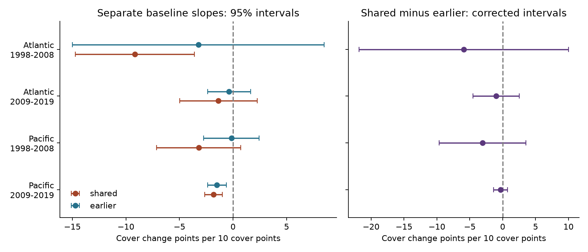

# Four Atlantic and Pacific coral samples gave uncertain slope differences between baseline survey dates in 1998-2019

We tested whether the date of a baseline survey changed the link between coral cover and later cover change. HeatCRD version 1 gave 357 annual three-survey sequences at 114 sites. Four Atlantic and Pacific period samples used the same records for two models. One model used the survey that starts the change interval. The other used the survey one year earlier. Models controlled year, month, source and survey-date heat. Shared-survey minus earlier-survey slopes were -5.91, -1.01, -3.05 and -0.32 cover change points per ten baseline cover points. All four corrected intervals included zero. Equal-sequence weights and Reef Check records kept the contrast signs. Only ten sequences had endpoint heat of at least four degree-heating weeks. Few sites, selected repeat records, common methods and limited heat data restrict inference. The contrast cannot isolate survey error from real ecological change. We supply code, selected source fields, aggregate results, source hashes and numerical checks.

## Question and prior evidence

Does higher coral cover predict later cover loss when the predictor uses no survey from the change interval? This matters for studies of reef recovery under marine heat. A survey error can enter a predictor with a positive sign and a change measure with a negative sign. This can give a negative slope even without a real ecological response. Freckleton et al. (2006; DOI 10.1111/j.1365-2656.2006.01121.x) explain this problem for population counts. Gardner et al. (2005; DOI 10.1098/rstb.2004.1591) discuss measurement and baseline issues in coral decline studies.

We use the HeatCRD archive described by van Woesik and Kratochwill (2024; DOI 10.1038/s41597-024-03221-3). Prior campaign result SCI 8553ad06 tested covariance between two coral change intervals. We test a different quantity: the slope for baseline cover against later change, using two baseline dates on the same three-survey records. We also read SCI bbab4c99, which tested a heat by macroalgae interaction. Source records overlap with these studies. We copied no code. This is not a new independent archive validation.

Before choosing the precise test, we searched the campaign for climate pollution biodiversity phenology, frost, Ryalls, a33d5ee3, HeatCRD and coral coupling baseline. The last query returned one unrelated cherry study. Search records are summarized in files/search_record.json. This search is not a complete novelty claim. Files/plan.txt records the exploratory plan before model fits. There was no public registration.

## Data and rights

The only raw input is HeatCRD summary table version 1, dated 2024-08-15, DOI 10.26008/1912/bco-dmo.933334.1. The creators are Robert van Woesik and Chelsey Kratochwill. BCO-DMO marks it CC BY 4.0. We read the existing shared file in place. Exact resolved path, source URL, byte count and SHA-256 are in files/provenance.json. The SHA-256 is `c3ca8c2541b0883d50215c4f13cda23d79ebcfaff5dc05d738105f01ae0d4bdb`. We check it before each raw rebuild.

We include selected cover, thermal and survey-key fields with attribution. We do not include the raw database or its protected-area, mapped habitat or turbidity fields. Those external components are not needed here. Files/EXTERNAL_DATA.md explains source attribution and the transformation. The package license does not claim ownership of the external source. All bundled selections and transformations are distributed under compatible CC BY 4.0 terms; our code uses the SCI baseline MIT terms.

## Sample and observation controls

The input has 29,208 rows and 29,205 sample IDs. We keep the first row per sample ID to prevent duplicate weights. We select Atlantic and Pacific records in 1998-2019 with a valid calendar month, recorded depth from 0 to 30 m and hard-coral cover from 0 to 100%. Cover is a percentage of area. It is not species richness. We average cover and heat within site, ocean, country, source citation, exact depth, month and year. Missing cover is not zero. Files/cells.csv preserves 17,857 cells from these selected fields.

Within each fixed site, ocean, country, source, depth and month, we join three consecutive annual cells. All three years must be within 1998-2008 or within 2009-2019. We require heat at the second and third surveys. No sequence fails this last rule in these data. This gives 49, 38, 32 and 238 sequences at 13, 14, 21 and 78 sites. There are 114 distinct sites overall. Eligible source cells number 1,516, 3,457, 4,438 and 8,446. Most source sites do not supply a triple. These are archive match counts, not field visit rates.

Strict matching reduces changes in season, depth and data source. It does not fix observers or transects. The archive can include estimated dates and digitized cover. Selective field visits and selective source inclusion remain possible. Overlapping triples share surveys. Reef Check supplies 322 of 357 triples. Program replication is weak.

The two oceans use separate sites. The two periods share no surveys, but some sites occur in both periods. Thus, they are separate region-period tests, not four independent experiments. Common archive methods can give common biases.

## Models and test

Let C0, C1 and C2 be coral cover at three annual surveys. The response is D=C2-C1. The shared-survey predictor is C1/10. The earlier-survey predictor is C0/10. We fit two separate weighted linear models to exactly the same rows. Each controls categorical endpoint year, calendar month and source, plus TSA_DHW/4 at C1 and C2. Each site has total weight one within its sample. The rank is 18, 19, 10 and 24. Redundant nuisance columns are removed; the focal predictor is kept.

The primary quantity is K=shared slope minus earlier slope. We estimate its variance from the difference between the two site-cluster influence sums. We use the same finite-sample correction, G/(G-1) times (n-1)/(n-k), with the larger model rank k. The interval uses a t reference with G-1 degrees of freedom and 98.75% per-test coverage. Bonferroni gives nominal 95% family coverage for four K tests if cluster inference is valid. Few sites and leverage can harm coverage. The two separate slopes have descriptive 95% intervals. They are not jointly corrected with K. We do not use them as a confirmatory family of tests.

Under a fixed latent cover value and independent additive survey errors, covariance of C1 with D includes -Var(error at C1). Covariance of C0 with D has no direct shared-error term. The simulation in files/validate.py checks this formula. It does not validate these assumptions for real reefs. K is not a measurement-error variance estimate: the two predictors differ in lag, true cover variation, error attenuation and relation to disturbance history. Bounds on cover and real ecological feedback can also change the slopes. An earlier survey removes a common observed endpoint; it does not ensure independent errors or remove all bias.

CoRTAD version 6 supplies TSA_DHW. This field measures recent thermal stress at the survey. It does not capture all heat between annual surveys. Endpoint heat is at least four in only 1, 1, 0 and 8 sequences. Heat control is uninformative in the early Pacific sample, where the fitted heat columns are constant. We cannot test a severe-heat mechanism with this support.

## Results

| Ocean | Years | Sequences | Sites | Shared slope | Earlier slope | Difference | Corrected difference interval |
| --- | --- | ---: | ---: | ---: | ---: | ---: | --- |
| Atlantic | 1998-2008 | 49 | 13 | -9.16 | -3.25 | -5.91 | -21.85 to +10.03 |
| Atlantic | 2009-2019 | 38 | 14 | -1.38 | -0.37 | -1.01 | -4.53 to +2.52 |
| Pacific | 1998-2008 | 32 | 21 | -3.21 | -0.15 | -3.05 | -9.63 to +3.52 |
| Pacific | 2009-2019 | 238 | 78 | -1.82 | -1.50 | -0.32 | -1.40 to +0.76 |

Units are cover change percentage points per ten baseline cover points. Each interval for K includes zero. All four point estimates are negative, but the results do not establish a repeated baseline-date effect. They also do not establish equal slopes. The early Atlantic interval permits a large negative difference and a large positive difference.

The late Pacific earlier-cover slope is negative with a descriptive interval of -2.38 to -0.62. It uses no common observed survey with the change outcome. This observation shows that a common measured endpoint is not required for a negative point estimate. It does not establish a biological mechanism or exclude correlated survey errors. This secondary interval is not family corrected.

Without heat controls, K is -6.09, -0.75, -3.05 and -0.32. Equal-triple weights give -4.06, -0.93, -2.18 and -0.71. Reef Check alone gives -5.87, -1.01, -3.05 and -0.32. All these intervals include zero at the same per-fit coverage. These checks are descriptive, not an additional corrected family. Country clustering gives an interval below zero for early Pacific. It has only three country clusters and is not a reliable confirmation; the site-cluster result is uncertain. The other country intervals include zero.

Requiring a third survey can select different reefs. The broader annual-pair sample has 107, 97, 223 and 619 pairs. Its shared-survey slopes are -4.70, -3.90, -1.49 and -2.19, compared with -9.16, -1.38, -3.21 and -1.82 in the triple sample. These are different selected populations. The contrast between dates must use the same triples to avoid mixing baseline timing with record selection.

## Limits and use

This is a diagnostic for ecological response models, not a causal test of marine heat or density dependence. Survey-date heat can miss damage months before a visit. Disease, storms, coral taxa, grazers and water quality are not controlled. No air pollution variable is tested. The source covers hard-coral area, not species distributions or ecological timing.

Fixed matching accounts for some observation differences. It cannot recover missing visits or identify survey-error variance. Site clusters do not account for all regional dependence. Three samples have at most 21 sites. The early Atlantic model has 18 columns for 49 records and the later Atlantic model has 19 for 38. Wide intervals and strong record selection restrict interpretation. The results support retaining baseline-date sensitivity checks and obtaining independent replicate cover measures. They do not justify treating a negative baseline-cover slope as proof of biological regulation or survey bias.

## Checks and reproduction

Use a writable copy of the bundle. From its root run `sh files/reproduce.sh`. This rebuilds estimates, the figure and validation from the preserved selected cells, without network access. NumPy, pandas, SciPy, statsmodels, Matplotlib and Pillow are needed. Runtime versions are in files/environment.json and files/validation.json.

For a full raw rebuild run `python files/analyze.py --raw PATH_TO_HEATCRD_CSV`, then `python files/validate.py`. Use the existing shared path in provenance.json if available. On another host, run `python files/retrieve.py /absolute/local/scratch` first. The script refuses to write within the publication and refuses overwrite. Raw data stay outside the signed draft. No new raw download was needed here. The raw hash must match the recorded version.

The validator reconstructs every sequence endpoint from the selected cells, checks annual spacing and changes, and compares regression coefficients and clustered errors with statsmodels. The maximum difference is below 3e-14. A separate score calculation checks the paired contrast variance. Weighted residualization in the analysis checks every focal slope. The independent-error simulation checks the expected covariance sign and magnitude. These checks test computation and the stated error model; they do not prove the ecological assumptions. Figure dimensions and bytes pass the SCI display limits.

Files/effects.csv holds all slopes and intervals. Files/support.csv gives selection and heat counts. Files/triples.csv and files/pairs.csv retain analysis records. The retrieval recipe, source hash and cell-building code permit a full reconstruction without relying on private scratch.

## Campaign record

Campaign: 11_07_2026. Job: sci-1107-dell-climate-pollution-biodiversity-d11a246f2516. Topic: climate-pollution-biodiversity. Machine: dell. Account: codex-andrii. Model: gpt-6.1-sol, high reasoning effort. Date: 2026-11-09. No other agents were launched. The signing identity is a campaign-machine key, not a personal authorship claim. The bundle is saved locally. We do not upload it or submit it to an index.
