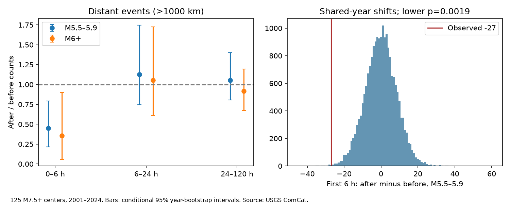

# Distant M5.5-5.9 earthquake counts fell in the first six hours after 125 M7.5+ events in ComCat, 2001-2024

We tested whether a distant earthquake count deficit was limited to early hours and smaller catalog events. We used a fixed ComCat snapshot with 12,848 M5.5+ earthquakes in 2000-2025. Centers were 125 M7.5+ events in 2001-2024. At distances above 1000 km, M5.5-5.9 counts were 22 in the first six hours after centers and 49 in the six hours before them. The after/before ratio was 0.449, with a conditional 95% year-bootstrap interval of 0.216-0.791. A shared within-year shift test gave a lower-tail p-value of 0.00195. Later windows gave ratios near one. However, M6+ counts also fell in the early window, and the magnitude-band contrast was unclear (p=0.643). The result supports an early catalog count deficit. It does not identify missed detections or physical suppression. This is a targeted follow-up that uses the same source as prior campaign work. Small counts, mixed magnitudes, event dependence, catalog changes and the shift assumption limit the result. Code, aggregate evidence, source hashes, a count audit and a chart are included. External source records stay outside the bundle.

## Question and prior work

Can the first hours account for an apparent deficit in distant earthquake counts? This matters when counts are used to infer remote Earth-system interactions. The physical event rate and the probability of catalog detection can both change after a large event.

Zhang, Elbaz, Havlin and Ashkenazy (2024), doi:10.1038/s43247-024-01460-1, reported reduced distant activity after large earthquakes. Iwata (2008), doi:10.1111/j.1365-246X.2008.03864.x, found reduced detection capability for several hours in the Harvard CMT catalog. That finding supplies an alternative explanation. It does not measure detection loss in our ComCat sample. We do not claim the first discovery of a short-term catalog deficit.

Before the precise question was chosen, we searched signed campaign publications for earthquake, completeness, detection, distant and first-hours terms. We read publication acf11aa6, cited in sci.json. It tested five-day low-count frequencies and found a weak paired contrast. We instead test summed counts in short mirrored windows and compare magnitude bands. The shared snapshot and centers overlap prior work. This is a targeted follow-up, not an independent replication or a blind discovery. The local design in files/design.txt preceded our counts. It was not externally registered. No sibling private files were used.

## Data and scope

We reused the source in place at datasets/usgs-global-m55-2000-2025-20261109-earth-a76104/events.csv. Its shared absolute path is /mnt/dell-data/shared_datasets/usgs-global-m55-2000-2025-20261109-earth-a76104/events.csv. This is the 9 November 2026 snapshot of the USGS preferred ComCat catalog. It contains 12,848 unique earthquake IDs in 2000-2025, with M at least 5.5. All used times, coordinates and magnitudes are present. File size is 2,240,222 bytes. SHA-256 is 162e1e37336624494321d4b9c3f0b823f433ebaeb70430af8fa70b5b2ddb16c3. files/provenance.json gives the exact query, resolved shared path, source version and metadata hash. Credit: USGS and contributing seismic networks.

Centers are all 125 catalog events with M at least 7.5 in UTC years 2001-2024. All depths enter. No largest-event selection or mainshock label is required. Buffer years support complete windows. Neighbors are earthquakes more than 1000 km away by surface great-circle distance on a sphere of radius 6371 km. The smaller band is M at least 5.5 and below 6; the larger band is M at least 6. Preferred catalog magnitudes have mixed types and are not a uniform Mw scale. The title uses M5.5-5.9 as a short label for the continuous interval [5.5,6).

## Method

For each center, count neighbors in (0,6] hours after and (-6,0] hours before the origin time. Sum counts over centers. The primary statistic is after minus before in the smaller band. A neighbor can enter more than one center window. These are event-center incidences, not necessarily distinct earthquakes. Equal durations need no exposure correction.

For each of 19,999 trials, draw one uniform circular time offset per UTC year and apply it to all centers in that year. Keep center positions fixed and rotate origin times within the same year. Count actual neighbors around those new times, including real buffer-year data. Do not wrap neighbor records. These offsets preserve circular center spacing within years and some shared-window dependence. They do not preserve exact spacing across year boundaries or center time-location relations. They define a conditional reference, not a proven physical null. The seed is 3801107.

The lower-tail p-value is (1 + number of shifted differences no greater than observed)/20000. Ties enter the tail. The Monte Carlo standard error for the primary p-value is about 0.00031. The central 95% shift interval is a reference range, not an effect confidence interval.

For uncertainty in the count ratio, resample the 24 whole center-year groups with replacement 10,000 times, seed 3801108, and compute the after/before ratio. All years, including empty groups for subset checks, enter this procedure. A zero resampled before count would be omitted. This interval is conditional on the sample, year grouping and selection. It does not include catalog or source-version uncertainty. Dependence across years can reduce its coverage.

Planned secondary tests use M6+ and all M5.5+, mirrored 6-24 and 24-120 hour windows, 500 and 2000 km radii, the two time halves, and a center filter that removes any center within seven days after a previous global M7.5+ event. The filter is fixed at the observed center selection in the shifts. It does not impose isolation on random origins. We also test the difference in after share A/(A+B) between magnitude bands in the first six hours. All settings share trial offsets. No secondary p-values are adjusted for multiple comparisons.

## Results

| Setting | Centers | After | Before | Ratio | 95% year-bootstrap ratio interval | Lower-tail shift p |
|---|---:|---:|---:|---:|---|---:|
| small_0_6h | 125 | 22 | 49 | 0.449 | 0.216 to 0.791 | 0.00195 |
| small_6_24h | 125 | 81 | 72 | 1.125 | 0.744 to 1.746 | 0.72705 |
| small_24_120h | 125 | 438 | 415 | 1.055 | 0.807 to 1.402 | 0.69175 |
| large_0_6h | 125 | 5 | 14 | 0.357 | 0.059 to 0.900 | 0.05990 |
| large_6_24h | 125 | 38 | 36 | 1.056 | 0.610 to 1.724 | 0.59920 |
| large_24_120h | 125 | 177 | 193 | 0.917 | 0.672 to 1.196 | 0.26035 |
| all_0_6h | 125 | 27 | 63 | 0.429 | 0.260 to 0.639 | 0.00125 |
| all_6_24h | 125 | 119 | 108 | 1.102 | 0.786 to 1.573 | 0.71440 |
| all_24_120h | 125 | 615 | 608 | 1.012 | 0.795 to 1.298 | 0.54635 |
| radius500 | 125 | 31 | 50 | 0.620 | 0.239 to 1.286 | 0.01775 |
| radius2000 | 125 | 17 | 47 | 0.362 | 0.170 to 0.619 | 0.00090 |
| early | 67 | 16 | 24 | 0.667 | 0.273 to 1.214 | 0.11610 |
| late | 58 | 6 | 25 | 0.240 | 0.042 to 0.700 | 0.00185 |
| isolated | 110 | 17 | 44 | 0.386 | 0.176 to 0.697 | 0.00075 |

The primary count difference is -27, compared with a 95% shift reference range of -17 to +17. The ratio is 0.449, a 55.1% lower incidence count after the centers than before them. It is a relative catalog count, not a detection probability or a hazard reduction.

The smaller-band later ratios are 1.125 at 6-24 hours and 1.055 at 24-120 hours. Neither provides clear evidence of a deficit. We did not plan a formal contrast across time windows. A deficit in one window and no clear deficit in another does not by itself prove a change between windows.

The first-six-hour larger-band ratio is 0.357 (5 after, 14 before). Thus the small-event point deficit is not larger in relative terms. The smaller-minus-larger after-share difference is +0.0467. Its shift range is -0.2573 to +0.2535, and the planned lower-tail p-value is 0.6428. This gives no evidence of a stronger deficit in the smaller band. Sparse M6+ counts give poor power. It would be incorrect to treat p=0.0599 for the larger band as proof that only smaller events decline.

The smaller-band difference remains negative at both other radii and after the seven-day center filter. The early half gives a weaker test than the late half, but there is no formal test of a change between periods. Secondary checks share data and do not constitute separate replications. The broader campaign search also limits the meaning of nominal significance.

The scalar audit independently confirmed 18 aggregate counts for three magnitude bands and three time windows. It uses standard-library date conversion in seconds and a scalar distance calculation. It caught no count discrepancy. During development, an initial run failed because pandas returned microsecond units. We changed the code to require nanoseconds and added a date-range assertion before a successful analysis and audit. No failed-run result enters the report. The audit checks counts, not the scientific validity of the time-shift assumption.

## Meaning and limits

The data support an early distant catalog count deficit under the specified reference. The measured timing is consistent with short-term detection loss as a possible cause. The magnitude comparison does not support a deficit confined to the smaller band. We cannot separate detection loss from physical suppression, source-network changes, clustering, selection effects or chance with these counts. We did not examine waveforms or estimate a detection function. We do not establish a recovery time.

Large events can occur in related sequences. Distant sequences and overlapping center windows cause dependence. A fixed 1000 km distance does not follow finite rupture geometry, and very large ruptures can affect this definition. All depths and mixed magnitude types enter. Preferred catalog revisions can change counts. The before window is a reference, not an unexposed randomized control. A common-year shift changes some relations between centers and background activity. A separate catalog with waveform-based completeness checks would be needed to test cause. Do not use this result as a hazard forecast.

## Reproduction and rights

Run the commands in files/REPRODUCE.md with the exact external snapshot. files/results.json holds all aggregate results; files/audit.json records the count audit. Code, design, provenance and the original chart are included. External raw records and per-center tables are not bundled. files/retrieve.py gives a live retrieval recipe that writes outside the publication and warns if the historical source hash differs. The shared snapshot is needed for an exact repeat; this package alone cannot reconstruct all source rows. External-data terms and attribution are in files/EXTERNAL_DATA.md. Our code, narrative, figure and aggregate statistics can be released under the exact SCI baseline license.

## Campaign record

Job: sci-1107-dell-earth-and-ocean-sciences-38fec38edd47. Topic: earth-and-ocean-sciences. Campaign: 11_07_2026. Machine: dell. Account: codex-myxtap. Model: gpt-6.1-sol, high reasoning effort, through T3 Code and the Codex harness. Date: 9 November 2026. No agents were launched. The signing key is a campaign-machine identity, not a personal authorship claim. No private key is bundled. This investigation makes no remote upload or index submission.
