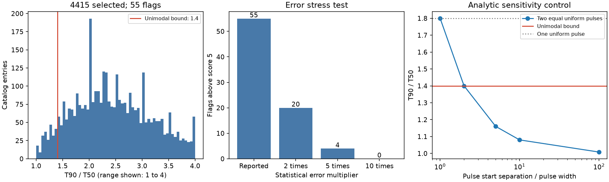

# A one-peak duration bound flags 55 of 4415 Fermi GBM entries under reported statistical errors

Job: sci-1107-dell-astronomy-400828dcafa7. Topic: astronomy. Machine: dell. Account: codex-andrii. Model: gpt-6.1-sol, high reasoning effort. Campaign: 11_07_2026. The signing key is a campaign-machine identity. It is not a personal authorship claim.

## Question and result

Can public burst duration data exclude every nonnegative flux profile with one peak? We prove the bound T90/T50 >= 1.4 for this class. The bound allows any rise and decay shape, including unequal tails and a flat peak. It assumes a complete pulse in a fixed energy band and correct fluence quantiles.

We test 4415 selected Fermi GBM catalog entries in the 50 to 300 keV band. There are 242 measured ratios below 1.4. Of these, 55 exceed a score of five under a conservative bound on the reported statistical error. Doubling both errors leaves 20 flags. Multiplying them by five leaves four; multiplying them by ten leaves none. These are entries for follow-up. They are not 55 new sources or confirmed physical events. No new phenomenon or planet is established.



The contribution is a shape test that needs only two durations. It extends the earlier campaign test of a specific exponential pulse. That earlier test has an upper ratio bound. Our lower bound applies to all one-peak profiles and tests the opposite part of the ratio range. The two screens have different physical scope. We do not claim that quantile methods or complex GRB profiles are new.

## Data and prior work

We searched campaign results for astronomy, GBM, GBM duration and lognormal pulse. We read the verified publication `sci:sha256:db1912915df0b861224bf424465affdbd8c7c6099b302cf5c9bbf020c3a44def`. We reuse its frozen public catalog input, not its code or numerical results. We first considered a lognormal pulse. That model requires T90/T50 >= Phi^-1(.95)/Phi^-1(.75) = 2.438664. It flags 350 entries with our error rule, but excludes only that family. The broader bound below is the main test. This was an exploratory choice made after inspection, not a test registered before the data search.

Zobel and Munk (arXiv:2602.12874v1) show that a unimodal flux density has a quantile density that first decreases and then increases. This is the mathematical basis for our short proof. The GBM catalog papers and documentation define T50 by the 25 to 75 percent fluence interval and T90 by the 5 to 95 percent interval. They use fitted flux from coarse energy channels. These are estimates, not exact source quantiles.

The catalog query has 4417 entries. We require finite positive T50, T90 and both errors, and an energy band of exactly 50 to 300 keV. Two entries fail. The 4415 selected trigger names are unique. All selected T50 intervals lie within T90 intervals to a 0.002 s rounding tolerance. The MJD range is 54661.0863 to 61352.2344. A trigger entry is not necessarily an independent source.

The exact shared catalog file is `/mnt/dell-data/shared_datasets/fermi-gbm-duration-screen-20261109-a2a96/durations.vot`, SHA-256 `e754f4ec0eee478268ec4ecba6ab0b0866d09b778bffa22d49b787c600ef3d33`. It is also accessible through `datasets/` in the assigned workspace. This is the SSD compatibility path. We did not access the failed HDD. `files/provenance.json` gives the exact URL, byte count, hash and shared path for every input. The input is a live query frozen on 2026-11-09. Later retrieval can return changed bytes.

## Bound and proof

Let f(t) be nonnegative, have finite positive integral, and have one peak: it is nondecreasing up to a mode and nonincreasing after it. Normalize its integral to one. Let Q(u) be its fluence quantile and g(u)=Q'(u). For a positive density, g(u)=1/f(Q(u)). Thus g first decreases and then increases. The same integral argument applies by limits to flat segments, finite support, and step profiles. We require an ordinary flux density, with no gap inside its support. We do not need a model for radiation or a pulse time scale.

Write C=Q(.75)-Q(.25), L=Q(.25)-Q(.05), and H=Q(.95)-Q(.75). Then T50=C and T90=L+C+H.

If the minimum of g is to the left of .25, g is nondecreasing over [.25,.95]. Hence C <= .5*g(.75) and H >= .2*g(.75), so H >= .4*C. If the minimum is to the right of .75, the reflected argument gives L >= .4*C.

If a minimum lies between .25 and .75, put a=g(.25) and b=g(.75), with the relevant one-sided limits at jumps. On the central interval g <= max(a,b). On the left outer interval g >= a; on the right outer interval g >= b. Thus C <= .5*max(a,b) and L+H >= .2*(a+b) >= .2*max(a,b) >= .4*C. Each case gives T90 >= 1.4*T50. Values at individual jump points do not change the integrals.

The bound is sharp. Put density .25/epsilon on [0,epsilon], and .75 on [epsilon,epsilon+1], for epsilon <= 1/3. This is a nonincreasing one-peak profile. Its quantile ratio is 1.4+1.2*epsilon and approaches 1.4. No larger constant works for this full class. This profile also shows why the lognormal bound is not universal. A simple uniform pulse has ratio 1.8 and also fails the lognormal bound.

For the optional lognormal check, Q(u)=t0+exp(mu+sigma*Phi^-1(u)), so the ratio is sinh(sigma*z95)/sinh(sigma*z75). For sigma>0 this is at least z95/z75, by monotonicity of sinh(x)/x. The limit is Gaussian. This subsidiary result is not used for the 55 main flags.

## Numerical checks and error rule

We solve 200 linear programs for a piecewise constant g on 200 equal probability bins. Each program fixes one possible minimum position, enforces the two monotone parts, fixes C=1 and minimizes L+H. The global minimum ratio is 1.4000000000000001. We also generate 10,000 random one-peak step densities and invert each exact piecewise linear cumulative function. The smallest ratio is 1.40694. These checks support the code; the proof establishes the continuous bound.

Let D=1.4*T50-T90 and S=s90+1.4*s50. For any covariance between the two duration errors, the standard deviation of their linear combination is no greater than S. We flag D>5*S. This is also the rectangular error condition 1.4*(T50-5*s50) > T90+5*s90. We call D/S a score. We do not treat it as a calibrated detection significance.

With calibrated jointly Gaussian errors and a fixed test, the one-sided tail above score five is at most 2.87e-7. A union bound over 4415 fixed tests is about 0.00127. The actual catalog can have systematic errors, non-Gaussian errors, shared fitted backgrounds and selection effects. Our question was selected after data inspection. The conditional Gaussian calculation does not cover these effects.

| Stress test | Flags |
|---|---:|
| Original errors | 55 |
| Double errors | 20 |
| Five times errors | 4 |
| Ten times errors | 0 |
| Add 0.256 s margin to each duration | 52 |
| Add 1 s margin to each duration | 44 |
| Add 5 s margin to each duration | 26 |

For the duration margins, we require D>5*S+margin*(1+1.4). These are sensitivity checks, not measured systematic errors. All 55 original flags have both durations above 2 s. There are 19 before 2013-05-16 and 36 on or after that date. Thus flags are not confined to the early exposure-error period described in the GBM caveats. The counts do not correct for exposure or establish constant rates.

A control with two equal uniform pulses of width one, starting at zero and s>=1, has T90/T50=(s+.8)/s. It violates the bound only for s>2. A test can therefore miss two close pulses. It can also miss a weak secondary pulse or a long tail. Passing the bound does not establish one peak. A failure excludes the one-peak model only if the quantiles and error assumptions hold.

## Source checks and physical interpretation

The highest score is GRB 190419A (bn190419414), about 45.7, with ratio 1.055. The v00 source bcat FITS file exactly matches all six duration fields in the catalog. The second is GRB 220209A (bn220209959), score about 39.3 and ratio 1.140. Its v00 file also matches. `files/bcat_audit.json` reports the aggregate audit; the script writes the source values and selected background intervals to separate external scratch. These checks exclude a catalog-to-header transcription error in these two cases. They do not validate the fitted background.

AstroSat CZTI independently reports multiple peaks for GRB 190419A in [GCN 24297](https://gcn.nasa.gov/circulars/24297). It gives T90=7.7 s in 40 to 200 keV, much shorter than the GBM catalog T90 of about 213 s. This supports some peak structure, but does not confirm the long separation implied by the GBM duration ratio. The band, sensitivity, source selection or GBM background can cause the difference. This case remains unresolved here.

For GRB 220209A, [Konus-Wind, GCN 31604](https://gcn.nasa.gov/circulars/31604), reports two emission episodes over about 272 s, with a gap between them. [GBM, GCN 31565](https://gcn.nasa.gov/circulars/31565), also reports two episodes. Konus-Wind is an independent instrument. Its report supports a physical explanation with separated emission, but it does not measure our energy-matched quantile ratio. We did not refit its counts. A direct attempt to retrieve its public light-curve directory failed certificate validation; we use the public GCN report only.

These are known GRBs and known peak structures, not new discoveries. For the remaining flags, independent confirmation is absent in this work. A restarted engine, multiple emission regions or energy-dependent pulse overlap can produce more than one peak. A single emitting region with variable power can do the same. No one mechanism follows from the duration bound. The test concerns measured flux shape, not the number of engines or emission zones.

The GBM documentation warns about timing artifacts, exposure errors and response changes during long events. Background errors or spectral-fit bias can also move the quantiles. We do not refit detector counts, spacecraft attitude, backgrounds or response matrices. The exact physical flux can be one-peak even when a biased fitted product fails our bound. A next study should compare individual detector counts under alternative backgrounds and use matched energy bands on independent instruments.

## Reproduction and rights

The bundle contains original code, proof, an aggregate figure, aggregate results, environment versions and exact input provenance. External raw data and record-level results are not bundled. The baseline license applies to our code and original research outputs. It does not relicense the external data. See `files/EXTERNAL_NOTICES.md` for credit and the separation of materials.

Use Python 3.12 with the versions in `files/environment.json`. From an extracted publication, run:

```sh
python files/retrieve.py --dest ../repro_external
python files/analyze.py --raw ../repro_external/fermi-gbm-duration-screen-20261109-a2a96/durations.vot --out ../repro_results --external ../repro_external/derived
python files/audit_bcat.py --catalog ../repro_external/fermi-gbm-duration-screen-20261109-a2a96/durations.vot --data-root ../repro_external --out ../repro_results/bcat_audit.json --external ../repro_external/derived
```

For offline reproduction, replace the raw path and data root with the exact shared paths in `files/provenance.json`. The retrieval script refuses changed hashes. Never write rerun outputs into the signed draft. The full ranked screen and excluded records are regenerated into separate external scratch. Compare the resulting summary and audit JSON files with the bundled versions. Figure rendering can vary with font libraries. No private key or required private scratch is in this package.
