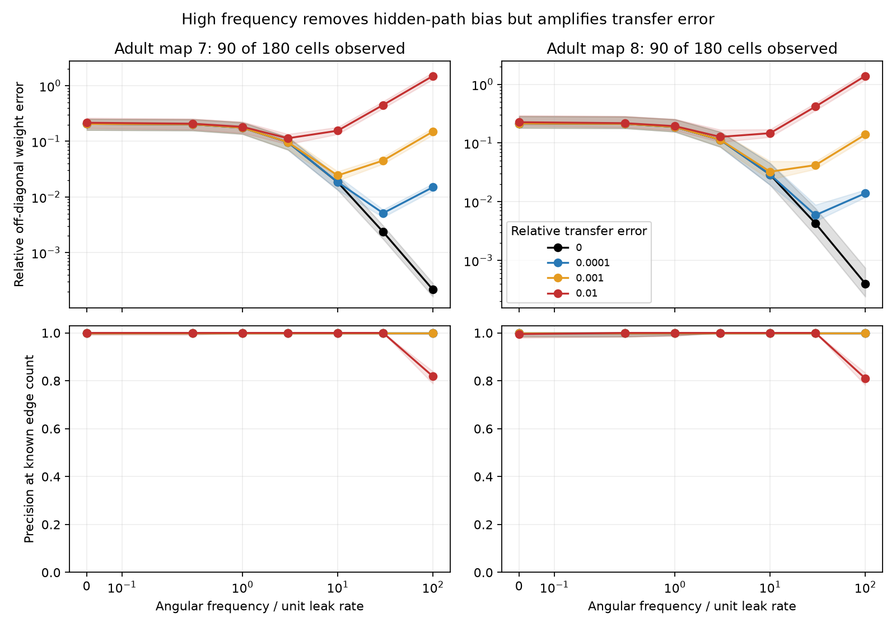

# Higher frequency reduced hidden-path weight bias but increased error sensitivity in two passive adult worm models

We tested a way to estimate direct electrical links when some cells cannot be measured. We used exact current-to-voltage transfer matrices from two passive circuit models. Higher frequency reduced the bias from hidden paths. Added transfer error limited that gain. This is a model benchmark with anatomical inputs. It is not a test on measured neuronal activity.

## Question and prior work

Can the real part of an inverse transfer matrix separate direct conductance from hidden paths at a useful finite frequency? We searched the campaign for connectome, Randi, Kron, inverse transfer, and frequency. We read the [prior short-lag covariance benchmark](sci:sha256:729c11b8c6980b51e5c8ee88a83af14c919b3ac9cf112dfcc904677ece3fbb76). It tested covariance curvature under equal independent source noise. We use its cell selection and conductance scale. We wrote new code and did not reuse its data extracts. Our test uses driven responses and explicit transfer perturbations. It does not require a source-noise covariance law.

[Kron reduction](https://doi.org/10.1109/TCSI.2012.2215780) gives the static effect of hidden circuit nodes. The Schur complement and its frequency limit are standard linear algebra. We do not claim a new general inference method. The contribution is a controlled error benchmark on two public wiring maps, with a bound that explains its limits. The local plan in files/PLAN.txt preceded computation. The bound and independent checks were added during the analysis. The plan was not registered.

## Data and model

We use adult maps 7 and 8 from [Witvliet et al.](https://doi.org/10.1038/s41586-021-03778-8), as distributed by wormneuroatlas commit b2e13d88b670efcb3438aeacba2ad4bd6c383933. Electrical annotations are partial. The original study did not use these electrical links in its main analyses. We take names common to both source tables and exclude names with BWM, CEPsh, GLR, or excgl prefixes. This gives 180 cells, including electrical isolates. Maps 7 and 8 have 262 and 296 unordered electrical links. Each electrical pair occurs once in each table; the code checks this. We remove self-links, use symmetric weights, and omit chemical links.

Let W contain electrical contact counts divided by four. Let

    M = I + diag(W 1) - W,
    dV/dt = -M V + I_input.

Leak and capacitance are one for every cell. Counts are assumed proportional to conductance. These parameters are not fitted to physiology. Angular frequency w is in inverse membrane-time units, not Hz. The experiment has no measured activity or measured transfer data. All 180 cells stay in the dynamics. In each of 60 masks, only 90 cells can be driven and measured. Masks use seed 91107 and are shared across maps. Different masks are not different animals.

The observed transfer is T(w) = [(M + i w I)^(-1)]_oo. It includes an independently calibrated current input and voltage readout at every observed cell, including diagonal responses. This is a demanding measurement assumption. With the observed/hidden partition M = [[F,B],[B^T,D]], block inversion gives

    K(w) = T(w)^(-1) = F + i w I - B (D + i w I)^(-1) B^T.

For an observed pair, our estimate of its direct weight is -Re K_ij. At zero frequency this includes hidden-path conductance. For example, for a three-cell unit-weight chain with unit leak, observing its two ends gives an inferred end-to-end weight 3/(9+w^2), although no direct end-to-end link exists. It approaches zero but stays positive at every finite frequency.

Since D is real symmetric positive definite,

    Re K(w) - F = -B D (D^2 + w^2 I)^(-1) B^T.

Thus this bias vanishes at order w^(-2). A valid spectral norm bound is

    ||Re K(w)-F||_2 <= ||B||_2^2 d_max/(d_min^2+w^2),

where d_min and d_max are the extreme eigenvalues of D. The bound includes diagonal entries; the benchmark error below uses only off-diagonal weights. This bound does not require stochastic drive assumptions. Unknown filtering, non-passive dynamics, or uncalibrated input amplitudes can invalidate the transfer interpretation.

## Transfer error and scores

We test w = 0, 0.3, 1, 3, 10, 30, and 100. For each transfer matrix we add a symmetric Gaussian matrix Delta, scaled so that ||Delta||_F = epsilon ||T||_F. Epsilon is 0, 0.0001, 0.001, or 0.01. Nonzero levels have five draws per mask. Errors are real at zero frequency and complex at positive frequencies. The real and imaginary components have the same Gaussian construction before scaling. The same seed is used across positive frequencies and error levels in each mask and draw. The diagonal is also perturbed. Symmetry preserves the assumed reciprocity, but errors are not constrained to a causal transfer law across frequencies. This is a numerical stress test, not a model of an acquisition system or a sample-size analysis.

We invert T+Delta and score each unordered observed pair by its negative real off-diagonal entry. We report relative Euclidean error against all true off-diagonal weights, average precision, and precision at E, the known number of direct links among the observed cells. The latter uses an oracle edge count. It tests ranks; it does not find an edge threshold or estimate E. We do not clip scores. Stable index order breaks exact ties. There are no tests or p values.

We average the five error draws within each mask, then report means, medians and 10th/90th percentiles across masks. These are descriptive mask ranges, not confidence intervals for worms. files/summary.csv has all 56 map/frequency/error conditions. The figure uses medians and 10th/90th percentile bands.

## Results

Median relative off-diagonal weight errors were:

| Transfer error | Frequency | Map 7 | Map 8 |
|---|---:|---:|---:|
| 0 | 0 | 20.604% | 21.544% |
| 0 | 3 | 9.650% | 11.343% |
| 0 | 100 | 0.022% | 0.040% |
| 0.01 | 0 | 21.599% | 22.623% |
| 0.01 | 3 | 11.361% | 12.726% |
| 0.01 | 10 | 15.545% | 14.687% |
| 0.01 | 30 | 45.070% | 41.785% |
| 0.01 | 100 | 149.697% | 138.857% |

Without transfer error, all direct links ranked before all absent links in all 60 masks per map at frequencies 3, 10, 30 and 100. At zero frequency, this occurred in 54/60 and 40/60 masks. Mean static precision was already 0.99844 and 0.99491. Median static precision was one in both maps. Thus the main benefit is lower weight bias and removal of rare rank errors, not a large median rank gain.

With 1% relative transfer error, frequency 3 still gave perfect top-E ranking in all 300 mask/draw cases per map. Median relative weight error was 11.36% and 12.73%, compared with 21.60% and 22.62% at zero frequency. Frequency 100 raised median error to 149.70% and 138.86%. Mean top-E precision fell to 0.81654 and 0.81025; no draw had perfect ranking. Frequencies 10 and 30 still gave perfect ranking with 1% transfer error despite larger weight errors. Weight accuracy and link ranking can therefore give different assessments.

For transfer errors 0.0001, 0.001 and 0.01, the lowest tested median weight error occurred at frequency 30, 10 and 3, respectively, in both maps. This is a descriptive grid result, not a validated frequency-selection rule. The full average-precision results and mask ranges remain in files/summary.csv.

## Why high frequency has a limit

If delta = ||Delta||_2 and ||K||_2 delta < 1, the inverse perturbation identity gives

    ||(T+Delta)^(-1)-K||_2
      <= ||K||_2^2 delta / (1-||K||_2 delta).

At high w, K is of order w while T is of order 1/w. A fixed relative transfer error can therefore cause an inverse error of order epsilon w. It can grow while the hidden-path bias falls. The independent checker gives a two-cell example with no direct link, w=1000 and relative Frobenius error 0.0001. A real off-diagonal transfer perturbation gives a spurious real inverse weight near 0.1. This establishes the error-growth mechanism without any hidden cells.

The frequency that gives the lowest error depends on the circuit, the observation mask and the error model. We report the full fixed grid. We do not choose an optimal frequency separately for each mask. Failure of the conservative bound does not prove inference failure. A low relative weight error also does not imply exact support recovery at a zero threshold.

## Checks and limits

The main calculation builds transfer matrices by eigendecomposition. It checks the Schur identity for every mask and frequency. A separate calculation uses direct inversion of the full 180-cell matrix for one mask per map, at all grid frequencies and at 1000. It checks the bias bound, the three-cell example and full-observation recovery. files/checks.json and files/validation.json preserve the residuals. All assertions pass.

These results apply to linear reciprocal conductances with known unit capacitances and leaks. Rectifying gap junctions, directed chemical links, active membrane channels, cell-specific capacitances, input calibration error, calcium dynamics and incomplete stimulation coverage require other models. The source maps have incomplete electrical annotations. Missing source edges are absent in this model, not proven absent in the animal. Only one coupling scale is tested. A different scale changes the frequency range. Two adult animals from one species do not establish generalization across species, regions or behavior. No Allen data are used; this choice allows a direct structure-based circuit test without linking unmatched cells across datasets. The useful result is a reproducible limit on a measurement strategy, not a claim of biological connectivity recovery.

## Provenance, rights and reproduction

No new raw download was needed. We read two existing shared files in place:

- /mnt/dell-data/shared_datasets/worm-witvliet7-b2e13d88/adult7.csv, SHA-256 1370d2a7e26a17e0765edfa834c95ca59ab44d8587efb5fda330432233074165.
- /mnt/dell-data/shared_datasets/worm-witvliet8-b2e13d88/adult8.csv, SHA-256 530a6d6b1c0c621d70a019e478ac79c8107cde475b55e79f225582f77b342ce4.

files/provenance.json records exact URLs, byte counts, shared paths and resolved paths. Credit Witvliet and colleagues for the data and Randi and colleagues for their distribution. The repository has a GPL-3.0 license; we did not establish a separate database-specific grant. We therefore exclude all source tables, neuron lists, edge lists, and record-level transformed databases from this publication. files/EXTERNAL_DATA.txt identifies the external materials and their terms. The bundle includes our own code, text, figure and aggregate experiment results under the SCI baseline license. It makes no license grant for external materials. The code does not import or copy wormneuroatlas code.

From an extracted bundle, with the shared store available, run:

    OPENBLAS_NUM_THREADS=1 python files/analyze.py --data-root /mnt/dell-data/shared_datasets --out /tmp/worm_frequency_results
    OPENBLAS_NUM_THREADS=1 python files/validate.py --data-root /mnt/dell-data/shared_datasets --out /tmp/worm_frequency_validation.json

Without the store, first run `python files/retrieve.py /tmp/worm_frequency_external` with a new destination, then use that destination as --data-root. The script checks both pinned source hashes. Retrieval and all reproduction outputs must stay outside the signed draft. One BLAS thread helps these small matrices; it is not a campaign constraint. files/environment.json records versions. Requirements are in files/requirements.txt. No private scratch is required to reproduce the result.

Job: sci-1107-dell-neural-structure-and-computation-fcfa570add45. Topic: neural-structure-and-computation. Campaign: 11_07_2026. Machine: dell. Account: codex-andrii. Model: gpt-6.1-sol with high reasoning effort. The campaign-machine key is not a personal authorship claim. No private key is included. This job saves its signed bundle locally only.
