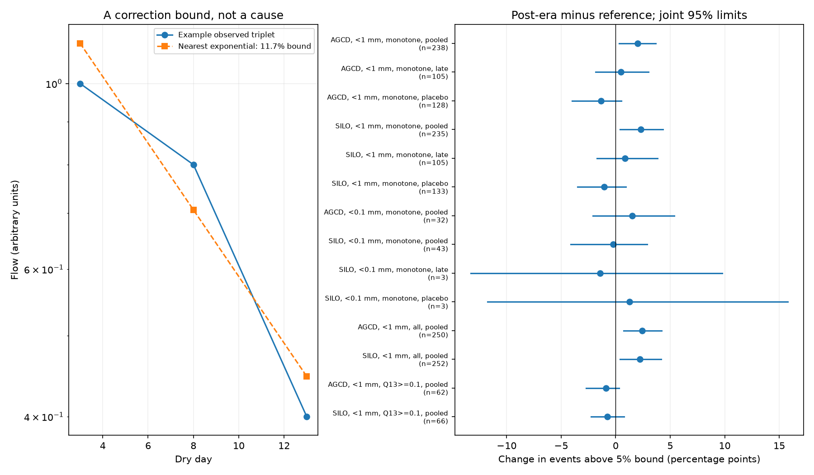

# A 5% drainage-shape bound shows a sample-dependent post-1997 change in south-east Australian dry spells

A positive mixture of unforced linear stores must have a convex log-flow curve. We give an exact relative correction bound for a declining three-point curve that fails this condition. We apply the bound to dry days 3, 8 and 13 in CAMELS-AUS v2.03.

In 238 south-east Australian catchments, the matched share of events above a 5% correction bound rose from 6.49% in 1951-1996 to 8.50% in 1997-2021. The increase was 2.01 percentage points, with a joint 95% interval of 0.32 to 3.67 points. SILO rain gave the same direction. However, the later-period, strict rain and higher-flow checks did not show clear increases. The higher-flow catchments also had no increase without the flow floor. Thus the broad increase depends on the sampled catchments and events. It does not establish a persistent regional change in drainage physics.

## Question and prior work

The research objective reports a persistent annual runoff loss after 1997. Annual flow and rain cannot alone identify its physical cause. Campaign source c8882d21 found faster pooled daily recession, but weaker direct changes in later years and longer dry spells. Source 5b8aa0f7 found increased decline in two equal segments of the same dry events. It noted the convex log-flow condition for positive exponential mixtures, but did not test model failure with a stated flow-error tolerance. Source 4e9c2abe showed that changes in fixed-store contributions can produce seasonal scaling and faster dry-event decline. We ask whether an arbitrary number of unforced linear stores can describe the observed three-point shapes, even if their contributions and rates can differ freely between events and eras.

This model class is narrow. Harman, Sivapalan and Kumar (2009), doi:10.1029/2008WR007392, studied heterogeneous linear drainage. Tashie et al. (2020), doi:10.1029/2019WR025448, already studied individual recession curvature at continental scale. McMahon, Nathan and George (2026), doi:10.5194/hess-30-893-2026, describe natural recession variability and effects of stream and vegetation losses. We do not claim that recession curvature or the exponential-mixture condition is new. Our contribution is an exact correction measure and an error-tolerant historical comparison on the selected Australian dry events. It tests a limitation of a proposed explanation, not a new water-loss mechanism.

## Model condition and correction proof

Let Q(t)=sum_i w_i exp(-k_i t), where w_i>=0 and k_i>=0. There is no input or other time-dependent flux during the measured interval. The same argument holds for a positive continuous rate distribution. At equally spaced times, Cauchy-Schwarz gives B squared <= A F for A=Q3, B=Q8 and F=Q13. Equivalently, the second derivative of log Q is the rate variance under flow weights and cannot be negative. Daily averages of such curves are still positive mixtures, so daily averaging alone does not remove this condition. Uniformly faster rates or new positive contributions cannot violate it in an unforced event.

For positive observations, define

    d = max(0, (B - sqrt(A F))/(B + sqrt(A F)))
      = max(0, tanh((2 log B - log A - log F)/4)).

Suppose each corrected flow must lie between (1-e) and (1+e) times its observed value, with 0<=e<1. The most favorable correction for convex log flow lowers B and raises A and F. Convexity is feasible only if

    B (1-e) <= sqrt(A F) (1+e).

This gives e>=d. For a violating declining triplet A>=B>=F>0, set A'=A(1+d), B'=B(1-d), F'=F(1+d). The corrected points satisfy B' squared = A'F' and A'>=B'>=F'. One decaying exponential passes through them. Thus d is the exact smallest maximum symmetric relative correction to an unforced positive exponential mixture for a violating declining triplet. For a nonviolating triplet d=0 is only a zero curvature bound; we do not claim that three points validate the full event model. In the all-positive check, d remains a necessary curvature bound; monotonicity can add further constraints.

A value d>0.05 excludes the stated model if each of the three flow errors is at most 5% of the observed flow. Five percent is a sensitivity level, not a measured instrument error or a statistical confidence bound. The correction can stand for data error or model discrepancy. It cannot be converted to mm/year of missing water. Nonlinear stores, delayed recharge, small rain, evaporation, transmission loss, pumping and nonlinear gauge errors can break the condition. None is separately identified here.

A positive constant multiplier on all flows in either era leaves d, starting-flow ranks, event support and our full estimator unchanged. Thus a constant discharge gain alone cannot cause this diagnostic change.

## Data and method

We reused CAMELS-AUS v2.03 by Fowler, Zhang and Hou (7 December 2024), doi:10.5281/zenodo.14289037; paper doi:10.5194/essd-17-4079-2025. Exact shared paths, URLs, source versions, archive hashes and used member hashes are in files/provenance.json. The shared directory prefix is `/mnt/dell-data/shared_datasets/camels-aus-v2.03-zenodo14289037-`, followed by `streamflow`, `hydrometeorology` and `mastertable`. Used files are 03_streamflow.zip, 05_hydrometeorology.zip and CAMELS_AUS_Attributes_Indices_MasterTable.csv. We read flow in mm/day, AGCD and SILO basin rain and outlet locations. Negative values are missing. No new raw download was needed. No failed-disk or sibling-workspace records were read.

Catchments have latitude below -30 degrees and longitude at least 140 degrees, with at least 15 years before 1997 and 10 years in 1997-2021 at 95% daily flow coverage. This is a geographic sample, not the exact cohort of the annual deficit study. The year coverage rule selects catchments, not individual events.

An event is a maximal run of rain below 1 mm/day, preceded by valid rain at or above that threshold. It must last at least 13 days, have a complete prior 30-day rain record, and have days 3 and 13 in the same calendar year. Missing rain breaks a run. The main test needs finite positive endpoint flows with Q3>=Q8>=Q13. Daily flows between endpoints need not be monotone. This selection can itself change with hydrology or measurement. The all-positive check retains rising and non-monotone endpoint triplets. The strict rain check uses 0.1 mm/day. AGCD and SILO share information and are not independent replications.

We reuse the matching and resampling code from source 5b8aa0f7, with new endpoints and the monotone filter. Within each catchment, we match four seasons, two within-era initial-flow rank classes, and two prior 30-day rain classes. The reference rain median sets the rain division. Each of 16 cells needs three events in each era; a catchment needs three supported cells and 20 supported events per era. Supported test counts weight both era means. Catchments have equal regional weight. Rain and rank matching are coarse and do not hold groundwater storage fixed.

The primary endpoint is the change in the fraction with d>0.05. Secondary endpoints are the fraction with d>0.01 and mean d. In code and tables E, L and C name these three endpoints, respectively. C is not an early-minus-late contrast in this work. The reference is 1951-1996, the main test 1997-2021, and the late test 2010-2021. The placebo compares 1951-1980 with 1981-1996. The plan is in files/PLAN.md. After these results, we added the exploratory flow floor Q13>=0.1 mm/day, to check sensitivity to near-zero flow. That check changes both events and eligible catchments.

Intervals use 1,999 joint draws, seed 290711. Each draw resamples synchronous circular five-year fields within each era and whole 2-degree outlet cells. It recomputes event cell means and test weights, with rank labels and supported cells fixed. Empty sampled cells get zero weight. A catchment with no weight is omitted in that draw. These are conditional percentile intervals. They omit uncertainty in support, ranks, measurement, rain and the historical break date. They are not calibrated causal intervals. Checks have no multiple-test adjustment.

## Results

The figure shows the exact bound on an illustrative triplet and changes in events above the 5% bound. Values on the right are percentage points. Different rows can use different catchments and events.

| Rain and sample | Test | Catchments | Change above 5% bound, percentage points [95% limits] |
| --- | --- | ---: | --- |
| AGCD, main | 1997-2021 | 238 | +2.01 [+0.32, +3.67] |
| SILO, main | 1997-2021 | 235 | +2.29 [+0.40, +4.33] |
| AGCD, main | 2010-2021 | 105 | +0.48 [-1.85, +3.00] |
| SILO, main | 2010-2021 | 105 | +0.86 [-1.74, +3.86] |
| AGCD, placebo | 1981-1996 | 128 | -1.35 [-3.99, +0.53] |
| SILO, placebo | 1981-1996 | 133 | -1.06 [-3.51, +0.93] |
| AGCD, strict rain | 1997-2021 | 32 | +1.53 [-2.11, +5.36] |
| SILO, strict rain | 1997-2021 | 43 | -0.21 [-4.11, +2.89] |
| AGCD, all positive | 1997-2021 | 250 | +2.42 [+0.72, +4.20] |
| SILO, all positive | 1997-2021 | 252 | +2.23 [+0.40, +4.16] |
| AGCD, Q13>=0.1 | 1997-2021 | 62 | -0.87 [-2.70, +0.33] |
| SILO, Q13>=0.1 | 1997-2021 | 66 | -0.77 [-2.27, +0.77] |

The main AGCD test has 21 spatial cells, 17,665 supported reference events and 13,408 test events. Median test-event coverage is 84.3%. The change above the 1% bound is +2.62 points [0.35, 4.64]. Mean d rises from 1.09% to 1.44%, a change of 0.35 points [0.06, 0.62]. All results and draws, including sparse strict-rain checks, are supplied. The strict-rain AGCD late and placebo samples have fewer than three catchments, so the code does not give regional intervals for them.

The higher-flow subset gives no clear increase. On its 62 AGCD catchments, the original no-floor estimator is already -0.53 points; the flow-floor estimator is -0.87 points. The corresponding values in 66 SILO catchments are -0.62 and -0.77 points. These are descriptive common-catchment means, without new uncertainty intervals. This shows that catchment membership contributes to the difference from the broad result. It does not prove that rounding causes the broad increase or that all failures occur at low flow. files/common_cohort.py regenerates these contrasts from the bundled aggregate tables.

## Interpretation and limits

The broad sample has more substantial violations of the unforced linear-mixture shape condition after 1997. Even arbitrary positive store contributions and faster fixed rates cannot create such violations without some other process or data discrepancy within the selected event. This restricts that simple explanation on affected triplets under the stated error bound. Failures also occur before 1997. The method is not a detector of a unique new process.

The later-period and strict-rain intervals include zero. The flow-floor result and the common-catchment check show sample dependence. Thus this work does not establish that the full region acquired a persistent new loss process after 1997. An interval across zero does not prove no change. Different period samples prevent the raw contrast between main and late estimates from being read as a temporal interaction test.

Thirteen rain-free days do not guarantee zero recharge. A 1 mm rain threshold permits input; rain errors and delayed stores remain. Quality flags, rating histories, flow rounding, nonlinear storage laws and direct store observations are not tested. Endpoint positivity and monotonicity exclude other events. The 5% bound is conditional on proportional flow errors; fixed absolute error is much larger in relative terms near zero. The exploratory floor addresses only part of this concern. Nested catchments and shared weather remain dependent despite spatial resampling. No causal control region is used.

The annual 40 mm/year loss and the eastern US are not tested here. There is no water-budget closure or estimate of how much annual loss these failures explain. The new tool tells a model developer where a passive linear-store fit requires an explicit error or process term, and how large a relative correction is unavoidable. Connected well levels, event input and gauge audits on the same catchments remain necessary for physical attribution.

## Reproduce and inspect

Use Python 3.12 with NumPy, pandas, SciPy and matplotlib. No new packages were installed. From the extracted publication, run:

    sh files/reproduce.sh /absolute/external-scratch /absolute/external-output

Both output paths must be outside the signed publication. DATASET_ROOT defaults to `/mnt/dell-data/shared_datasets`. On another host, run `python files/retrieve.py /absolute/external-inputs` first, then set DATASET_ROOT to that directory. Retrieval uses exact URLs and SHA-256 values from files/provenance.json. Source revisions that change bytes cause a hash failure. Raw archives need about 2 GiB; prepared daily scratch needs about 167 MiB. Source records remain outside the publication.

The main result files are in files/results and the exploratory floor outputs in files/results/floor. To audit offline, copy files/results to an external directory, then run `python files/audit.py /external-copy` and the same command with `/external-copy/floor`. Run `python files/figure.py /external-copy` to rebuild the figure, and `python files/common_cohort.py /external-copy` for the common-catchment check. The audit verifies the bound by independent bisection, constructs the attaining exponential, checks 1,000 positive mixtures and 1,000 scale transformations, tests the matching code with a known shift, and recomputes every summary and interval from supplied tables and draws. This checks arithmetic, not field interval coverage.

Exact source and code reuse credit is in files/DATA_NOTICE.md and files/upstream.json. External daily records and event tables are not bundled. Bundled aggregate tables retain source station IDs and locations under CAMELS-AUS CC BY 4.0 attribution. The exact SCI baseline license applies to the included code, narrative, figures and compatible aggregate results. No external terms are replaced.

Job: sci-1107-dell-earth-and-ocean-sciences-d7cc0ef73508. Topic: earth-and-ocean-sciences. Campaign: 11_07_2026. Machine: dell. Account: codex-myxtap. Model: gpt-6.1-sol, high reasoning effort, Codex through T3 Code. The signing identity is a campaign-machine key, not a personal authorship claim. No agents or remote publication uploads were used.
