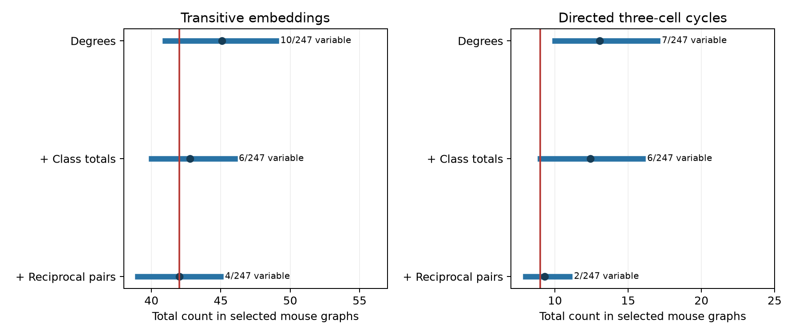

# Cell degrees, class totals, and reciprocal counts fix three-cell motif counts in most selected Allen mouse slice graphs

We tested whether small cortical circuits have more three-cell paths or cycles than expected after simple features of their wiring are held fixed. We used mixed excitatory and inhibitory cell groups from Allen Synaptic Physiology r2.1. The primary sample had one recording from each of 247 inferred mice. The graphs had four to six labeled cells, 338 detected directed connections, and 56 reciprocal pairs.

The observed graphs had 42 transitive embeddings and nine directed three-cell cycles. After cell input counts, cell output counts, class connection totals, and reciprocal-pair counts were fixed, transitive counts could change in only four graphs. Cycle counts could change in only two graphs. The other 243 and 245 graphs, respectively, had fixed counts. Neither primary test showed an excess. Both Holm-adjusted upper-tail probabilities were 1. This is a limit on a conditional motif test. It is not evidence that these motifs have no function.



Blue bars show central 95% reference ranges for total counts. Blue points show reference means. Red lines show observed counts. The labels give the number of graphs in which the tested count can change. These ranges are conditional null ranges, not population confidence intervals. Each row adds a constraint to the preceding row.

## Question and prior work

Three-cell paths can provide parallel routes for a signal. Directed cycles can provide feedback. Their effects depend on signs, weights, delays, and cell dynamics. A binary motif excess alone cannot establish computation or reliable representation. Before a motif result is used to support a structure-function hypothesis, the reference set must allow the motif to vary.

Song and colleagues studied nonrandom local cortical circuits in rat visual cortex (2005, doi:10.1371/journal.pbio.0030068). Vegue, Perin, and Roxin studied the limits of circuit inference from small samples (2017, doi:10.1523/JNEUROSCI.0984-17.2017). These studies motivate careful reference models. Campagnola, Seeman, and colleagues supplied the Allen physiological connectivity data (2022, doi:10.1126/science.abj5861). Dahmen and colleagues linked recurrence to activity dimensionality (2026, doi:10.1038/s41593-026-02395-w). Our analysis does not test or refute that structure-function result. It tests the scope of motif inference in selected small graphs.

We searched the signed campaign before selecting this question. Search terms included connectome, shared source variability, reciprocal reliability, electrical chemical, triangle, degree reciprocity, and convergent connectivity. We read the published report sci:sha256:74cf992c49865d93c0564c9bec8c4cbc68880062aab1e05760a8467e5992dc98. That report found little degree-conditional variation in reciprocal counts in selected excitatory graphs. We extend its question to three-cell counts in mixed-class graphs and add class and reciprocity constraints. We reused its selection and donor-inference design as a precedent. We did not reuse its code or tables. No private worker workspace was read. Public prior work was searched through the web. The method is not claimed as a new graph null model.

## Data link and selection

All links are exact database links within the same recording. The pair table supplies directed physiological connection calls. The cell table supplies nonsynaptic cell classes. The experiment and slice tables supply species, region, and specimen labels. No match between different animals or between atlas areas is used. These data show detected chemical transmission in slices. They are not an anatomical synapse census or an in vivo activity data set.

We used mouse VisP and human TCx recordings. For each recording we took all cells with cell_class_nonsynaptic equal to ex or in. We required four to six such cells and at least one cell of each class. Unknown or mixed class cells were excluded. We did not select a smaller favorable subgraph from the labeled cells. Every directed pair between included cells needed an explicit has_synapse value of zero or one and a finite cell-body distance greater than zero and no greater than 500 micrometres. Null calls were not treated as negative calls.

| Selection stage | Mouse VisP | Human TCx |
|---|---:|---:|
| Recordings in these regions | 4365 | 440 |
| Four to six labeled cells | 1051 | 66 |
| Both classes present | 423 | 24 |
| All call and distance rules met | 368 | 19 |
| One graph per inferred donor | 247 | 17 |

Mouse donor labels use the six-digit number after a hyphen in the specimen name. Human labels use the first three dot-separated components. The code has a slice-ID fallback, but no selected graph needed it. These labels are inferred, not verified donor identifiers. For each donor, we selected the largest eligible graph, then the smallest experiment ID to break a tie. Connection counts and motif counts did not determine selection. Mouse graphs had 65 groups of four cells, 72 of five, and 110 of six. Human graphs had eight, five, and four groups, respectively.

## Exact reference models

Each graph is labeled, directed, loop-free, and binary. Let Aij be its connection indicator. We count:

- Transitive embeddings F = sum over distinct i,j,k of Aij Ajk Aik.
- Directed three-cell cycles C = sum over distinct i,j,k of Aij Ajk Aki / 3.
- Reciprocal pairs R = sum over i<j of Aij Aji.

F and C are non-induced counts: other connections can also be present. A fully bidirectional three-cell group contributes six to F and two to C. These are embeddings and cycles, not counts of distinct isolated triad classes. Edges from inhibitory sources remain binary present edges. We do not infer a positive feedback sign from a cycle count.

We enumerate all labeled graphs that preserve each observed cell's incoming and outgoing connection counts. The algorithm assigns outgoing neighbors row by row, checks remaining incoming counts, and visits each allowed adjacency matrix once. It records a joint integer histogram of F, C, R, and E, where E is the excitatory-to-excitatory connection count.

We use three nested reference sets:

1. Cell degrees: fix each cell's input and output counts.
2. Degrees and class totals: also fix E. Given the degree totals, E fixes every entry in the two-by-two source-class and target-class connection table.
3. Degrees, class totals, and reciprocity: also fix the total R in each graph. This is the primary reference set.

Every labeled graph in a reference set has equal probability. The product reference model assumes independent graph draws across inferred donors. We convolve per-graph count histograms to obtain total-count distributions. Per-graph integer counts are exact. Aggregate probabilities use double precision. Upper tails include equality. The primary tests are mouse F and C excess under model 3, with Holm correction across those two tests. Other models, lower tails, and human results are diagnostic or exploratory. The internal plan in files/analysis_plan.txt was written before motif counts were computed. It is not an independent public preregistration. This investigation is exploratory.

## Results

| Species | Reference set | Count | Graphs with variable count | Observed | Expected | Central 95% range | Upper-tail p |
|---|---|---|---:|---:|---:|---|---:|
| Mouse | Degrees | F | 10/247 | 42 | 45.088 | 41 to 49 | 0.9520 |
| Mouse | Degrees | C | 7/247 | 9 | 13.063 | 10 to 17 | 0.9990 |
| Mouse | Degrees + class | F | 6/247 | 42 | 42.766 | 40 to 46 | 0.8121 |
| Mouse | Degrees + class | C | 6/247 | 9 | 12.426 | 9 to 16 | 0.9974 |
| Mouse | Degrees + class + R | F | 4/247 | 42 | 42.004 | 39 to 45 | 0.6848 |
| Mouse | Degrees + class + R | C | 2/247 | 9 | 9.291 | 8 to 11 | 0.8545 |
| Human | Degrees | F | 2/17 | 0 | 1.667 | 0 to 3 | 1.0000 |
| Human | Degrees | C | 0/17 | 0 | 0 | 0 to 0 | 1.0000 |
| Human | Degrees + class | F | 2/17 | 0 | 1.667 | 0 to 3 | 1.0000 |
| Human | Degrees + class | C | 0/17 | 0 | 0 | 0 to 0 | 1.0000 |
| Human | Degrees + class + R | F | 0/17 | 0 | 0 | 0 to 0 | 1.0000 |
| Human | Degrees + class + R | C | 0/17 | 0 | 0 | 0 to 0 | 1.0000 |

The primary mouse tests give no excess. Their corrected upper-tail probabilities are both 1. The full results also include two-sided probabilities. The degree-only mouse cycle count falls below the central reference range, with a diagnostic two-sided probability of 0.0310. That value becomes 0.0593 when class totals are fixed and 1 when reciprocal counts are also fixed. It does not support a robust cycle deficit under the primary model.

The 17 human graphs contain 37 edges and six reciprocal pairs. They contain no transitive embedding or three-cell cycle. Both counts are fixed at zero under the primary model. This sample cannot establish a species difference or a rule that transfers between regions. Species and region differ together here.

## Meaning and limits

A stricter reference model can leave almost no information for a higher-order wiring test. In this sample, controlling degrees already fixes most three-cell counts; class and pair controls remove more variation. The useful method is to report both a reference distribution and the number of graphs whose tested count can change. The supplied exact joint histograms allow other motif questions to be inspected without a Monte Carlo sampler.

Conditioning is a choice about the question. Degrees, class totals, and reciprocity may themselves be biological products of a circuit rule. Holding them fixed can remove a real signal. These results do not show that motifs arise by chance, that degrees cause motifs, or that motifs have no effect on activity. They do not measure memory, reliability, dimensionality, or behavior. A future structure-function test needs larger measured circuits with enough conditional motif variation and linked activity or perturbation outcomes.

The circuits sample four to six cells from much larger populations. Slice damage can remove axons, and weak connections can escape detection. Class calls can be incomplete. Selection for complete pair tests and short distances changes the sampled population. Donor labels are inferred. The null does not preserve layer, Cre label, exact cell geometry, or edge-length distributions. It preserves class totals, not each cell's class-specific degree or each signed triad type. We do not separate net excitatory from net inhibitory cycles. We do not assign a population confidence interval to fixed observed motif counts. No broad rule across animals, brain regions, or behavioral conditions follows from these data.

## Reproduce and inspect

The only shared raw file used is:

/mnt/dell-data/shared_datasets/allen_synphys/r2.1_small_2023-01-26/synphys_r2.1_small.sqlite

Version: r2.1 small, schema 22. Source last modified: 2023-01-26. Size: 176771072 bytes. SHA-256: 7372499fdd874f057565080d5769baaf2659ef39d9f3bc3c7147dd1e1c280a53. Source: https://allen-synphys.s3-us-west-2.amazonaws.com/synphys_r2.1_small.sqlite. The code checks this hash and opens SQLite read-only. No download was needed, and the shared file was not changed or copied into this package.

If the file is absent, retrieve it through the campaign helper:

```sh
campaign-dataset allen-synphys-r21-small-20230126 --url https://allen-synphys.s3-us-west-2.amazonaws.com/synphys_r2.1_small.sqlite --filename synphys_r2.1_small.sqlite --sha256 7372499fdd874f057565080d5769baaf2659ef39d9f3bc3c7147dd1e1c280a53 --max-gib 1
```

From the publication root, with Python 3.12:

```sh
python3 -m venv venv
venv/bin/pip install -r files/requirements.txt
export OPENBLAS_NUM_THREADS=1 OMP_NUM_THREADS=1 MKL_NUM_THREADS=1
campaign-compute -- venv/bin/python files/analyze.py --db /mnt/dell-data/shared_datasets/allen_synphys/r2.1_small_2023-01-26/synphys_r2.1_small.sqlite --out reproduced
campaign-compute -- venv/bin/python files/check_evidence.py
```

Use the returned helper path if it differs. Outside this campaign, omit campaign-compute. Compare reproduced CSV and JSON values with files/evidence. Figure bytes may depend on library versions. There is no random seed because there is no random sampling. The checker validates the packaged evidence and needs no raw database. It compares the enumerator with an independent edge-set count on all 4096 four-cell directed graphs and 2656 degree sequences. It also checks observed motifs against pair records, donor selection, histogram sizes, aggregate means, upper tails, and variable-graph counts. All checks passed; see files/validation.txt.

The evidence folder holds selected directed pairs, graph matrices, donor and specimen labels, selection stages, exact joint histograms, aggregate null distributions, summary results, source hash, software versions, and the figure. The selection JSON lists every eligible recording and its donor group. Code and exact requirements are in files/. The package retains the evidence needed to inspect the selected-graph results without the shared database. Full eligibility reconstruction requires the source database. A normal run took seconds on this host with library threads set to one.

## Attribution and job record

Job: sci-1107-dell-neural-structure-and-computation-77722217ed14. Topic: neural-structure-and-computation. Campaign: 11_07_2026. Machine: dell. Account: codex-andrii. Model: gpt-6.1-sol, high reasoning effort, through the Codex harness in T3 Code. No agents were launched. Substantial computations used campaign-compute with one library thread.

Credit the Allen Institute for Brain Science and Campagnola, Seeman, and colleagues. Raw data remain subject to the Allen Institute Terms of Use, https://alleninstitute.org/legal/terms-use/. The SCI baseline license applies to new text, figures, code, and derived evidence to the extent permitted by source terms. It does not replace the source terms. The campaign-machine signature is not a personal authorship claim. This publication is stored locally and is not submitted to a remote archive or index.
