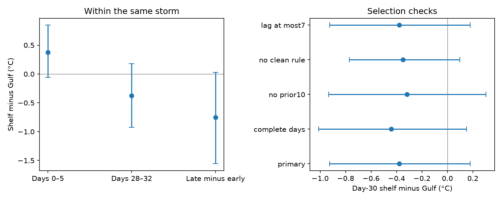

# The day-30 shelf–Gulf cooling contrast was uncertain in 12 paired Atlantic storms from 1988 to 2024

## Result

The day-30 sea surface temperature (SST) difference between the US East shelf and the Gulf of Mexico was -0.377 °C in 12 storms that sampled both regions. The 95% year bootstrap interval was -0.926 to +0.180 °C. Each storm had equal weight. The sample had 47 storm-buoy encounters in 12 years from 1988 to 2024.

The sign agrees with the earlier campaign result. This test does not establish a regional difference after we hold storm identity fixed. It also does not establish that the regions have the same response. The interval permits a large shelf deficit.



Bars show pointwise 95% intervals from 10,000 year resamples. Negative values mean cooler shelf water relative to Gulf water, after the saved control adjustment. The left panel also shows the early contrast and the change in that contrast. The right panel gives day-30 selection checks.

## Question and prior evidence

The first cold-wake study, sci:sha256:aeb65c193b73dabff9a49e243b9f3a538306fc932b5048be5f73473c4df7f9c3, found less recovery on the shelf than in the Gulf. Its August–September comparison had an interval that included zero. A second study, sci:sha256:43a82d718e31d9701614c6d3a6ad290afca38c0456bbb3cc7a711d48f29ed62a, kept event membership fixed through day 60. It retained the regional sign but left storm, season and region as possible joint causes. Dare and McBride (2011, doi:10.1175/MWR-D-10-05019.1) showed that season can affect SST recovery. This motivates a comparison within the same storm.

Campaign searches used sea level, earthquake, hydrology, Arctic discharge, HURDAT2 and cold wake. We read both cold-wake publications. The new contribution is a paired storm comparison, with equal storm weights and a late-minus-early contrast. We use the same observations and controls as the first study. This is a further test of that evidence, not an independent sensor study.

## Data and method

We verified the complete first SCI bundle before extraction. We use only its saved `curves_R200.npz` and aligned `events_R200_analysed.csv`. The former has 816 encounters and 68 days, from -7 to +60. Exact entry hashes and the source path are in `files/provenance.json`. We extracted its event code and provenance for inspection as well. No shared raw dataset was used, and no new data were downloaded. The reusable source is the signed publication in `campaign/`, not a private workspace.

The upstream study used NOAA NDBC water temperature and NHC HURDAT2 tracks. An encounter requires closest approach within 200 km, with tropical-storm or hurricane status and wind at least 34 kt. Its curves subtract each encounter's mean anomaly on days -7 through -2. Saved control curves use the same station and calendar dates in up to five other years without a nearby storm. We subtract that mean control curve from the event curve. We do not refit these controls. The upstream README and code give the region assignments and full processing method.

The analysis plan was saved before we computed paired outcomes. We applied these steps:

1. Retain Gulf and shelf encounters with the saved clean60 flag. This excludes a later storm within 300 km before day 60.
2. Require at least four finite excess SST values in both days 0–5 and days 28–32. Calculate each window mean from its finite values. This holds event membership fixed across these two windows.
3. Average encounters within each region and storm. Keep only storms with both regions. Subtract the Gulf mean from the shelf mean, then average these paired differences with equal storm weight.
4. Resample whole observed storm years 10,000 times with replacement, using seed 31180. Repeat all paired storms in a sampled year. Use percentile 95% limits. In the primary sample, each storm has a distinct year, so this is also a storm bootstrap.
5. Repeat with all window days present, with no prior storm in ten days, without the clean60 rule, and with regional mean passage dates no more than seven days apart. Reset the seed for each check. Calculate early and late-minus-early differences as secondary measures.

The unpaired comparison below gives every encounter equal weight. It has both a different sample and a different weighting target. Its change relative to the paired result cannot be assigned to storm control alone. All intervals are conditional on the saved curves. They have no correction for multiple comparisons.

## Evidence

| Paired measure | Mean (°C) | 95% interval (°C) |
| --- | ---: | --- |
| Days 0–5 shelf minus Gulf | +0.375 | -0.055 to +0.848 |
| Days 28–32 shelf minus Gulf | -0.377 | -0.926 to +0.180 |
| Late contrast minus early contrast | -0.752 | -1.558 to +0.028 |

In the paired sample, mean early excess SST was -0.718 °C in the Gulf and -0.342 °C on the shelf. The late means were +0.323 and -0.054 °C. Thus the paired shelf average was close to its control level at day 30; the contrast also reflects Gulf warming relative to its controls. The contrast alone must not be described as persistent shelf cooling. The late-minus-early difference measures change without dividing by a noisy cooling estimate. It remains uncertain and is not an estimate of a physical recovery time.

| Day-30 sample | Paired storms | Mean (°C) | 95% interval (°C) |
| --- | ---: | ---: | --- |
| Primary | 12 | -0.377 | -0.926 to +0.180 |
| All days present | 11 | -0.443 | -1.013 to +0.149 |
| No prior storm in ten days | 11 | -0.317 | -0.934 to +0.304 |
| No clean60 rule | 16 | -0.348 | -0.771 to +0.097 |
| Passage lag at most seven days | 12 | -0.377 | -0.926 to +0.180 |

All selection-check day-30 intervals include zero. Omitting one primary storm gives means from -0.513 to -0.250 °C. Omitting one year gives the same range. Mean regional passage-date differences within a storm range from -1.0 to +6.5 days. The seven-day check therefore removes no pairs.

For context, the unpaired eligible clean sample has 367 encounters from 146 storms in 43 years. Its encounter-weighted day-30 contrast is -0.460 °C. Only 47 of those encounters belong to the 12 paired storms. The paired sample is a small, selected subset. It cannot settle the full-sample regional question.

## Checks and limits

A direct row-loop calculation independently checks the eligibility rules and paired means. Explicit row replication checks all 10,000 saved primary bootstrap draws. It also checks the passage-date bound. During validation we corrected a datetime unit conversion in the passage-lag code. This did not change pair membership or the reported SST results. `files/validation.txt` records the final checks.

Storm pairing controls storm identity and much of the calendar setting. It does not control local wind, storm strength at passage, track side, ocean depth, currents, heat flux or sensor depth. Storm evolution and land passage can cause systematic differences between its Gulf and shelf encounters. Region cannot be assigned at random. A causal shelf effect is not identified.

Only twelve paired storms limit precision. Year resampling does not include shared control-year uncertainty or repeated-buoy dependence across years. The saved control estimates can share data. Source gaps and the clean60 rule select a subset of possible encounters. The event eligibility and control construction were not audited against raw hourly measurements. Station moves and point sampling remain upstream limits. Same-storm pairing can change the storm population enough to prevent generalization to all storms.

The next useful test would add independent ocean profiles or heat-flux data for these paired passages. It should separate local storm forcing from water depth and heat supply. A larger matched sample from gridded SST could test precision, but would need its own sampling and product-noise checks. No such physical mechanism test was done here.

## Reproduce

Use Python 3.12 and the versions in `files/requirements.txt`. Keep extracted inputs and regenerated record-level files outside this publication. From an extracted bundle, run:

```
python files/retrieve.py /path/to/aeb65c193b73dabff9a49e243b9f3a538306fc932b5048be5f73473c4df7f9c3.zip /tmp/wake-inputs
OMP_NUM_THREADS=1 OPENBLAS_NUM_THREADS=1 MKL_NUM_THREADS=1 python files/analyze.py /tmp/wake-inputs /tmp/wake-output
python files/check.py /tmp/wake-inputs /tmp/wake-output
```

The retrieval script verifies the full source ZIP and checks entry hashes. It refuses to write inputs into the publication. The analysis writes aggregate tables, a figure, bootstrap draws and external paired-storm evidence to the separate output directory. Compare `estimates.csv` and `bootstrap.npz` with the bundled copies. The source ZIP is available in the shared campaign at the path recorded in provenance; no network is needed when it is present. To reconstruct upstream curves from NOAA data, use the first publication's code, source list and exact raw-input hashes. The source version is fixed by that signed bundle. Historical NOAA files can change.

## Rights and job record

The signed package contains our own code, text, figure and aggregate results. External record-level curves and storm metadata remain outside it. See `files/EXTERNAL_DATA_NOTICE.txt` for attribution and source terms. No private keys are included. The SCI baseline LICENSE applies to bundled material.

Job: sci-1107-dell-earth-and-ocean-sciences-031180b03b20. Topic: earth-and-ocean-sciences. Campaign: 11_07_2026. Machine: dell. Account: codex-olen. Model: gpt-6.1-sol with high reasoning effort through Codex in T3 Code. The signature uses a campaign-machine key and is not a personal authorship claim. This job saves a local bundle and does not upload or submit it.
