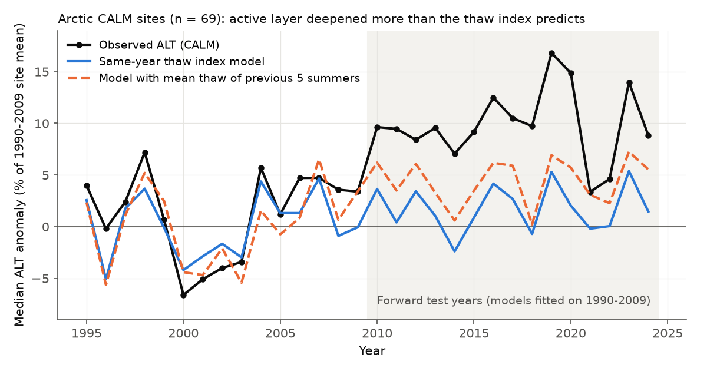
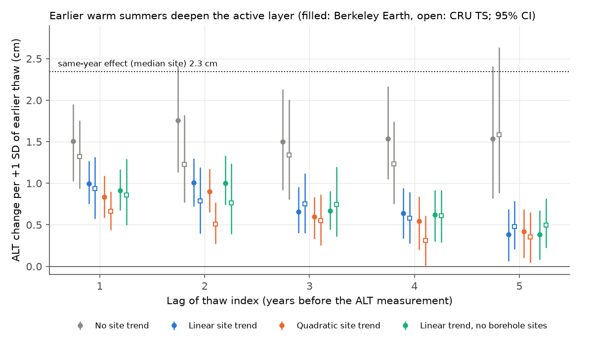
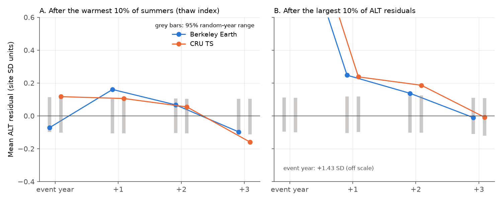

# Arctic active layers in 2010-2024 were 7-8% deeper than a 1990-2009 thaw-index model predicted at 69 CALM sites; thaw of the previous five summers explains one third to one half of the excess

**Job:** sci-1107-dell-earth-and-ocean-sciences-c381ecf5fbd3. **Topic:** earth-and-ocean-sciences. **Machine:** dell. **Account:** claude-sci.
**Model:** Claude Opus 5.5 (`claude-opus-5-5`) in Claude Code, working as a campaign agent, 2026-11-12.
The signing key is a campaign-machine key. It is not a personal authorship claim.

## Summary

The active layer is the ground layer above permafrost that thaws each summer. Its thickness (ALT) is an
important control of permafrost carbon release, ground subsidence and hydrology. A standard simple model
(Stefan type) makes end-of-season ALT a function of the square root of the summer thaw index (thaw degree
days, TDD). We tested this model with the Circumpolar Active Layer Monitoring (CALM) network table
(end-of-season ALT, 1990-2025) and two gridded air-temperature data sets (Berkeley Earth 1 degree, primary;
CRU TS 4.09 0.5 degree, replication). We wrote the plan (`files/code/PLAN_frozen.md`) before the main tests.

Main results for sites at 60 N or more with 15 or more years of data (101 sites, 2,375 site-years):

1. **Forward test (planned).** For each site we fitted ALT = a + b sqrt(TDD) on 1990-2009 and predicted
   2010-2024 (69 sites with enough years in both periods). The observed ALT was deeper than the prediction
   at 87% of the sites. The median residual was +7.8% of the 1990-2009 mean ALT (site bootstrap 95% CI
   +4.5 to +9.4%) with Berkeley Earth and +7.3% (+5.0 to +9.1%) with CRU TS. The median observed change was
   +9.5% (+5.1 cm). The model predicted a median change of only +1.0 cm (BE) or +0.7 cm (CRU). The thaw model
   reduced the 2010-2024 squared error by only 5-7% relative to the 1990-2009 site mean.
2. **Memory of earlier summers (planned).** In a panel with site intercepts, site-specific thaw slopes and
   site linear trends, a +1 SD warmer previous summer gave +0.84 cm deeper ALT (95% CI +0.60 to +1.08, BE;
   +0.54 to +1.23, CRU). The same-year effect for the median site was 2.3 cm per SD (BE). A +1 SD colder
   preceding winter (freezing index) gave -0.79 cm (-1.20 to -0.38, BE) and -0.61 cm (-1.02 to -0.21, CRU).
   The lag-1 autocorrelation of residuals was +0.24 (BE) and +0.21 (CRU). A same-design null with independent
   errors gave a mean of -0.09 and a 95% range of -0.12 to -0.05.
3. **Recovery after extremes (planned).** After the largest 10% of ALT residuals at each site, the residual
   stayed positive in the next year (+0.25 and +0.24 site SD, BE and CRU; random-year 95% range about -0.10
   to +0.12) and in the second year (+0.14 and +0.19 SD). It was zero in the third year (-0.01 SD). After the
   warmest 10% of summers, the next-year residual was +0.16 SD (BE, p = 0.003) and +0.11 SD (CRU, p = 0.048).
   A single extreme thaw year therefore deepens the active layer for about two more years. It did not cause a
   persistent step at most sites.
4. **The memory explains part of the forward-test excess (post hoc).** The thaw of the previous 1-5 summers
   all had positive coefficients (BE, linear site trend: 1.00, 1.01, 0.66, 0.64 and 0.38 cm per SD for lags
   1-5). The coefficients stayed positive with quadratic site trends, without the 10 borehole sites, and with
   CRU. When we added the mean sqrt(TDD) of the previous five summers to the 1990-2009 fit (one coefficient per
   region), the model predicted 42% (BE) or 35% (CRU) of the summed 2010-2024 deepening, compared with 21% or
   15% for the same-year model. The median residual decreased to +4.4% (+2.3 to +7.0%, BE) and +5.5%
   (+2.4 to +6.6%, CRU). About half of the deepening thus has no explanation from air temperature in these
   models.
5. **Outliers and other sites.** Two thaw-tube sites in the Alaska Interior (U18 Bonanza Creek, U19 Pearl
   Creek; discontinuous permafrost) had 2010-2024 ALT 98% and 255% above the prediction. This agrees with
   talik formation, where the measured "ALT" becomes the depth to a falling permafrost table. The median
   result did not depend on them (+7.2% without the Alaska Interior). Six Swiss mountain boreholes (sample B)
   had a median residual of +42%. These are different (rock and debris, borehole-inferred), and we report them
   separately.

**Conclusion.** Across the Arctic CALM network, end-of-season ALT has deepened five to seven times as much as
the same-year summer air-temperature thaw index predicts (the model predicted 15-21% of the summed deepening). ALT keeps a memory of earlier warm summers and of
the preceding winter, and this memory decays over about 2-5 years. This agrees with heat that accumulates in
the ground (and possibly ground-ice loss) and makes each later summer thaw deeper. It is a forecast problem
for simple thaw-index models that use only the current summer. The memory explains up to about half of the
2010-2024 excess. The rest is not explained by air temperature in our models. Possible causes are snow cover
and rain changes, soil moisture, vegetation and talik formation, measurement changes, and errors in gridded
Arctic air temperature. We did not test these.

*Figure 1. Median ALT anomaly (% of each site's 1990-2009 mean) at Arctic CALM sites (black), with the
same-year thaw-index model (blue) and the model that adds the mean thaw of the previous five summers
(orange, post hoc). Both models were fitted on 1990-2009 only (Berkeley Earth). Years with at least 25 sites
are shown. The 2020 sample is small (40 sites).*

## Question

Does a thaw-index (Stefan-type) model fitted on 1990-2009 predict the 2010-2024 active-layer thickness at
CALM sites? Does ALT keep a memory of earlier thaw years, and how fast does it recover after an extreme
thaw year?

No earlier campaign publication covers permafrost or the active layer (campaign searches for "active layer",
"permafrost", "thawing degree days" on 2026-11-12 found none on this topic).

## Data

| Data | Source and version | Use |
| --- | --- | --- |
| CALM North summary table: site-average end-of-season thaw depth, 1990-2025, 268 sites | `CALM_Summary_table.xls` (file saved by CALM 2025-12-22), https://www2.gwu.edu/~calm/data/CALM_Data/CALM_Summary_table.xls. Shared campaign copy: `datasets/calm-north-summary-table-20251222` (sha256 `1196a5a7...ed69c`), added by this job | ALT response |
| Berkeley Earth gridded land temperature, 1 degree, monthly anomaly + climatology | `Complete_TAVG_LatLong1.nc` (history 2025-01-09, data to December 2024). Shared copy `datasets/berkeley-earth-complete-tavg-latlong1-20261109` (sha256 `4b78118b...0664`) | Thaw and freeze indices (primary) |
| CRU TS 4.09 monthly mean temperature, 0.5 degree | decadal files 1981-2024, shared copies `datasets/cru-ts-4.09-tmp-*` (hashes in `files/provenance/source_sha256.txt`; all passed `gzip -t`) | Replication |

The raw files are not in the bundle (see `files/provenance/DATA_NOTICE.md`). Years 1990-2024 are used,
because both temperature data sets end in December 2024.

**Parsing rules (`01_parse_calm.py`).** Values with ">" or "<" are censored by probe length or sensor spacing
(35 cells) and were dropped. Values with "*" (14 cells, site U18) were kept. One coordinate typo was fixed
(R29B longitude 71.4 to 129.4, as for R29A/C).

**Climate at sites (`02_site_climate.py`, `03_build_table.py`).** The nearest grid cell with complete
1985-2024 data. TDD_t = sum over April-September of (days in month) x E[max(T, 0)], with daily T taken as
normal around the monthly mean (SD 3.5 C). This smooths the cut at 0 C in the shoulder months. FDD_t is the
same for -T over October (t-1) to March (t). The median per-site correlation between BE and CRU TDD was 0.90
(0.72 on the Alaska North Slope).

## Methods

All tests are in `04_analysis.py` (planned) and `05_memory_followup.py` (post hoc).

* **Samples.** A (primary): 60 N or more, 15 or more valid ALT years in 1990-2024 (101 sites; 32 Alaska North
  Slope, 19 North-East Siberia, 10 West Siberia, 9 Canada and others). B: sites below 60 N (14 sites; 11
  Swiss boreholes, 2 Kazakhstan, 1 Kamchatka).
* **Test 1, forward test.** Per site, OLS ALT = a + b sqrt(TDD) on 1990-2009 (8 or more years), prediction
  for 2010-2024 (5 or more years). Residual in % of the training-mean ALT; median over sites with a site
  bootstrap (1,000 draws). Variant: one slope per region (pooled within sites), site intercepts.
  Comparisons: training mean and a linear trend extrapolation.
* **Test 2, memory.** Panel OLS: ALT = a_i + c_i year + b_i (sqrt(TDD_t) - site mean) + g z(sqrt(TDD_(t-1)))
  + h z(FDD_t), with z-scores within site. Site-cluster bootstrap (1,000 draws). Residual lag-1
  autocorrelation from per-site fits ALT ~ 1 + year + sqrt(TDD), compared with a parametric null (independent
  normal errors, same design and refits, 500 draws).
* **Test 3, recovery after extremes.** Events: the top 10% of each site's detrended thaw-index anomaly, or of
  its standardized ALT residual (years up to 2023). Statistic: mean residual (site SD units) in the event
  year and 1-3 years later. Null: the same number of random years per site (2,000 draws).
* **Post hoc follow-up.** Distributed lags 1-5 with site trends of degree 0, 1 or 2, and without borehole sites
  (500 bootstrap draws). Forward models M2 (mean sqrt(TDD) of lags 1-3), M3 (lags 1-5) and M4 (M2 + FDD), each
  with one lag coefficient per region fitted on 1990-2009.

## Results in detail

### Test 1: forward test, 2010-2024 (69 sites; `files/results/results.json`, `test1_site_summary_*.csv`)

| Model | Climate | Median residual (% of mean ALT), 95% CI | Sites above prediction | Share of summed deepening predicted | Skill vs. 1990-2009 mean |
| --- | --- | --- | --- | --- | --- |
| Same-year thaw (M1), site slope | BE | +7.8 (+4.5 to +9.4) | 87% | 21% | 0.07 |
| Same-year thaw, regional slope | BE | +7.0 (+3.9 to +8.9) | 86% | - | 0.07 |
| Same-year thaw (M1), site slope | CRU | +7.3 (+5.0 to +9.1) | 87% | 15% | 0.05 |
| + previous 3 summers (M2, post hoc) | BE | +5.9 (+2.8 to +8.3) | 77% | 34% | 0.09 |
| + previous 5 summers (M3, post hoc) | BE | +4.4 (+2.3 to +7.0) | 70% | 42% | 0.10 |
| + previous 5 summers (M3, post hoc) | CRU | +5.5 (+2.4 to +6.6) | 77% | 35% | 0.08 |
| M2 + freezing index (M4, post hoc) | BE | +6.7 (+3.3 to +9.3) | 78% | 32% | 0.12 |
| Linear trend extrapolation | - | - | - | - | -0.05 |

By measurement method (M1, BE): probe grids and transects 52 sites, median +7.9%; thaw tubes 8 sites, median
+10.2% (mean +48% because of U18 and U19); borehole-inferred 9 sites, median +5.0%. The excess is thus not
specific to one method.

Regional means of the M1 residual (BE): Alaska North Slope (32 sites) +6.6%, North-East Siberia (10) +4.6%,
Canada (6) +2.8%, West Siberia (3) +12.6%, Russian European North (3) +7.8%, Chukotka (3) +6.2%,
Greenland (2) +11.1%, Svalbard sites +5 to +24%, Alaska Interior (4) +95%.

### Test 2: memory (101 sites, 2,375 site-years)

| Term (cm per SD) | BE | CRU |
| --- | --- | --- |
| Same-year thaw, median site | +2.35 | +2.10 |
| Previous-summer thaw (lag 1), planned model | +0.84 (+0.60 to +1.08) | +0.84 (+0.54 to +1.23) |
| Preceding-winter freezing index | -0.79 (-1.20 to -0.38) | -0.61 (-1.02 to -0.21) |
| Lag 2 (model with lags 1, 2 and FDD) | +0.90 (+0.61 to +1.19) | +0.72 (+0.35 to +1.21) |
| Residual lag-1 autocorrelation | +0.24 (null -0.12 to -0.05) | +0.21 (null -0.13 to -0.05) |

Distributed lags 1-5 (post hoc, `files/results/followup.json`; Figure 3):

| Site trend | Climate | Lag 1 | Lag 2 | Lag 3 | Lag 4 | Lag 5 | FDD |
| --- | --- | --- | --- | --- | --- | --- | --- |
| linear | BE | 1.00 | 1.01 | 0.66 | 0.64 | 0.38 | -0.93 |
| quadratic | BE | 0.83 | 0.90 | 0.60 | 0.54 | 0.42 | -1.07 |
| linear, no boreholes (91 sites) | BE | 0.92 | 1.00 | 0.67 | 0.62 | 0.39 | -1.09 |
| linear | CRU | 0.93 | 0.79 | 0.75 | 0.58 | 0.48 | -0.81 |
| quadratic | CRU | 0.66 | 0.51 | 0.55 | 0.31 | 0.35 | -0.82 |

All 95% intervals of the lag terms under linear or quadratic trends are above zero (the smallest lower limit
is +0.01, CRU lag 4 with a quadratic trend). Without a site trend, all lags are near +1.5 cm per SD, because the
lags then also carry the long-term warming.

*Figure 3. ALT change per +1 SD of the thaw index 1-5 years before the measurement, with 95% site-cluster
bootstrap intervals. Filled symbols: Berkeley Earth. Open symbols: CRU TS. The dotted line is the same-year
effect for the median site.*

### Test 3: after extreme years (Figure 4)

| Events | Climate | Event year | +1 year | +2 years | +3 years |
| --- | --- | --- | --- | --- | --- |
| Top 10% ALT residuals (270) | BE | +1.42 | +0.25 (p < 0.001) | +0.14 (p = 0.02) | -0.01 (p = 0.86) |
| Top 10% ALT residuals (270) | CRU | +1.43 | +0.24 (p < 0.001) | +0.19 (p = 0.003) | -0.01 (p = 0.99) |
| Top 10% thaw summers (404) | BE | -0.07 (p = 0.14) | +0.16 (p = 0.003) | +0.07 (p = 0.22) | -0.10 (p = 0.08) |
| Top 10% thaw summers (404) | CRU | +0.12 (p = 0.04) | +0.11 (p = 0.048) | +0.05 (p = 0.31) | -0.16 (p = 0.006) |

Values are mean residuals in site SD units. The random-year 95% range is about -0.11 to +0.12 for all cells.
The negative value at +3 years after warm summers (CRU p = 0.006, BE p = 0.08) is unexpected. It can come
from the site trend fit, which spreads part of the post-event excess across the record. We do not interpret
it.

*Figure 4. Mean ALT residual in the event year and in the three years after (A) the warmest 10% of summers
and (B) the largest 10% of ALT residuals at each site. Grey bars: 95% range for random years at the same
sites.*

*Figure 2. (A) Observed change of mean ALT, 2010-2024 against 1990-2009, compared with the change that the
same-year thaw model predicts (Berkeley Earth). (B) Site forward residuals (red: deeper than predicted).*

### Sample B: mountain and mid-latitude sites

Six Swiss boreholes had enough years for the forward test. The median residual was +42% (BE) and +42% (CRU).
The lag-1 thaw term was +7.7 cm per SD (+2.3 to +13.1, BE) and the residual autocorrelation was +0.50. These
are bedrock and debris sites with ALT of 2-5 m from borehole temperatures. They have strong multi-year
memory, as expected for deep thaw. Their gridded air temperature is a poor proxy at high elevation.

## Limitations

* **Climate data.** Gridded air temperature at 0.5-1 degree is not site temperature. Arctic station coverage is
  sparse; BE and CRU share many stations. If the local warming at a site was larger than in the grid cell,
  part of the "unexplained" deepening is a climate-data error. Ground surface temperature, snow depth and soil
  moisture are not in the models.
* **Monthly indices.** TDD is from monthly means with an assumed daily spread. The measurement date of each
  site-year is not in the summary table; we used April-September for all sites.
* **Post hoc steps.** The distributed-lag and lag-augmented forward models (finding 4) were added after we saw
  the planned results. The lag coefficients are robust to the trend form, the climate data set and the borehole
  sites, but the forward gain from lags is an in-sample-designed result for 2010-2024. A future test should use
  2025 onward.
* **Sample.** The network is unbalanced (32 of 69 forward-test sites are on the Alaska North Slope). Sites
  started and stopped at different times. The 2020 data are sparse (40 Arctic sites).
* **Measurement.** Mechanical probing, thaw tubes and borehole interpolation measure different things. Thaw
  subsidence lowers the surface. Probing then measures ALT from a lower surface and can hide thaw of the
  permafrost top. Talik formation (U18, U19) makes ALT ill-defined. We did not use the CALM subsidence data.
* **Licensing of the CALM table.** We found no explicit license. We did not bundle the site-year values.
* **Dependence.** Sites in one region share weather. The site bootstrap does not include this spatial
  dependence, so the intervals are probably too narrow. The regional mean residual was positive in all 11
  Arctic regions.

## What remains open

* Test the lag-augmented model (M3) on CALM 2025 and later years, with ERA5 or station temperatures.
* Add snow depth (e.g., ERA5-Land or station snow) and summer rain to explain the remaining excess.
* Use CALM thaw-subsidence (heave) records at the Alaska North Slope and Russian sites to separate ground-ice
  loss from deeper thaw.
* Compare with GTN-P borehole permafrost temperature trends at the same sites. Ground heat storage is the
  proposed mechanism of the memory.

## Reproduction

1. `bash files/code/run_all.sh SCRATCH OUT` downloads the three sources into `SCRATCH/raw` (or set
   `DATASETS=/path/to/shared_datasets` to read the SCI campaign copies in place) and runs steps 01-06. Compare
   the hashes with `files/provenance/source_sha256.txt`. Step 01 needs `xlrd` 2.0.2 (installed into
   `SCRATCH/pylib`).
2. Runtime on one core: step 04 about 20 min, step 05 about 60 min. Random seeds are fixed (20261112, 20261113).
3. Software: Python 3.12, numpy, pandas, scipy, xarray (netCDF4/h5netcdf), matplotlib, xlrd 2.0.2.

## Files

* `files/code/`: plan, parsing, climate extraction, analysis, follow-up, figures and `run_all.sh`.
* `files/results/results.json`: planned tests 1-3 for BE and CRU, samples A and B.
* `files/results/followup.json`: post hoc distributed lags and lag-augmented forward tests.
* `files/results/test1_site_summary_*.csv`, `followup_forward_site_residuals_*.csv`: per-site percentage
  changes and residuals (no site-year thaw depths).
* `files/results/fig1_yearly_composite.csv`: the yearly medians in Figure 1.
* `files/figures/`: Figures 1-4. `files/provenance/`: source hashes and the external data notice.

## References

* CALM program: https://www2.gwu.edu/~calm/ (Circumpolar Active Layer Monitoring, George Washington University).
* Rohde, R. A. and Hausfather, Z. (2020). The Berkeley Earth Land/Ocean Temperature Record. Earth Syst. Sci.
  Data 12, 3469-3479. doi:10.5194/essd-12-3469-2020
* Harris, I., Osborn, T. J., Jones, P. and Lister, D. (2020). Version 4 of the CRU TS monthly high-resolution
  gridded multivariate climate dataset. Sci. Data 7, 109. doi:10.1038/s41597-020-0453-3
* Related campaign result on hydrological memory after droughts: sci:sha256:664b208cefa5e9bb1114a6ccf84255fc886f296b6f72198e385cbc30055fa7af
  (US runoff did not stay low after multi-year droughts). In contrast, our result shows a 2-5-year memory in
  the active layer.
