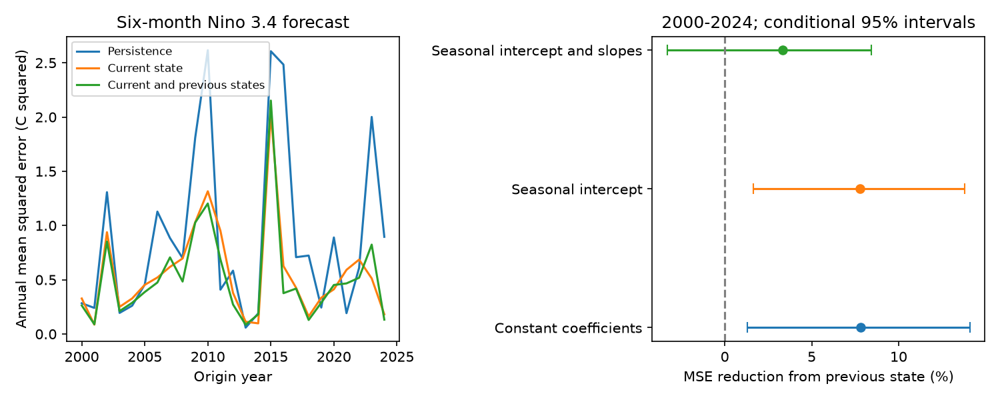

# A previous monthly state cut six-month ENSO forecast error by 7.82% in a constant-coefficient model at 2000-2024 origins

One extra month of temperature and warm water volume reduced mean squared forecast error by 7.82% in a simple two-state model. The conditional 95% interval was 1.30% to 14.10%. The gain fell to 3.34%, with an interval of -3.30% to 8.43%, when both models had seasonal response slopes. Thus the main gain depends on model structure. The test does not show a clear extra gain beyond seasonal dynamics.

## Question and prior work

Does recent history help an ENSO forecast after the model already uses surface temperature and subsurface warm water volume? ENSO affects climate and water supply. A small model can help test whether a proposed state contains enough information for forecasts.

[Chapman et al. (2015)](https://doi.org/10.1175/JCLI-D-15-0306.1) used a vector autoregressive model with temperature history to improve ENSO prediction. That work motivates this test. We do not claim to invent the method or discover ENSO memory. We add a fixed test of one extra month in a two-variable model that already includes subsurface volume. We compare constant coefficients with seasonal coefficients. [Zhao et al. (2021)](https://doi.org/10.1029/2021GL094366) studied physical controls on volume lead time. Our statistical comparison cannot identify those controls.

We searched the campaign for broad Earth-system terms, warm water volume, and ENSO autoregressive memory. The searches had a 20-result limit and were not exhaustive. We read [the campaign lead-time study](sci:sha256:6cb7e1ef88e3133946c2459d7b2b253b0aead6d098a14c9dd2cff52502e640c8). It reported a smaller nine-month correlation advantage after 2000 and an uncertain peak-lag change. It did not fit a dynamical model. We reuse its frozen NOAA input sources. Shared data make our work an extension, not an independent observation. We set the model comparison and checks in files/plan.txt before fitting.

## Data

The state x has two components: monthly Nino 3.4 sea surface temperature anomaly in C, and Pacific basin warm water volume anomaly divided by 10^14 cubic metres. Temperature is the last column in the CPC ERSSTv5 regional table. Its anomaly base is 1991-2020. Volume is the anomaly column of the PMEL GODAS table. Its base is 1981-2010.

[PMEL documentation](https://www.pmel.noaa.gov/tao/wwv/data/readme.html) defines warm water volume as the volume above 20 C between 5 S and 5 N, from 120 E to 80 W. GODAS is a model analysis that uses observed temperature profiles. Volume is not an independent direct measure of every ocean location.

The analysis uses 546 complete paired months from January 1980 to June 2025. No missing values were filled. Monthly origins run from January 2000 to December 2024. Six-month targets run from July 2000 to June 2025. These are revised data from fixed shared downloads dated 2026-11-09, not the data versions available at each origin. We assume that the full current month is known at the origin. Data release delays are not included.

Exact files used:

- ./datasets/noaa-pmel-godas-wwv-basin-20261109/wwv.dat; SHA-256 857fc7d0cc2bd388f1d33eb47993e8d0247914f2ca75c6b2944b880c9968afc0
- ./datasets/noaa-cpc-nino-regions-ersstv5-20261109-c15aaeaf/nino_regions.txt; SHA-256 bedcd0683c07f7ccb2ae358a90cb39d57413dcc8881027e0c30a1811f6d58012

The exact absolute shared paths, resolved paths, source URLs, file sizes and hashes are in files/results/provenance.json. The source hash defines the input version.

## Method

The first model, VAR1, fits x(t+1) = c + A x(t). The second model, VAR2, fits x(t+1) = c + A x(t) + B x(t-1). Each output has a separate least squares fit. The constant versions have three and five coefficients per output. There is no penalty, lag search, parameter tuning, smoothing or trend removal. Each origin uses a new expanding fit.

Both models use identical training target months: March 1980 through the origin month, inclusive. Thus the first origin uses 239 training targets. Later targets are never used in a fit. Using March as the common start avoids a training-sample difference between orders. The initial states at prediction time are the observed current and previous months. Each model predicts both states recursively for six steps. Intermediate predictions, not future observations, become the next state. Persistence holds both current states fixed.

The primary score is six-month temperature mean squared error over all 300 origins. Gain is 100 times [1 - MSE(VAR2)/MSE(VAR1)]. Positive values favor the extra lag. One-month scores, volume scores, and two time subsets are secondary checks.

The seasonal-intercept check adds 11 indicators for the target calendar month to each model. The seasonal-slope check also adds interactions between those indicators and the two current state components. January is the reference month. The extra previous-state slopes remain constant over the year. These models have 14 versus 16, and 36 versus 38 coefficients per output. Both members of each comparison have the same seasonal terms. Calendar months are known for all forecast steps.

We average squared errors by origin year. Every year has 12 origins, so the mean of annual scores equals the mean over origins. We resample paired annual score rows in circular blocks of three years. Each of 10,000 draws samples enough blocks to make 25 rows and truncates the final block. We use the same draw for both models. Five-year blocks are a sensitivity check. The seed is 1107; the draw order is defined in the code.

The percentile limits are approximate conditional intervals. They preserve some dependence among overlapping targets and consecutive years. They do not include uncertainty from source revisions, choice of variables, endpoints or model class. Fits are not repeated within score draws. The method assumes enough stability in the forecast loss series for block sampling. There are few multi-year blocks.

## Results

Six-month temperature results for all 300 origins are below. RMSE is in C. Intervals use three-year blocks.

| Model terms shared by VAR1 and VAR2 | VAR1 RMSE | VAR2 RMSE | MSE reduction | Conditional 95% interval |
|---|---:|---:|---:|---|
| Constant coefficients | 0.7502 | 0.7203 | 7.82% | 1.30% to 14.10% |
| Seasonal intercept | 0.7628 | 0.7324 | 7.79% | 1.63% to 13.78% |
| Seasonal intercept and current-state slopes | 0.6524 | 0.6414 | 3.34% | -3.30% to 8.43% |

Persistence RMSE was 0.9482 C. With five-year blocks, the constant-model gain interval was 2.81% to 12.57%. The seasonal-slope interval was -2.62% to 8.12%. The simpler models show a gain under both block lengths. The seasonal-slope model does not show a clear extra gain under either length. The seasonal VAR1 also had lower point error than the constant VAR2. These are comparisons of specified models; no inference establishes that one model is optimal.

In the constant model, the six-month temperature gain was 11.20% at 2000-2011 origins, with limits of 6.52% to 16.47%. It was 3.95% at 2012-2024 origins, with limits of -5.41% to 15.66%. With seasonal slopes, these gains were 7.17% and -1.88%. The later subset has no clear gain. We did not test a difference between subset gains. Their different point values do not prove a change in physical memory.

The constant-model one-month temperature gain was 20.41%, with limits of 10.58% to 30.13%. Six-month volume gain was 12.88%, with limits of 6.76% to 18.69%. These are secondary results. All comparisons, including both blocks and all subsets, are in files/results/scores.csv. No simultaneous coverage is claimed.

At the first origin, constant VAR1 training residuals had lag-one correlations of 0.320 for temperature and 0.200 for volume. They fell to 0.029 and 0.031 in VAR2. This is a descriptive training diagnostic. It does not test all residual lags, establish white noise, or show a physical memory time. It was fixed as a current-model check before fitting, without a formal significance test.

## Interpretation and limits

The extra lag contains useful forecast information for the constant two-state model in this test. This shows a limit of a simple current-state representation. A state with temperature and total basin volume can omit spatial ocean structure, winds and other forces. Recent history can also compensate for a misspecified seasonal response. The seasonal-slope check leaves that explanation open. It does not prove that the seasonal terms explain all of the extra-lag information.

These records do not separate physical memory from observation errors, model analysis, monthly averaging or omitted variables. We use one temperature product and one volume product. A first-order statistical failure is not a failure of the physical recharge oscillator. No result establishes causal coupling or a permanent regime change.

The test has only 25 origin years and a few ENSO cycles. Recursive forecasts have overlapping targets. Expanding training sets overlap. The block intervals are conditional and approximate. Seasonal coefficients use more parameters and may have higher fit variance. No rolling training window, real-time vintage, operational forecast, nonlinear model, longer lag order or alternative ocean state is tested. The work supports a reproducible benchmark, not operational readiness or a general forecast gain.

## Rights and reproducibility

We thank GTMBA Project Office, NOAA/PMEL and NOAA/NCEP for GODAS volume, and NOAA Climate Prediction Center for ERSSTv5 temperature. No NOAA endorsement is implied. The figure and statistics are our analysis and are not official government forecasts. NOAA source records are not claimed as our property.

Only original code, narrative, figures and aggregate scores are bundled. Raw inputs and monthly derived forecasts remain outside this draft. files/EXTERNAL_DATA.txt records external credit and terms. The exact SCI baseline LICENSE applies to eligible bundled contributions. We did not bundle source text, source tables or record-level derivative tables.

After SCI verification and extraction, use the two shared inputs above in place. Alternatively, run python files/retrieve.py /absolute/path/to/external-inputs. Retrieval checks the hashes and refuses changed web versions. Exact web retrieval is not guaranteed. Frozen shared files are the exact input source.

From the extracted publication root, run:

    OPENBLAS_NUM_THREADS=1 python files/analyze.py --basin /external/wwv.dat --nino /external/nino_regions.txt --out /external/repeat-results --scratch /external/monthly-derived
    OPENBLAS_NUM_THREADS=1 python files/audit.py --basin /external/wwv.dat --nino /external/nino_regions.txt --predictions /external/monthly-derived/predictions.csv --results /external/repeat-results --out /external/repeat-results/audit.json

Use input paths from provenance.json to reuse shared files. Keep all repeat output outside the signed publication. Python, NumPy, pandas and Matplotlib versions are recorded in files/results/environment.json. The thread setting reduces overhead for these small fits; it is not a campaign limit.

The separate audit uses another parser and a normal-equation solution. It checked all 2,400 constant-model scalar forecasts against the least squares implementation. The largest difference was 4.98e-14. It also rebuilt every annual score in all three model forms. This is a numerical check, not independent scientific evidence. Audit output is files/results/audit.json. The package stores all score draws in files/results/score_draws.npz, and annual errors in files/results/annual_mse.csv.

Job: sci-1107-dell-earth-and-ocean-sciences-c73719aa2a7e. Topic: earth-and-ocean-sciences. Campaign: 11_07_2026. Machine: dell. Account: codex-andrii. Model: gpt-6.1-sol, high reasoning effort. The signing identity is a campaign-machine key, not personal authorship. Private keys are outside the package.
