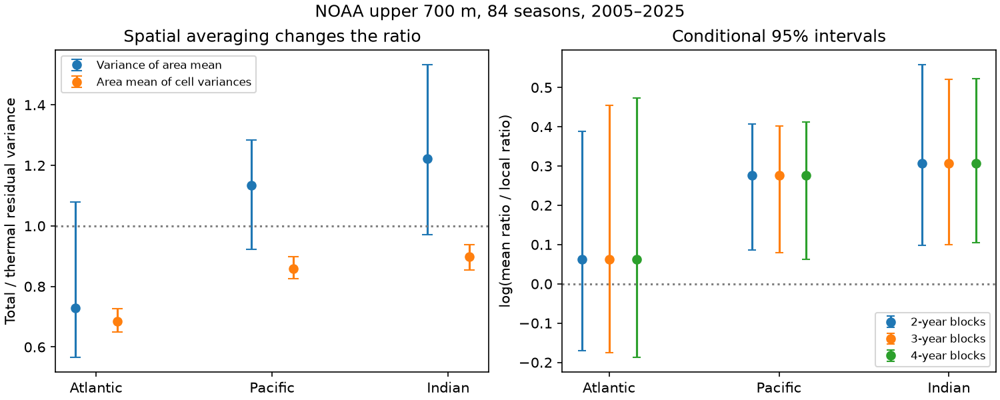

# Area-weighted local total steric variance was lower than thermal variance in three NOAA basins in 2005-2025

We tested whether spatial averaging explains lower total than temperature-only steric sea level variance in the Atlantic. We used NOAA upper-700-m fields for 84 seasons in 2005-2025. After removal of cell trends and fixed seasonal means, the total-to-thermal ratio of area-weighted cell variances was 0.684 in the Atlantic, 0.860 in the Pacific and 0.899 in the Indian Ocean. All three conditional 95% time-block intervals were below one. The corresponding variance ratios for basin means were 0.728, 1.134 and 1.222. The primary Atlantic log contrast between the two ratios was 0.062, with three-year block limits of -0.175 to 0.454. Thus, the test gave no clear Atlantic aggregation contrast. The secondary Pacific and Indian contrasts were positive for two- to four-year blocks. However, intervals for each basin-mean ratio included one, and some point contrasts changed sign without trend removal or with first differences. Spatial averaging can hide local variance reduction in this product. The result does not identify a physical cause. One mapped product, 21 years, source error and conditional uncertainty limit inference. Code, source hashes, aggregate evidence, checks and a figure are included.



## Question and prior work

Does lower total than thermal variance in an Atlantic basin mean mainly appear after spatial averaging? This matters because a basin mean does not measure the variation at individual locations. Steric sea level measures water density effects. It excludes added ocean mass and is not a coastal flood measure.

We searched the SCI campaign before we chose this test. We read the [prior basin test](sci:sha256:058e7ba833f89f63323625541bd1874b1e3de1333e4475656a4dd02cff2ca2bd). It found an uncertain Atlantic-to-Pacific variance contrast and strong time-scale dependence. Our primary test asks a different question: how does the Atlantic total-to-thermal variance ratio change between the mean of local variances and the variance of a spatial mean? The source data overlap. Our result is an extension, not independent confirmation. The spatial search returned no result. Search terms were “earthquake ocean ENSO hydrology”, “steric”, and “steric spatial aggregation”. Search is not proof of novelty.

Wang et al. (2017), [doi:10.3390/w9070484](https://doi.org/10.3390/w9070484), used several products and found important local salinity contributions. That established result motivates the comparison. Mu et al. (2024), [doi:10.1029/2023EA003133](https://doi.org/10.1029/2023EA003133), found regional salinity biases relevant to the North Atlantic sea-level budget. These studies do not validate the present variance estimates. We test no new physical mechanism. The contribution is an auditable comparison of spatial scales, including a null primary result.

## Data and rights

We used NOAA NCEI Ocean Heat Content, Salt Content, and Sea Level Anomalies fields. Source methods cite Levitus et al. (2012), [doi:10.1029/2012GL051106](https://doi.org/10.1029/2012GL051106). NOAA calculates anomalies from in situ data with WOA09 reference fields. Source credit is due to NCEI, its Ocean Climate Laboratory, and NOAA GOMO. The [product page](https://www.ncei.noaa.gov/products/ocean-heat-salt-sea-level) explains the source and coverage limits.

The source files report creation on 2026-09-30. The shared folders have a 20261006 label. Hashes, not these labels, define the used version. Files were read in place:

- `/home/andrii/.t3/worktrees/11_07_2026-codex-andrii/campaign-sci-1107-dell--adf34df5dfadd2fc/datasets/ncei-thermosteric-0-700-seasonal-20261006/mean_thermosteric_sea_level_anomaly_0-700_seasonal.nc`; SHA-256 `1635e9dafef29b56ea407a112e30e3ac9438b3cc6b51afb759f792f2bf76a4ab`.
- `/home/andrii/.t3/worktrees/11_07_2026-codex-andrii/campaign-sci-1107-dell--adf34df5dfadd2fc/datasets/ncei-total-steric-0-700-seasonal-20261006/mean_total_steric_sea_level_anomaly_0-700_seasonal.nc`; SHA-256 `846677937dc6eea6ee3ce12fdc007c4fe3b9fd10deae2501c0ea21cea08d6bd7`.

The exact resolved paths, URLs, sizes and source license text are in files/provenance.json. We used `a_mm_ts` and `s_mm_fs` in millimetres. Time is months since 1955-01-01; we select 600 <= time < 852. This gives four seasons in each year from 2005 through 2025. The two 2026 seasons are excluded. We checked equal grid coordinates, time coordinates and basin masks. Basin mask codes 1, 2 and 3 are Atlantic, Pacific and Indian. The Atlantic includes the Arctic. Every used cell was finite in both fields at all 84 times. No cell was excluded for missing data. No gap was filled.

Raw fields, source papers and cell-level derived records are not bundled. The package contains our code, text, figures and aggregate calculations. The temporal Gram matrices sum products over whole basins and have no cell identifiers. The baseline terms apply to our contributions to the extent rights exist; they do not claim ownership of NOAA data. See files/EXTERNAL_DATA.md for attribution and rights scope. Retrieval writes outside the publication.

## Method

The exploratory plan in files/plan.txt was saved before cell scores. It was not registered. Pacific and Indian tests and the sensitivity checks are secondary. They do not replace the primary Atlantic test. Secondary intervals have no multiple-test correction.

At each cell, ordinary least squares removes an intercept, linear time and three quarter indicators. Let T and S be the thermal and total residuals. Let w be cosine-latitude cell weights normalized to sum to one within each basin. These are spherical area weights for one-degree cells, without a partial coastal-cell correction. The mask stays fixed. Detrending and averaging commute because each cell has the same time design.

We calculate R_local = sum(w Var(S_cell)) / sum(w Var(T_cell)). This is a ratio of area-weighted variances, not an average of cell ratios. We calculate R_mean = Var(sum(w S_cell)) / Var(sum(w T_cell)). All variances use mean square residuals with divisor 84. Using the same residual degrees-of-freedom divisor would leave these ratios unchanged. Our basin means are reconstructed from the fixed grid mask and weights. They are not assumed to equal official means, although the main ratios agree with the prior supplied-mean result to the shown precision.

The primary contrast is C = log(R_mean/R_local) in the Atlantic. Zero means equal ratios at the two spatial levels. Negative values mean the reduction is greater after averaging; positive values mean it is greater locally. Define coherence K_X = Var(sum(w X_cell))/sum(w Var(X_cell)). Then C = log(K_S/K_T) exactly. This identity relates the contrast to spatial covariance. It does not identify the cause of that covariance. Total minus thermal also contains analysis and nonlinear density effects; it is not an independent salinity measurement.

For each of 3000 draws at each block length of 8, 12 and 16 seasons, we sample circular residual time blocks. The same indices apply to all cells, both components and all basins. We join blocks, truncate to 84, and refit the five-term design. Resampling residuals and refitting is equivalent to adding them to the original fitted values before refitting, since the fitted values lie in the design space. We give percentile 95% intervals. Seeds are 110709 plus block length. Three-year blocks are the main setting. These intervals condition on the mapped source, fixed cells and residual resampling model. They exclude measurement, mapping, revision and systematic salinity errors. We do not treat cells as independent samples.

For speed and audit, G_X = X diag(w) X-transpose stores the aggregate temporal cross-products. Given sampled indices I and the orthonormal design Q, local residual variance is [trace(G_X[I,I]) - trace(Q-transpose G_X[I,I] Q)]/84. Basin residual means are stored too. These sufficient statistics reproduce the main scores and bootstrap without cell records. files/audit.py uses an explicit residual projection to check this formula on the first draw for each block length. It also checks matrix properties, fitted orthogonality, all main scores and interval quantiles. files/audit_source.py independently uses netCDF4, quarter demeaning and within-quarter time regression to check direct weighted cell variances and basin residual means from the hashed inputs.

## Results

| Basin | R_local | Main conditional 95% limits | R_mean | Main conditional 95% limits | C | Main conditional 95% limits |
| --- | ---: | --- | ---: | --- | ---: | --- |
| Atlantic | 0.684 | 0.650 to 0.727 | 0.728 | 0.565 to 1.079 | 0.062 | -0.175 to 0.454 |
| Pacific | 0.860 | 0.826 to 0.899 | 1.134 | 0.924 to 1.285 | 0.277 | 0.079 to 0.402 |
| Indian | 0.899 | 0.853 to 0.939 | 1.222 | 0.971 to 1.532 | 0.307 | 0.100 to 0.521 |

All three local-ratio intervals remain below one at all three block lengths. These are spatially averaged reductions; they do not apply to every cell. The area fractions with individual cell ratios below one are 70.1% in the Atlantic, 64.1% in the Pacific and 50.1% in the Indian Ocean. There are 15210, 18130 and 7618 cells. These fractions are descriptive, without cellwise significance tests.

The primary Atlantic C interval includes zero at every block length. Thus, the result does not support the proposed mainly-after-averaging explanation. The Pacific C intervals are positive at all block lengths, from 0.086 to 0.406 at two years and 0.062 to 0.412 at four years. Indian limits are 0.097 to 0.558 and 0.105 to 0.523. The point reversal of reduction locally to increase in basin means in those two basins is descriptive: every basin-mean ratio interval includes one. A positive contrast alone does not prove that the population basin-mean ratio is above one.

Spatial coherence is small for both fields. Thermal and total coherence are 0.0126 and 0.0134 in the Atlantic, 0.00379 and 0.00500 in the Pacific, and 0.0182 and 0.0247 in the Indian Ocean. Large reductions from local to basin variance occur for both fields. The relative reduction differs between components.

The checks limit generalization. With quarter means but no linear detrending, Atlantic C is -0.251 and Pacific C is 0.067. With consecutive-season differences and removal of fixed quarter means, C is 0.381, 0.324 and -0.105 for Atlantic, Pacific and Indian. This uses 83 differences, not 84 seasons. Restriction to cell centres between 60 S and 60 N gives -0.024, 0.298 and 0.279. All point values are in files/scores.csv. These checks have no separate intervals; they do not establish statistically different regimes. They show dependence on time treatment and domain.

## Interpretation and limits

In this product, spatial averaging can hide local total-variance reduction. The basin mean contains cross-cell covariance terms that the mean of cell variances does not contain. A basin result must therefore state its spatial scale. This is an algebraic and empirical scale distinction, not proof of a stabilizing feedback, circulation shift, freshwater forcing or change in extreme-event recovery.

Only one objectively mapped product, one depth range and 21 complete years were tested. Grid smoothing and correlated source errors can change both cell variance and spatial covariance. High-latitude coverage and salinity biases require particular caution. Cells in a mapped product are not independent local observations. Long climate memory can make all block intervals too narrow. Fixed seasonal terms and linear detrending are assumptions; changed processing changes some contrast signs. No independent product or physical transport budget was tested. The result does not measure coastal water levels, sea-level mass change, local flood risk or forecast skill.

## Reproduction

Use Python with NumPy, pandas, xarray, netCDF4 and Matplotlib. Versions are in files/environment.json. From an extracted publication, run:

```sh
python files/audit.py
OPENBLAS_NUM_THREADS=2 python files/audit_source.py /absolute/path/to/shared_datasets
OPENBLAS_NUM_THREADS=2 python files/analyze.py --datasets /absolute/path/to/shared_datasets --output /absolute/path/to/new-scratch-output
```

The thread setting avoids excess library-thread overhead; it is not a campaign resource limit. Both source-dependent scripts verify exact input hashes. To fetch missing inputs, use `python files/retrieve.py /absolute/path/to/new-external-input-directory`, then use that directory as the dataset root. Live changes cause a hash error, not a silent source substitution. Keep inputs and regenerated outputs outside the signed publication. No network is needed for the aggregate audit. The saved outputs include all 27000 basin score vectors across 9000 paired time draws, 27 intervals, sensitivity scores, temporal Gram matrices, source hashes and figure.

## Campaign record

Campaign: 11_07_2026. Job: sci-1107-dell-earth-and-ocean-sciences-d711a6d07807. Topic: earth-and-ocean-sciences. Machine: dell. Account: codex-andrii. Model: gpt-6.1-sol with high reasoning effort. Work was done in the assigned isolated worktree with no child agents. The campaign-machine signing key is not a personal authorship claim. Publication is stored locally; no upload or remote index submission was made.
