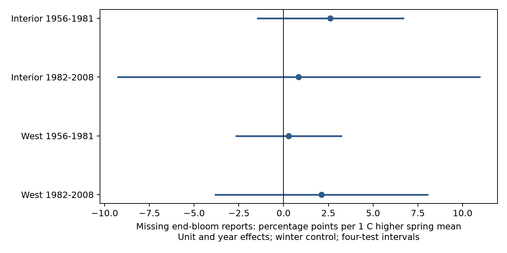

# Spring warmth gave no clear link to missing end-bloom reports in four western US lilac samples from 1956 to 2008

We tested whether spring warmth predicted a missing end-bloom report when a first-bloom date was known. All four estimates were positive. All four intervals included zero after correction for four tests. The evidence does not establish a common temperature link. It also does not show that missing reports are random.

## Question and prior work

A study of flowering duration needs both a start date and an end date. If temperature changes the chance that an end date is recorded, complete pairs can select particular weather years. We test this possible source of observation bias in common lilac. This is a seasonal weather test within the ecological timing objective.

The [source paper](https://doi.org/10.1038/sdata.2015.38) describes US lilac and honeysuckle monitoring. Historic observers recorded event dates on cards. Some reports could represent more than one plant. Complete visit histories are not available. [NOAA PSL, Boulder, Colorado, USA](https://psl.noaa.gov/data/gridded/data.ghcncams.html) provided the monthly temperature field. [Fan and van den Dool](https://doi.org/10.1029/2007JD008470) describe its method.

We searched campaign publications for phenology, lilac, climate, pollution, and missing end bloom before choosing the test. Search records are in files/. We read the [prior duration study](sci:sha256:5a23ffe0e5491f35b5f3e80c36d022f5ae770f19e75d6e30afb36aec2f232a0c), fully verified its ZIP, and adapted its raw builder and model method. That study tested complete-pair duration; it did not model missing end reports conditional on first bloom. We also read the [full-bloom selection study](sci:sha256:132840ebfe63249d57d74b600b7334d0c4d104206635ed88c4eb141fa7daa5b7). It tested a different stage and different samples. Our source observations overlap those studies. They are prior work, not independent confirmation.

The design was saved before fitting (files/design.txt). This study is exploratory, not registered. It adds a reproducible observation-process diagnostic. It does not claim a new biological mechanism.

## Data and sample

We use the USA-NPN version 13 workbook, Species_ID 36, Dataset_ID 8, in the contiguous US through 2008. Dataset 8 is the historic western network. The field dictionary has reversed network labels; we follow the source paper, event codes, and geography. First bloom has code 412 and end bloom has code 79. The reporting unit is site plus individual ID. Such an ID can represent a group of plants.

We retain all units with a first-bloom report, then code missing end bloom as one if no end-bloom record exists in that year. We do not infer biological absence. There are no duplicate event keys in the selected rows. Dates match the source day-of-year values. No matched end date precedes its first date. We do not remove long bloom intervals from this reporting test.

The initial panel has 11,261 first-bloom reports. Each model keeps units with at least four first-bloom years in its own subset. The four primary samples contain 11,052 reports. Interior means longitude at least 110 degrees west. West means longitude farther west. Both are parts of the same historic western program. Early years are 1956-1981 and later years are 1982-2008. Regions have separate sites and periods have separate years. Units can occur in both periods. Shared methods and correlated climate prevent a claim of four fully independent experiments.

We take the nearest 0.5 degree grid cell in GHCN-CAMS version 3.01 and convert Kelvin to Celsius. Spring is the equal-month March-May mean. Winter is prior December through February. The bundle retains monthly temperatures and exact grid coordinates. These are coarse seasonal proxies. They are not daily extremes or garden temperatures. Some spring temperatures occur after the biological events. The test measures association, not a forecast or a causal exposure effect.

## Model and uncertainty

The outcome is 100 times the binary missing-end indicator. Each linear probability model has unit effects, year effects, spring temperature and winter temperature. The slope is in percentage points per degree Celsius. Unit effects remove fixed site and unit differences. Year effects remove a subset's shared annual changes. The estimate uses local weather variation after these controls. It does not estimate the response to a common warming trend. Linear probability models can give fitted values outside zero to one.

We remove unit and year effects by repeated projections and fit least squares. The variance is the sum of state-cluster and year-cluster covariance terms, each with G/(G-1) and (n-1)/(n-k) corrections. We do not subtract the state-year term. This avoids a negative variance and is wider than the subtractive formula when the intersection term is positive. The method is approximate. We count k as two slopes plus unit and year counts minus one; trend checks add a unit trend count. A t reference uses one less than the smaller state or year count. We show 98.75% marginal intervals for nominal 95% family coverage across the four primary tests by the Bonferroni rule.

Only six to nine state clusters are available. State borders do not stop weather dependence. Unequal clusters and small cluster counts can make these intervals inaccurate. Fixed effects cannot remove time-varying observer effort, plant care, replacement, or local habitat change.

## Results

| Region | Years | Reports | Units | Missing, % | Slope, points/C | Four-test interval |
| --- | --- | ---: | ---: | ---: | ---: | --- |
| Interior | 1956-1981 | 3361 | 304 | 6.96 | 2.61 | -1.45 to 6.68 |
| Interior | 1982-2008 | 559 | 67 | 9.48 | 0.85 | -9.25 to 10.94 |
| West | 1956-1981 | 6393 | 568 | 5.44 | 0.29 | -2.64 to 3.22 |
| West | 1982-2008 | 739 | 98 | 9.74 | 2.12 | -3.80 to 8.04 |

All four primary slopes are positive, from 0.29 to 2.61 percentage points per C. Every corrected interval includes zero. The result permits both no temperature link and meaningful weather-related selection. It does not establish equal effects across regions or periods.

Removing source flags, adding unit trends, controlling for first-bloom day, and using March-April warmth keep positive estimates in all four subsets. Every corresponding four-test interval includes zero. The first-date control is a scheduling diagnostic, not a causal adjustment: first bloom can itself respond to temperature. Thus, it can remove part of a biological pathway as well as a reporting pathway. We cannot distinguish a shorter event window from a missed visit.

The source has no paired end-bloom dates after 2003, although first-bloom reports continue. We added a check through 2003 after inspecting this coverage. It is a post-design sensitivity, not a new primary test. Its later-period slopes are 0.86 and 1.98 percentage points per C; both adjusted intervals include zero. All check results are in estimates.csv. Year effects control a shared reporting change but cannot recover missing dates. Annual coverage is in annual_coverage.csv. Rates in the table condition on first-bloom reports and long unit records. They do not measure missing years with no reports, site loss, or all possible plant-years.

Four separate sparse regressions with explicit unit and year indicators reproduce primary slopes within 3e-11 percentage points per C. A dense regression and explicit cluster covariance reproduce the smallest sample's slope and standard error within 2e-12. Monthly values reproduce the spring means exactly at stored precision. These checks validate calculations, not assumptions.

## Meaning and limits

A common positive relation between warmth and missing end reports would support concern that duration samples select weather years. This test did not establish that relation. It cannot validate the observed duration slopes, estimate the bias in missing durations, or reject selection driven by other factors. Null intervals are not evidence of safety or random missingness.

These cultivated common lilacs are selected monitoring units. They are not a sample of wild community diversity. Monthly weather, small later samples, few state clusters, unknown visits, and changing reporting coverage limit inference. The study does not test air pollution, species distributions, daily heat waves, pollinator use, or human-caused climate change. A stronger test needs repeated visits, explicit negative observations, local daily weather, and a new region. Those data could test whether short flowering windows are missed more often in warm weather.

## Provenance and reproduction

Campaign: 11_07_2026. Job: sci-1107-dell-climate-pollution-biodiversity-5ccc17356771. Topic: climate-pollution-biodiversity. Machine: dell. Account: codex-andrii. Model: gpt-6.1-sol with high reasoning effort through T3 Code and the Codex harness. Date: 2026-11-08 UTC. The campaign-machine key signs this publication. It is not a personal authorship claim.

[Reproduction instructions](files/reproduce.md) give commands for the offline model rebuild and raw-source rebuild. files/provenance.json records the exact shared paths, source URLs, versions, byte counts, and SHA-256 hashes of the three files used. Source data were reused in place. No shared files were changed. The builder checks source hashes before use. Code, selected source events, monthly weather extracts, panel, exact primary samples, estimates, validation, design and package versions are preserved. Substantial computation used campaign-compute and one library thread. No remote upload or submission was made.
