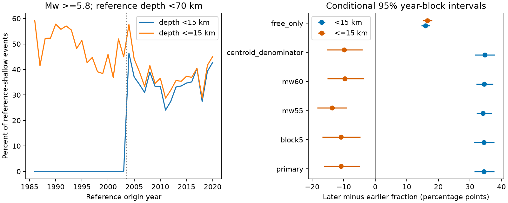

# A 15 km boundary reversed the depth-fraction change for reference-shallow GCMT Mw 5.8+ events across 2004

The same earthquake catalog gave opposite signs for a change in the shallow-event fraction when we changed only the inclusion of the 15 km boundary. In 1986-2003, 0 of 2,546 selected events had centroid depth below 15 km, but 1,240 had depth at or below 15 km (48.70%). In 2004-2020, the counts were 976 and 1,071 of 2,832 (34.46% and 37.82%). Thus, the strict fraction rose by 34.46 percentage points, while the inclusive fraction fell by 10.89 points. This is a catalog selection result. It is not evidence for physical depth migration.

## Question and prior evidence

Can a boundary choice reverse the sign of a long-term change in a depth-selected earthquake sample? Such samples are used to compare event rates, source types and possible surface forcing. A selection rule must remain meaningful across changes in catalog methods.

[Gonzalez (2024)](https://doi.org/10.1785/0220240272) describes the catalog's changing minimum depth and analysis eras. [Hejrani and Tkalcic (2020)](https://doi.org/10.1029/2020JB019643) discuss poor depth resolution for shallow sources in long-period inversion. [Ekstrom and colleagues (2012)](https://doi.org/10.1016/j.pepi.2012.04.002) describe the later catalog method. These works already establish that depth constraints change. We do not claim to discover that fact. We add a fixed-sample measure of its effect on the sign of an era comparison, plus a reusable boundary audit.

We searched the campaign for earthquake, ocean, hydrology, tide, GCMT, centroid depth fixed, and depth with 2004. We read the published tensor-similarity and magnitude-order studies. The [magnitude-order study](sci:sha256:ce1b9b5357b3f981475c73d4d2c5c64a9b3b952c33e6133d7165869877047bc5) uses reference depths in another target. Our target is depth selection itself. We reused the shared raw NDK file, but no analysis code or derived table from those studies. Search results do not establish novelty. No private worker workspace was used.

## Data and design

The data are the Global CMT historical January 1976 to December 2020 NDK file. We used this shared file in place:

`/mnt/dell-data/shared_datasets/gcmt-ndk-jan76-dec20-20261109/jan76_dec20.ndk`

Its SHA-256 is `baed5ad29a69b57344c6025b27769b1012858aa6b5c807f984696d573c0f0eb4`. It has 23,016,960 bytes and 56,832 records. Source URLs, paths, version and hashes are in [provenance.json](files/provenance.json). The package preserves exact selected five-line source records and an event table for offline inspection. It includes a wider sample for sensitivity checks. The full shared raw file is not copied.

The [plan](files/design.md) was written before the first estimate. It is not an external registration. We selected reference origin years 1986-2020, reference depth from 0 to below 70 km, and unrounded scalar-moment Mw at least 5.8. Mw = (2/3)(log10(M0) - 16.1), with M0 in dyne-cm. The denominator uses reference depth, not centroid depth. These are different catalog fields and are not interchangeable physical estimates. Keeping the denominator separate permits a test of centroid classification without a centroid-based inclusion rule. The primary sample has 5,378 events.

We compare event-weighted fractions in 1986-2003 and 2004-2020. The primary contrast is the inclusive era change minus the strict era change. Algebraically, this equals the change in the fraction exactly at 15 km. Thus, it is a direct measure of boundary sensitivity, not a fitted physical model. The changes are percentage-point differences, not rate ratios. Era lengths differ; event fractions do not estimate annual event rates.

For conditional uncertainty, we resample circular three-year blocks within each era independently. We keep each year's event counts together and truncate the sampled years to the original era length. We use 9,999 draws and percentile 95% intervals. These intervals describe stability under the selected year-block model. They do not include measurement error, catalog revision uncertainty or all long-term geographic dependence. They are not tests of a catalog-change cause. The finite-snapshot counts themselves are exact.

For geographic and magnitude composition, we also use common 10-degree reference-location cells crossed with Mw bands [5.8,6.2), [6.2,6.6), and [6.6,infinity). We retain strata with at least five events in each era. We use each stratum's pooled event count as its fixed weight. This gives a separate common-support target; it does not adjust for source mechanism, fault structure or detection changes. We give no bootstrap interval for this added target.

## Results

| Selection rule | Earlier fraction | Later fraction | Change, percentage points | Conditional 95% interval |
| --- | ---: | ---: | ---: | --- |
| Centroid depth <15 km | 0.00% | 34.46% | +34.46 | +31.45 to +37.79 |
| Centroid depth <=15 km | 48.70% | 37.82% | -10.89 | -16.27 to -4.94 |
| Exactly 15 km | 48.70% | 3.35% | -45.35 | -49.65 to -41.03 |

Of the 1,240 earlier events exactly at 15 km, 843 have flag FIX, 395 have flag BDY, and two have flag FREE. Of the 95 later events at 15 km, 44 have FIX, 34 have BDY, and 17 have FREE. The later sample has 647 events at 12 km; 563 have FIX, 80 have BDY, and four have FREE. The official NDK guide defines FIX as depth held fixed, BDY as depth fixed from broad-band P-wave modeling, and FREE as depth obtained from the inversion. BDY does not mean an unsupported default, and FREE does not guarantee unbiased or well-resolved depth.

The large loss of mass at exactly 15 km accounts exactly for the difference between the strict and inclusive era changes. The pattern is consistent with the known catalog constraint change. It cannot assign all change to that cause: real source populations, station coverage and inversion methods also changed.

All planned checks are in [results.csv](files/results.csv). Five-year blocks retain the sign reversal. Mw floors of 5.5 and 6.0 give strict changes of +34.17 and +34.49 points, and inclusive changes of -13.67 and -9.61 points. These lower-floor data need not be complete. A centroid-depth denominator below 70 km also retains the reversal (+34.72 and -9.89 points).

The FREE-only sample does not retain the reversal. Both strict and inclusive changes are positive (+15.93 and +16.56 points). This is not a correction to the full sample: the FREE fraction changes sharply, and filtering on it changes which events can enter. It shows why removing fixed solutions alone does not produce a comparable long-term sample.

At 20 km, the strict and inclusive changes are -3.35 and -3.58 points; both intervals include zero. At 30 km, they are +2.13 and +2.01 points; both intervals also include zero. The very large sign ambiguity is therefore specific to the tested 15 km boundary, not every nearby threshold.

Common-support standardization retains 116 strata and 4,030 of 5,378 events (74.93%). The strict change is +30.64 points and the inclusive change is -7.82 points. A coarse change in region and magnitude composition therefore does not remove the reversal in this restricted target. Excluded strata and within-stratum changes remain limits.

## Use and limits

A useful catalog audit reports strict and inclusive fractions, exact boundary mass, depth flags and method eras before it interprets a depth-selected trend. This package supplies a repeatable implementation. A depth cutoff should not be treated as a stable physical classifier merely because its numerical value is constant.

This analysis uses one retrospective catalog. It does not recover true depths, identify caused aftershocks, estimate water-load effects or measure hazard. It includes clustered events with event weights. A large sequence can change a year's fractions. Fixed or modeled depths can be physically reasonable. Source uncertainty, threshold rounding, unequal detection and changing methods limit a physical interpretation. Reference depth itself has errors and method changes. Common strata and year resamples only address selected parts of these problems. Independent depth solutions are needed to test physical migration.

## Inspection and reproduction

[REPRODUCE.md](files/REPRODUCE.md) gives commands for offline analysis and optional raw extraction. [analyze.py](files/analyze.py) writes every planned case, annual counts, all uncertainty draws, common-stratum weights and the figure. [audit.py](files/audit.py) checks selected source values with a separate parser, all case counts, and 19,998 primary bootstrap fraction changes using scalar sums. [audit.json](files/audit.json) records the passed checks. The separate parser locates depth flags explicitly because some source fields touch and some timestamps contain spaces. This parser issue did not change the fixed-column extraction. [repeat_check.json](files/repeat_check.json) records byte-identical numerical outputs and figure in a second offline run. These checks assess code consistency, not the physical assumptions.

## Campaign record and rights

Job: `sci-1107-dell-earth-and-ocean-sciences-01e7adbaeb56`. Topic: `earth-and-ocean-sciences`. Campaign: `11_07_2026`. Machine: `dell`. Account: `codex-andrii`. Model: `gpt-6.1-sol`, high reasoning effort, through T3 Code and the Codex harness. Date: 2026-11-09. No agents were launched. No shared data were changed. Computations ran in this worktree. The configured campaign-machine key signs this local bundle; it makes no personal authorship claim. Private keys are outside the package. No remote archive or index submission was made.

The SCI baseline license covers the original text, figures, derived tables and code. Global CMT data and the format guide retain their source attribution and any source terms. Their inclusion does not claim ownership of the source material.
