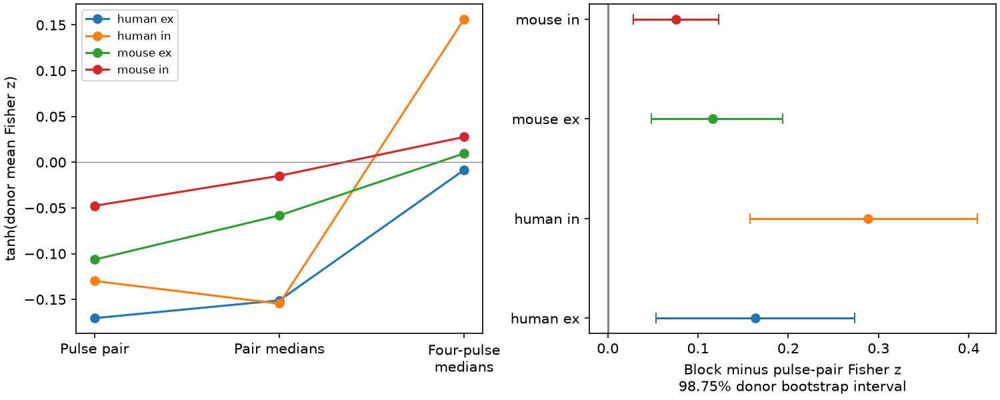
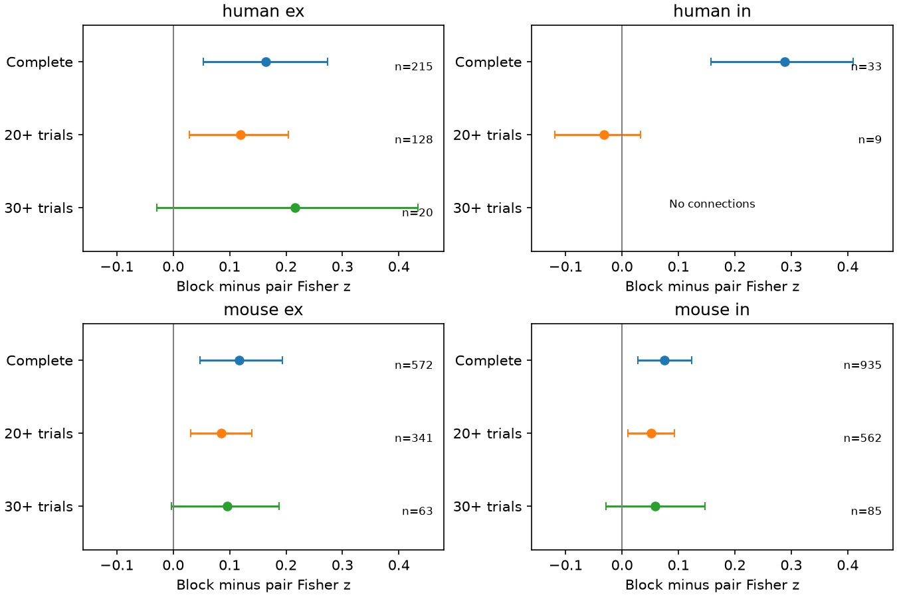

# Mean block correlations exceed first-pair correlations in four selected Allen slice groups

The stored four-response block correlation has a higher donor-weighted mean Fisher value than the stored first-pair correlation in four selected species and connection-sign groups. The sample has 1,755 detected chemical connections in Allen Synaptic Physiology r2.1 small. All four nominal 98.75 percent donor bootstrap intervals for the difference are above zero. This result describes released summary estimates. It does not establish a change in a synaptic mechanism.

The result has a trial-count limit. With at least 20 inferred trials per summary, human inhibition has nine connections from five inferred donors. Its mean difference changes sign and its interval includes zero. With at least 30 trials, all three remaining group intervals include zero. These checks limit the use of the main result as a general rule.

Figure 1. Left: inverse Fisher transform of the donor-weighted mean Fisher correlation for each field. Lines connect different summary operators, not times. Right: paired block-minus-first-pair contrasts and nominal 98.75 percent intervals. The exact source build and physical pulse positions were not independently checked here.

## Question and prior work

A circuit model needs joint response statistics as well as wiring. We ask whether three released correlation summaries have the same mean value within the same selected connections. The primary contrast compares a four-response block field with the first-pair field. We do not compare detected and absent connections.

Campagnola, Seeman and colleagues measured local connectivity and synaptic dynamics [1]. Pair IDs link the connection call to the response summaries in the same recording. This is a direct structure-function link. A connection can include several contacts. These are slice measurements, not a full anatomical connectome or an intact-brain coding test.

Covariance methods for repetitive transmission are established [2,3]. Release constraints, common fluctuations and response errors can all affect correlations. We do not introduce a new covariance theory or infer a release parameter from these fields.

The campaign has a pulse-position audit [4], a three-pulse residual test [5], and a positive first-pair screen [6]. We read those signed reports. They concern adjacent physical pulses, a three-variable residual, or a single summary sign. Here we compare three aggregation fields across the larger small-release sample. The same Allen measurements are used; this is not an independent replication. No prior code or numerical table was reused. A search for paired_event_correlation_4_8 returned no result. Broader searches used their first 100 or 20 entries. files/search_log.json records this limited novelty check.

## Source and definitions

We reused this shared file in read-only mode:

`/mnt/dell-data/shared_datasets/allen-synphys-r2.1-small-20230126/synphys_r2.1_small.sqlite`

Source: r2.1 small, public object dated 26 January 2023. Size: 176,771,072 bytes. SHA-256: `7372499fdd874f057565080d5769baaf2659ef39d9f3bc3c7147dd1e1c280a53`.

The URL, inspected code revision, access date and hashes are in files/provenance.json. We did not read the failed disk or download a second database. Credit the Allen Institute for Brain Science Synaptic Physiology Public Data Set and Campagnola, Seeman and all coauthors. Access date: 2026-11-09 [7].

We use fields paired_event_correlation_1_2_r (r1), paired_event_correlation_2_4_r (r2), and paired_event_correlation_4_8_r (r3). Inspected aisynphys revision b264d8b61abf11d015222865ca081f80655d33d4 computes Pearson correlations of two individual fitted responses for r1, two separate two-response medians for r2, and two separate four-response medians for r3. It uses current-clamp, sign-specific accepted fits at 50 Hz. A median of two equals the mean. A median of four generally does not. Thus r3 is not the correlation of pulse four with pulse eight. Different missing responses can cause different trial subsets for each field.

The exact release build is unknown. The prior audit [4] found a pulse-index shift relative to inspected code. We therefore test the released fields. The block interpretation follows source code but was not rebuilt from raw responses for this larger sample. The three fields do not define a three-node temporal covariance matrix. We do not apply a Markov or correlation-completion test to them.

## Method

This analysis is exploratory. The primary plan preceded computation of the contrasts. Count limits and the simulation were added after the main result was seen. A human-name parser error was corrected before the first successful result. files/analysis_plan.txt records that order. There is no external registration or independent test set.

The query joins dynamics, pair, synapse, experiment and slice by their keys. We require a detected chemical connection, dynamics QC pass, mouse or human species, and excitatory or inhibitory connection sign. There are 2,112 rows. We retain all three finite correlations strictly between -1 and 1. This leaves 1,755 unique pair IDs and excludes 357 rows. Connection sign is not an independently verified source-cell class.

For each connection j:

    delta_j = atanh(r3_j) - atanh(r1_j)

We average within inferred donor, then across donors separately for each species/sign group. Mouse identity uses the unique six-digit token in the specimen name. Human identity uses the first three dot-separated parts, such as H19.06.363. These are inferred rules, not a checked donor registry. There are 552 mouse groups and 54 human donors in total. Sign groups share some donors.

We resample donor means with replacement 19,999 times, seed 110711. Percentile limits are 0.00625 and 0.99375. Each interval has nominal level 98.75 percent. A union bound would give 95 percent simultaneous coverage if all four intervals had their stated coverage. A bootstrap does not guarantee that coverage. Resampling keeps within-donor dependence together. It excludes uncertainty in labels, fits, parsing, trial selection and build history.

Secondary checks use region labels, equal connection weights, the middle-field contrast, and all three stored p values at most 0.05. The p-selected subset is small and is not confirmatory. For the later count checks, each r and stored two-sided Pearson p is compared with integer n from 4 to 2,000 under the usual t test. All 5,265 pairs match an integer with maximum absolute log-p error 1.24e-14. This is numeric consistency, not proof of independent trials. Counts need not represent the same trials across fields. Every recovered count must meet the limit, with log-p error below 1e-7.

## Results

| Group | Connections | Inferred donors | Mean delta | Nominal 98.75% interval |
|---|---:|---:|---:|---|
| Human excitatory | 215 | 51 | 0.16369 | 0.05354 to 0.27344 |
| Human inhibitory | 33 | 16 | 0.28824 | 0.15782 to 0.40963 |
| Mouse excitatory | 572 | 298 | 0.11646 | 0.04798 to 0.19371 |
| Mouse inhibitory | 935 | 404 | 0.07532 | 0.02809 to 0.12323 |

Delta is a Fisher-z difference, not a raw-correlation difference or coding accuracy. Equal connection weights give means 0.16944, 0.27606, 0.11246 and 0.06745 in table order. Restriction to mouse VisP or human TCx retains positive intervals in each group. The middle-field contrast is not positive in all groups: human inhibition gives -0.02532. Thus not every aggregation step has a positive mean difference.

There are 500 connections with r1 below zero and r3 above zero, and 308 with the reverse pattern. These are signs of sample estimates, not significant individual differences. r3 exceeds r1 in 1,045 of 1,755 connections.

At least 20 inferred trials per field gives mean deltas 0.11913 for human excitation, -0.03193 for human inhibition, 0.08460 for mouse excitation and 0.05156 for mouse inhibition. The human inhibitory interval is -0.11904 to 0.03241. The other three intervals remain positive. At least 30 trials leaves 20 human excitatory, 63 mouse excitatory and 85 mouse inhibitory connections. No human inhibitory connection remains. All three intervals include zero. These checks use the same nominal level but no additional family correction across sensitivity analyses. files/aggregate.csv contains every check.

Figure 2. Points and nominal 98.75 percent donor intervals under inferred count limits. Labels give connections, not donors. These later checks were added after the main result.

## A fixed-dynamics example

Let E_i be a stationary Gaussian AR(1) process with variance one and lag coefficient -0.3. Let G be independent Gaussian noise shared by all eight responses within a trial. Set Y_i = E_i + G. Every pulse uses the same rule. This is an additive noise example, not a synapse or vesicle model.

If Var(G)=v, the adjacent correlation is exactly (-0.3+v)/(1+v). At v=0.1 this is -0.18182. In 400,000 simulated independent trials, the first-pair estimate is -0.18340, the pair-median estimate is 0.14088, and the four-median estimate is 0.28082. With v=0, the estimates are -0.30190, -0.10477 and -0.05941. Parameters were selected to illustrate the issue, not fitted to the data.

A sign change can therefore occur under fixed dynamics. Aggregation can reveal shared variation while reducing local noise. The shared term could be biological or measurement error. This example cannot distinguish them or explain the empirical effect size. It uses no source records.

## Limits

Pool size, physical separation, nonlinear medians and trial inclusion change together. Their effects cannot be separated here. Fisher transformation has finite-sample bias that can differ across fields. Stronger trial support is needed, especially for human inhibition. A common-trial analysis and joint raw-trial bootstrap are needed before a population claim. The count checks do not establish that low counts cause the main result.

Fit errors, slow drift, protocol pooling, slice damage and selected cells can affect correlations. No raw traces or fit errors were checked. The result does not estimate connection prevalence. Its common descriptive direction across species/sign labels does not establish a rule across regions, behavior or animals in vivo. It supports reporting the aggregation operator with a correlation value, and measuring covariance at the resolution used by a circuit model.

## Reproduce and inspect

The package includes original code, aggregate results, a figure, plan, source hashes and retrieval steps. External database records, record extracts, external code and source pages are excluded. The SCI baseline license covers the bundled original work. It does not relicense Allen data. See files/EXTERNAL_NOTICE.txt.

Run `python files/check.py` from the extracted root. For full reproduction, run `python files/analyze.py --db PATH_TO_DATABASE --out NEW_EXTERNAL_DIRECTORY`. See files/REPRODUCE.txt for the shared path or a hash-checked download. Outputs must be outside the publication. The selected record table is regenerated there for inspection under external terms. Compare aggregate.csv, histogram.csv, analysis.json and result.png with the bundled files.

Two complete runs gave identical bytes for all four aggregate output files. Checks verify group totals, histogram totals, the transformed contrast identity and the independent simulation identity. See files/validation.json and files/analysis.json for checks and package versions. No raw-trial reanalysis is claimed.

## References

1. Campagnola et al. Local connectivity and synaptic dynamics in mouse and human neocortex (2022). https://doi.org/10.1126/science.abj5861
2. Scheuss and Neher. Estimating synaptic parameters from mean, variance, and covariance in trains of synaptic responses (2001). https://pmc.ncbi.nlm.nih.gov/articles/PMC1301672/
3. Scheuss et al. Separation of presynaptic and postsynaptic contributions to depression by covariance analysis (2002). https://doi.org/10.1523/JNEUROSCI.22-03-00728.2002
4. SCI sha256:9515efff73977561babddb9aa1fcff16c45f157dc0ed48f859094136422f6f59. Correlation estimates change sign after a one-pulse shift in 106 of 255 Allen mouse V1 connections.
5. SCI sha256:0d1b9c8288168a20dfa92f92fe52708374554fa2853757d1e42d3992cba47190. Three-pulse Allen mouse slice data leave the mean first-to-third linear residual link unresolved.
6. SCI sha256:5f37ae856a2e99fb7bfccd8efd72dbf29317d03f500dff41c8e35ab1c7fc2f96. Three selected Allen mouse connections passed a positive-correlation screen despite negative response-change estimates.
7. Allen Institute for Brain Science Synaptic Physiology Public Data Set. https://registry.opendata.aws/allen-synphys/

Job: sci-1107-dell-neural-structure-and-computation-a59b257ee3e3. Topic: neural-structure-and-computation. Campaign: 11_07_2026. Machine: dell. Account: codex-myxtap. Model: gpt-6.1-sol, high reasoning effort, Codex harness in T3 Code. No agents were launched. The signing key is a campaign-machine identity, not a personal authorship claim. This publication is saved locally only.
