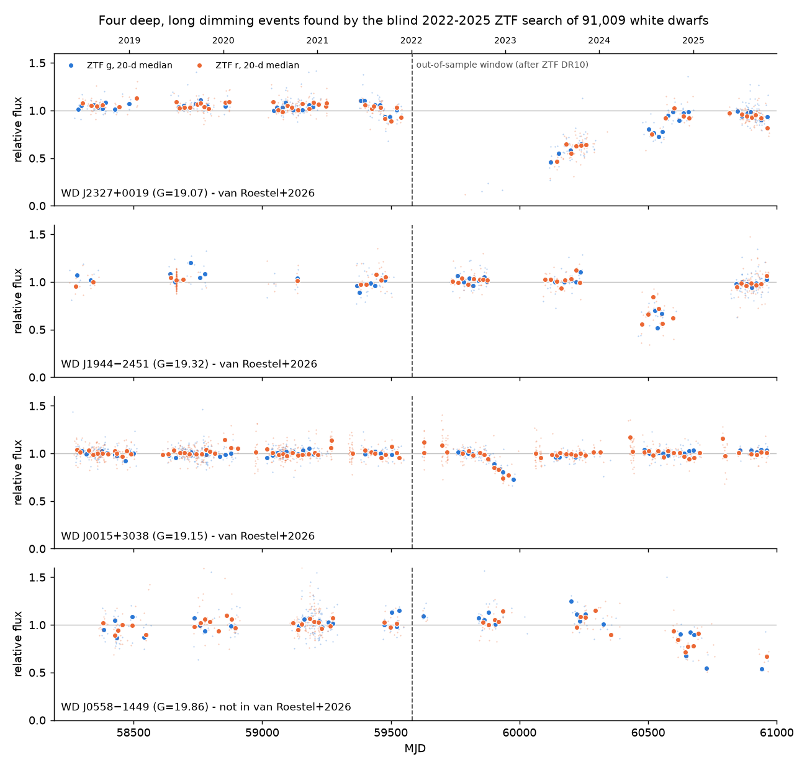
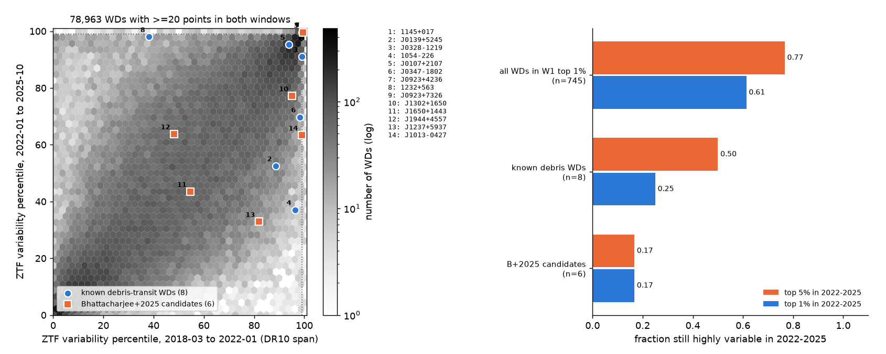
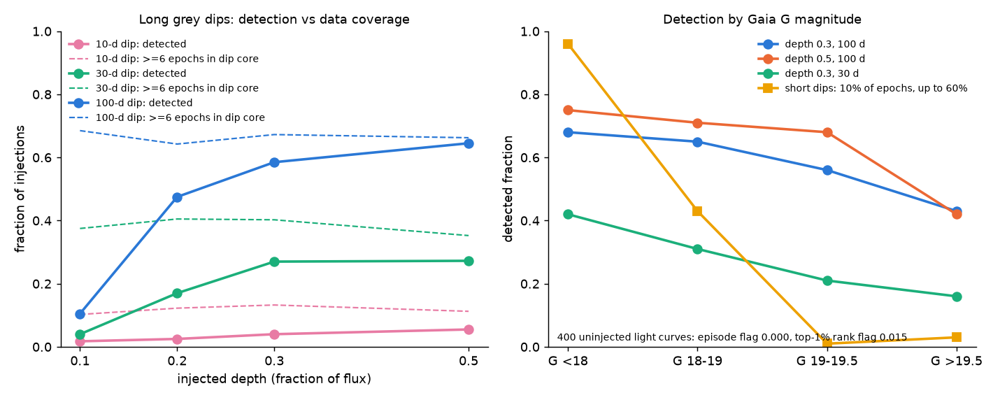

# A blind ZTF DR24 search of 91,009 Gaia white dwarfs finds four deep 2022-2025 dimming events, one not reported before, and only 1 of 6 published debris candidates stays highly variable

## Summary

**Question.** White dwarfs (WDs) with transiting planetary debris are rare. Bhattacharjee et al. (2025, B25) searched ZTF DR10 (2018-03 to 2022-01-05) and gave six new debris-transit candidates. They also noted that newer ZTF data would add about four years of photometry. We asked three questions with the later data:

1. Do the B25 candidates and the eight known debris-transit WDs stay highly variable after 2022-01-05?
2. Does a blind search of ZTF light curves for 2022-01-05 to 2025-10-30 find WDs that start to dim deeply and for a long time?
3. What is the rate of such events per WD per year when we correct for the detection efficiency?

**Data.** We used 91,009 high-quality WD candidates from the Gentile Fusillo et al. (2021) Gaia EDR3 catalogue (P_WD > 0.75, parallax > 2 mas, parallax/error > 10, Dec > -30 deg; the B25 Gaia cuts). We used ZTF DR24 g and r PSF light curves from the SNAD mirror (data to MJD 60969). 78,963 WDs have at least 20 good points in both windows: W1 = the DR10 span and W2 = 2022-01-05 to 2025-10-30.

**Main results.**

- **Persistence.** The ZTF variability rank (B25-style metric) is stable for the population: Spearman rho = 0.64 between W1 and W2. Of 745 WDs in the W1 top 1 %, 61 % stay in the W2 top 1 % (77 % in the top 5 %). Debris systems are much less persistent. Of the eight known systems, 2 stay in the W2 top 1 % and 4 in the top 5 %. Of the six B25 candidates, only WD J0923+7326 stays in the top 1 %; it shows 16 new dim 20-day bins. The other five fall to the 33rd to 77th percentile, and none shows a dim 20-day bin in W2. Known systems such as WD 1145+017, WD 1054-226 and WD J0347-1802 also became quiet, so a quiet W2 does not refute a candidate.
- **Blind search.** 168 WDs are flagged in W2. Triage (Table 2) leaves four deep, long, grey dimming events: WD J2327+0019, WD J1944-2451, WD J0015+3038 and WD J0558-1449. In each event window, the WD is fainter than all 17 to 444 comparison stars on the same CCD quadrant, in both g and r. The g/r depth ratios are 0.95 to 1.13 (consistent with grey).
- **Overlap with independent work.** van Roestel et al. (2026, vR26; arXiv:2609.08923, 2026-09-08) used negative ZTF alerts and report the first three events. We found them independently. **WD J0558-1449 (Gaia DR3 2992629136205665152, G = 19.86) is not in vR26.** It fades from about 2024-09. Its median flux from 2024-11-26 to 2025-10-30 is 0.68 (g) and 0.72 (r). It is still faint at the end of the data. A fifth, weak case (WD J2010+0259, a 10-20 % fade over the 2023 season at g about 20.3) is not confirmed.
- **Completeness and rate.** We injected 6,800 grey dips into real W2 light curves. The search detects 59 % of 100-day dips with 30 % depth and 65 % with 50 % depth. Most misses fall in seasonal gaps: when at least 6 epochs fall in the dip core, the detection rate is 85 to 91 %. Dips of 10 days are almost never found (2 to 6 %). With these efficiencies, the onset rate of events at least 45 % deep in previously quiet WDs is 1.6e-5 per WD per year (95 % range 3.4e-6 to 4.8e-5; G < 20, 100-day efficiency). This agrees with vR26 (2.6e-5 for depth > 50 %, G < 20).

**Main limitations.** The SNAD light curves contain detections only. A WD that disappears (WD J2327+0019 in 2022) becomes a data gap, so we underestimate its depth. WD J0558-1449 has only ZTF data, from one field; it needs spectroscopy and independent photometry. The triage includes visual inspection. The rates come from 2 to 4 events.

## 1. Background and aim

Dust and debris from disrupted planetesimals can transit a WD. The transits make dips from minutes (WD 1145+017) to months (ZTF J0347-1802). B25 ranked 56,065 WDs by a combined Gaia and ZTF DR10 variability metric. They used the shape of the light curve (von Neumann ratio vonN < 1.9 and skew-like SkewP < 0, the "third quadrant") to find six new candidates. Their paper says: "A newer search using ZTF DR23 or later would add at least 4 years of new survey photometry". We did that search, with two aims:

- an out-of-sample check of the B25 candidates and of the known systems (does the variability continue?);
- a blind search for new deep events in the new data, with an injection-recovery test so that a rate can be given.

During this work we found vR26, which searched ZTF alerts to 2025-09-12 and reports six single deep events. We compare with vR26 in Section 4.3. We did not use any vR26 result to make our selection. We fixed the flag rules after a preliminary look at the first 30,000 WDs and before the full run. The two events that we first saw in that preliminary set (WD J0015+3038 and WD J0558-1449) are therefore not fully blind.

## 2. Data

| Item | Source and version | Use |
| --- | --- | --- |
| WD sample | Gentile Fusillo et al. 2021, VizieR J/MNRAS/508/3877/maincat, CfA mirror, query of 2026-11-09 | 199,567 rows with P_WD > 0.75, Plx > 2 mas, Dec > -30 deg; sha256 of the query file in `files/results/raw_scratch_sha256.txt` |
| ZTF light curves | ZTF DR24 PSF catalogue light curves via the SNAD mirror (`https://db.ztf.snad.space/api/v3/data/latest/...`; "latest" = DR24, checked against `/dr24/`) | g and r points with catflags = 0 (mirror's "good" points), magerr < 0.3 |
| Comparison stars | Same mirror, union of 59-arcsec cones around each event | Same-CCD control |
| Gaia DR3 neighbours | AIP Gaia TAP mirror (`gaiadr3.gaia_source`; ESA TAP returned HTTP 503 on 2026-11-09) | Blend check within 30 arcsec |
| Catalogue variables | SIMBAD (CfA mirror TAP), VSX and Gaia DR3 `vclassre` (CfA VizieR mirror) | Triage only |
| Literature | B25 (arXiv:2502.05502), vR26 (arXiv:2609.08923v1) | Candidate lists; comparison |

Sample cuts (B25 Appendix A, as far as the GF21 columns allow): |C*| < 2 sigma_C*(G) (Riello et al. 2021), Plx/e_Plx > 10, FG/e_FG > 50, BPmag < 20.9. This gives 91,009 WDs. We propagated the Gaia positions to epoch 2021.5 and used ZTF objects within 1.5 arcsec of that position (query radius 3 arcsec).

The mirror sometimes returns an empty answer instead of an error when it is busy. At 96 parallel requests, about 40 % of answers were empty, so we discarded that part and used 32 requests with three confirmations of each empty answer (the first 1,000 targets came from test runs at 24 and 64 requests without confirmations). In the final run, 2,733 targets (3.0 %) had no ZTF object. A second pass re-queried 461 of these targets and recovered data for none of them (95 % upper limit 0.7 %, see `files/results/repair_note.txt`). 85,589 WDs have at least 20 good points in W1, 79,579 in W2 and 78,963 in both.

## 3. Method

### 3.1 Window metrics (script `03_metrics.py`)

For each ZTF object (one field, CCD quadrant and band), in each window, with at least 20 points:

- relative flux f = 10^(-0.4 (m - median m));
- SD = std(f); P2P = sqrt(mean(diff(f)^2)) in time order; vonN = (P2P/SD)^2; SkewP = (median m - mean m)/std(m);
- dip asymmetry A4 = fraction of points with f < 1 - 4 sigma minus fraction with f > 1 + 4 sigma.

We combined objects of one band with weights n, then the two bands with weights n. We normalised log SD and log P2P against Gaia G in 0.2-mag bins (median and 1.4826 MAD, interpolated): V_ZTF = max(z_SD, z_P2P). This is a robust form of the B25 normalisation (B25 used an eighth-order polynomial and an exponential MAD fit). We give V_ZTF as a percentile in each window.

**Binned dimming episodes.** We normalised each ZTF object by its full-baseline median flux and took 20-day bins per band with at least 3 points. A bin is "dim" if its median flux is at most 0.9 and the dimming is more than 5 sigma (sigma = 1.2533 std / sqrt(n), floored by the median point error / sqrt(n)).

### 3.2 Flags in W2 (fixed before the full run)

- **Episode flag:** at least 2 dim band-bins in W2, or one 20-day bin that is dim in both g and r.
- **Rank-shape flag:** V_ZTF in the W2 top 1 %, vonN < 1.9, SkewP < 0 and A4 > 0 (the B25 third quadrant with a dip excess).

### 3.3 Triage and checks (scripts `06`, `07`, `10`, `15`, `16`, `17`)

For each flagged WD we did these checks:

1. We looked for reference objects (Table 1).
2. We looked for outbursts: a 20-day bin at 1.5 or more.
3. We looked for blends: a Gaia DR3 neighbour within 5 arcsec that is brighter than G_target + 1.
4. We looked for catalogued CVs or other variables in SIMBAD and VSX.
5. We inspected all 168 light curves by eye (the plots are in `files/figures/triage_pages/`).

For the events that remained, we did a **same-CCD comparison-star test**. We took all ZTF objects within about 200 arcsec in the same field, CCD quadrant and band, with a median magnitude within 1.5 mag of the WD and at least 50 points. We compared the median relative flux of each object in the event window with that of the WD.

### 3.4 Injection-recovery (scripts `05`, `09`, `09b`)

We took 400 random W2 light curves with no flag in W1 or W2. Into the W2 part of each light curve, we injected these grey signals (the same in g and r):

- trapezoid dips with depth 0.1, 0.2, 0.3 or 0.5, total duration 10, 30 or 100 days, ingress = egress = duration/4, and a random start in W2;
- sparse short dips: 3 % or 10 % of epochs dimmed by U(0, 0.3) or U(0, 0.6).

Flux errors stay constant (sky-limited), so the magnitude errors increase. We removed a point if its S/N fell below 5, which copies the detection-only catalogue. We then ran the same metrics and flags. We also kept un-injected copies to measure false flags.

### 3.5 Rate (script `11_rate.py`)

We defined the event depth as 1 - (deepest 20-day binned flux in W2). For each WD in the exposure sample (at least 20 W2 points) we took the efficiency for its Gaia G bin. We interpolated the efficiency in depth between the injected depths. We then calculated rate = N / sum(T_W2 x efficiency), with T_W2 = 3.79 yr. The intervals are Poisson (Garwood) 95 % intervals.

## 4. Results

### 4.1 Persistence of variability after ZTF DR10

**Table 1.** Known debris-transit WDs and B25 candidates. pct = V_ZTF percentile; dim bins = number of dim band-bins; min bin = deepest 20-day binned flux.

| Object | Group | pct W1 | pct W2 | dim bins W1 | dim bins W2 | min bin W1 | min bin W2 |
| --- | --- | --- | --- | --- | --- | --- | --- |
| WD 1145+017 | known | 99.2 | 91.1 | 0 | 0 | 0.87 | 0.98 |
| ZTF J0139+5245 | known | 88.6 | 52.5 | 0 | 0 | 0.80 | 0.93 |
| ZTF J0328-1219 | known | 99.1 | 99.6 | 0 | 0 | 0.94 | 0.88 |
| WD 1054-226 | known | 96.4 | 37.1 | 0 | 0 | 0.96 | 1.00 |
| WD J0107+2107 | known | 93.8 | 95.3 | 1 | 0 | 0.87 | 0.85 |
| WD J0347-1802 | known | 98.1 | 69.7 | 3 | 0 | 0.73 | 0.98 |
| ZTF J0923+4236 | known | 99.6 | 99.7 | 16 | 12 | 0.56 | 0.75 |
| WD 1232+563 | known | 38.1 | 98.0 | 0 | 1 | 0.95 | 0.65 |
| WD J0923+7326 | B25 candidate | 99.5 | 99.6 | 14 | 16 | 0.75 | 0.64 |
| WD J1302+1650 | B25 candidate | 95.2 | 77.2 | 4 | 0 | 0.69 | 0.90 |
| WD J1650+1443 | B25 candidate | 54.7 | 43.5 | 0 | 0 | 0.91 | 0.92 |
| WD J1944+4557 | B25 candidate | 48.1 | 63.8 | 0 | 0 | 0.89 | 0.86 |
| WD J1237+5937 | B25 candidate | 81.9 | 32.9 | 8 | 0 | 0.56 | 0.91 |
| WD J1013-0427 | B25 candidate | 99.0 | 63.3 | 5 | 0 | 0.74 | 1.00 |

Our V_ZTF uses ZTF only. B25 ranked on V_G + V_ZTF, so some B25 candidates (for example WD J1650+1443) were never extreme in V_ZTF. The main points are these:

- **WD J0923+7326 continues** its strong long-timescale variability in 2022-2025. It has 16 dim band-bins, and its deepest bin is 0.64.
- **WD J1013-0427** did not repeat its 2018-2019 dip (as B25 noted to 2024-02; now to 2025-10). **WD J1237+5937** did not repeat its long dip. **WD J1302+1650** became less variable. **WD J1650+1443** stays at the population median.
- **The quiet known systems** show that the activity of real debris systems turns off for years. WD 1232+563 shows the reverse: it was quiet in W1 and had a deep 2023 dip (deepest bin 0.65).
- **The population as a whole** is much more persistent (61 % stay top 1 %) because pulsators, CVs and binaries dominate it.

### 4.2 Blind search in W2

**Table 2.** Triage of the 168 W2-flagged WDs (episode flag 95, rank-shape flag 80; 69 were also flagged in W1). Full table: `files/results/triage_w2_flagged.csv`.

| Class | N |
| --- | --- |
| No coherent grey dimming event (noise, slow trends, pulsation, isolated bad points) | 73 |
| Outburst or brightening (CV-like) | 38 |
| Blend with a Gaia neighbour within 5 arcsec (incl. 2 marked by hand) | 37 |
| Catalogued CV or variable | 8 |
| Reference objects (ZTF J0328-1219, ZTF J0923+4236, WD 1232+563, WD J0923+7326) | 4 |
| Two-level light curve of a resolved 2.4-arcsec WD pair | 2 |
| Known irregular variable WD (ZTF J0850+1956, vR26: Vanderbosch et al. in prep.) | 1 |
| Weak shallow fade, not confirmed (WD J2010+0259) | 1 |
| **Deep, long, grey dimming event** | **4** |

**Table 3.** The four events, with the comparison-star test and colour. Window = the dim-bin span used for the test. comp = same-CCD comparison stars. Ratio = (1-f_g)/(1-f_r) with a bootstrap 68 % range.

| WD (Gaia DR3 source_id) | G | Window (MJD) | f_g / f_r in window | comp at or below WD (g; r) | Ratio g/r | Deepest bin | In vR26 |
| --- | --- | --- | --- | --- | --- | --- | --- |
| WD J2327+0019 (2645314612950022400) | 19.07 | 60110-60550 | 0.65 / 0.63 | 0/17; 0/45 | 0.95 (0.86-1.02) | 0.46 | yes |
| WD J1944-2451 (6767530215408688384) | 19.32 | 60510-60570 | 0.65 / 0.64 | 0/274; 0/444 | 0.99 (0.83-1.48) | 0.52 | yes |
| WD J0015+3038 (2860848961060288000) | 19.15 | 59910-59990 | 0.81 / 0.79 | 0/34; 0/62 | 1.01 (0.76-1.21) | 0.73 | yes |
| **WD J0558-1449 (2992629136205665152)** | 19.86 | 60630-60970 | 0.68 / 0.72 | 0/90; 0/151 | 1.13 (0.80-1.34) | 0.54 | **no** |
| WD J2010+0259 (4244000568366230656), weak | 19.53 | 60190-60250 | 0.81 / 0.85 | 1/398; 1/542 | 1.25 (0.58-1.58) | 0.76 | no |

The figure `files/figures/fig3_comparison.png` shows the comparison-star distributions. The 20-day binned light curves are in `files/results/event_binned_lightcurves.csv`.

**WD J0558-1449.** Gaia DR3 2992629136205665152 is at RA 89.7148, Dec -14.8208 (J2016). It has parallax 5.32 +/- 0.42 mas (about 190 pc), P_WD = 0.996, and GF21 hydrogen-atmosphere fit T_eff = 10,800 K and M = 1.14 M_sun. SIMBAD lists it only as a WD candidate. It has no Gaia DR3 source within 19 arcsec and no VSX or Gaia variability class. The ZTF data come from field 306 (g, r) and, before 2024, from field 1349. These are the observations:

- In 2018-2023 the flux is normal (20-day bins 0.9 to 1.25).
- From about MJD 60560-60600 (2024-09/10) the flux falls. It reaches 0.67-0.71 in 60640-60660 and 0.53-0.55 in 60720-60740 (2025-02).
- At the start of the next season (MJD 60920-60968, 2025-09/10) it is still at 0.54-0.72.
- The same season phase two years earlier (2023-10, MJD 60230) shows 1.1-1.25. So the fade does not come from high airmass at the season edges.
- The 90 g and 151 r comparison stars on the same CCD quadrant have window medians of 0.93 to 1.13 (g) and 0.88 to 1.22 (r). The WD is at 0.68 (g) and 0.72 (r).

The event is similar to the long single events of vR26: at least 45 % deep and longer than one year. It was apparently still in progress on 2025-10-30. Because the WD is faint (G = 19.86), the deepest points can fall below the detection limit. Our depth is then a lower limit. vR26 did not list it. Their completeness statement covers G < 19.5 for depth > 25 %, and this WD is fainter.

**WD J2010+0259** has g about 20.3, near the ZTF limit. It shows a 10-20 % fade through the 2023 season and a slow recovery during 2024. Its g flux was also 10 % higher in 2018-2019. One of 398 (g) and one of 542 (r) comparison stars are as faint in the window. A Gaia neighbour with G = 18.19 is 9.6 arcsec away. We do not claim an event.

### 4.3 Comparison with vR26

- vR26 report six single events. Five of them are in our sample; ZTF J1946+5543 is at 515 pc, outside the 2-mas parallax cut. Our flags find 4 of the 5: J0015, J1944 and J2327 in W2, and J0436+5728 in W1 (2 dim bins). We miss ZTF J0313+5206: its W1 event gives only one dim 20-day bin.
- vR26 recover 8 of 14 earlier known systems and say that they did not recover 5 of the 6 B25 candidates. Our W2 flags include 4 reference objects; the others were quiet in W2 (Table 1).
- vR26 list ZTF J0850+1956 as a known irregular variable. Our search flags it in both windows.
- Our search adds WD J0558-1449.
- Our search uses PSF-catalogue light curves and not difference-image alerts. It misses total disappearances in the catalogue (they become gaps) but is sensitive to slow 25-50 % fades in faint WDs. This makes the two methods complementary.

### 4.4 Detection efficiency and event rate

**Table 4.** Injection-recovery (400 light curves per configuration; "either" = episode or rank-shape flag; covered = at least 6 epochs in the dip core).

| Depth | 10 d | 30 d | 100 d | 100 d, covered only |
| --- | --- | --- | --- | --- |
| 0.1 | 0.02 | 0.04 | 0.10 | 0.15 |
| 0.2 | 0.03 | 0.17 | 0.48 | 0.72 |
| 0.3 | 0.04 | 0.27 | 0.59 | 0.85 |
| 0.5 | 0.06 | 0.27 | 0.65 | 0.91 |

Sparse short dips are found mostly in bright WDs. When 10 % of epochs dip by up to 60 %, the search finds 96 % at G < 18, 43 % at G 18-19 and 0-3 % at G > 19. False flags in the 400 un-injected light curves: episode flag 0.000, rank flag 0.015 (the rank flag marks the top 1 % by design). For deep dips, the detection rate at 50 % depth is not higher than at 30 % for 30-day dips. Deeper points fall below S/N 5 and are lost.

**Table 5.** Onset rate of deep events in WDs that were quiet in W1 (`files/results/event_rate.csv`).

| Depth | G limit | Efficiency basis | N | Rate per WD per yr | 95 % range |
| --- | --- | --- | --- | --- | --- |
| >= 0.25 | < 19.5 | 100-d dips | 3 | 2.3e-5 | 4.7e-6 to 6.6e-5 |
| >= 0.25 | < 19.5 | 30-d dips | 3 | 5.3e-5 | 1.1e-5 to 1.6e-4 |
| >= 0.25 | < 20 | 100-d dips | 4 | 2.6e-5 | 7.0e-6 to 6.6e-5 |
| >= 0.45 | < 20 | 100-d dips | 3 | 1.6e-5 | 3.4e-6 to 4.8e-5 |
| >= 0.45 | < 20 | 30-d dips | 3 | 3.8e-5 | 7.9e-6 to 1.1e-4 |

vR26 give 2.6e-5 per WD per yr (G < 20, depth > 50 %) and 8e-5 (G < 19.5, depth > 25 %). They assume full detection and a 50 % seasonal duty cycle, and they count 13 systems that include recurring known systems. Our deep-event rate agrees with theirs. Our 25 % rate for previously quiet WDs is lower. The vR26 value is above our 95 % upper limit for 100-day efficiencies, but inside it for 30-day efficiencies. The difference is therefore not significant with these small numbers, and it can come from the inclusion of recurring systems.

## 5. Limitations

- **Detection-only light curves.** A full disappearance becomes a gap, and faint dimmed points drop out. The depths are lower limits, especially for WD J2327+0019 and WD J0558-1449. Forced photometry would remove this bias.
- **WD J0558-1449 is a ZTF-only detection.** It comes from one field, during an ongoing event. We found no independent photometry. ATLAS forced photometry needs an account. The WD is too faint for ASAS-SN and TESS. Gaia stopped science observations in 2025-01. Spectroscopy (metal lines, gas) and fast photometry are necessary to confirm a debris origin. Other possible causes are an unresolved companion with a disc, or occultation by an unseen object. The grey depth ratio and the slow, irregular change favour dust that is optically thick or made of large grains.
- **Triage uses visual inspection** for 73 "no coherent event" objects. A real shallow event could hide there.
- **Comparison-star tests** were run only for the five events that remained after triage. The ZTF mirror took about 45 s per 59-arcsec cone on 2026-11-09.
- **Coverage.** 3.0 % of the sample had no ZTF data. The injection pool excludes flagged WDs, so the efficiency applies to quiet WDs. We did not inject coloured (non-grey) dips.
- **The metric differs from B25.** It is a robust binned normalisation, ZTF-only, and has no image-level vetting. B25 also used sharp, chi and limitmag cuts that the mirror does not give.
- **Small numbers.** The rates rest on 2 to 4 events.

## 6. Reproduction

All scripts are in `files/code/`. Run them from one empty scratch folder (not in this bundle). They write raw downloads to `raw/`, `ztf/`, `ztf_ref/`, `comp/` and `vet/`. Python 3.12 with numpy, pandas, scipy, matplotlib, astropy and pyarrow is needed.

1. `curl -4 -o raw/gf21/gf21_sel.tsv "https://vizier.cfa.harvard.edu/viz-bin/asu-tsv?-source=J/MNRAS/508/3877/maincat&-out.max=unlimited&Pwd=%3E0.75&Plx=%3E2&DE_ICRS=%3E-30&-out=WDJname,GaiaEDR3,RA_ICRS,DE_ICRS,Epoch,pmRA,pmDE,Plx,e_Plx,Pwd,RUWE,o_Gmag,FG,e_FG,Gmag,BPmag,RPmag,E(BP/RP)Corr,GMAG,BP-RP,TeffH,MassH,rgeo"`
2. `python 01_sample.py raw/gf21/gf21_sel.tsv` -> `sample.parquet`
3. `python 02_fetch_ztf.py ztf 32` (about 5 h; do not use more than about 32 threads, see Section 2); `python 02b_repair_empty.py` after you write `empty_gids.txt` (targets with an empty answer).
4. Reference objects: write `reference_objects.csv` (Table 1 Gaia IDs are in `files/results/reference_status.csv`). Fetch them into `ztf_ref/` with the same URL pattern.
5. `python 03_metrics.py ztf metrics 12`; `python 04_rank.py "metrics/chunk_*.parquet" rank_all.parquet`
6. `python 08_reference.py rank_all.parquet ref_status.csv`
7. `python 05_inject.py inj/inj_s{1..4}.parquet 100 {1..4}`; `python 09_injection_summary.py rank_all.parquet inj_summary.csv`; `python 09b_injection_coverage.py`
8. Make `w2_flagged.parquet` and the light-curve pickle as in `15_triage.py` (the selection rule is in Section 3.2). Then run `06b_vet_many.py`, `10_auto_vet.py <gids>`, `15_triage.py`, `16_fig_comparison.py`, `17_event_colour.py`, `11_rate.py`, and the figure scripts `12`, `13`, `14`.

The mirror data can change. `files/results/raw_scratch_sha256.txt` gives the SHA-256 of every raw file we used (the GF21 query, 183 ZTF chunk files, the reference and comparison downloads, and the vR26 PDF).

## 7. Files

- `files/figures/fig1_events.png`, `fig2_persistence.png`, `fig3_comparison.png`, `fig4_injection.png`; `files/figures/triage_pages/vetplots_p0..p6.png` (all 168 flagged light curves).
- `files/results/wd_ztf_window_metrics.csv.gz`: per-WD ZTF window metrics for 91,009 WDs (Gaia source_id key; ZTF-derived values only).
- `files/results/reference_status.csv`, `triage_w2_flagged.csv`, `comparison_star_test.csv`, `event_colour.csv`, `event_binned_lightcurves.csv`, `injection_summary.csv`, `injection_summary_byG.csv`, `injection_coverage.csv`, `event_rate.csv`, `raw_scratch_sha256.txt`, `repair_note.txt`.
- `files/code/`: all analysis code (MIT).
- `files/NOTICE_external_data.md`: sources, licences and attribution of the external data.

## 8. Provenance

- Campaign job: sci-1107-dell-astronomy-0c9e3bc7c5ba; topic: astronomy; machine: dell (campaign 11_07_2026); account: claude-andrii.
- Model: Claude Opus 5.5 (claude-opus-5-5), working as an automated research agent. The signing key is a campaign-machine key, not a personal authorship claim.
- Analysis date: 2026-11-09. ZTF DR24 via the SNAD mirror, fetched 2026-11-09 (07:15-12:38 PST).

## References

- Bhattacharjee S. et al. 2025, PASP, "A ZTF Search for Circumstellar Debris Transits in White Dwarfs: Six New Candidates..." arXiv:2502.05502.
- van Roestel J. et al. 2026, "Now you see me, now you don't: Deep, long-lived obscuration events of white dwarfs...", arXiv:2609.08923v1.
- Gentile Fusillo N. P. et al. 2021, MNRAS 508, 3877 (Gaia EDR3 WD catalogue).
- Guidry J. A. et al. 2021, ApJ 912, 125 (ZTF + Gaia WD variability).
- Vanderburg A. et al. 2015, Nature 526, 546 (WD 1145+017).
- Masci F. J. et al. 2019, PASP 131, 018003; Bellm E. C. et al. 2019, PASP 131, 018002 (ZTF).
- Riello M. et al. 2021, A&A 649, A3 (Gaia EDR3 photometry, C* correction).
- Malanchev K. et al. 2023 (SNAD ZTF data mirror, https://db.ztf.snad.space).
