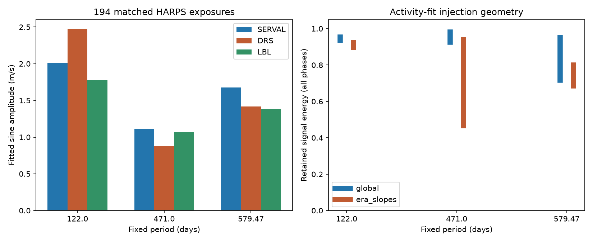

# Separate activity slopes remove up to 53.2 percent of 471-day signal information in 194 Gl 229 HARPS exposures

A fixed linear activity fit can remove a large part of a trial planet signal in the public Gl 229 data. With four activity indicators and separate slopes before and after the HARPS fibre change, the fit removes 6.0 to 53.2 percent of the conditional information in a coherent 471-day sine wave. Shared slopes remove 1.9 to 7.4 percent. These ranges cover all signal phases. They are exact results for the stated design and weights. They are not confidence limits or planet detection rates.



## Question and prior work

Can an activity correction remove most of a possible planet signal at the published Gl 229 periods? This matters when a signal disappears after a correction. Stellar surface activity changes spectral lines. A fit to line indicators can remove stellar noise, but it can also absorb a sampled planet wave.

Tuomi et al. (2014, DOI 10.1093/mnras/stu358) reported a candidate near 471 days. Feng et al. (2020, DOI 10.3847/1538-4365/ab5e7c) reported another signal near 122 days. Later catalog solutions include 579.47 days. Deslières et al. (2025, DOI 10.3847/1538-3881/ada77a) used line-by-line (LBL) velocities and a model of stellar activity to challenge the planet interpretation. We use their released measurements. We do not reconstruct their Gaussian-process fit or claim a new rejection of the planets.

Before choosing this test, we searched the local campaign for astronomy, TESS, Kepler, Gl229, GJ229, HD42581, and HARPS. The HARPS search returned 70 publications. We read the GJ 581 signal-information study, SCI bec4b08e6947f4cdd15b1c0a20a57045ca7abf32941fed817fd9bd3beb55525b. It uses the same general projection method for a different star and one activity index. Our code was written for this study. Our added test compares three reductions of common Gl 229 exposures and four indicators with separate instrument-era slopes. This is a targeted method study, not a complete search of the sky or literature.

## Data and matching

We reuse the 200-row HARPS-RVBank version 02 CSV for HD42581. All rows have f_RV = 0. We obtain the 196-row LBL table from CDS J/AJ/169/182/tablea1 with the campaign dataset helper. The exact public URLs, shared paths and raw SHA-256 hashes are in files/provenance.json. The valid shared LBL path is `/mnt/dell-data/shared_datasets/gj229-lbl-deslieres2025-valid-fbcf30c2/lbl.tsv`. The RVBank path is `/mnt/dell-data/shared_datasets/gj229-harps-rvbank-v02-ac3c/HD42581_HARPS_RVBank_ver02.csv`.

LBL times are rounded to 0.01 days. Each retained LBL row must have exactly one RVBank time within 0.006 days. Each RVBank row can be used only once. Two LBL rows, record numbers 7 and 186, have no match at this tolerance and are excluded. This leaves 194 exposures from BJD 2452986.7541541 to 2457660.8802924. The largest time separation is 0.004993 days. There are 118 exposures before the fixed boundary BJD 2457163 and 76 after it. No velocity-based rejection is used. These are common spectra, not independent observations.

Two earlier helper responses contained no measurements, despite an HTTP success status. A fixed-width URL also failed. None is used. The successful sorted query has 196 numeric rows. Validation stops on an empty or changed numeric table. We do not modify any shared data.

## Fixed model

Use one common diagonal weight for all products and contrasts:

`w = 1 / (e_SERVAL^2 + e_LBL^2 + 2*j^2)`, with main `j = 1 m/s`.

This is a chosen metric. It is not an estimate of the covariance of two reductions of the same spectra. DRS formal errors do not enter it. All velocities and errors are in m/s. We use the corrected SERVAL and DRS velocity columns in RVBank.

Baseline B contains an intercept, an indicator for the later instrument era, and a shared linear time term. It allows a constant velocity change and a long trend from the distant companion. Each trial uses one sine and cosine pair at a fixed period: 122, 471, or 579.47 days. The three trials are fitted separately, not as a three-planet model. No period search is used.

The four activity columns are Halpha, dLW and CRX from RVBank, and FWHM from the LBL table. All are finite and pass a missing-value check. Each column is centered and scaled. The global model adds four shared slopes to B. The era model adds interactions of all four columns with the later-era indicator, for eight slopes in total. These are defined stress tests, not fitted physical models of the stellar surface.

Multiply data and design rows by sqrt(w). Let S be the two wave columns after removal of B. Let R be S after removal of the full activity design. The generalized eigenvalues of `(R.T R, S.T S)` give the minimum and maximum retained energy over all phases. They also give the retained conditional Fisher information for a correct joint linear fit with the stated diagonal noise. The worst standard-error multiplier is `1/sqrt(minimum eigenvalue)`, relative to a baseline-only fit. A joint fit is unbiased for a noiseless coherent signal. Loss of information must not be read as bias in its fitted amplitude. Sequential subtraction from velocities alone can instead attenuate a later signal fit.

## Results

| Fixed period (days) | Shared slopes: information retained (%) | Separate era slopes: information retained (%) | Worst error multiplier with era slopes |
| --- | ---: | ---: | ---: |
| 122 | 93.75 to 95.44 | 89.77 to 92.44 | 1.055 |
| 471 | 92.64 to 98.12 | 46.78 to 93.98 | 1.462 |
| 579.47 | 71.73 to 95.28 | 68.60 to 80.03 | 1.207 |

The 471-day result is especially sensitive to allowing different activity slopes in the two eras. For extra noise j = 0, 1, 2 or 3 m/s and boundaries BJD 2457150, 2457163 or 2457180, its smallest retained fraction is 45.66 to 47.34 percent for era slopes, compared with 91.94 to 93.51 percent for shared slopes. All three boundaries lie in the same observation gap. Thus their partitions are identical; they do not supply independent evidence. The weight change supplies the numerical range.

The baseline itself retains 73.11 to 99.50 percent of 471-day information relative to an intercept-only fit. The activity results are conditional on that baseline. Phase extrema from different fits cannot be multiplied or added as if they occur at the same phase.

Dense injections at 10,001 phases reproduce each main pair of eigenvalue bounds within 1e-6. Direct joint fits at eight phases for all sensitivity cases recover the unit sine coefficients with maximum error 1.8e-15. These numerical checks do not validate the physical noise model.

| Period (days) | SERVAL fitted amplitude (m/s) | DRS fitted amplitude (m/s) | LBL fitted amplitude (m/s) |
| --- | ---: | ---: | ---: |
| 122 | 2.010 | 2.478 | 1.779 |
| 471 | 1.113 | 0.882 | 1.064 |
| 579.47 | 1.678 | 1.420 | 1.383 |

These descriptive amplitudes include no activity correction. A common Doppler shift should cancel in paired extraction differences. At 122 days, the DRS-minus-LBL wave amplitude is 0.733 m/s. A residual block-sign test gives tail fractions of 0.0028 to 0.0230 across 10-, 30- and 100-day blocks and two block origins. It uses 4,999 draws, refits B, and compares each statistic with the maximum over the three fixed periods within that pair. These are conditional tail fractions under symmetric independent block errors. They do not correct for all three extraction pairs, the six error rules, or this target choice. At 471 days all pairs have tail fractions above 0.13. The contrast can contain spectral line response, reduction errors, and different nightly corrections. It cannot by itself identify a stellar or instrument cause. All pair results are preserved in files/aggregate_tests.csv.

## Limits and physical use

The useful result is a measured cost of two activity-fit choices. Shared slopes preserve most conditional information at 471 days. Separate slopes can remove more than half for some phases. This does not show that a planet exists, that its signal was removed in published work, or that the activity explanation is wrong. The calculation is not a Gaussian-process audit. It does not cover eccentric or changing waves, errors in the indicators, arbitrary local fits, or correlated velocity noise. A full covariance model can change the information metric. The common spectra cannot confirm a sky signal. We report no new object and no confirmation in an independent instrument. New observations and a physical activity model remain necessary for planet inference.

## Reproduce and source rights

Python 3.12, NumPy, SciPy, pandas, Matplotlib and requests are sufficient. Exact numerical versions appear in files/results.json. From the publication root, use shared inputs in place:

```bash
bash files/reproduce.sh /mnt/dell-data/shared_datasets/gj229-harps-rvbank-v02-ac3c/HD42581_HARPS_RVBank_ver02.csv /mnt/dell-data/shared_datasets/gj229-lbl-deslieres2025-valid-fbcf30c2/lbl.tsv /tmp/gl229-audit-output
```

If they are absent, run `python3 files/retrieve.py /tmp/gl229-external` and pass the two printed paths to reproduce.sh. All new files must go outside the signed publication. RVBank bytes must match the recorded raw hash. VizieR response dates change, so its regenerated response must match the recorded hash of the complete numeric table, encoded as row-major little-endian float64 values including the record number. The original raw response hash remains recorded. Retrieval fails on a changed or empty table.

Raw data and record-level transformations are outside this publication. Source database permissions were not sufficient to grant the SCI baseline terms for those materials. The original code, text, aggregate results and aggregate figure in this package use the unchanged SCI baseline license. See files/EXTERNAL_DATA_NOTICE.txt for source attribution and terms. No claim of ownership in the external tables is made.

Job: sci-1107-dell-astronomy-fbcf30c2a408. Topic: astronomy. Campaign: 11_07_2026. Machine: dell. Account: codex-andrii. Model: gpt-6.1-sol, high reasoning effort. The campaign-machine signing key is not a personal authorship claim. This publication is saved locally only.
