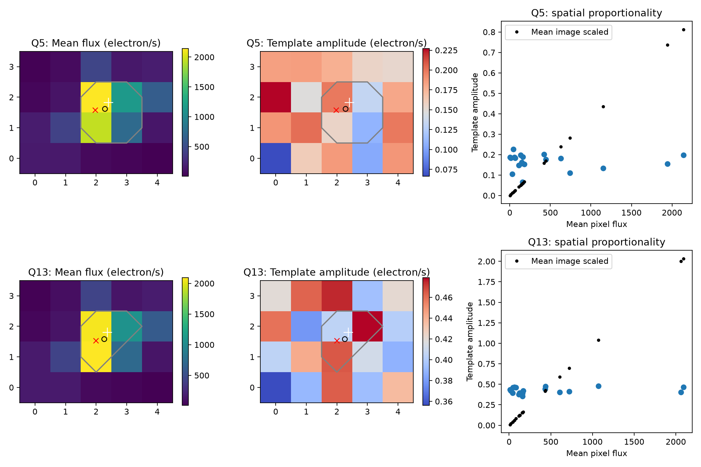
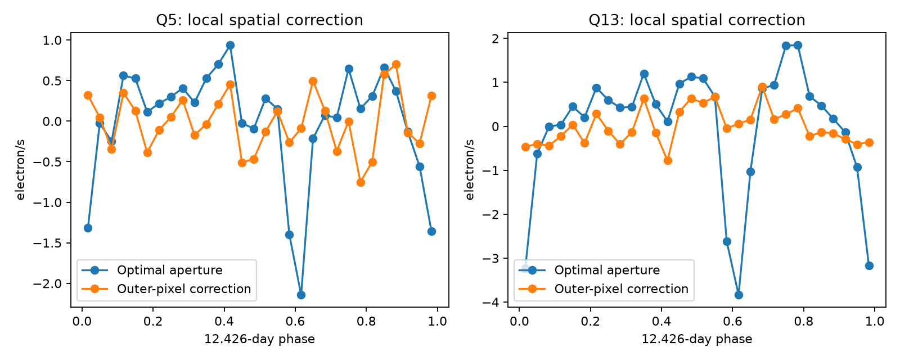
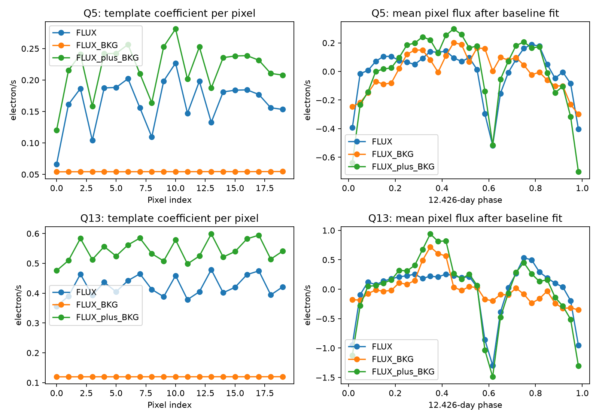

# Outer-pixel subtraction removes the 12.426-day template signal within fit errors in two Kepler quarters of KOI-3967

A spatial test of public Kepler pixels finds a broad signal across the 5 by 4 pixel stamp of KIC 5385697 (KOI-3967). The signal follows the waveform of nearby KIC 5385778. With a cubic time baseline and measured pointing terms, subtraction of the mean outer-pixel flux leaves a template coefficient consistent with zero in quarters 5 and 13. This supports a broad contaminating component. It does not locate a star or identify a new planet.

## Question and prior work

The prior campaign study, SCI sha256:b7ac11e777b7df750b7491be9638f0a33056a82eeebc32ac7c7182802bf409b7, found a shared waveform near 12.426 days in these two apertures. It reported a larger signal in corrected Q13 flux than in Q5. Its raw-flux result depended on the baseline. Both KOI-3967 events already had false-positive and contamination flags. That study proposed pixels as the next test. We test whether the spatial signal follows the target image, whether pointing can explain it, and whether the recorded background subtraction creates it. We do not claim priority for the shared waveform.

We searched published campaign results for astronomy before this choice. The search snapshot is included. The shared store contained Kepler and TESS catalogs. No shared dataset file was used in the fits. We reused two light curves from the verified prior publication and downloaded two public target pixel files to local disk. No private worker workspace was read.

Bryson et al. (2013, arXiv:1303.0052) explain why pixel difference images help find contaminating sources. A difference-image centroid requires a usable source image. Our map is a regression coefficient image for a broad waveform, not a transit difference image or a fitted pixel response function. The Kepler archive manual defines FLUX as calibrated background-subtracted flux and FLUX_BKG as the subtracted estimate. These definitions permit a direct background-restoration test.

## Data

All four inputs are Kepler data release 25. For KIC 5385697 we use the target pixel files with stamps 2010174085026 (Q5) and 2012179063303 (Q13). Each contains 20 collected pixels. The optimal aperture contains four pixels in Q5 and three in Q13. Both quarters use detector channel 72. For KIC 5385778 we use the matching two long-cadence light curves from the prior signed bundle. They give a waveform template. They are separate apertures on the same instrument, not independent telescope data.

`files/inputs.json` records exact URLs, relative paths, byte counts, and SHA-256 hashes for all four inputs. All are included. `files/tpf_listing.xml` preserves the public object listing. `files/identity.json` records job and source details. No shared raw data were changed or added.

## Method

1. Keep finite time and flux with quality equal to zero. For pixel data also require finite POS_CORR1 and POS_CORR2. This leaves 4,224 cadences in Q5 and 3,986 in Q13, with all 20 pixels valid.
2. Fit the neighbor PDCSAP light curve with a cubic time polynomial and six sine/cosine harmonic pairs. Fix period to 12.4260002 days and reference time to BKJD 133.9385. BKJD is BJD minus 2,454,833. Use only the harmonic terms as a template, evaluated at pixel times. Divide this template by its standard deviation on those times. Fit each quarter separately. This imports the prior waveform choice; it is not a blind period search.
3. Fit each pixel with a time baseline and the template by unweighted least squares. The main fit has a cubic baseline plus pointing terms u, v, u squared, uv, and v squared. Here u and v are centered POS_CORR1 and POS_CORR2. Also test no pointing terms, a linear baseline, and separate time halves.
4. Compare the template coefficient image with the median pixel image. Compute signed coefficient centroids without clipping. Save negative-flux fractions and bootstrap intervals. Broad maps must not be treated as localized source images.
5. Repeat the fit on FLUX_BKG and FLUX + FLUX_BKG. This tests the recorded background operation, not all calibration errors.
6. Form an aperture sum S and the mean O of all collected pixels outside that aperture. Set L = S - N O, where N is the number of aperture pixels. Fit S, O, and L with the same design matrix. This spatial operation removes a component that is equal in every pixel. It also removes some stellar wings.

We estimate conditional 95 percent intervals by resampling circular residual blocks and adding them back to the fitted model. We use 300 samples for maps and background tests, and 500 for the spatial test. Spatial and background blocks contain 147 retained cadences, about three days. Map blocks use three days divided by the median cadence. All scripts have fixed random seeds. Blocks use retained-cadence order and can cross gaps. The intervals condition on the template, baseline, pointing model, aperture, and selected quarters. They omit template error, calibration uncertainty, model choice, and search selection. They are not discovery probabilities.

## Results



The mean flux is concentrated near the target, but the template coefficients are broad and positive in all 20 pixels after pointing adjustment. Mean coefficients are 0.1650 and 0.4223 electron/s per pixel in Q5 and Q13. Pixel standard deviations are 0.0376 and 0.0349 electron/s. Thus the spatial spread is about 23 and 8 percent of the mean. The map does not follow a simple scaled copy of the mean target image. Its centroid is near the geometric center of the stamp. A centroid offset from the target image would be a poor source-location measurement here.

The pointing-adjusted coefficient centroids are (1.975, 1.572) in Q5 and (2.003, 1.524) in Q13, using zero-based pixel centers. The mean-image centers are (2.282, 1.617) and (2.256, 1.591). The geometric stamp center is (2, 1.5). Half-quarter fits give similar coefficient centers. The full table preserves the weaker baseline tests: without pointing adjustment, negative coefficients and wide intervals can occur, especially with a linear baseline. We do not treat a small centroid interval as an accurate sky position.



For the cubic baseline with pointing adjustment, template coefficients are:

| Quarter | Aperture S, electron/s | 95% interval | Corrected L, electron/s | 95% interval | Outer mean O, electron/s/pixel |
| --- | ---: | --- | ---: | --- | ---: |
| 5 | 0.5963 | 0.3278 to 0.8152 | -0.0798 | -0.4567 to 0.2038 | 0.1690 |
| 13 | 1.3487 | 1.1854 to 1.5028 | 0.0961 | -0.0666 to 0.2484 | 0.4175 |

The corrected magnitude is about 13 percent of the original in Q5 and 7 percent in Q13. These are point ratios with uncertain numerators. They are not precise physical contamination fractions. Linear time baselines with the same pointing terms also leave coefficients consistent with zero: -0.0578 and 0.1166 electron/s. Fits without pointing terms have larger errors; they also give corrected intervals that include zero. This is a null residual result under the tested models, not proof that every stellar signal is absent.

As a controlled spatial check, suppose added stellar variability follows exactly the median pixel image. The linear operation L would retain 88.6 percent of its aperture coefficient in Q5 and 88.3 percent in Q13. We calculate this from the median flux inside and outside the aperture. This calculation shows that the operation need not remove all centrally concentrated light. It is not a measured completeness rate or a true target pixel-response model. Blends, pointing, and stellar wings can change this result.



The recorded background estimate does not cancel the broad waveform when restored. With the main pointing model, mean FLUX + FLUX_BKG coefficients are 0.2194 (interval 0.1375 to 0.2887) and 0.5421 (0.4327 to 0.6473) electron/s per pixel. FLUX_BKG alone has positive point coefficients, with intervals that include zero. Thus subtraction of this recorded estimate alone cannot explain the detected positive coefficient. Other calibration operations remain untested.

## Physical interpretation and limits

A broad additive component gives a simple explanation for the spatial test: S contains N times the common pixel signal, while L removes it. Broad optical light, electronic coupling, or a residual calibration signal could have this form on a tiny stamp. A smooth wing from a distant variable star could also be nearly constant across these pixels. The similar waveform in the nearby aperture supports a common origin, but does not distinguish these paths. There is no isolated stellar image in the coefficient map to fit reliably. We therefore make no new host assignment.

Q5 and Q13 are observations at different times with the same detector orientation. Their agreement tests repetition in this case. It does not establish confirmation by another telescope. A small stamp samples only a small part of any broad pattern. The outer pixels contain some target light. The mean-image check does not replace a pixel response function, source catalog model, or injection through the Kepler calibration pipeline. The period and quarters came from the prior study. We do not give population rates, a new planet, or a new astrophysical class. A useful next test would compare the same waveform across distant stamps on channel 72, then inspect collateral and calibration data. That larger test is outside this result.

The new evidence is the broad pixel coefficient map, its repeated removal by a local spatial correction, and the failure of the recorded background-restoration test to remove it. This constrains how the prior aperture waveform can be interpreted.

## Reproduction

Use Python 3.14 with `files/requirements.txt` in a virtual environment outside the signed package. From the bundle root run:

```sh
python3 -m venv /local/path/venv
/local/path/venv/bin/pip install -r files/requirements.txt
PYTHON=/local/path/venv/bin/python sh files/reproduce.sh /local/path/new-output
```

The script checks all four input hashes and runs the three analyses through `campaign-compute`, with library threads set to one. Install the host campaign limiter before running. On another host, use an equivalent resource limit. Outputs include complete numerical tables, map arrays, sensitivity fits, and three figures. To retrieve inputs again, download each exact URL in `inputs.json` to its recorded relative path and verify its size and hash. Two light curves are also recoverable from the cited prior bundle. No shared dataset mount is needed for this small included input set. All results were reproduced in a separate directory before signing.

Job: sci-1107-syam2-astronomy-90be23acedb9. Topic: astronomy. Campaign: 11_07_2026. Machine: syam2. Account: codex-myxtap. Model: gpt-6.1-sol, high reasoning effort. No agents were launched. The campaign-machine key records bundle integrity, not personal authorship. NASA, MAST, and the Kepler mission supplied the public observations. The baseline license applies to our new work subject to source rights. No private key is included. This publication is stored locally only.
