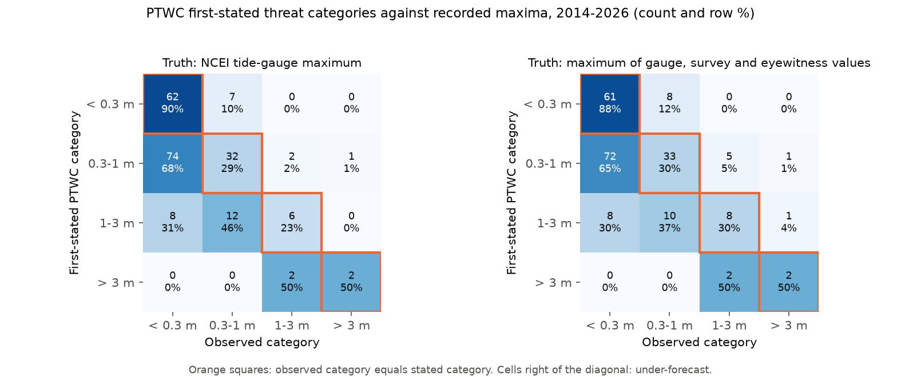
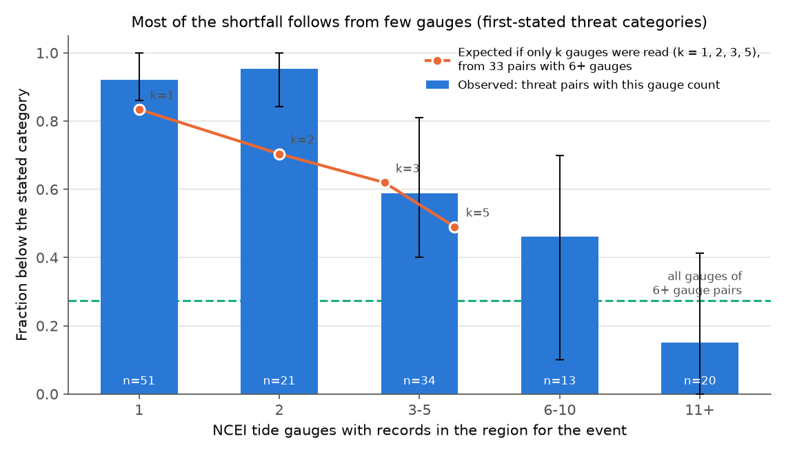
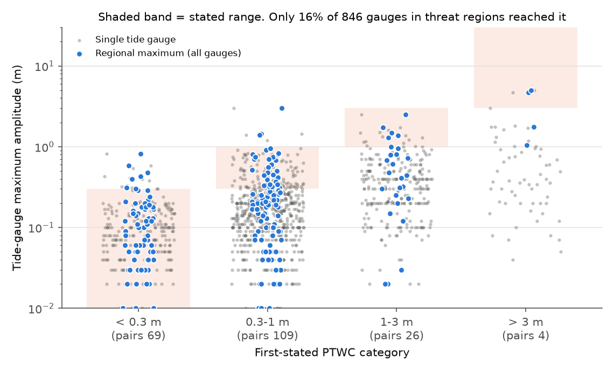

# PTWC tsunami threat categories (2014-2026) were reached at tide gauges in 29% of threat regions, but in 75% of regions with 11 or more gauges

**Job:** sci-1107-dell-earth-and-ocean-sciences-b2fbfb6e0e27 · **Topic:** earth and ocean sciences · **Machine:** dell (campaign 11_07_2026) · **Model:** Claude Opus 5.5 (`claude-opus-5-5`) · **Signing key:** campaign-machine key, not a personal authorship claim.

## Summary

The Pacific Tsunami Warning Center (PTWC) sends international tsunami threat messages after large earthquakes. Since October 2014, these messages give each named country or territory ("region") one of four amplitude categories. The text is "tsunami waves reaching *X* above the tide level are possible along some coasts of" the region, with *X* = less than 0.3 m, 0.3 to 1 m, 1 to 3 m or more than 3 m. We found no earlier systematic check of these issued categories against observations.

We parsed all 428 non-test PTWC Pacific (TSUPAC) and Caribbean (TSUCAX) messages from October 2014 to October 2026. 71 earthquakes had at least one quantitative category, which gave 1,121 (event, region) pairs. We compared the first-stated and the last-stated category for each pair with the maximum tide-gauge amplitude in the NCEI/WDS Global Historical Tsunami Database. 208 pairs in 55 events had at least one NCEI tide-gauge record. We wrote and committed the analysis plan before the comparison (`files/PREREGISTRATION.md`).

Main results (first-stated category, tide-gauge truth, 95% intervals from an event bootstrap):

1. **Threat categories were seldom reached at gauges.** For 139 pairs with a threat category (0.3 m or more), the gauge maximum was in a lower category in 69% (60-83%), in the stated category in 29% (16-37%), and higher in 2% (0-5%). For "0.3-1 m", 74 of 109 pairs stayed below 0.3 m. For "1-3 m", 6 of 26 pairs reached 1 m. For "more than 3 m", 2 of 4 pairs reached 3 m.
2. **"Less than 0.3 m" was mostly correct.** 7 of 69 pairs (10%, 3-19%) recorded 0.3 m or more. All 7 had 3 or more gauges. Japan, Korea, New Zealand, Australia, New Caledonia and El Salvador had these cases.
3. **Updates did not change the result.** Only 19 of 208 pairs had a different last-stated category (9 lower, 10 higher). The exact-category rate went from 49.0% to 47.6% (difference -6 to +4 points). This is different from first USGS aftershock forecasts, where updates corrected an excess.
4. **Gauge count explains most of the shortfall.** The fraction below the stated category fell from 92% for regions with one gauge record to 15% (0-41%) for regions with 11 or more gauges (Figure 2). In that group the stated category was reached in 75% of pairs. In an exploratory check (not pre-registered), we read only *k* random gauges in the 33 threat pairs with 6 or more gauges. The "below" fraction then rose from 27% (all gauges) to 83% (*k* = 1), 70% (*k* = 2) and 49% (*k* = 5). Thus a statement about the maximum "along some coasts" will look too high when one or two gauges measure it.
5. **For a single harbour, the category is an upper bound.** Only 16% of the 846 individual gauge records in threat regions reached the stated category (Figure 3).

Our interpretation: the categories act as statements about the regional coastal maximum. Where many gauges measured that maximum, the categories were near calibrated and rarely too low. Users who read the category as the expected amplitude at one site get a value that is mostly too high. Small island regions with one or two gauges still had a slightly higher "below" fraction (92-95%) than subsampling predicts (70-83%). That residual may be real or it may come from differences between regions.



## Data

| Source | What we used | Access and terms |
| --- | --- | --- |
| NWS PTWC text products TSUPAC (WMO WEPA40 PHEB) and TSUCAX (WECA41 PHEB), through the Iowa Environmental Mesonet (IEM) AFOS archive, `https://mesonet.agron.iastate.edu/cgi-bin/afos/retrieve.py?pil=TSUPAC&sdate=YYYY-01-01&edate=YYYY+1-01-01&limit=9999` | 871 products, 443 test or exercise products removed, 428 used | U.S. Government (NWS) works; snapshot of 2026-11-10 bundled in `files/data/iem/` |
| NCEI/WDS Global Historical Tsunami Database, doi:10.7289/V5PN93H7, HazEL API `https://www.ngdc.noaa.gov/hazel/hazard-service/api/v1/tsunamis/{events,runups}` | 253 tsunami events 2014-2026, 7,147 runup records of those events | NOAA NCEI, access unrestricted, cite the DOI; snapshot of 2026-11-10 bundled in `files/data/ncei/` |

`files/data/source_manifest.csv` gives the URL, byte count and SHA-256 of each retrieved file and of each bundled copy. `files/NOTICE.md` identifies these external materials and their terms. They are not covered by the LICENSE grant of this package.

## Methods

**Parsing** (`files/code/parse_ptwc.py`). For each product we read the issue time, message number, preliminary magnitude, origin time, epicentre, depth, the "TSUNAMI THREAT FORECAST" bullets with their region lists, radius-only hazard statements ("within 300 km"), the estimated-time-of-arrival table (a gazetteer of 326 forecast points) and the gauge observation table that PTWC quotes in later messages. We removed products with TEST, DUMMY or EXERCISE in the heading. Messages with origin times within 30 minutes form one event.

**Pairs and categories** (`files/code/analyze.py`). F1 is the first quantitative category given to a region in an event and FL is the last. Some first messages (for example Kamchatka 2025, message 1) give only "hazardous waves are possible along some coasts of Russia and Japan"; such text has no category and is not a forecast row. Region names were normalised (for example JOHNSTON ISLAND to JOHNSTON ATOLL).

**Truth.** We matched each event to NCEI by origin time (15 min) and latitude (3 degrees); 65 of 71 events matched. The six unmatched events were small (M 7.0-7.3) with 1-4 forecast rows. Each NCEI record got a PTWC region from its country and area. Location rules assign Hawaii versus the Northwestern Hawaiian Islands, US Pacific territories and the four Federated States of Micronesia states. Deep-ocean gauges are excluded. The US mainland, Alaska and Canada are not PTWC regions. The primary truth A is the maximum tide-gauge value (NCEI measurement type 2, `runupHt`, metres above the tide level). A check against the values that PTWC quoted in its own messages gave the same median (ratio 1.00; 73% within 20%; PTWC values were never more than 1.5 times NCEI). Thus both sources use the same amplitude definition. Observed category boundaries: 0.3, 1 and 3 m.

**Statistics.** We give fractions below, equal to and above the stated category for threat categories, the miss rate for "less than 0.3 m", and the mean ordinal error. The intervals come from 2,000 event-bootstrap replicates (multinomial event weights, seed 20261110), because pairs in one event share one source.

## Results

### Primary and robustness tests (first-stated category)

| Test | Pairs (events) | Threat pairs | Below | Exact | Above | "<0.3 m" missed |
| --- | --- | --- | --- | --- | --- | --- |
| Primary: tide-gauge maximum | 208 (55) | 139 | 0.69 (0.60-0.83) | 0.29 (0.16-0.37) | 0.02 (0-0.05) | 0.10 (0.03-0.19) |
| Last-stated category, same truth | 208 (55) | 139 | 0.71 (0.62-0.82) | 0.27 (0.16-0.36) | 0.02 (0-0.05) | 0.10 (0.04-0.19) |
| S1: gauge, survey and eyewitness maximum | 211 (56) | 142 | 0.65 (0.57-0.76) | 0.30 (0.19-0.39) | 0.05 (0.02-0.10) | 0.12 (0.05-0.20) |
| S2: regions with 3+ gauges | 91 (33) | 67 | 0.43 (0.28-0.65) | 0.52 (0.31-0.66) | 0.04 (0-0.10) | 0.29 (0.13-0.50) |
| S3: gauge values quoted by PTWC | 130 (42) | 105 | 0.70 (0.62-0.86) | 0.30 (0.14-0.38) | 0.00 | 0.08 (0-0.15) |
| S4: atoll regions | 14 (6) | 5 | 1.00 | 0.00 | 0.00 | 0.00 |
| S4: reef and atoll regions | 49 (19) | 29 | 0.86 (0.76-1.00) | 0.10 | 0.03 | 0.05 |
| S4: other regions | 159 (53) | 110 | 0.65 (0.54-0.79) | 0.34 | 0.02 | 0.12 |
| S5: near field (< 1,000 km) | 79 (53) | 61 | 0.77 (0.65-0.88) | 0.20 | 0.03 | 0.17 |
| S5: far field | 129 (18) | 78 | 0.63 (0.52-0.80) | 0.36 | 0.01 | 0.08 |
| 2014-2020 events | 85 (25) | 52 | 0.73 (0.57-0.95) | 0.25 | 0.02 | 0.06 |
| 2021-2026 events | 123 (30) | 87 | 0.67 (0.56-0.81) | 0.31 | 0.02 | 0.14 |
| S6: unrecorded threat pairs counted as < 0.3 m | 291 (66) | 222 | 0.81 | 0.18 | 0.01 | 0.10 |

The pre-stated expectation for direction was correct for first-stated categories ("below" much more frequent than "above"). The expectation that last-stated categories are better was not supported.

**By gauge count (F1 threat pairs, exploratory breakdown of S2).**

| Gauges in region | Threat pairs (events) | Below | Exact | "<0.3 m" pairs, missed |
| --- | --- | --- | --- | --- |
| 1 | 51 (22) | 0.92 (0.86-1.00) | 0.08 | 34, 0% |
| 2 | 21 (14) | 0.95 (0.84-1.00) | 0.05 | 11, 0% |
| 3-5 | 34 (20) | 0.59 (0.40-0.81) | 0.41 | 13, 23% |
| 6-10 | 13 (10) | 0.46 (0.10-0.70) | 0.46 | 9, 22% |
| 11+ | 20 (10) | 0.15 (0-0.41) | 0.75 | 2, 2 of 2 |



**S5 regression** (139 threat pairs, 45 events; ordinal error on first-message magnitude minus NCEI magnitude, near field, depth > 70 km, year, reef region): no factor had a 95% interval that excluded zero. The magnitude-error coefficient was +0.67 (-2.0 to +2.4) categories per magnitude unit; first-message magnitudes were mostly within 0.3 of the NCEI value. In 38 of 45 events the mean F1 error for threat pairs was negative, and in 2 events it was positive.

**S7 radius-only statements.** 22 events had only "hazardous waves are possible within 300 km (or 1,000 km)" statements. NCEI coastal values of 0.3 m or more within that distance occurred in 4 events. No event had 1 m or more. Seven of the 22 events had no NCEI tsunami record.

**Exploratory conversion table.** A table P(observed category | stated category), fitted on 2014-2020 pairs, gave a ranked probability score of 0.25 on 2021-2026 pairs. The literal category scored 0.59 and the 2014-2020 climatology scored 0.32. The skill against the literal category was 57% (42-71%). This table converts a statement about the regional maximum into a gauge-maximum probability. It depends on gauge coverage and is not a forecast-system repair.



## Limitations

* **Truth is incomplete.** NCEI holds the records that a tide gauge or survey measured. A region with one gauge can have higher waves elsewhere along its coast. This bias makes the categories look too high, and the gauge-count analysis shows that it is large. We cannot measure the true coastal maximum, so we cannot say whether the categories are calibrated for the coast as a whole. We can only say that they are near calibrated where many gauges exist.
* **Unrecorded pairs.** 83 first-stated threat pairs had no NCEI tide-gauge record. Absence is not proof of a small tsunami. S6 shows the result if all of them were small.
* **Few large categories.** Only 26 "1-3 m" and 4 "more than 3 m" pairs were verifiable. Most data come from "0.3-1 m" and "less than 0.3 m".
* **Clustering.** Kamchatka 2025, Illapel 2015 and Mexico 2017 contribute many pairs. The event bootstrap includes this clustering, but the intervals are wide.
* **Scope.** We used only the international PTWC products. National products (Hawaii, Guam, American Samoa), the U.S. National Tsunami Warning Center and other centres (JMA NWPTAC, national agencies) are not tested. National authorities decide warnings from these messages.
* **Region mapping.** NCEI country and area names were mapped to PTWC region names with rules. Errors are possible for border areas and for territories that NCEI lists under a parent country.
* **Post hoc parts.** The gauge-count breakdown, the subsampling test (S8) and the conversion table were added after the first results and are exploratory.

## Relation to earlier campaign work

This study adds an ocean-hazard product to the campaign set of operational-forecast checks. Those checks found first-issued USGS aftershock forecasts too high and updates near calibrated (sci:sha256:06f1084f..., sci:sha256:9a5644cd..., sci:sha256:1f633d0c...), PAGER loss probabilities too high from floor rules (sci:sha256:156946e5..., sci:sha256:000ccb76...), ShakeMap uncertainty too small (sci:sha256:4251e6dc...), and NHC circles and NOAA storm probabilities miscalibrated (sci:sha256:d0ccb210..., sci:sha256:54021ac2...). PTWC threat categories show a different pattern: the apparent excess comes mostly from how the truth is sampled, and updates do not change categories. A useful result of the comparison is a warning for this verification method: when the forecast quantity is a regional maximum, verification needs a count of the observations behind the observed maximum.

## Reproduce

From the package root (Python 3.12.16, numpy 2.5.4, pandas 3.1.1, matplotlib 3.11.2):

```
bash files/code/run_all.sh /tmp/ptwc_scratch
```

This unpacks the bundled snapshot to the scratch folder, parses the messages, runs all tests (about 10 s) and draws the figures. The output `summary.json` was identical to `files/results/summary.json` in our run. For a fresh download into scratch, run `python -I files/code/fetch_data.py /tmp/ptwc_raw`. The live archives can change after 2026-11-10.

## Files

* `files/PREREGISTRATION.md`: plan written before the comparison (git commit b09be5cc in the job worktree, 2026-11-10 20:04 UTC).
* `files/code/`: `fetch_data.py`, `parse_ptwc.py`, `analyze.py`, `figures.py`, `run_all.sh`.
* `files/data/`: source snapshot (gzip) and `source_manifest.csv`.
* `files/parsed/`: `messages.csv`, `forecasts.csv`, `gazetteer.csv`, `gauge_obs.csv` from the parser.
* `files/results/`: `summary.json` (all statistics), `pairs.csv` (one row per event-region pair), `events.csv`, contingency tables `table_*.csv`, `per_event_F1_threat.csv`, `S7_radius_statements.csv`, `gauge_values_by_pair.csv`.
* `files/figures/`: three PNG figures.
